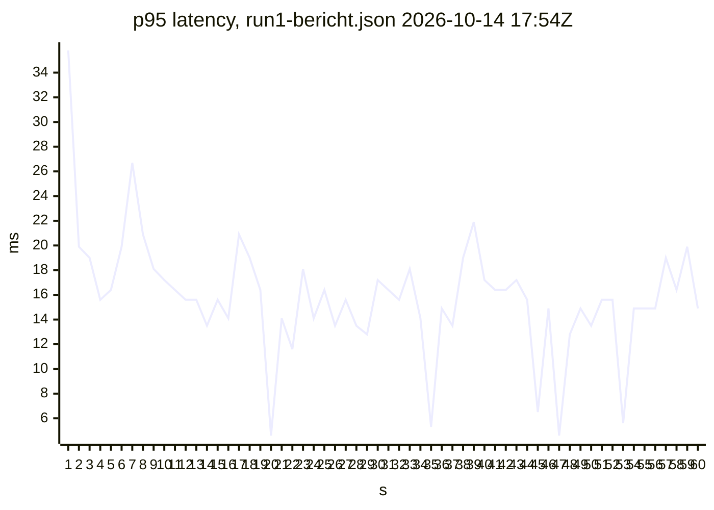
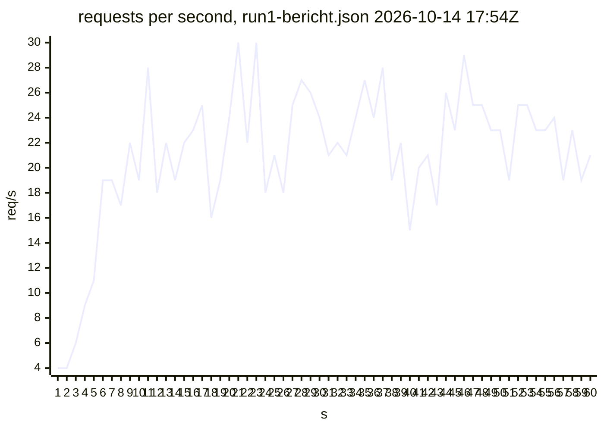

<!-- generated by docwizz: edits are overwritten -->
# API endpoints

| Method | Route | Summary | Input | Response | Authorization | Handler | Called from |
|---|---|---|---|---|---|---|---|
| GET | `/api/audit` | Returns the most recent N audit entries (default 100) ordered newest-first. | `[service] db: ExportLogDbContext` `[query] limit: int?` | 200 | — | [SettingsEndpoints.cs:134](../src/Connector.Api/Endpoints/SettingsEndpoints.cs#L134) |  |
| POST | `/api/auth/change-password` | Self-service password change. Requires the current password, and signs the user out everywhere afterwards (this session included), so a session opened with the old password doesn't outlive it. | `[body] req: ChangePasswordRequest` `[special] httpContext: HttpContext` `[service] db: ExportLogDbContext` `[service] audit: AuditService` | 200, 400, 401 | required | [AuthEndpoints.cs:106](../src/Connector.Api/Endpoints/AuthEndpoints.cs#L106) | `changePassword` |
| POST | `/api/auth/hash` | Dev-only: returns a BCrypt hash for a plaintext password (to seed appsettings for production users). | `[body] req: HashRequest` | 200 `<anonymous type:  Hash>` | — | [AuthEndpoints.cs:132](../src/Connector.Api/Endpoints/AuthEndpoints.cs#L132) |  |
| POST | `/api/auth/login` | Exchanges username/password for a signed JWT (HS256, Auth:JwtExpiryHours, default 8h) and audits the login. Unknown usernames still pay a BCrypt verify so timing doesn't reveal which accounts exist. | `[body] req: LoginRequest` `[service] db: ExportLogDbContext` `[service] audit: AuditService` | 200 `LoginResponse`, 401 | — | [AuthEndpoints.cs:25](../src/Connector.Api/Endpoints/AuthEndpoints.cs#L25) | `login` |
| GET | `/api/auth/me` | The caller's identity, role and effective permissions — what the UI uses to decide which menu items, routes and buttons to show. The server checks every permission again on each request regardless. | `[special] httpContext: HttpContext` `[body] permissions: RolePermissionStore` | 200 `CurrentUserDto` | required | [AuthEndpoints.cs:87](../src/Connector.Api/Endpoints/AuthEndpoints.cs#L87) | `fetchCurrentUser` |
| POST | `/api/auth/revoke-my-sessions` | Self-service "log me out everywhere" — invalidates every JWT issued to the caller (including, after this response, the very token used to call it) before its own expiry. Deliberately scoped to the caller's own sessions only; see SessionRevocationStore's doc comment for why an admin-triggered "revoke someone else's session" action isn't included here. | `[special] httpContext: HttpContext` `[service] db: ExportLogDbContext` `[service] audit: AuditService` | 200 | required | [AuthEndpoints.cs:73](../src/Connector.Api/Endpoints/AuthEndpoints.cs#L73) | `revokeAllSessions` |
| GET | `/api/branding` | Unauthenticated: the login screen, browser tab title, and favicon all need this before sign-in. | `[service] db: ExportLogDbContext` | 200 `BrandingConfig` | — | [BrandingEndpoints.cs:17](../src/Connector.Api/Endpoints/BrandingEndpoints.cs#L17) | `getBranding` |
| PUT | `/api/branding` | Validates and stores the app name and logo/favicon/background images as size-capped base64 data URLs. An empty value clears that asset back to the default. Audited as branding_updated. | `[body] dto: BrandingConfig` `[service] db: ExportLogDbContext` `[special] httpContext: HttpContext` `[service] audit: AuditService` | 200 `BrandingConfig`, 400 | — | [BrandingEndpoints.cs:28](../src/Connector.Api/Endpoints/BrandingEndpoints.cs#L28) | `saveBranding` |
| GET | `/api/connection` | Returns the stored connection — never the password itself, only whether one is set (HasPassword). See knowledge/architecture/data-source-configuration.md. | `[service] db: ExportLogDbContext` | 200 `ErpConnectionInfo`, 404 | — | [ConnectionEndpoints.cs:94](../src/Connector.Api/Endpoints/ConnectionEndpoints.cs#L94) | `getConnection` |
| POST | `/api/connection` | Tests the connection, persists it on success, and returns the live source schema. | `[body] request: DataSourceConfig` `[service] db: ExportLogDbContext` `[service] resolver: IDataSourceProviderResolver` `[special] ct: CancellationToken` | 200 `SourceSchema`, 400 | — | [ConnectionEndpoints.cs:119](../src/Connector.Api/Endpoints/ConnectionEndpoints.cs#L119) | `saveConnection` |
| GET | `/api/connection/status` | Whether a connection is configured, and to which system — without host, account or TLS details, which only Admins (who own the Connect page) see. The dashboard and the route guard use this for every user. | `[service] db: ExportLogDbContext` | 200 `ConnectionStatusDto` | required | [ConnectionEndpoints.cs:80](../src/Connector.Api/Endpoints/ConnectionEndpoints.cs#L80) | `getConnectionStatus` |
| GET | `/api/export-definitions` | Lists all export definitions, ordered by name, as summaries (no node tree). | `[service] db: ExportLogDbContext` `[special] ct: CancellationToken` | 200 | — | [ExportDefinitionEndpoints.cs:36](../src/Connector.Api/Endpoints/ExportDefinitionEndpoints.cs#L36) | `listExportDefinitions` |
| POST | `/api/export-definitions` | Creates a definition after validating its node tree (identifiers, filters, GDPR denylist) and the IntegrationKey/ContractVersion pair; starts at ConfigVersion 1. Audited. | `[body] request: ExportDefinitionRequest` `[service] db: ExportLogDbContext` `[special] httpContext: HttpContext` `[service] audit: AuditService` `[special] ct: CancellationToken` | 201 `ExportDefinitionDto`, 400 | — | [ExportDefinitionEndpoints.cs:50](../src/Connector.Api/Endpoints/ExportDefinitionEndpoints.cs#L50) | `createExportDefinition` |
| DELETE | `/api/export-definitions/{id:int}` | Deletes a definition. Audited. | `[route] id: int` `[service] db: ExportLogDbContext` `[special] httpContext: HttpContext` `[service] audit: AuditService` `[special] ct: CancellationToken` | 204, 404 | — | [ExportDefinitionEndpoints.cs:153](../src/Connector.Api/Endpoints/ExportDefinitionEndpoints.cs#L153) | `deleteExportDefinition` |
| GET | `/api/export-definitions/{id:int}` | Returns one definition including its full node tree. | `[route] id: int` `[service] db: ExportLogDbContext` `[special] ct: CancellationToken` | 200 `ExportDefinitionDto`, 404 | — | [ExportDefinitionEndpoints.cs:96](../src/Connector.Api/Endpoints/ExportDefinitionEndpoints.cs#L96) | `getExportDefinition` |
| PUT | `/api/export-definitions/{id:int}` | Replaces a definition after the same validation as create and bumps its ConfigVersion. Audited. | `[route] id: int` `[body] request: ExportDefinitionRequest` `[service] db: ExportLogDbContext` `[special] httpContext: HttpContext` `[service] audit: AuditService` `[special] ct: CancellationToken` | 200 `ExportDefinitionDto`, 400, 404 | — | [ExportDefinitionEndpoints.cs:107](../src/Connector.Api/Endpoints/ExportDefinitionEndpoints.cs#L107) | `updateExportDefinition` |
| POST | `/api/export-definitions/{id:int}/duplicate` | Copies a definition under a new name (default "\<name> (Copy)"). The copy starts disabled, unscheduled, at ConfigVersion 1 and without the IntegrationKey/ContractVersion pair. Audited. | `[route] id: int` `[body] request: DuplicateExportDefinitionRequest?` `[service] db: ExportLogDbContext` `[special] httpContext: HttpContext` `[service] audit: AuditService` `[special] ct: CancellationToken` | 201 `ExportDefinitionDto`, 404 | — | [ExportDefinitionEndpoints.cs:182](../src/Connector.Api/Endpoints/ExportDefinitionEndpoints.cs#L182) | `duplicateExportDefinition` |
| PATCH | `/api/export-definitions/{id:int}/enable` | Enables or disables a definition. Enabling is refused when another enabled definition already claims the same IntegrationKey/ContractVersion pair. Audited. | `[route] id: int` `[body] request: EnableRequest` `[service] db: ExportLogDbContext` `[special] httpContext: HttpContext` `[service] audit: AuditService` `[special] ct: CancellationToken` | 200 `ExportDefinitionDto`, 400, 404 | — | [ExportDefinitionEndpoints.cs:230](../src/Connector.Api/Endpoints/ExportDefinitionEndpoints.cs#L230) | `setExportDefinitionEnabled` |
| POST | `/api/export-definitions/{id:int}/preview` | Runs the definition's tree against the configured source and returns up to 50 records, GDPR-denied fields removed. Records no run history; returns an empty preview when no connection is configured. | `[route] id: int` `[service] db: ExportLogDbContext` `[service] resolver: IDataSourceProviderResolver` `[special] ct: CancellationToken` | 200 `ExportDefinitionPreviewDto`, 404, 500 | — | [ExportDefinitionEndpoints.cs:275](../src/Connector.Api/Endpoints/ExportDefinitionEndpoints.cs#L275) | `previewExportDefinition` |
| POST | `/api/export-definitions/{id:int}/run` | Runs the definition in full and returns the built file directly, with X-Export-Run-Id, X-Record-Count and X-Config-Version headers. Records a run-history row and an audit entry, success or failure. | `[route] id: int` `[service] db: ExportLogDbContext` `[service] resolver: IDataSourceProviderResolver` `[special] httpContext: HttpContext` `[service] audit: AuditService` `[special] ct: CancellationToken` | 404, 500 | — | [ExportDefinitionEndpoints.cs:326](../src/Connector.Api/Endpoints/ExportDefinitionEndpoints.cs#L326) | `runExportDefinition` |
| POST | `/api/export-definitions/{id:int}/run-selected` | Explicit ID selection is parameterized and intersects with the saved root WHERE clause. | `[route] id: int` `[body] request: SelectedRecordsExportRequest` `[service] db: ExportLogDbContext` `[service] resolver: IDataSourceProviderResolver` `[special] httpContext: HttpContext` `[service] audit: AuditService` `[special] ct: CancellationToken` | 400, 404, 500 | — | [ExportDefinitionEndpoints.cs:384](../src/Connector.Api/Endpoints/ExportDefinitionEndpoints.cs#L384) |  |
| GET | `/api/export-definitions/{id:int}/runs` | Returns the definition's latest 200 runs (test and real), newest first. | `[route] id: int` `[service] db: ExportLogDbContext` `[special] ct: CancellationToken` | 200, 404 | — | [ExportDefinitionEndpoints.cs:529](../src/Connector.Api/Endpoints/ExportDefinitionEndpoints.cs#L529) | `listExportDefinitionRuns` |
| POST | `/api/export-definitions/{id:int}/test` | Test run capped at 50 records (TestRunLimit): records a run-history row flagged IsTestRun and returns the run result, not the file. Audited. | `[route] id: int` `[service] db: ExportLogDbContext` `[service] resolver: IDataSourceProviderResolver` `[special] httpContext: HttpContext` `[service] audit: AuditService` `[special] ct: CancellationToken` | 200 `ExportDefinitionRunResultDto`, 404 | — | [ExportDefinitionEndpoints.cs:477](../src/Connector.Api/Endpoints/ExportDefinitionEndpoints.cs#L477) | `testExportDefinition` |
| GET | `/api/export-mapping` | Returns the stored export mapping config, or 404 if none saved. | `[service] db: ExportLogDbContext` | 200 `ExportMappingConfig`, 404 | — | [ExportMappingEndpoints.cs:21](../src/Connector.Api/Endpoints/ExportMappingEndpoints.cs#L21) | `getExportMapping` |
| PUT | `/api/export-mapping` | Validates and persists a full export mapping config. | `[body] config: ExportMappingConfig` `[service] db: ExportLogDbContext` `[special] httpContext: HttpContext` `[service] audit: AuditService` | 200 `ExportMappingConfig`, 400 | — | [ExportMappingEndpoints.cs:35](../src/Connector.Api/Endpoints/ExportMappingEndpoints.cs#L35) | `saveExportMapping` |
| GET | `/api/export-mapping/presets` | Returns all saved presets as a name→config dictionary. | `[service] db: ExportLogDbContext` | 200 `Dictionary<string, ExportMappingConfig>` | — | [ExportMappingEndpoints.cs:60](../src/Connector.Api/Endpoints/ExportMappingEndpoints.cs#L60) | `getPresets` |
| DELETE | `/api/export-mapping/presets/{name}` | Deletes a single named preset. Returns 404 when the name does not exist. | `[route] name: string` `[service] db: ExportLogDbContext` `[special] httpContext: HttpContext` `[service] audit: AuditService` | 204, 404 | — | [ExportMappingEndpoints.cs:105](../src/Connector.Api/Endpoints/ExportMappingEndpoints.cs#L105) | `deletePreset` |
| PUT | `/api/export-mapping/presets/{name}` | Creates or updates a single named preset. | `[route] name: string` `[body] config: ExportMappingConfig` `[service] db: ExportLogDbContext` `[special] httpContext: HttpContext` `[service] audit: AuditService` | 200 `ExportMappingConfig`, 400 | — | [ExportMappingEndpoints.cs:74](../src/Connector.Api/Endpoints/ExportMappingEndpoints.cs#L74) | `savePreset` |
| GET | `/api/exports` | Returns the run list with an IsStale flag so the UI can warn about long-pending runs. | `[service] db: ExportLogDbContext` | — | — | [ExportEndpoints.cs:12](../src/Connector.Api/Endpoints/ExportEndpoints.cs#L12) | `listExports` |
| GET | `/api/exports/{seqNo:int}` | Returns full detail including a gap warning when the preceding run has not been released. | `[route] seqNo: int` `[service] db: ExportLogDbContext` | 200 `ExportDetailDto`, 404 | — | [ExportEndpoints.cs:48](../src/Connector.Api/Endpoints/ExportEndpoints.cs#L48) | `getExport` |
| POST | `/api/exports/{seqNo:int}/deliver` | Records that a Released run reached the vendor: who delivered it, the imported record count and optional notes (max 2,000 chars). Can only be recorded once per run. | `[route] seqNo: int` `[body] request: DeliverRequest` `[special] httpContext: HttpContext` `[service] db: ExportLogDbContext` `[service] audit: AuditService` | 200, 400, 404, 409 | — | [ExportEndpoints.cs:157](../src/Connector.Api/Endpoints/ExportEndpoints.cs#L157) | `deliverExport` |
| POST | `/api/exports/{seqNo:int}/release` | Four-eyes release: a second user's credentials must approve moving a Pending run to Released. 409 if the run is not Pending or was changed concurrently; rate-limited and audited. | `[route] seqNo: int` `[body] request: ReleaseRequest` `[special] httpContext: HttpContext` `[service] db: ExportLogDbContext` `[body] permissions: RolePermissionStore` `[service] audit: AuditService` | 200, 400, 404, 409 | — | [ExportEndpoints.cs:102](../src/Connector.Api/Endpoints/ExportEndpoints.cs#L102) | `releaseExport` |
| POST | `/api/exports/{seqNo:int}/skip` | Marks a Pending or Failed run as Skipped so it no longer blocks the sequence; the optional reason is written to the audit log. | `[route] seqNo: int` `[body] request: SkipRequest` `[special] httpContext: HttpContext` `[service] db: ExportLogDbContext` `[service] audit: AuditService` | 200, 404, 409 | — | [ExportEndpoints.cs:199](../src/Connector.Api/Endpoints/ExportEndpoints.cs#L199) | `skipExport` |
| GET | `/api/gdpr-denied-fields` | Returns the currently active GDPR denylist (DB value if set, else defaults). | `[service] db: ExportLogDbContext` | 200 `<anonymous type: string[] fields>` | — | [SettingsEndpoints.cs:64](../src/Connector.Api/Endpoints/SettingsEndpoints.cs#L64) | `getGdprDeniedFields` |
| PATCH | `/api/gdpr-denied-fields` | Replaces the GDPR denylist. Validates and stores as JSON in AppSetting. | `[body] request: GdprDenylistRequest` `[service] db: ExportLogDbContext` `[special] httpContext: HttpContext` `[service] audit: AuditService` | 200 `<anonymous type: List<string> fields>`, 400 | — | [SettingsEndpoints.cs:75](../src/Connector.Api/Endpoints/SettingsEndpoints.cs#L75) | `saveGdprDeniedFields` |
| GET | `/api/health` | Checks the log DB connection and that the staging directory is writable; 200 "healthy" when both pass, otherwise 503 "degraded" with per-check flags. | `[service] logDb: ExportLogDbContext` `[service] sinkOpts: IOptions<ExportSinkOptions>` | 200 `<anonymous type: string status, <anonymous type: bool log_db, bool staging> checks>` | — | [HealthEndpoints.cs:14](../src/Connector.Api/Endpoints/HealthEndpoints.cs#L14) |  |
| GET | `/api/import-definitions` | Lists all import definitions, ordered by name, as summaries (no node tree). | `[service] db: ExportLogDbContext` `[special] ct: CancellationToken` | 200 | — | [ImportDefinitionEndpoints.cs:36](../src/Connector.Api/Endpoints/ImportDefinitionEndpoints.cs#L36) | `listImportDefinitions` |
| POST | `/api/import-definitions` | Creates a definition after the save-time guardrails in ValidateRequestAsync (writable-column allowlist checked against the live ERP schema, no key/identity/computed/FK targets, no child inserts) and the IntegrationKey/ContractVersion pair check; starts at ConfigVersion 1. Audited. | `[body] request: ImportDefinitionRequest` `[service] db: ExportLogDbContext` `[service] resolver: IDataSourceProviderResolver` `[special] httpContext: HttpContext` `[service] audit: AuditService` `[special] ct: CancellationToken` | 201 `ImportDefinitionDto`, 400 | — | [ImportDefinitionEndpoints.cs:49](../src/Connector.Api/Endpoints/ImportDefinitionEndpoints.cs#L49) | `createImportDefinition` |
| DELETE | `/api/import-definitions/{id:int}` | Deletes a definition. Audited. | `[route] id: int` `[service] db: ExportLogDbContext` `[special] httpContext: HttpContext` `[service] audit: AuditService` `[special] ct: CancellationToken` | 204, 404 | — | [ImportDefinitionEndpoints.cs:158](../src/Connector.Api/Endpoints/ImportDefinitionEndpoints.cs#L158) | `deleteImportDefinition` |
| GET | `/api/import-definitions/{id:int}` | Returns one definition including its full node tree and writable-column allowlist. | `[route] id: int` `[service] db: ExportLogDbContext` `[special] ct: CancellationToken` | 200 `ImportDefinitionDto`, 404 | — | [ImportDefinitionEndpoints.cs:95](../src/Connector.Api/Endpoints/ImportDefinitionEndpoints.cs#L95) | `getImportDefinition` |
| PUT | `/api/import-definitions/{id:int}` | Replaces a definition after the same validation as create and bumps its ConfigVersion. Audited. | `[route] id: int` `[body] request: ImportDefinitionRequest` `[service] db: ExportLogDbContext` `[service] resolver: IDataSourceProviderResolver` `[special] httpContext: HttpContext` `[service] audit: AuditService` `[special] ct: CancellationToken` | 200 `ImportDefinitionDto`, 400, 404 | — | [ImportDefinitionEndpoints.cs:106](../src/Connector.Api/Endpoints/ImportDefinitionEndpoints.cs#L106) | `updateImportDefinition` |
| POST | `/api/import-definitions/{id:int}/duplicate` | Copies a definition under a new name (default "\<name> (Copy)"). The copy starts disabled at ConfigVersion 1 and without the IntegrationKey/ContractVersion pair. Audited. | `[route] id: int` `[body] request: DuplicateImportDefinitionRequest?` `[service] db: ExportLogDbContext` `[special] httpContext: HttpContext` `[service] audit: AuditService` `[special] ct: CancellationToken` | 201 `ImportDefinitionDto`, 404 | — | [ImportDefinitionEndpoints.cs:187](../src/Connector.Api/Endpoints/ImportDefinitionEndpoints.cs#L187) | `duplicateImportDefinition` |
| PATCH | `/api/import-definitions/{id:int}/enable` | Enables or disables a definition. Enabling is refused when another enabled definition already claims the same IntegrationKey/ContractVersion pair. Audited. | `[route] id: int` `[body] request: EnableRequest` `[service] db: ExportLogDbContext` `[special] httpContext: HttpContext` `[service] audit: AuditService` `[special] ct: CancellationToken` | 200 `ImportDefinitionDto`, 400, 404 | — | [ImportDefinitionEndpoints.cs:234](../src/Connector.Api/Endpoints/ImportDefinitionEndpoints.cs#L234) | `setImportDefinitionEnabled` |
| POST | `/api/import-definitions/{id:int}/preview` | Parses + walks + plans an inbound file against a saved definition with zero persistence: no ImportRunEntity row is created and nothing is written to the ERP (mirrors ExportDefinitionEndpoints' own untracked preview). The operator supplies the file content directly. | `[route] id: int` `[body] request: ImportDefinitionPreviewRequest` `[service] db: ExportLogDbContext` `[service] resolver: IDataSourceProviderResolver` `[special] ct: CancellationToken` | 200 `ImportPlan`, 400, 404, 500 | — | [ImportDefinitionEndpoints.cs:280](../src/Connector.Api/Endpoints/ImportDefinitionEndpoints.cs#L280) | `previewImportDefinition` |
| POST | `/api/import-definitions/{id:int}/records` | Stages one or more JSON records using the same canonical import, diff and approval path as /runs. | `[route] id: int` `[body] request: SelectedRecordsImportRequest` `[special] httpContext: HttpContext` `[service] db: ExportLogDbContext` `[service] audit: AuditService` `[service] resolver: IDataSourceProviderResolver` `[special] ct: CancellationToken` | 400, 404 | — | [ImportDefinitionEndpoints.cs:408](../src/Connector.Api/Endpoints/ImportDefinitionEndpoints.cs#L408) |  |
| GET | `/api/import-definitions/{id:int}/runs` | Returns the definition's latest 200 import runs, newest first, with their match/change/reject counts. | `[route] id: int` `[service] db: ExportLogDbContext` `[special] ct: CancellationToken` | 200, 404 | — | [ImportDefinitionEndpoints.cs:340](../src/Connector.Api/Endpoints/ImportDefinitionEndpoints.cs#L340) | `listImportDefinitionRuns` |
| POST | `/api/import-definitions/{id:int}/runs` | The UI's manual "Run" action (import-definitions/{id} page): stages an operator-selected file as a real ImportRunEntity at PendingReview, the same way ImportWorker's inbound/ folder watcher would — same walk/plan logic as .../preview above, but persisted so it goes through the normal four-eyes release/reject flow instead of being thrown away. No manifest/checksum file needed: the checksum is computed from the posted content itself, and (definitionId, checksum) still dedupes against a re-submit of the same file. | `[route] id: int` `[body] request: ImportDefinitionStageRequest` `[special] httpContext: HttpContext` `[service] db: ExportLogDbContext` `[service] audit: AuditService` `[service] resolver: IDataSourceProviderResolver` `[special] ct: CancellationToken` | `IResult` | — | [ImportDefinitionEndpoints.cs:383](../src/Connector.Api/Endpoints/ImportDefinitionEndpoints.cs#L383) | `stageImportDefinitionRun` |
| POST | `/api/import-definitions/suggest-from-export` | The "Create from export" suggestion the New Import Definition flow offers. Takes the same sample ImportEnvelope JSON the preview panel already accepts and looks for an ExportDefinition whose provenance pair matches it. No persistence, no ERP connection — this only ever reads ExportDefinitions. Always 200 OK — a miss is a normal lookup outcome, never a 4xx — but unlike the pure ImportMappingSuggestion.SuggestFrom, a miss here always carries a `Reason` explaining which gate stopped it (malformed/no-provenance sample, no export tagged with that key/version, one tagged but disabled, or one tagged and enabled but missing CorrelationKeySourceField) instead of a flat null, so the operator isn't left guessing why a provenance-carrying paste "wasn't recognized." | `[body] request: ImportMappingSuggestionRequest` `[service] db: ExportLogDbContext` `[special] ct: CancellationToken` | 200 `ImportMappingSuggestionCheckResult` | — | [ImportDefinitionEndpoints.cs:332](../src/Connector.Api/Endpoints/ImportDefinitionEndpoints.cs#L332) | `suggestImportMappingFromExport` |
| GET | `/api/import-runs/{id:int}` | The frontend's review/diff view needs a run's full plan before an Approver can meaningfully decide anything — GET .../{id}/runs on ImportDefinitionEndpoints only returns the summary counts. This is a plain read, so unlike release/reject it's not restricted to PendingReview runs: revisiting a Released/Rejected/Failed run's plan after the fact is useful too, and costs nothing extra here. | `[route] id: int` `[service] db: ExportLogDbContext` `[special] ct: CancellationToken` | 200 `ImportRunDetailDto`, 404 | — | [ImportRunEndpoints.cs:25](../src/Connector.Api/Endpoints/ImportRunEndpoints.cs#L25) | `getImportRun` |
| POST | `/api/import-runs/{id:int}/reject` | Discards a PendingReview run without writing anything to the target (no second approver needed). | `[route] id: int` `[special] httpContext: HttpContext` `[service] db: ExportLogDbContext` `[service] audit: AuditService` `[special] ct: CancellationToken` | 200 `ImportRunDto`, 404, 409 | — | [ImportRunEndpoints.cs:105](../src/Connector.Api/Endpoints/ImportRunEndpoints.cs#L105) | `rejectImportRun` |
| POST | `/api/import-runs/{id:int}/release` | Four-eyes commit of a PendingReview run: a second user's credentials must approve, then ImportRunReleaser writes the staged plan to the target. 500 with the error if the commit fails. | `[route] id: int` `[body] request: ReleaseRequest` `[special] httpContext: HttpContext` `[service] db: ExportLogDbContext` `[body] permissions: RolePermissionStore` `[service] audit: AuditService` `[service] resolver: IDataSourceProviderResolver` `[special] ct: CancellationToken` | 200 `ImportRunDto`, 400, 404, 409, 500 | — | [ImportRunEndpoints.cs:45](../src/Connector.Api/Endpoints/ImportRunEndpoints.cs#L45) | `releaseImportRun` |
| GET | `/api/pipeline/preview` | Returns up to 50 records of what the saved export mapping would produce, nested or flat to match a JSON export, with GDPR-denied fields removed. Errors are reported in the body (status "error"), not as HTTP failures, so the mapping screen can show them inline. | `[service] db: ExportLogDbContext` `[service] resolver: IDataSourceProviderResolver` `[special] ct: CancellationToken` | 200 `PreviewResult` | — | [PipelineEndpoints.cs:254](../src/Connector.Api/Endpoints/PipelineEndpoints.cs#L254) | `getPreview` |
| POST | `/api/pipeline/run` | "Run Now": builds the saved Step-3 export mapping (?format=json\|csv\|xlsx, default json), writes the package to the staging folder and records it as the next Pending ExportRun awaiting four-eyes release. Fails the run (400) when no mapping/connection is configured or the query returns 0 records. | `[query] format: string?` `[service] db: ExportLogDbContext` `[body] sink: FileSystemExportSink` `[service] logger: ILogger<Program>` `[service] audit: AuditService` `[service] resolver: IDataSourceProviderResolver` `[special] httpContext: HttpContext` `[special] ct: CancellationToken` | 200 `RunNowResult`, 500 | — | [PipelineEndpoints.cs:22](../src/Connector.Api/Endpoints/PipelineEndpoints.cs#L22) |  |
| POST | `/api/pipeline/run/{name}` | Runs a named Step-3 preset (Save As…) and returns the built file directly in the response — the synchronous, external-system-friendly counterpart to /api/pipeline/run above. Unlike that endpoint this does NOT create an ExportRun, does not write to the staging folder, and is not subject to Four-Eyes Release: those model the legacy CI-to-vendor delivery contract specifically (see knowledge/operations/four-eyes-release.md), which a generic API-triggered pull is out of scope for — same reasoning ExportDefinitionEndpoints' /run already applies. Every call still writes one audit log entry (success or failure), so triggering is never silent. This is a deliberate exception to four-eyes, so it must only be reachable by a dedicated machine caller, never by a logged-in human's interactive session: ApiKey-only (X-Api-Key header, see ApiKeyAuthenticationHandler) — a JWT from a normal user login does not authenticate here. The frontend never calls this route (it uses the four-eyes-gated /api/pipeline/run instead). | `[route] name: string` `[query] format: string?` `[service] db: ExportLogDbContext` `[service] audit: AuditService` `[service] resolver: IDataSourceProviderResolver` `[special] httpContext: HttpContext` `[special] ct: CancellationToken` | 404, 500 | required | [PipelineEndpoints.cs:168](../src/Connector.Api/Endpoints/PipelineEndpoints.cs#L168) |  |
| GET | `/api/schema` | Returns the fixed ICD export column contract (column, source, type, notes) with its schema version. | — | 200 `SchemaDto` | — | [SchemaEndpoints.cs:15](../src/Connector.Api/Endpoints/SchemaEndpoints.cs#L15) | `getSchema` |
| GET | `/api/settings/instance` | This connector's identity as stamped into every export manifest (Producer): application, version and instance ID. Authenticated, unlike GET /api/version — the instance ID stays out of the login screen. | `[service] db: ExportLogDbContext` | 200 `ExportProducer` | — | [SettingsEndpoints.cs:105](../src/Connector.Api/Endpoints/SettingsEndpoints.cs#L105) | `getConnectorInstance` |
| POST | `/api/settings/instance/regenerate` | Gives this installation a new instance ID, for one set up from a copy of another's database (#233). The paired instance then sees a new producer ID; the old ID is kept so this installation's earlier exports are still rejected as its own. | `[service] db: ExportLogDbContext` `[special] httpContext: HttpContext` `[service] audit: AuditService` | 200 `ExportProducer` | — | [SettingsEndpoints.cs:118](../src/Connector.Api/Endpoints/SettingsEndpoints.cs#L118) | `regenerateConnectorInstanceId` |
| GET | `/api/settings/manifest-signing` | List manifest pairing policy and trusted instance IDs without secrets. | `[service] db: ExportLogDbContext` | 200 `<anonymous type: bool requireSignedConnectorFiles, string outboundPeerInstanceId, string[] trustedInstanceIds>` | — | [ManifestSigningEndpoints.cs:11](../src/Connector.Api/Endpoints/ManifestSigningEndpoints.cs#L11) |  |
| DELETE | `/api/settings/manifest-signing/peers/{instanceId}` | Remove a trusted connector instance and its signing key. | `[route] instanceId: string` `[service] db: ExportLogDbContext` `[special] context: HttpContext` `[service] audit: AuditService` | 204, 400, 404 | — | [ManifestSigningEndpoints.cs:75](../src/Connector.Api/Endpoints/ManifestSigningEndpoints.cs#L75) |  |
| PUT | `/api/settings/manifest-signing/peers/{instanceId}` | Register or rotate a shared secret for a trusted connector instance. | `[route] instanceId: string` `[body] request: SetManifestPeerRequest` `[service] db: ExportLogDbContext` `[special] context: HttpContext` `[service] audit: AuditService` | 204, 400 | — | [ManifestSigningEndpoints.cs:31](../src/Connector.Api/Endpoints/ManifestSigningEndpoints.cs#L31) |  |
| PUT | `/api/settings/manifest-signing/policy` | Require authenticated connector manifests for paired imports. | `[body] request: SetManifestSigningPolicyRequest` `[service] db: ExportLogDbContext` `[special] context: HttpContext` `[service] audit: AuditService` | 204 | — | [ManifestSigningEndpoints.cs:101](../src/Connector.Api/Endpoints/ManifestSigningEndpoints.cs#L101) |  |
| GET | `/api/settings/permissions` | The grantable permissions, grouped by menu item, and the User role's current set. | `[body] store: RolePermissionStore` | 200 `RolePermissionsDto` | — | [PermissionEndpoints.cs:12](../src/Connector.Api/Endpoints/PermissionEndpoints.cs#L12) | `getRolePermissions` |
| PUT | `/api/settings/permissions` | Replaces the User role's permissions. Unknown keys are dropped and each permission adds its menu item's "view" permission (Permissions.Normalize); the stored result is returned. Applies to the next request. | `[body] req: RolePermissionsRequest` `[body] store: RolePermissionStore` `[service] db: ExportLogDbContext` `[special] httpContext: HttpContext` `[service] audit: AuditService` | 200 `RolePermissionsDto`, 400 | — | [PermissionEndpoints.cs:26](../src/Connector.Api/Endpoints/PermissionEndpoints.cs#L26) | `saveRolePermissions` |
| GET | `/api/settings/scheduler` | Returns the effective scheduler config: DB value if saved, else appsettings defaults. | `[service] db: ExportLogDbContext` `[service] defaults: IOptions<ExportWorkerOptions>` | 200 | — | [SettingsEndpoints.cs:14](../src/Connector.Api/Endpoints/SettingsEndpoints.cs#L14) | `getSchedulerConfig` |
| PUT | `/api/settings/scheduler` | Validates and persists the scheduler config. Takes effect on the worker's next sleep cycle. | `[body] dto: SchedulerConfigData` `[service] db: ExportLogDbContext` `[special] httpContext: HttpContext` `[service] audit: AuditService` | 200 `SchedulerConfigData`, 400 | — | [SettingsEndpoints.cs:31](../src/Connector.Api/Endpoints/SettingsEndpoints.cs#L31) | `saveSchedulerConfig` |
| GET | `/api/source-schema` | Returns schema from the persisted Postgres connection when one is configured, falling back to the hardcoded demo schema only when no connection has been stored yet. A stored connection that fails to introspect is reported as an error rather than silently substituting the demo schema, so a mapping can't be built against demo-only tables (e.g. "masterdata") that don't exist in the real database. | `[service] db: ExportLogDbContext` `[service] resolver: IDataSourceProviderResolver` `[special] ct: CancellationToken` | 200 `SourceSchema`, 500 | — | [ConnectionEndpoints.cs:181](../src/Connector.Api/Endpoints/ConnectionEndpoints.cs#L181) | `getSourceSchema` |
| GET | `/api/users` | Every user and their role, in username order. Password hashes never leave the server. | `[service] db: ExportLogDbContext` `[special] ct: CancellationToken` | — | — | [UserEndpoints.cs:40](../src/Connector.Api/Endpoints/UserEndpoints.cs#L40) | `listUsers` |
| POST | `/api/users` | Creates a user. 409 when the username (compared case-insensitively) is taken. | `[body] req: CreateUserRequest` `[service] db: ExportLogDbContext` `[special] httpContext: HttpContext` `[service] audit: AuditService` | 201 `UserDto`, 400, 409 | — | [UserEndpoints.cs:51](../src/Connector.Api/Endpoints/UserEndpoints.cs#L51) | `createUser` |
| DELETE | `/api/users/{username}` | Deletes a user; their open sessions stop working on their next request. Their audit entries stay. | `[route] username: string` `[service] db: ExportLogDbContext` `[special] httpContext: HttpContext` `[service] audit: AuditService` | 204, 404, 409 | — | [UserEndpoints.cs:142](../src/Connector.Api/Endpoints/UserEndpoints.cs#L142) | `deleteUser` |
| PUT | `/api/users/{username}` | Changes a user's role and/or resets their password. A password reset signs that user out everywhere. | `[route] username: string` `[body] req: UpdateUserRequest` `[service] db: ExportLogDbContext` `[special] httpContext: HttpContext` `[service] audit: AuditService` | 200 `UserDto`, 400, 404, 409 | — | [UserEndpoints.cs:85](../src/Connector.Api/Endpoints/UserEndpoints.cs#L85) | `updateUser` |
| GET | `/api/version` | Unauthenticated — the login screen shows it so a deployment can be verified before sign-in. | — | 200 `<anonymous type: string version>` | — | [HealthEndpoints.cs:39](../src/Connector.Api/Endpoints/HealthEndpoints.cs#L39) | `getVersion` |

## Load (measured)

From imported powerwizz reports (`docwizz load import`); the newest run per endpoint. Latencies in ms, ±2.5 % per the report. _stale_: the endpoint's code changed after the run.

| Endpoint | Step | Requests | Error rate | p50 | p95 | p99 | Run |
|---|---|---|---|---|---|---|---|
| `GET /api/audit` | history/audit | 167 | 0.00 % | 2.7 | 5.6 | 6.5 | run1-bericht.json 2026-10-14 17:54Z |
| `GET /api/auth/me` | dashboard/me | 186 | 0.00 % | 2.3 | 5.1 | 5.6 | run1-bericht.json 2026-10-14 17:54Z |
| `GET /api/connection/status` | dashboard/connection | 184 | 0.00 % | 2.3 | 5.6 | 6.5 | run1-bericht.json 2026-10-14 17:54Z |
| `GET /api/export-definitions` | dashboard/export-jobs | 182 | 0.00 % | 2.6 | 5.1 | 6.8 | run1-bericht.json 2026-10-14 17:54Z |
| `GET /api/exports` | history/exports | 170 | 0.00 % | 2.4 | 5.3 | 6.2 | run1-bericht.json 2026-10-14 17:54Z |
| `GET /api/import-definitions` | dashboard/import-jobs | 180 | 0.00 % | 2.6 | 5.3 | 5.9 | run1-bericht.json 2026-10-14 17:54Z |
| `GET /api/source-schema` | schema/source-schema | 174 | 0.00 % | 15.6 | 19.9 | 26.7 | run1-bericht.json 2026-10-14 17:54Z |
| `POST /api/auth/login` | login/login | 20 | 5.00 % | 13.5 | 19 | 20.9 | run1-bericht.json 2026-10-14 17:54Z |

| Run | Target | Users | Ramp-up | Duration | Auth |
|---|---|---|---|---|---|
| run1-bericht.json 2026-10-14 17:54Z | `http://localhost:5189/` | 20 | 10 s | 60 s | Shared |

### Timeline

Per run, all steps together, per second as powerwizz measured it (at most 60 points; a point spanning several seconds shows their worst p95 and their average requests per second).

#### Run run1-bericht.json 2026-10-14 17:54Z

## Request pipeline (project `Connector.Api`)

Middleware in the order it is registered; each request passes through it top to bottom.

1. `UseCors`
2. `UseHttpsRedirection`
3. `UseHsts`
4. `Use`
5. `UseStaticFiles`
6. `UseAuthentication`
7. `UseAuthorization`
8. `UseRateLimiter`

## Flows

What each endpoint reaches: calls, injected dependencies and interface dispatch, hop by hop. Reached means the code can get there, not that every request does.

- `GET /api/audit`: ExportLogDbContext → SQLite  
  _data:_ ExportLogDbContext · _external:_ SQLite
- `POST /api/auth/change-password`: AuditService, ExportLogDbContext, SessionRevocationStore, UserEndpoints, UserStore → AppSettingsStore, ErrorSanitizer, SQLite  
  _data:_ ExportLogDbContext · _external:_ SQLite
- `POST /api/auth/login`: AuditService, ExportLogDbContext, UserStore → ErrorSanitizer, SQLite  
  _data:_ ExportLogDbContext · _external:_ SQLite
- `GET /api/auth/me`: RolePermissionStore → Permissions
- `POST /api/auth/revoke-my-sessions`: AuditService, ExportLogDbContext, SessionRevocationStore → AppSettingsStore, ErrorSanitizer, SQLite  
  _data:_ ExportLogDbContext · _external:_ SQLite
- `GET /api/branding`: AppSettingsStore, ExportLogDbContext → SQLite  
  _data:_ ExportLogDbContext · _external:_ SQLite
- `PUT /api/branding`: AppSettingsStore, AuditService, BrandingEndpoints, ExportLogDbContext → ErrorSanitizer, SQLite  
  _data:_ ExportLogDbContext · _external:_ SQLite
- `GET /api/connection`: AppSettingsStore, ExportLogDbContext → SQLite  
  _data:_ ExportLogDbContext · _external:_ SQLite
- `POST /api/connection`: AppSettingsStore, ConnectionEndpoints, DataSourceProviderResolver, ErrorSanitizer, ExportLogDbContext, MariaDbDataSourceProvider, +4 more → MariaDbConnectionFactory, MariaDbSchemaReader, PostgreSQL, RelationalConnectionRules, ServiceNowClient, ServiceNowSchemaReader, +2 more → MySQL, ServiceNowQueryCompiler → ServiceNowClientOptions  
  _data:_ ExportLogDbContext · _external:_ PostgreSQL, SQLite, MySQL
- `GET /api/connection/status`: AppSettingsStore, DataSourceType, ExportLogDbContext → SQLite  
  _data:_ ExportLogDbContext · _external:_ SQLite
- `GET /api/export-definitions`: ExportLogDbContext → SQLite  
  _data:_ ExportLogDbContext · _external:_ SQLite
- `POST /api/export-definitions`: AuditService, ExportDefinitionEndpoints, ExportLogDbContext, ExportNodeJson → DynamicExportService, ErrorSanitizer, SQLite → FieldMapping  
  _data:_ ExportLogDbContext · _external:_ SQLite
- `DELETE /api/export-definitions/{id:int}`: AuditService, ExportLogDbContext → ErrorSanitizer, SQLite  
  _data:_ ExportLogDbContext · _external:_ SQLite
- `GET /api/export-definitions/{id:int}`: ExportDefinitionEndpoints, ExportLogDbContext → ExportNodeJson, SQLite → FieldMapping  
  _data:_ ExportLogDbContext · _external:_ SQLite
- `PUT /api/export-definitions/{id:int}`: AuditService, ExportDefinitionEndpoints, ExportLogDbContext, ExportNodeJson → DynamicExportService, ErrorSanitizer, SQLite → FieldMapping  
  _data:_ ExportLogDbContext · _external:_ SQLite
- `POST /api/export-definitions/{id:int}/duplicate`: AuditService, ExportDefinitionEndpoints, ExportLogDbContext → ErrorSanitizer, ExportNodeJson, SQLite → FieldMapping  
  _data:_ ExportLogDbContext · _external:_ SQLite
- `PATCH /api/export-definitions/{id:int}/enable`: AuditService, ExportDefinitionEndpoints, ExportLogDbContext → ErrorSanitizer, ExportNodeJson, SQLite → FieldMapping  
  _data:_ ExportLogDbContext · _external:_ SQLite
- `POST /api/export-definitions/{id:int}/preview`: AppSettingsStore, DataSourceProviderResolver, DynamicExportService, ErrorSanitizer, ExportLogDbContext, ExportNodeJson → DataSourceCapabilities, FieldMapping, MariaDbDataSourceProvider, MariaDbDialect, MeteredDataSourceProvider, PostgreSqlDataSourceProvider, +3 more → MariaDbConnectionFactory, PostgreSQL, PostgreSqlJsonValues → MySQL  
  _data:_ ExportLogDbContext · _external:_ SQLite, PostgreSQL, MySQL
- `POST /api/export-definitions/{id:int}/run`: AuditService, DataSourceProviderResolver, DynamicExportService, ExportDefinitionEndpoints, ExportDefinitionRunner, ExportLogDbContext → AppSettingsStore, ErrorSanitizer, ExportNodeJson, FileSystemExportSink, ManifestSigningPolicy, SQLite → CsvExportFormatWriter, DataSourceCapabilities, ExcelExportFormatWriter, ExportFormatWriterFactory, ExportSchema, FieldMapping, +9 more → MariaDbConnectionFactory, PostgreSQL, PostgreSqlJsonValues → MySQL  
  _data:_ ExportLogDbContext · _external:_ SQLite, File system, PostgreSQL, MySQL
- `POST /api/export-definitions/{id:int}/run-selected`: AuditService, DataSourceProviderResolver, DynamicExportService, ExportDefinitionEndpoints, ExportDefinitionRunner, ExportLogDbContext, +1 more → AppSettingsStore, ErrorSanitizer, FieldMapping, FileSystemExportSink, ManifestSigningPolicy, SQLite → CsvExportFormatWriter, DataSourceCapabilities, ExcelExportFormatWriter, ExportFormatWriterFactory, ExportSchema, File system, +8 more → MariaDbConnectionFactory, PostgreSQL, PostgreSqlJsonValues → MySQL  
  _data:_ ExportLogDbContext · _external:_ SQLite, File system, PostgreSQL, MySQL
- `GET /api/export-definitions/{id:int}/runs`: ExportLogDbContext → SQLite  
  _data:_ ExportLogDbContext · _external:_ SQLite
- `POST /api/export-definitions/{id:int}/test`: AuditService, DataSourceProviderResolver, ExportDefinitionEndpoints, ExportDefinitionRunner, ExportLogDbContext → AppSettingsStore, DynamicExportService, ErrorSanitizer, ExportNodeJson, FileSystemExportSink, ManifestSigningPolicy, +1 more → CsvExportFormatWriter, DataSourceCapabilities, ExcelExportFormatWriter, ExportFormatWriterFactory, ExportSchema, FieldMapping, +9 more → MariaDbConnectionFactory, PostgreSQL, PostgreSqlJsonValues → MySQL  
  _data:_ ExportLogDbContext · _external:_ SQLite, File system, PostgreSQL, MySQL
- `GET /api/export-mapping`: AppSettingsStore, ExportLogDbContext, ExportMappingJson → ExportJsonWrapperConfig, SQLite  
  _data:_ ExportLogDbContext · _external:_ SQLite
- `PUT /api/export-mapping`: AppSettingsStore, AuditService, ExportLogDbContext, ExportMappingEndpoints → DynamicExportService, ErrorSanitizer, SQLite  
  _data:_ ExportLogDbContext · _external:_ SQLite
- `GET /api/export-mapping/presets`: AppSettingsStore, ExportLogDbContext, ExportMappingJson → ExportJsonWrapperConfig, SQLite  
  _data:_ ExportLogDbContext · _external:_ SQLite
- `DELETE /api/export-mapping/presets/{name}`: AppSettingsStore, AuditService, ExportLogDbContext, ExportMappingJson → ErrorSanitizer, ExportJsonWrapperConfig, SQLite  
  _data:_ ExportLogDbContext · _external:_ SQLite
- `PUT /api/export-mapping/presets/{name}`: AppSettingsStore, AuditService, ExportLogDbContext, ExportMappingEndpoints, ExportMappingJson → DynamicExportService, ErrorSanitizer, ExportJsonWrapperConfig, SQLite  
  _data:_ ExportLogDbContext · _external:_ SQLite
- `GET /api/exports`: ExportLogDbContext → SQLite  
  _data:_ ExportLogDbContext · _external:_ SQLite
- `GET /api/exports/{seqNo:int}`: ExportLogDbContext → SQLite  
  _data:_ ExportLogDbContext · _external:_ SQLite
- `POST /api/exports/{seqNo:int}/deliver`: AuditService, ExportLogDbContext → ErrorSanitizer, SQLite  
  _data:_ ExportLogDbContext · _external:_ SQLite
- `POST /api/exports/{seqNo:int}/release`: AuditService, ExportLogDbContext, FourEyesReview → ErrorSanitizer, RolePermissionStore, SQLite, UserStore → Permissions  
  _data:_ ExportLogDbContext · _external:_ SQLite
- `POST /api/exports/{seqNo:int}/skip`: AuditService, ExportLogDbContext → ErrorSanitizer, SQLite  
  _data:_ ExportLogDbContext · _external:_ SQLite
- `GET /api/gdpr-denied-fields`: DynamicExportService, ExportLogDbContext → SQLite  
  _data:_ ExportLogDbContext · _external:_ SQLite
- `PATCH /api/gdpr-denied-fields`: AppSettingsStore, AuditService, ExportLogDbContext → ErrorSanitizer, SQLite  
  _data:_ ExportLogDbContext · _external:_ SQLite
- `GET /api/health`: ExportLogDbContext, HealthEndpoints → File system, SQLite  
  _data:_ ExportLogDbContext · _external:_ File system, SQLite
- `GET /api/import-definitions`: ExportLogDbContext → SQLite  
  _data:_ ExportLogDbContext · _external:_ SQLite
- `POST /api/import-definitions`: AuditService, DataSourceProviderResolver, ExportLogDbContext, ImportDefinitionEndpoints, ImportNodeJson → AppSettingsStore, DynamicExportService, ErrorSanitizer, ImportNodeWalker, MariaDbDataSourceProvider, MeteredDataSourceProvider, +3 more → ExportNodeJson, FieldMapping, MariaDbConnectionFactory, MariaDbSchemaReader, PostgreSQL, ServiceNowClient, +1 more → MySQL, ServiceNowQueryCompiler → ServiceNowClientOptions  
  _data:_ ExportLogDbContext · _external:_ SQLite, PostgreSQL, MySQL
- `DELETE /api/import-definitions/{id:int}`: AuditService, ExportLogDbContext → ErrorSanitizer, SQLite  
  _data:_ ExportLogDbContext · _external:_ SQLite
- `GET /api/import-definitions/{id:int}`: ExportLogDbContext, ImportDefinitionEndpoints → ImportNodeJson, SQLite → ExportNodeJson, FieldMapping  
  _data:_ ExportLogDbContext · _external:_ SQLite
- `PUT /api/import-definitions/{id:int}`: AuditService, DataSourceProviderResolver, ExportLogDbContext, ImportDefinitionEndpoints, ImportNodeJson → AppSettingsStore, DynamicExportService, ErrorSanitizer, ImportNodeWalker, MariaDbDataSourceProvider, MeteredDataSourceProvider, +3 more → ExportNodeJson, FieldMapping, MariaDbConnectionFactory, MariaDbSchemaReader, PostgreSQL, ServiceNowClient, +1 more → MySQL, ServiceNowQueryCompiler → ServiceNowClientOptions  
  _data:_ ExportLogDbContext · _external:_ SQLite, PostgreSQL, MySQL
- `POST /api/import-definitions/{id:int}/duplicate`: AuditService, ExportLogDbContext, ImportDefinitionEndpoints → ErrorSanitizer, ImportNodeJson, SQLite → ExportNodeJson, FieldMapping  
  _data:_ ExportLogDbContext · _external:_ SQLite
- `PATCH /api/import-definitions/{id:int}/enable`: AuditService, ExportLogDbContext, ImportDefinitionEndpoints → ErrorSanitizer, ImportNodeJson, SQLite → ExportNodeJson, FieldMapping  
  _data:_ ExportLogDbContext · _external:_ SQLite
- `POST /api/import-definitions/{id:int}/preview`: AppSettingsStore, DataSourceProviderResolver, ErrorSanitizer, ExportLogDbContext, ImportConnection, ImportNodeJson, +2 more → DynamicExportService, ExportNodeJson, FieldMapping, MariaDbDataSourceProvider, MariaDbDialect, MeteredDataSourceProvider, +3 more → MariaDbConnectionFactory, PostgreSQL, ServiceNowTableApiProvider → MySQL  
  _data:_ ExportLogDbContext · _external:_ SQLite, PostgreSQL, MySQL
- `POST /api/import-definitions/{id:int}/records`: AuditService, DataSourceProviderResolver, ExportLogDbContext, ImportDefinitionEndpoints → AppSettingsStore, DynamicExportService, ErrorSanitizer, ImportConnection, ImportNodeJson, ImportNodeWalker, +3 more → ExportNodeJson, FieldMapping, MariaDbDataSourceProvider, MariaDbDialect, MeteredDataSourceProvider, PostgreSqlDataSourceProvider, +1 more → MariaDbConnectionFactory, PostgreSQL, ServiceNowTableApiProvider → MySQL  
  _data:_ ExportLogDbContext · _external:_ SQLite, PostgreSQL, MySQL
- `GET /api/import-definitions/{id:int}/runs`: ExportLogDbContext → SQLite  
  _data:_ ExportLogDbContext · _external:_ SQLite
- `POST /api/import-definitions/{id:int}/runs`: AuditService, DataSourceProviderResolver, ExportLogDbContext, ImportDefinitionEndpoints → AppSettingsStore, DynamicExportService, ErrorSanitizer, ImportConnection, ImportNodeJson, ImportNodeWalker, +3 more → ExportNodeJson, FieldMapping, MariaDbDataSourceProvider, MariaDbDialect, MeteredDataSourceProvider, PostgreSqlDataSourceProvider, +1 more → MariaDbConnectionFactory, PostgreSQL, ServiceNowTableApiProvider → MySQL  
  _data:_ ExportLogDbContext · _external:_ SQLite, PostgreSQL, MySQL
- `POST /api/import-definitions/suggest-from-export`: ExportLogDbContext, ImportDefinitionEndpoints → ExportNodeJson, ImportMappingSuggestion, SQLite → FieldMapping  
  _data:_ ExportLogDbContext · _external:_ SQLite
- `GET /api/import-runs/{id:int}`: ExportLogDbContext, ImportRunEndpoints → ImportPlanJson, SQLite  
  _data:_ ExportLogDbContext · _external:_ SQLite
- `POST /api/import-runs/{id:int}/reject`: AuditService, ExportLogDbContext, ImportRunEndpoints, ImportRunReleaser → SQLite → ErrorSanitizer  
  _data:_ ExportLogDbContext · _external:_ SQLite
- `POST /api/import-runs/{id:int}/release`: AuditService, DataSourceProviderResolver, ExportLogDbContext, FourEyesReview, ImportRunEndpoints, ImportRunReleaser → AppSettingsStore, DynamicExportService, ErrorSanitizer, ImportConnection, ImportPlanJson, MariaDbDialect, +4 more → MariaDbDataSourceProvider, MeteredDataSourceProvider, Permissions, PostgreSqlDataSourceProvider → MariaDbConnectionFactory, PostgreSQL, ServiceNowTableApiProvider → MySQL  
  _data:_ ExportLogDbContext · _external:_ SQLite, PostgreSQL, MySQL
- `GET /api/pipeline/preview`: AppSettingsStore, DataSourceProviderResolver, DynamicExportService, ErrorSanitizer, ExportLogDbContext, ExportMappingJson → DataSourceCapabilities, ExportJsonWrapperConfig, MariaDbDataSourceProvider, MariaDbDialect, MeteredDataSourceProvider, PostgreSqlDataSourceProvider, +4 more → MariaDbConnectionFactory, PostgreSQL, PostgreSqlJsonValues → MySQL  
  _data:_ ExportLogDbContext · _external:_ SQLite, PostgreSQL, MySQL
- `POST /api/pipeline/run`: AppSettingsStore, AuditService, DataSourceProviderResolver, DynamicExportService, ErrorSanitizer, ExportLogDbContext, +3 more → DataSourceCapabilities, ExportJsonWrapperConfig, ExportQueryMetrics, File system, MariaDbDataSourceProvider, MariaDbDialect, +6 more → MariaDbConnectionFactory, PostgreSQL, PostgreSqlJsonValues → MySQL  
  _data:_ ExportLogDbContext · _external:_ File system, SQLite, PostgreSQL, MySQL
- `POST /api/pipeline/run/{name}`: AppSettingsStore, AuditService, DataSourceProviderResolver, DynamicExportService, ErrorSanitizer, ExportLogDbContext, +1 more → DataSourceCapabilities, ExportJsonWrapperConfig, ExportQueryMetrics, MariaDbDataSourceProvider, MariaDbDialect, MeteredDataSourceProvider, +5 more → MariaDbConnectionFactory, PostgreSQL, PostgreSqlJsonValues → MySQL  
  _data:_ ExportLogDbContext · _external:_ SQLite, PostgreSQL, MySQL
- `GET /api/settings/instance`: AppSettingsStore, ExportLogDbContext → SQLite  
  _data:_ ExportLogDbContext · _external:_ SQLite
- `POST /api/settings/instance/regenerate`: AppSettingsStore, AuditService, ExportLogDbContext → ErrorSanitizer, SQLite  
  _data:_ ExportLogDbContext · _external:_ SQLite
- `GET /api/settings/manifest-signing`: AppSettingsStore, ExportLogDbContext → SQLite  
  _data:_ ExportLogDbContext · _external:_ SQLite
- `DELETE /api/settings/manifest-signing/peers/{instanceId}`: AppSettingsStore, AuditService, ExportLogDbContext → ErrorSanitizer, SQLite  
  _data:_ ExportLogDbContext · _external:_ SQLite
- `PUT /api/settings/manifest-signing/peers/{instanceId}`: AppSettingsStore, AuditService, ExportLogDbContext → ErrorSanitizer, SQLite  
  _data:_ ExportLogDbContext · _external:_ SQLite
- `PUT /api/settings/manifest-signing/policy`: AppSettingsStore, AuditService, ExportLogDbContext → ErrorSanitizer, SQLite  
  _data:_ ExportLogDbContext · _external:_ SQLite
- `GET /api/settings/permissions`: RolePermissionStore → Permissions
- `PUT /api/settings/permissions`: AuditService, ExportLogDbContext, RolePermissionStore → AppSettingsStore, ErrorSanitizer, Permissions, SQLite  
  _data:_ ExportLogDbContext · _external:_ SQLite
- `GET /api/settings/scheduler`: AppSettingsStore, ExportLogDbContext → SQLite  
  _data:_ ExportLogDbContext · _external:_ SQLite
- `PUT /api/settings/scheduler`: AppSettingsStore, AuditService, ExportLogDbContext → ErrorSanitizer, SQLite  
  _data:_ ExportLogDbContext · _external:_ SQLite
- `GET /api/source-schema`: AppSettingsStore, ConnectionEndpoints, DataSourceProviderResolver, ErrorSanitizer, ExportLogDbContext, MariaDbDataSourceProvider, +3 more → MariaDbConnectionFactory, MariaDbSchemaReader, PostgreSQL, ServiceNowClient, ServiceNowSchemaReader, SQLite → MySQL, ServiceNowQueryCompiler → ServiceNowClientOptions  
  _data:_ ExportLogDbContext · _external:_ PostgreSQL, SQLite, MySQL
- `GET /api/users`: ExportLogDbContext → SQLite  
  _data:_ ExportLogDbContext · _external:_ SQLite
- `POST /api/users`: AuditService, ExportLogDbContext, UserEndpoints, UserRoles, UserStore → ErrorSanitizer, SQLite  
  _data:_ ExportLogDbContext · _external:_ SQLite
- `DELETE /api/users/{username}`: AuditService, ExportLogDbContext, SessionRevocationStore, UserEndpoints, UserStore → AppSettingsStore, ErrorSanitizer, SQLite  
  _data:_ ExportLogDbContext · _external:_ SQLite
- `PUT /api/users/{username}`: AuditService, ExportLogDbContext, SessionRevocationStore, UserEndpoints, UserRoles, UserStore → AppSettingsStore, ErrorSanitizer, SQLite  
  _data:_ ExportLogDbContext · _external:_ SQLite
