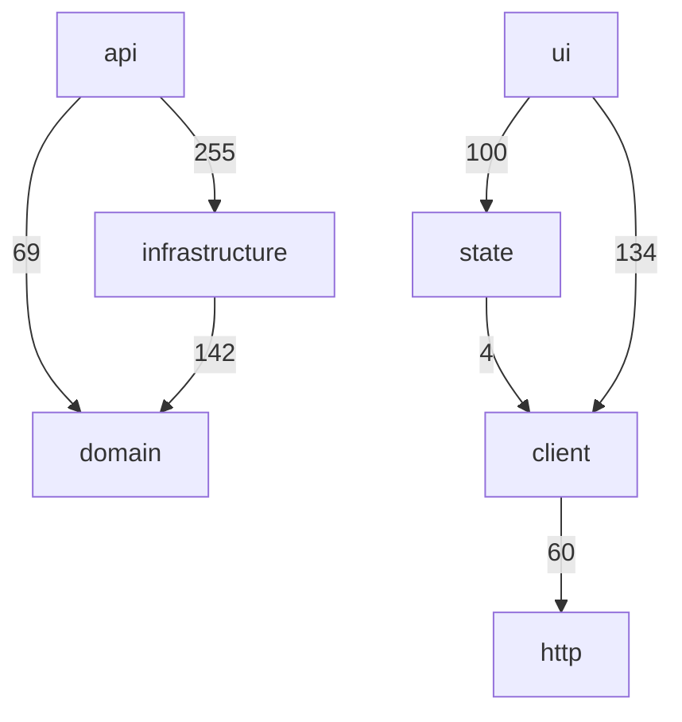

<!-- generated by docwizz: edits are overwritten -->
# Architecture description

Organised after the concepts of ISO/IEC/IEEE 42010. Sections marked _derived_ are generated from the code; _human-authored_ sections live in `architecture/` next to these pages and are never overwritten. This is a documentation structure, not a claim of conformance with the standard.

## Human-authored sections

| Section | Status |
|---|---|
| stakeholders | missing |
| concerns | missing |
| decisions | missing |
| deployment | missing |
| security | missing |

## Stakeholders and concerns

_Human-authored, missing:_ Who has an interest in the system — write `architecture/stakeholders.md`.

_Human-authored, missing:_ What they need the architecture to address — write `architecture/concerns.md`.

## Viewpoints and views

| Viewpoint | Addresses | View |
|---|---|---|
| System context | scope, external actors and systems | [System context](views/context.md) |
| Containers | deployable units and how they communicate | [Containers](views/containers.md) |
| Components | building blocks per layer and their dependencies | [Components](views/components.md) |
| Dependencies | layering rules, violations, cycles | [Dependencies](architecture.md) |
| API | interfaces offered to clients | [API](api.md) |
| Data | persisted entities and state | [Data](views/data.md) |
| Deployment | where the units run | [Deployment](views/deployment.md) |
| Packages | declared third-party packages, versions and manifests | [Packages](views/packages.md) |

## Architecture _(derived)_

| Layer | Files | May depend on |
|---|---|---|
| ui | 102 | state, client |
| state | 5 | client |
| client | 15 | http |
| api | 27 | domain, infrastructure |
| domain | 28 | nothing |
| infrastructure | 70 | domain |

## Components _(derived)_

api: 81, client: 54, domain: 69, infrastructure: 94, no layer: 16, state: 1, ui: 102 — see [components](views/components.md).

## Interfaces _(derived)_

- 71 HTTP endpoints — see [API](api.md)
- 61 code interfaces: `AuditEntry`, `BrandingConfig`, `ConnectionConfig`, `ConnectionForm`, `ConnectionStatus`, `ConnectorInstance`, `CurrentUser`, `DeliverRequest`, `DetectedExportFile`, `ErpConnectionInfo`, `ExportDefinition`, `ExportDefinitionPreview`, `ExportDefinitionRequest`, `ExportDefinitionRun`, `ExportDefinitionSummary`, `ExportDefinitionTestResult`, `ExportDetail`, `ExportJsonMetadataField`, `ExportJsonWrapperConfig`, `ExportMappingConfig`, `ExportNode`, `ExportSummary`, `FieldMapping`, `GdprDeniedFieldsResult`, `IDataSourceProvider`, `IDataSourceProviderResolver`, `IExportFormatWriter`, `ImportDefinition`, `ImportDefinitionRequest`, `ImportDefinitionRun`, `ImportDefinitionSummary`, `ImportMappingSuggestion`, `ImportMappingSuggestionCandidateField`, `ImportMappingSuggestionCheckResult`, `ImportNode`, `ImportPlan`, `ImportPlanOperation`, `ImportRun`, `ImportRunDetail`, `ISqlDataSourceProvider`, `ISqlDialect`, `MappingField`, `MappingNestedField`, `MappingNestedGroup`, `MappingRelation`, `MappingRelationField`, `PermissionGroup`, `PermissionInfo`, `PreviewResult`, `ReleaseRequest`, `RolePermissions`, `RouteAccess`, `RunNowResult`, `SchedulerConfig`, `SchemaColumnDef`, `SchemaDefinition`, `SkipRequest`, `SourceColumn`, `SourceSchema`, `SourceTable`, `UserAccount`
- 19 frontend routes — see [frontend](frontend.md)

## Dependencies _(derived)_

7 layer dependencies (0 not allowed), 0 violations, 0 module cycles, 38 external packages — see [dependencies](architecture.md) and [context](views/context.md).

## Data flow _(derived)_

Allowed dependencies actually used, i.e. the paths requests and data take through the layers.

## Deployment

_Derived:_ [deployment view](views/deployment.md).

_Human-authored, missing:_ Environments, hosting and operations — write `architecture/deployment.md`.

## Security

_Derived:_ endpoint authorization as declared in code — authorization required: 5, none declared: 66.

Endpoints without declared authorization: `DELETE /api/export-definitions/{id:int}`, `DELETE /api/export-mapping/presets/{name}`, `DELETE /api/import-definitions/{id:int}`, `DELETE /api/settings/manifest-signing/peers/{instanceId}`, `DELETE /api/users/{username}`, `GET /api/audit`, `GET /api/branding`, `GET /api/connection`, `GET /api/export-definitions/{id:int}/runs`, `GET /api/export-definitions/{id:int}`, `GET /api/export-definitions`, `GET /api/export-mapping/presets`, `GET /api/export-mapping`, `GET /api/exports/{seqNo:int}`, `GET /api/exports`, `GET /api/gdpr-denied-fields`, `GET /api/health`, `GET /api/import-definitions/{id:int}/runs`, `GET /api/import-definitions/{id:int}`, `GET /api/import-definitions`, `GET /api/import-runs/{id:int}`, `GET /api/pipeline/preview`, `GET /api/schema`, `GET /api/settings/instance`, `GET /api/settings/manifest-signing`, `GET /api/settings/permissions`, `GET /api/settings/scheduler`, `GET /api/source-schema`, `GET /api/users`, `GET /api/version`, `PATCH /api/export-definitions/{id:int}/enable`, `PATCH /api/gdpr-denied-fields`, `PATCH /api/import-definitions/{id:int}/enable`, `POST /api/auth/hash`, `POST /api/auth/login`, `POST /api/connection`, `POST /api/export-definitions/{id:int}/duplicate`, `POST /api/export-definitions/{id:int}/preview`, `POST /api/export-definitions/{id:int}/run-selected`, `POST /api/export-definitions/{id:int}/run`, `POST /api/export-definitions/{id:int}/test`, `POST /api/export-definitions`, `POST /api/exports/{seqNo:int}/deliver`, `POST /api/exports/{seqNo:int}/release`, `POST /api/exports/{seqNo:int}/skip`, `POST /api/import-definitions/{id:int}/duplicate`, `POST /api/import-definitions/{id:int}/preview`, `POST /api/import-definitions/{id:int}/records`, `POST /api/import-definitions/{id:int}/runs`, `POST /api/import-definitions/suggest-from-export`, `POST /api/import-definitions`, `POST /api/import-runs/{id:int}/reject`, `POST /api/import-runs/{id:int}/release`, `POST /api/pipeline/run`, `POST /api/settings/instance/regenerate`, `POST /api/users`, `PUT /api/branding`, `PUT /api/export-definitions/{id:int}`, `PUT /api/export-mapping/presets/{name}`, `PUT /api/export-mapping`, `PUT /api/import-definitions/{id:int}`, `PUT /api/settings/manifest-signing/peers/{instanceId}`, `PUT /api/settings/manifest-signing/policy`, `PUT /api/settings/permissions`, `PUT /api/settings/scheduler`, `PUT /api/users/{username}`

_Human-authored, missing:_ Threat model, authentication scheme, data protection — write `architecture/security.md`.

## Architecture decisions

_Human-authored, missing:_ Decisions and their rationale (or keep ADRs in docs/adr/) — write `architecture/decisions.md`.

