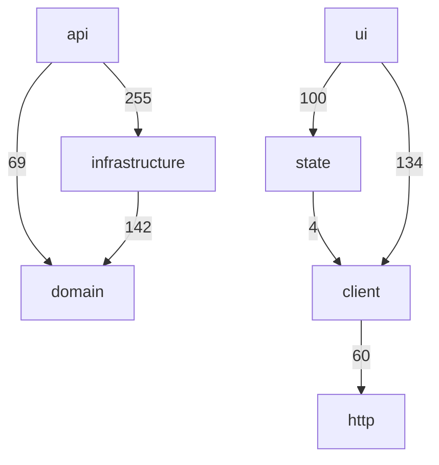
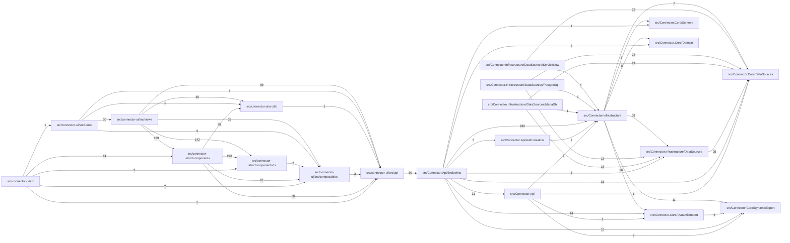

<!-- generated by docwizz: edits are overwritten -->
# Architecture

Views: [System context](views/context.md) · [Containers](views/containers.md) · [Components](views/components.md) · [Data](views/data.md) · [Deployment](views/deployment.md) · [Packages](views/packages.md)

## Layers

Actual dependencies between layers (edge label = number of references). Allowed per config: 
`ui → state/client`, `state → client`, `client → http`, `api → domain/infrastructure`, `domain → ∅`, `infrastructure → domain`.

## Modules

## Violations (0)

None.

## Cycles (0)

None.

## Coupling

Fan-in: modules that depend on this one. Fan-out: modules it depends on. Instability = fan-out / (fan-in + fan-out); stable modules (near 0) are costly to change, so they should not depend on unstable ones.

| Module | Layer | Fan-in | Fan-out | Instability |
|---|---|---|---|---|
| [src/Connector.Infrastructure](modules/src-Connector.Infrastructure.md) | infrastructure | 6 | 6 | 0.50 |
| [src/Connector.Api/Endpoints](modules/src-Connector.Api-Endpoints.md) | api | 1 | 9 | 0.90 |
| [src/connector-ui/src/api](modules/src-connector-ui-src-api.md) | client | 6 | 1 | 0.14 |
| [src/Connector.Core/DataSources](modules/src-Connector.Core-DataSources.md) | domain | 7 | 0 | 0.00 |
| [src/connector-ui/src/components](modules/src-connector-ui-src-components.md) | ui | 2 | 4 | 0.67 |
| [src/connector-ui/src/composables](modules/src-connector-ui-src-composables.md) | state | 5 | 1 | 0.17 |
| [src/connector-ui/src/views](modules/src-connector-ui-src-views.md) | ui | 1 | 5 | 0.83 |
| [src/connector-ui/src](modules/src-connector-ui-src.md) | ui | 0 | 5 | 1.00 |
| [src/connector-ui/src/router](modules/src-connector-ui-src-router.md) | — | 1 | 4 | 0.80 |
| [src/Connector.Api](modules/src-Connector.Api.md) | api | 1 | 4 | 0.80 |
| [src/Connector.Infrastructure/DataSources](modules/src-Connector.Infrastructure-DataSources.md) | infrastructure | 4 | 1 | 0.20 |
| [src/connector-ui/src/components/ui](modules/src-connector-ui-src-components-ui.md) | ui | 3 | 1 | 0.25 |
| [src/connector-ui/src/lib](modules/src-connector-ui-src-lib.md) | — | 3 | 1 | 0.25 |
| [src/Connector.Core/DynamicExport](modules/src-Connector.Core-DynamicExport.md) | domain | 4 | 0 | 0.00 |
| [src/Connector.Core/DynamicImport](modules/src-Connector.Core-DynamicImport.md) | domain | 3 | 1 | 0.25 |
| [src/Connector.Infrastructure/DataSources/MariaDb](modules/src-Connector.Infrastructure-DataSources-MariaDb.md) | infrastructure | 0 | 3 | 1.00 |

_… 5 more modules._

## Risks (21)

- Logic in the API layer: `ImportDefinitionEndpoints.ValidateRequestAsync(ImportDefinitionRequest, ExportLogDbContext, IDataSourceProviderResolver, CancellationToken, int?)` has complexity 30 — move the decisions into the application layer ([ImportDefinitionEndpoints.Validation.cs](../src/Connector.Api/Endpoints/ImportDefinitionEndpoints.Validation.cs#L32))
- Logic in the API layer: `ExportDefinitionEndpoints.ValidateRequestAsync(ExportDefinitionRequest, ExportLogDbContext, CancellationToken, int?)` has complexity 28 — move the decisions into the application layer ([ExportDefinitionEndpoints.cs](../src/Connector.Api/Endpoints/ExportDefinitionEndpoints.cs#L678))
- Logic in the API layer: `ExportMappingEndpoints.ValidateNestedGroup(ExportMappingNestedGroup, IReadOnlySet<string>, string, int)` has complexity 25 — move the decisions into the application layer ([ExportMappingEndpoints.cs](../src/Connector.Api/Endpoints/ExportMappingEndpoints.cs#L193))
- Logic in the API layer: `ExportDefinitionEndpoints.ValidateNode(ExportNode, IReadOnlySet<string>, string, int)` has complexity 23 — move the decisions into the application layer ([ExportDefinitionEndpoints.cs](../src/Connector.Api/Endpoints/ExportDefinitionEndpoints.cs#L773))
- Logic in the API layer: `ImportDefinitionEndpoints.ValidateNode(ImportNode, ImportNode, string, string, int, List<(string Table, string Column, string Path)>)` has complexity 23 — move the decisions into the application layer ([ImportDefinitionEndpoints.Validation.cs](../src/Connector.Api/Endpoints/ImportDefinitionEndpoints.Validation.cs#L246))
- Logic in the API layer: `ImportDefinitionEndpoints.BuildSuggestionAsync(string, ExportLogDbContext, CancellationToken)` has complexity 20 — move the decisions into the application layer ([ImportDefinitionEndpoints.Mapping.cs](../src/Connector.Api/Endpoints/ImportDefinitionEndpoints.Mapping.cs#L57))
- Logic in the API layer: `POST /api/export-definitions/{id:int}/run-selected` has complexity 15 — move the decisions into the application layer ([ExportDefinitionEndpoints.cs](../src/Connector.Api/Endpoints/ExportDefinitionEndpoints.cs#L384))
- Logic in the API layer: `PUT /api/branding` has complexity 13 — move the decisions into the application layer ([BrandingEndpoints.cs](../src/Connector.Api/Endpoints/BrandingEndpoints.cs#L28))
- Logic in the API layer: `PUT /api/users/{username}` has complexity 12 — move the decisions into the application layer ([UserEndpoints.cs](../src/Connector.Api/Endpoints/UserEndpoints.cs#L85))
- Logic in the API layer: `ImportDefinitionEndpoints.ValidateInsertCoversRequiredColumns(string, string, ImportNode, IReadOnlyDictionary<string, SourceTable>)` has complexity 11 — move the decisions into the application layer ([ImportDefinitionEndpoints.Validation.cs](../src/Connector.Api/Endpoints/ImportDefinitionEndpoints.Validation.cs#L177))
- Logic in the API layer: `ImportDefinitionEndpoints.StageImportAsync(int, string, string?, HttpContext, ExportLogDbContext, AuditService, IDataSourceProviderResolver, CancellationToken, ImportDefinitionEntity?)` has complexity 11 — move the decisions into the application layer ([ImportDefinitionEndpoints.cs](../src/Connector.Api/Endpoints/ImportDefinitionEndpoints.cs#L459))
- Logic in the API layer: `POST /api/pipeline/run` has complexity 11 — move the decisions into the application layer ([PipelineEndpoints.cs](../src/Connector.Api/Endpoints/PipelineEndpoints.cs#L22))
- Logic in the API layer: `ConnectionEndpoints.WithStoredPasswordIfUnchanged(DataSourceConfig, DataSourceConfig?)` has complexity 9 — move the decisions into the application layer ([ConnectionEndpoints.cs](../src/Connector.Api/Endpoints/ConnectionEndpoints.cs#L28))
- Logic in the API layer: `ExportMappingEndpoints.ValidateRelations(ExportMappingConfig)` has complexity 9 — move the decisions into the application layer ([ExportMappingEndpoints.cs](../src/Connector.Api/Endpoints/ExportMappingEndpoints.cs#L259))
- Logic in the API layer: `ImportDefinitionEndpoints.TryParseSample(string)` has complexity 9 — move the decisions into the application layer ([ImportDefinitionEndpoints.Mapping.cs](../src/Connector.Api/Endpoints/ImportDefinitionEndpoints.Mapping.cs#L174))
- Logic in the API layer: `POST /api/pipeline/run/{name}` has complexity 9 — move the decisions into the application layer ([PipelineEndpoints.cs](../src/Connector.Api/Endpoints/PipelineEndpoints.cs#L168))
- Logic in the API layer: `POST /api/connection` has complexity 8 — move the decisions into the application layer ([ConnectionEndpoints.cs](../src/Connector.Api/Endpoints/ConnectionEndpoints.cs#L119))
- Logic in the API layer: `ExportDefinitionEndpoints.IsSafeFilterExpression(string)` has complexity 8 — move the decisions into the application layer ([ExportDefinitionEndpoints.cs](../src/Connector.Api/Endpoints/ExportDefinitionEndpoints.cs#L659))
- Logic in the API layer: `ImportDefinitionEndpoints.ValidateTargetAgainstSchema(string, string, string, IReadOnlySet<string>, IReadOnlyDictionary<string, SourceTable>)` has complexity 8 — move the decisions into the application layer ([ImportDefinitionEndpoints.Validation.cs](../src/Connector.Api/Endpoints/ImportDefinitionEndpoints.Validation.cs#L207))
- Logic in the API layer: `PUT /api/settings/manifest-signing/peers/{instanceId}` has complexity 8 — move the decisions into the application layer ([ManifestSigningEndpoints.cs](../src/Connector.Api/Endpoints/ManifestSigningEndpoints.cs#L31))
- Logic in the API layer: `GET /api/pipeline/preview` has complexity 8 — move the decisions into the application layer ([PipelineEndpoints.cs](../src/Connector.Api/Endpoints/PipelineEndpoints.cs#L254))
