<!-- generated by docwizz: edits are overwritten -->
# Frontend

## Routes

| Path | Component |
|---|---|
| `/` | [DashboardView](modules/src-connector-ui-src-views.md#dashboardview) |
| `/:pathMatch(.*)*` | [NotFoundView](modules/src-connector-ui-src-views.md#notfoundview) |
| `/audit` | [AuditView](modules/src-connector-ui-src-views.md#auditview) |
| `/connect` | [ConnectionView](modules/src-connector-ui-src-views.md#connectionview) |
| `/erp` |  |
| `/erp-database` |  |
| `/export-definitions` | [ExportDefinitionsView](modules/src-connector-ui-src-views.md#exportdefinitionsview) |
| `/export-definitions/:id` | [ExportDefinitionEditView](modules/src-connector-ui-src-views.md#exportdefinitioneditview) |
| `/export-schema` | [SchemaView](modules/src-connector-ui-src-views.md#schemaview) |
| `/exports` | [ExportView](modules/src-connector-ui-src-views.md#exportview) |
| `/exports/:seqNo` | [ExportDetail](modules/src-connector-ui-src-views.md#exportdetail) |
| `/icd-schema` | [IcdSchemaView](modules/src-connector-ui-src-views.md#icdschemaview) |
| `/import-definitions` | [ImportDefinitionsView](modules/src-connector-ui-src-views.md#importdefinitionsview) |
| `/import-definitions/:id` | [ImportDefinitionEditView](modules/src-connector-ui-src-views.md#importdefinitioneditview) |
| `/login` | [LoginView](modules/src-connector-ui-src-views.md#loginview) |
| `/pipeline` |  |
| `/schema` |  |
| `/settings` | [SettingsView](modules/src-connector-ui-src-views.md#settingsview) |
| `/source-schema` | [SourceSchemaView](modules/src-connector-ui-src-views.md#sourceschemaview) |

## Screenshots

### `/`

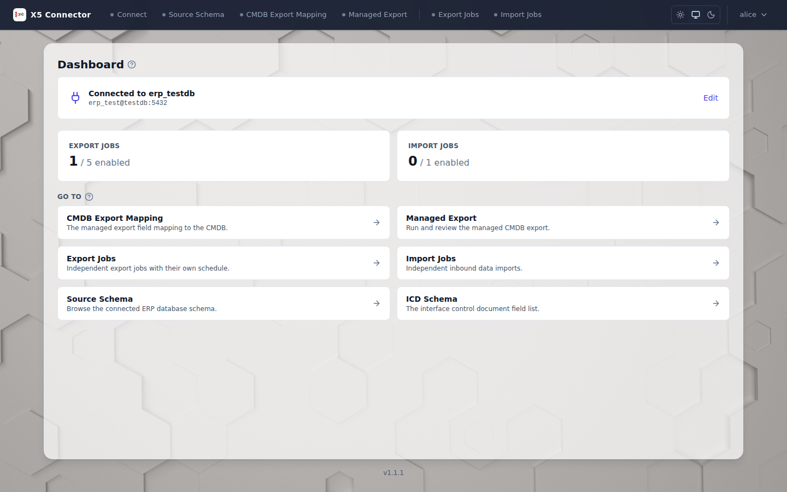

### `/audit`

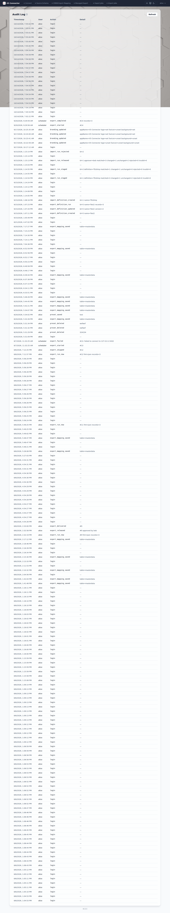

### `/connect`

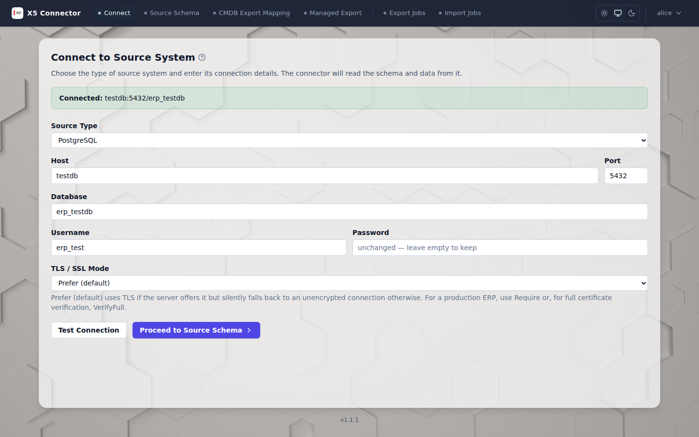

### `/export-definitions`

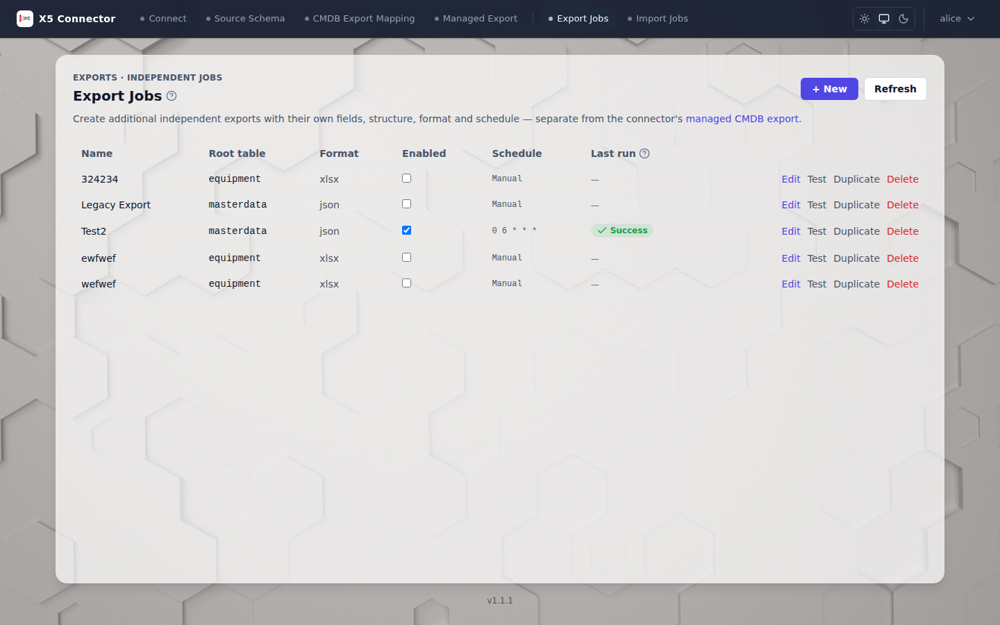

### `/export-schema`

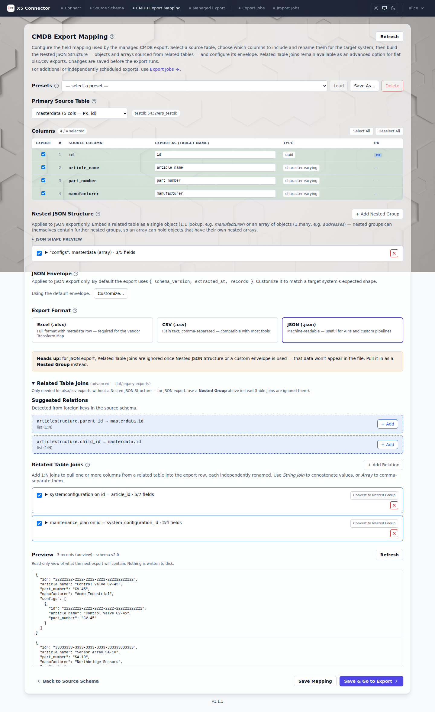

### `/exports`

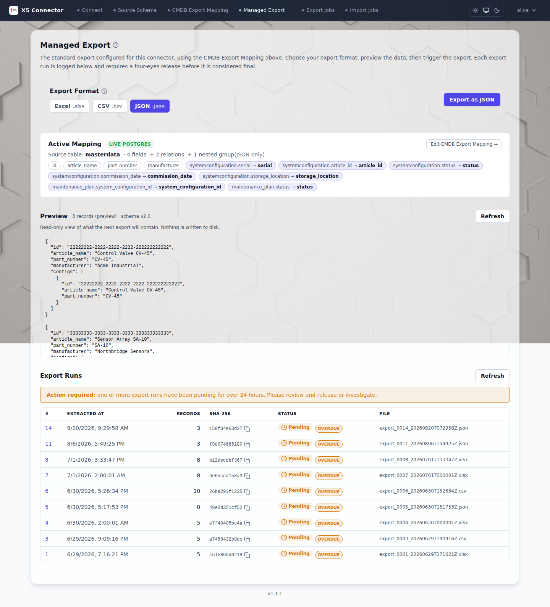

### `/icd-schema`

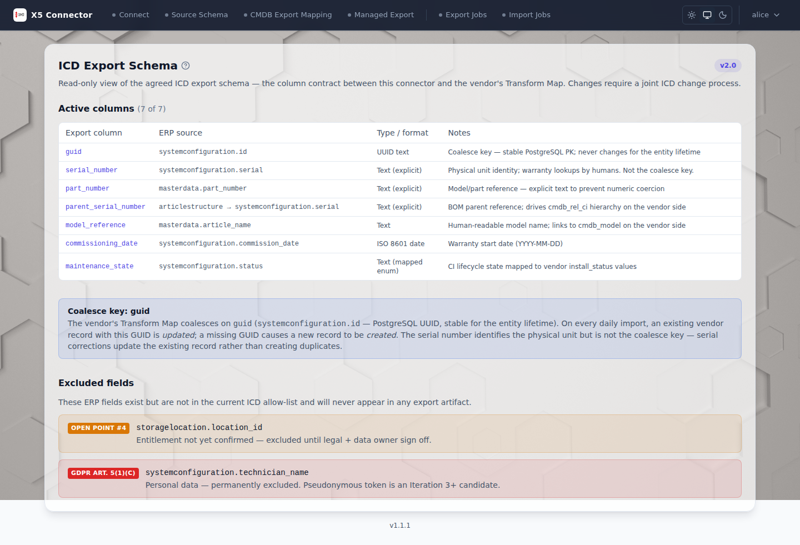

### `/import-definitions`

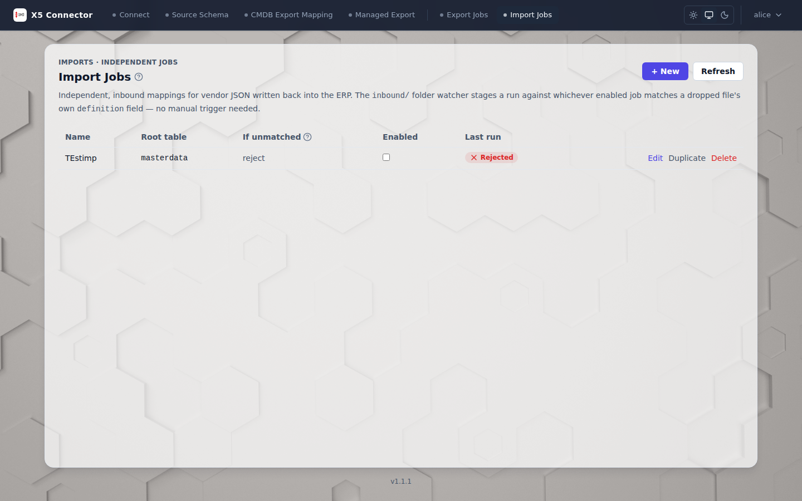

### `/login`

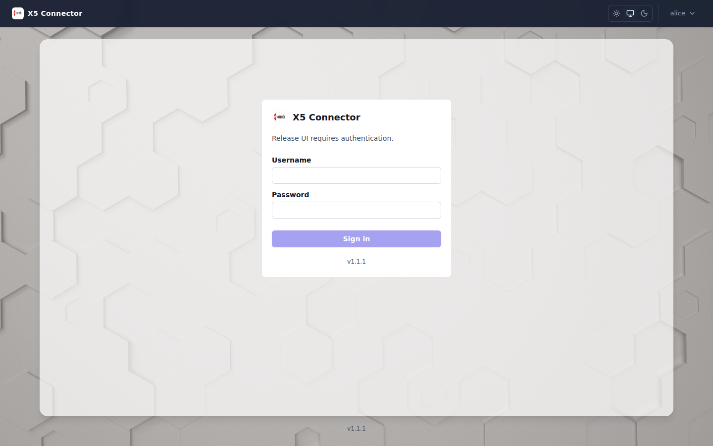

### `/settings`

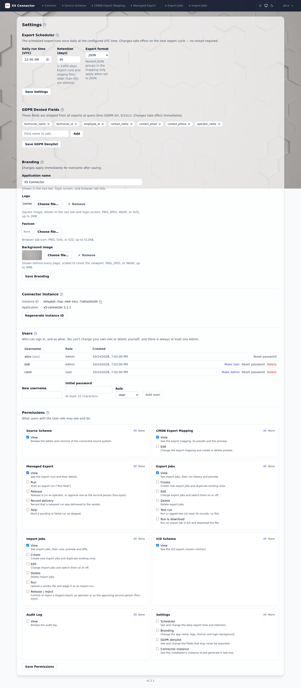

### `/source-schema`

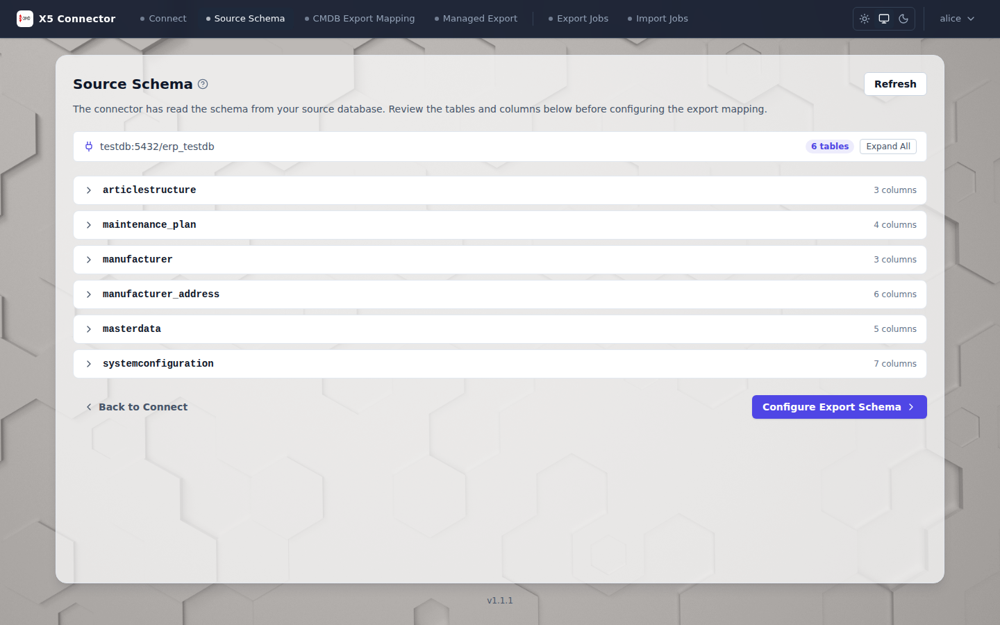

## Components

| Component | Summary | Props | Emits | Hooks & composables | Renders | Listens to | Used by |
|---|---|---|---|---|---|---|---|
| [App](modules/src-connector-ui-src.md#app) | App shell: a header with the branded logo and app name and the theme toggle, plus (when signed in) the navigation and a user menu for changing the password, signing out or signing out of all sessions; then the current route's view, toasts and, when signed in, the app version. |  |  | useBranding(), useRouter(), useRoute() | ConnectorNav, ThemeToggle, UserMenu, AppVersion, ChangePasswordDialog, ToastHost | UserMenu @sign-out, UserMenu @revoke-sessions, UserMenu @change-password, ChangePasswordDialog @changed |  |
| [ActiveMappingSummary](modules/src-connector-ui-src-components.md#activemappingsummary) | Card on the Managed Export page summarising the saved CMDB export mapping: source table, enabled fields, relations and nested groups, with a link to edit it (or to configure one when none is saved). Renders nothing while loading. | mapping: ExportMappingConfig \| null, loading: boolean |  |  |  |  | ExportView |
| [AddUserForm](modules/src-connector-ui-src-components.md#adduserform) | Settings → Users' "add a user" row: username, initial password and role. Emits `added` so the list reloads. | minPasswordLength: number | added | useToasts() | Input, Select, Button |  | UsersSettings |
| [AppVersion](modules/src-connector-ui-src-components.md#appversion) | Comes from the running API, not baked into the bundle, so it shows what the container actually runs even if the browser still has an older index.html cached. |  |  |  |  |  | App, LoginView |
| [AuditLogTable](modules/src-connector-ui-src-components.md#auditlogtable) | — | entries: AuditEntry[] |  |  |  |  | AuditView |
| [BrandingImageField](modules/src-connector-ui-src-components.md#brandingimagefield) | Image picker for one branding asset, bound with v-model as a data URL (null = use the default). Rejects non-images and files over maxBytes inline, shows a preview, and can remove the image. | label: string, helpText: string, accept: string, maxBytes: number, previewShape: 'square' \| 'wide' |  | useId() | FieldShell, Button, Icon | Button @click | BrandingSettingsForm |
| [BrandingSettingsForm](modules/src-connector-ui-src-components.md#brandingsettingsform) | Settings form for the app name, logo, favicon and background image. Saves via PUT /api/branding and reloads the app-wide branding so the change shows immediately. | config: BrandingConfig |  | useToasts(), useBranding(), useSaveStatus() | HelpTooltip, Input, BrandingImageField, Button, SaveStatusAlert |  | SettingsView |
| [ChangePasswordDialog](modules/src-connector-ui-src-components.md#changepassworddialog) | Self-service password change, opened from the user menu. On success the server has signed this account out everywhere, so the dialog emits `changed` and the app sends the user back to the login page. |  | changed |  | Modal, Input, Button | Button @click | App |
| [ColumnMappingTable](modules/src-connector-ui-src-components.md#columnmappingtable) | — | fields: MappingField[], columnMap: Record\<string, SourceColumn> | dirty |  |  |  | SchemaView |
| [ConnectionStatusCard](modules/src-connector-ui-src-components.md#connectionstatuscard) | The dashboard's connection card. Every user sees whether a connection exists and its name; only Admins (who own Connect) see the account and host, and get the Edit/Connect link. Everyone else is told whom to ask. |  |  | useCurrentUser(), onMounted | Card, Icon |  | DashboardView |
| [ConnectionTlsSelect](modules/src-connector-ui-src-components.md#connectiontlsselect) | TLS mode for a relational source. Both providers store the same names (the backend maps them for MariaDB); only the labels and the offered set differ — MariaDB has no "Allow". | sourceType: 'postgres' \| 'mariadb' |  |  | Select |  | ConnectionView |
| [ConnectorInstanceInfo](modules/src-connector-ui-src-components.md#connectorinstanceinfo) | Identity of this connector installation: the instance ID every export manifest carries, so an operator can tell which installation a connector-to-connector import ("From connector: …") came from. The ID can be regenerated for an installation set up from a copy of another's database (#233). |  |  | useToasts() | SectionHeader, HelpTooltip, Button, Icon, ConfirmAction | Button @click, ConfirmAction @confirm | SettingsView |
| [ConnectorNav](modules/src-connector-ui-src-components.md#connectornav) | Main navigation bar: a flat row of links to each area, highlighted for the current route. Below the nav breakpoint it collapses into a toggle and dropdown that closes on outside click, Escape or navigation. |  |  | useRoute(), useRouter(), onMounted, onBeforeUnmount | Icon |  | App |
| [DeliverRunForm](modules/src-connector-ui-src-components.md#deliverrunform) | Form on a released export run's detail page for recording that the file reached the vendor, with an optional imported-record count and notes. Emits `delivered` on success. | seqNo: number | delivered | useToasts() | Card, Input, TextField, Button | Input @update:model-value, Button @click | ExportDetail |
| [ExportDefinitionBasicFields](modules/src-connector-ui-src-components.md#exportdefinitionbasicfields) | The export definition editor's basic settings: name, description, root table, output format, cron schedule, enabled flag, the provenance fields (IntegrationKey, ContractVersion, CorrelationKeySourceField) and the connector-to-connector target (TargetImportDefinition). Edits `definition` in place; cleared optional inputs are stored as null, not ''. | definition: ExportDefinition, availableTables: SourceTable[], rootTableLocked: boolean | root-table-changed |  | HelpTooltip, ExportScheduleField, ExportFormatPicker |  | ExportDefinitionEditView |
| [ExportDefinitionPreviewPanel](modules/src-connector-ui-src-components.md#exportdefinitionpreviewpanel) | Runs POST /api/export-definitions/{id}/preview — the *same* query path Run Now uses, just capped and untracked. Records are arbitrary nested JSON (every ExportNode shape, regardless of the definition's own OutputFormat, since the format writer only applies at Run Now/Test time) — rendered as pretty-printed JSON rather than a flattened table, since a 3-level nested tree has no single flat column set to render as a grid. | recordCount: number \| null, records: unknown[], loading: boolean, error: string \| null | refresh |  | HelpTooltip |  | ExportDefinitionEditView |
| [ExportDefinitionRunControls](modules/src-connector-ui-src-components.md#exportdefinitionruncontrols) | Action bar for the export definition editor: Save (PUT, merged back into `definition`), Test against the live connection (capped test run), Run Now (downloads the built file), Duplicate and Delete (with confirm). Parents react to `duplicated` / `deleted` to navigate away. Each action shows only for a user holding its permission. | definition: ExportDefinition | duplicated, deleted | useToasts(), useCurrentUser(), useSaveStatus() | Button, ConfirmAction | Button @click, ConfirmAction @confirm | ExportDefinitionEditView |
| [ExportDefinitionRunsTable](modules/src-connector-ui-src-components.md#exportdefinitionrunstable) | The per-definition analogue of ExportRunsTable.vue — deliberately a separate component, not a reuse of that one: ExportDefinitionRunEntity has no sequence/four-eyes fields (those model the legacy CI pipeline), but it does carry ConfigVersion/TriggeredBy/IsTestRun, which ExportRunEntity doesn't. Only scheduled runs have a staged file (hover shows its SHA-256). | runs: ExportDefinitionRun[], loading: boolean, error: string \| null | refresh |  | RunHistoryFrame, StatusBadge | RunHistoryFrame @refresh | ExportDefinitionEditView |
| [ExportFormatPicker](modules/src-connector-ui-src-components.md#exportformatpicker) | — | modelValue: 'xlsx' \| 'csv' \| 'json' | update:modelValue |  | HelpTooltip |  | ExportDefinitionBasicFields, SchemaView |
| [ExportNodeFieldEditor](modules/src-connector-ui-src-components.md#exportnodefieldeditor) | Self-referencing recursive component (see NestedGroupEditor.vue for the same pattern applied to the legacy mapping shape). Deliberately a flat, read-the-identifiers-and-fix-them form — not a tree builder: it edits SourceField/RelatedTable/JoinKey/SourceJoinKey and the Enabled flag on the existing tree in place, but never adds, removes, or re-kinds a node. That's enough to point a migrated definition at real production table/column names; building/restructuring the tree is ExportNodeTreeEditor.vue's job, not this recovery form's. | nodes: ExportNode[], depth: number | dirty |  |  |  |  |
| [ExportNodeMappingEditor](modules/src-connector-ui-src-components.md#exportnodemappingeditor) | Inline editor for one scalar-field node's FieldMapping: rename is the node's own TargetKey input (owned by the caller), so this only covers the four FieldMapping members — transform, transform argument, null-fallback, and data-type coercion target. Mirrors Connector.Core.DynamicExport.FieldTransform/FieldDataType exactly (see ExportNode.cs) so every value this can emit is one the backend validator already accepts. | mapping: FieldMapping | dirty |  | HelpTooltip |  | ExportNodeTreeEditor, ImportNodeTreeEditor |
| [ExportNodeTreeEditor](modules/src-connector-ui-src-components.md#exportnodetreeeditor) | The export definition tree builder: the single recursive editor for every ExportNode kind ("scalar-field" \| "object" \| "array"), in every output format. Used as the definition editor's tree UI once a definition has real columns to build from (otherwise see ExportNodeFieldEditor.vue). Structurally mirrors NestedGroupEditor.vue (the legacy MappingNestedGroup tree editor) but is kept as its own component: the two operate on different, incompatible tree shapes (MappingNestedGroup's flat per-group `fields` list vs. ExportNode's uniform recursive `children`), and NestedGroupEditor.vue serves only the legacy `/export-schema` flow. | nodes: ExportNode[], contextTable: string, availableTables: SourceTable[], depth: number | dirty |  | ExportNodeMappingEditor, Icon, SuggestedRelations | ExportNodeMappingEditor @dirty, SuggestedRelations @add | ExportDefinitionEditView |
| [ExportRunsTable](modules/src-connector-ui-src-components.md#exportrunstable) | — | runs: ExportSummary[], loading: boolean, error: string \| null | refresh |  | Button, Icon, StatusBadge | Button @click | ExportView |
| [ExportScheduleField](modules/src-connector-ui-src-components.md#exportschedulefield) | Schedule picker: presets (Manual/Hourly/Daily/Weekly) plus an advanced free-text cron field. modelValue is the raw ExportDefinition.Schedule (a 5-field cron string, or null for manual-only) — this never invents a second source of truth for it. | modelValue: string \| null | update:modelValue |  | HelpTooltip |  | ExportDefinitionBasicFields |
| [FieldPickerTable](modules/src-connector-ui-src-components.md#fieldpickertable) | Shared by RelationCard and NestedGroupEditor — both need an identical checkbox+rename table over "columns of a related table", differing only in which property holds the rename (relations call it targetField, nested groups call it targetKey). `targetProp` picks that property type-safely per caller instead of forcing the two mapping shapes to match. | fields: T[], relatedTable: string, targetProp: keyof T | dirty |  |  |  | NestedGroupEditor, RelationCard |
| [FlatPreviewTable](modules/src-connector-ui-src-components.md#flatpreviewtable) | Read-only grid of flat preview rows (numbered, one column per export column, '—' for a missing value), with a note when the preview was capped. | columns: string[], rows: Record\<string, string>[], totalCount: number, max: number |  |  |  |  | PreviewTable |
| [GdprDenylistEditor](modules/src-connector-ui-src-components.md#gdprdenylisteditor) | Settings editor for the GDPR denylist: source fields that are never exported. Add or remove field names, then save; the new list applies to the next export or preview. | initialFields: string[] |  | useToasts(), useSaveStatus() | HelpTooltip, Button, Icon, Input, SaveStatusAlert | Button @click, Input @keydown | SettingsView |
| [IcdActiveColumnsTable](modules/src-connector-ui-src-components.md#icdactivecolumnstable) | — | columns: SchemaColumnDef[] |  |  |  |  | IcdSchemaView |
| [IcdExcludedFieldsList](modules/src-connector-ui-src-components.md#icdexcludedfieldslist) | — | fields: { erpSource: string; reason: string; detail: string; tag: string }[] |  |  |  |  | IcdSchemaView |
| [ImportAllowedColumnsEditor](modules/src-connector-ui-src-components.md#importallowedcolumnseditor) | This is the primary safety boundary of the whole import feature: a saved mapping can never write outside this explicit allowlist, checked against the live schema at save time. Deliberately its own component, visibly separate from the tree, so it's never something an operator can miss while scrolling past field rows. | columns: string[], usedColumns: string[] | dirty |  | SectionHeader, HelpTooltip, Icon |  | ImportDefinitionEditView |
| [ImportDefinitionBasicFields](modules/src-connector-ui-src-components.md#importdefinitionbasicfields) | — | definition: ImportDefinition, availableTables: SourceTable[], rootTableLocked: boolean | root-table-changed |  | HelpTooltip |  | ImportDefinitionEditView |
| [ImportDefinitionPreviewPanel](modules/src-connector-ui-src-components.md#importdefinitionpreviewpanel) | Preview runs POST .../preview — parses + walks + plans a sample inbound file against this saved definition with zero persistence (no ImportRunEntity, nothing written to the ERP). Run instead posts to .../runs, which stages a real ImportRunEntity at PendingReview the same way the inbound/ folder watcher would — the parent view owns that call so it can refresh run history / open the review dialog. | plan: ImportPlan \| null, loading: boolean, error: string \| null, running: boolean, rootNode: ImportNode \| null | refresh, create-from-export, run | useCurrentUser() | SectionHeader, HelpTooltip, Button, Alert, ImportUnmappedFieldsWarning, ImportPlanSummaryBadges, ImportPlanDiffTable | Button @click | ImportDefinitionEditView |
| [ImportDefinitionRunControls](modules/src-connector-ui-src-components.md#importdefinitionruncontrols) | The import-side analogue of ExportDefinitionRunControls.vue — deliberately narrower: there's no "Test against live connection" here (an import definition has no query to sanity-check). Staging a real run (manual file select or the inbound/ folder watcher) and previewing a sample file both live on ImportDefinitionPreviewPanel.vue instead, since both act on the same pasted/selected JSON it already owns. | definition: ImportDefinition | duplicated, deleted | useToasts(), useCurrentUser(), useSaveStatus() | Button, ConfirmAction | Button @click, ConfirmAction @confirm | ImportDefinitionEditView |
| [ImportDefinitionRunsTable](modules/src-connector-ui-src-components.md#importdefinitionrunstable) | The import-side analogue of ExportDefinitionRunsTable.vue: same per-definition run-history shape, but carries the full count breakdown (changed/unchanged/inserted/rejected/conflicted/ invalid) instead of a bare record count, and a Review action on PendingReview rows — the entry point into ImportRunReviewDialog.vue's four-eyes commit flow. | runs: ImportDefinitionRun[], loading: boolean, error: string \| null | refresh, review |  | RunHistoryFrame, StatusBadge | RunHistoryFrame @refresh | ImportDefinitionEditView |
| [ImportDiffValue](modules/src-connector-ui-src-components.md#importdiffvalue) | One old/new value cell's contents, shared by both columns of ImportPlanDiffTable.vue — split out purely to keep that table's own template under fallow's complexity gate, not because either side has behavior of its own beyond the null/empty check and which style applies. | value: string \| null, variant: 'old' \| 'new' |  |  |  |  | ImportPlanDiffTable |
| [ImportMappingSuggestionPanel](modules/src-connector-ui-src-components.md#importmappingsuggestionpanel) | "Create from export": the New Import Definition flow's other starting point besides "Start blank." A dedicated step rather than reusing ImportDefinitionPreviewPanel.vue's paste-a-sample affordance verbatim — that panel drives POST .../{id}/preview against an *already-saved* definition's live ERP connection, which doesn't exist yet here. This mirrors its paste-JSON UX instead, wired to the suggestion lookup rather than a plan diff. |  | accept, start-blank | onMounted | HelpTooltip, Button | Button @click | ImportDefinitionEditView |
| [ImportNodeTreeEditor](modules/src-connector-ui-src-components.md#importnodetreeeditor) | The write-side mirror of ExportNodeTreeEditor.vue: same recursive-editor idea, built against ImportNode instead of ExportNode. Two differences follow directly from the data model, not from UI taste: there's no Filter input (ImportNode has no such field — every matched row is in scope, filtering happens at the correlation-key match, not here), and OnMissingChild has no picker at all — only "reject" is permitted (the save-time validator rejects "insert" outright), so offering a choice that always fails server-side would be actively misleading. | nodes: ImportNode[], contextTable: string, availableTables: SourceTable[], depth: number | dirty |  | ExportNodeMappingEditor, Icon, SuggestedRelations | ExportNodeMappingEditor @dirty, SuggestedRelations @add | ImportDefinitionEditView |
| [ImportPlanDiffTable](modules/src-connector-ui-src-components.md#importplandifftable) | Shared by ImportDefinitionPreviewPanel.vue (a sample-file preview) and ImportRunReviewDialog.vue (a staged run's four-eyes review) — both need the same "one row's changed fields, grouped by CorrelationValue" rendering of a plan's operations as a field-level diff. PlanJson is the write-side source of truth; this component only ever displays operations handed to it, never recomputes anything. | operations: ImportPlanOperation[] |  |  | ImportDiffValue |  | ImportDefinitionPreviewPanel, ImportRunReviewDialog |
| [ImportPlanSummaryBadges](modules/src-connector-ui-src-components.md#importplansummarybadges) | Split out of ImportDefinitionPreviewPanel.vue purely to keep that panel's own template under fallow's complexity gate. isStale means the sample textarea has been edited since `plan` was computed (Preview is an explicit, manual action — it never reruns just because the text changed), so the count badges below dim and a banner explains why they may no longer match what's on screen. | plan: ImportPlan, isStale: boolean |  |  | Badge |  | ImportDefinitionPreviewPanel |
| [ImportRunCountSummary](modules/src-connector-ui-src-components.md#importruncountsummary) | The count breakdown for one import run — pulled out of ImportRunReviewDialog.vue purely to keep that file's already-branchy template (loading/error/pending/terminal states) from growing further; this piece itself has almost no branching of its own. `insertCount` is optional and only shown when non-zero: rows created under UnmatchedRootPolicy "insert" (connector-to-connector imports). | matchedCount: number, changedCount: number, unchangedCount: number, rejectedCount: number, conflictCount: number, invalidCount: number, insertCount: number |  |  | HelpTooltip, Badge |  | ImportRunReviewDialog |
| [ImportRunOutcome](modules/src-connector-ui-src-components.md#importrunoutcome) | The read-only "what happened" summary for a Released/Rejected/Failed import run — the ImportRunReviewDialog.vue counterpart to its own pending-review Operator/Approver form, pulled out for the same reason as ImportRunCountSummary.vue: keeping the dialog's own template from growing another branch. | operatedBy: string \| null, approvedBy: string \| null, releasedAt: string \| null, errorMessage: string \| null |  |  |  |  | ImportRunReviewDialog |
| [ImportRunReviewDialog](modules/src-connector-ui-src-components.md#importrunreviewdialog) | The import run review/diff view: reuses ReleaseDialog.vue's Operator/Approver form pattern, extended with the full count breakdown and a field-level diff of the matched/changed rows PlanJson actually carries — a run's plan is the write-side source of truth, so this dialog only ever displays it, never recomputes its own. | runId: number \| null | resolved | useToasts(), useCurrentUser() | Modal, StatusBadge, ImportRunCountSummary, HelpTooltip, ImportPlanDiffTable, Input, ImportRunOutcome, Button | Button @click | ImportDefinitionEditView |
| [ImportUnmappedFieldsWarning](modules/src-connector-ui-src-components.md#importunmappedfieldswarning) | Split out of ImportDefinitionPreviewPanel.vue purely to keep that panel's own template under fallow's complexity gate — see findUnmappedRootFields (lib/importPreviewHints.ts) for what this actually warns about. Renders nothing when there's nothing to warn about, so the caller can drop it in unconditionally alongside the (mutually exclusive) "looks like an exported job file" alert. | fields: string[] |  |  | Alert |  | ImportDefinitionPreviewPanel |
| [JobRowActions](modules/src-connector-ui-src-components.md#jobrowactions) | The per-row actions of the Export Jobs and Import Jobs lists: open (Edit, or View without the edit permission), then Test, Duplicate and Delete (with confirm), each shown only when the parent allows it. | to: RouteLocationRaw, canEdit: boolean, showTest: boolean, showDuplicate: boolean, showDelete: boolean, testing: boolean, duplicating: boolean, deleting: boolean | test, duplicate, delete |  | ConfirmAction | ConfirmAction @confirm | ExportDefinitionsView, ImportDefinitionsView |
| [JsonEnvelopeEditor](modules/src-connector-ui-src-components.md#jsonenvelopeeditor) | — |  | dirty |  | HelpTooltip, Icon |  | JsonExportOptionsPanel |
| [JsonExportOptionsPanel](modules/src-connector-ui-src-components.md#jsonexportoptionspanel) | — | nestedGroups: MappingNestedGroup[], availableTables: SourceTable[] | add, remove, dirty |  | NestedGroupsSection, JsonEnvelopeEditor | NestedGroupsSection @add, NestedGroupsSection @remove, NestedGroupsSection @dirty, JsonEnvelopeEditor @dirty | SchemaView |
| [NestedGroupEditor](modules/src-connector-ui-src-components.md#nestedgroupeditor) | Self-referencing recursive component. Vue 3 SFCs can implicitly reference themselves by filename, but defineOptions makes the self-registration explicit and independent of the file staying named exactly "NestedGroupEditor.vue". Template complexity is intentionally left unsplit here: this component supports arbitrary nesting depth, so its "children" block recurses into itself — pulling that block into a separate file would just import this file right back, a circular dependency fallow itself flags as worse than the complexity it'd save. The field-row and field-picker sections are already extracted (see FieldPickerTable.vue); this is what's left after that. | group: MappingNestedGroup, availableTables: SourceTable[], depth: number, siblings: MappingNestedGroup[] | remove, dirty |  | IssuesAlert, FieldPickerTable, Icon | FieldPickerTable @dirty | NestedGroupsSection |
| [NestedGroupsSection](modules/src-connector-ui-src-components.md#nestedgroupssection) | Pure structural preview of the JSON shape being built — target keys, object vs. array, and nesting only, no live data. Lets someone see the tree they're building without running a real export first. | groups: MappingNestedGroup[], availableTables: SourceTable[] | add, remove, dirty |  | HelpTooltip, NestedGroupEditor | NestedGroupEditor @remove, NestedGroupEditor @dirty | JsonExportOptionsPanel |
| [NestedPreviewList](modules/src-connector-ui-src-components.md#nestedpreviewlist) | — | records: unknown[], totalCount: number, max: number |  |  |  |  | PreviewTable |
| [PermissionsSettings](modules/src-connector-ui-src-components.md#permissionssettings) | Admin-only Settings → Permissions: one card per menu item with a checkbox per permission, deciding what the User role may see and do. Ticking any permission ticks the item's "View" too, and unticking "View" clears the rest, mirroring how the server normalizes the set. Applies on the users' next click after saving. |  |  | useToasts(), useSaveStatus(), onMounted | HelpTooltip, Alert, Card, Button, SaveStatusAlert | Button @click | SettingsView |
| [PresetsToolbar](modules/src-connector-ui-src-components.md#presetstoolbar) | Named export-mapping presets for the legacy mapping screen: load the saved presets, apply one (emits `apply` with its config), save the current mapping under a name ("Save As…", overwriting a same-named preset), or delete the selected preset. | canSave: boolean, getConfig: () => ExportMappingConfig | apply | useToasts(), onMounted | SectionHeader, HelpTooltip |  | SchemaView |
| [PreviewTable](modules/src-connector-ui-src-components.md#previewtable) | Preview panel for the legacy export mapping: shows loading, errors, an empty state, or the first 20 records, as nested JSON or a flat table depending on the mapping. Emits `refresh` to re-run the preview. | preview: PreviewResult \| null, loading: boolean, error: string \| null | refresh |  | Button, NestedPreviewList, FlatPreviewTable | Button @click | ExportView, SchemaView |
| [RelatedJoinsPanel](modules/src-connector-ui-src-components.md#relatedjoinspanel) | — | relations: MappingRelation[], relatableTables: SourceTable[], selectedTableColumns: SourceColumn[], selectedTableName: string, suggestions: SuggestedRelation[] | addSuggested, add, remove, dirty, convertToNestedGroup |  | SuggestedRelations, RelationsSection | SuggestedRelations @add, RelationsSection @add, RelationsSection @remove, RelationsSection @dirty, RelationsSection @convert-to-nested-group | SchemaView |
| [RelationCard](modules/src-connector-ui-src-components.md#relationcard) | Collapsible editor for one flattened relation in the legacy mapping: related table, join columns, which related fields to include, and how multiple matches are flattened (strategy and delimiter). Can be removed or converted into a nested group. | relation: MappingRelation, relatableTables: SourceTable[], selectedTableColumns: SourceColumn[] | remove, dirty, convertToNestedGroup |  | FieldPickerTable, Icon | FieldPickerTable @dirty | RelationsSection |
| [RelationsSection](modules/src-connector-ui-src-components.md#relationssection) | — | relations: MappingRelation[], relatableTables: SourceTable[], selectedTableColumns: SourceColumn[] | add, remove, dirty, convertToNestedGroup |  | HelpTooltip, RelationCard | RelationCard @remove, RelationCard @dirty, RelationCard @convert-to-nested-group | RelatedJoinsPanel |
| [ReleaseDialog](modules/src-connector-ui-src-components.md#releasedialog) | Four-eyes release for a pending export run: a button that opens a dialog where a second user enters their credentials to approve. The approver can't be the signed-in operator. Emits `released` on success. | seqNo: number | released | useToasts() | Button, Modal, HelpTooltip, Input | Button @click | ExportDetail |
| [ResetPasswordDialog](modules/src-connector-ui-src-components.md#resetpassworddialog) | An Admin sets a new password for `username` (open while it is non-null). The server signs that user out everywhere. | minPasswordLength: number |  | useToasts() | Modal, Input, Button | Button @click | UsersSettings |
| [RunDetailTable](modules/src-connector-ui-src-components.md#rundetailtable) | Read-only table of an export run's details: sequence, extraction time, record count, SHA-256 (copyable), file name, and release and delivery information. | run: ExportDetail |  |  | Icon |  | ExportDetail |
| [RunHistoryFrame](modules/src-connector-ui-src-components.md#runhistoryframe) | Shared shell of the per-definition run-history tables (ExportDefinitionRunsTable.vue, ImportDefinitionRunsTable.vue): heading with Refresh, loading/error states, the empty message, and the table with its header row. Callers supply only the body rows, through the default slot. | title: string, columns: { label: string; numeric?: boolean }[], loading: boolean, error: string \| null, empty: boolean, emptyText: string | refresh |  | Button | Button @click | ExportDefinitionRunsTable, ImportDefinitionRunsTable |
| [SchedulerSettingsForm](modules/src-connector-ui-src-components.md#schedulersettingsform) | Settings form for the nightly managed export: run time (UTC), how many days staged export files are kept, and the output format. Takes effect on the next export cycle. | config: SchedulerConfig |  | useToasts(), useSaveStatus() | HelpTooltip, Input, Select, Button, SaveStatusAlert |  | SettingsView |
| [SkipRunForm](modules/src-connector-ui-src-components.md#skiprunform) | Form on a pending or failed export run's detail page for skipping it, with an optional reason for the audit log. Emits `skipped` on success. | seqNo: number | skipped | useToasts() | Card, Input, Button | Button @click | ExportDetail |
| [SourceColumnsTable](modules/src-connector-ui-src-components.md#sourcecolumnstable) | — | columns: SourceColumn[] |  |  | Icon |  | SourceSchemaView |
| [StatusBadge](modules/src-connector-ui-src-components.md#statusbadge) | Data-driven instead of a switch/ternary chain: a status maps to one (icon, color) pair here, and every consumer — export runs, export/import definition runs, import-run four-eyes review — funnels through the same table rather than each growing its own branch. | status: string |  |  | Icon |  | ExportDefinitionRunsTable, ExportRunsTable, ImportDefinitionRunsTable, ImportRunReviewDialog, ExportDefinitionsView, ExportDetail, ImportDefinitionsView |
| [SuggestedRelations](modules/src-connector-ui-src-components.md#suggestedrelations) | — | suggestions: SuggestedRelation[], selectedTableName: string | add |  |  |  | ExportNodeTreeEditor, ImportNodeTreeEditor, RelatedJoinsPanel |
| [ThemeToggle](modules/src-connector-ui-src-components.md#themetoggle) | Icon-only — the text labels ("Light"/"Auto"/"Dark") took up nav space the top bar doesn't have to spare. Each button keeps an aria-label/title so the meaning isn't icon-only for screen readers or on hover. |  |  | useTheme() | Icon |  | App |
| [Alert](modules/src-connector-ui-src-components-ui.md#alert) | — | variant: 'success' \| 'warning' \| 'danger' \| 'info', title: string |  |  |  |  | ImportDefinitionPreviewPanel, ImportUnmappedFieldsWarning, PermissionsSettings, UsersSettings, IssuesAlert, SaveStatusAlert, AuditView, ConnectionView, ExportDefinitionEditView, ExportDefinitionsView, ExportDetail, ExportView, IcdSchemaView, ImportDefinitionEditView, ImportDefinitionsView, SchemaView, SettingsView, SourceSchemaView |
| [BackLink](modules/src-connector-ui-src-components-ui.md#backlink) | — | to: RouteLocationRaw |  | useRouter() | Button, Icon | Button @click | ExportDefinitionEditView, ExportDetail, ImportDefinitionEditView |
| [Badge](modules/src-connector-ui-src-components-ui.md#badge) | Generic status/count pill. Consolidates the ad-hoc "rounded-full px-2 py-0.5 text-xs" spans that were hand-rolled per view (count summaries, preview panels, ...) — StatusBadge stays the icon+label variant for run/import statuses specifically; this is the plain no-icon pill for everything else. | variant: 'neutral' \| 'success' \| 'warning' \| 'danger' \| 'info' \| 'brand' |  |  |  |  | ImportPlanSummaryBadges, ImportRunCountSummary |
| [Button](modules/src-connector-ui-src-components-ui.md#button) | Standard button in four visual variants. While `loading`, it shows a spinner (hiding the `icon` slot) and is disabled; the default slot is the label. | variant: 'primary' \| 'secondary' \| 'ghost' \| 'danger', type: 'button' \| 'submit', disabled: boolean, loading: boolean |  |  |  |  | AddUserForm, BrandingImageField, BrandingSettingsForm, ChangePasswordDialog, ConnectorInstanceInfo, DeliverRunForm, ExportDefinitionRunControls, ExportRunsTable, GdprDenylistEditor, ImportDefinitionPreviewPanel, ImportDefinitionRunControls, ImportMappingSuggestionPanel, ImportRunReviewDialog, PermissionsSettings, PreviewTable, ReleaseDialog, ResetPasswordDialog, RunHistoryFrame, SchedulerSettingsForm, SkipRunForm, BackLink, ConfirmAction, AuditView, ConnectionView, ExportDefinitionEditView, ExportDefinitionsView, ExportView, ImportDefinitionEditView, ImportDefinitionsView, LoginView, SchemaView, SourceSchemaView |
| [Card](modules/src-connector-ui-src-components-ui.md#card) | — | elevated: boolean |  |  |  |  | ConnectionStatusCard, DeliverRunForm, PermissionsSettings, SkipRunForm, DashboardView, LoginView |
| [ConfirmAction](modules/src-connector-ui-src-components-ui.md#confirmaction) | De-duplicates the "click Delete → inline Confirm/Cancel" pattern repeated across run-controls panels and definition list rows. Renders as a fragment (no wrapping element) so it drops straight into whatever flex row the trigger button already lived in — `confirming` swaps the trigger slot for a prompt + confirm/cancel pair in place, matching how each call site already laid things out. | busy: boolean, prompt: string, confirmLabel: string, cancelLabel: string, variant: 'button' \| 'link' | confirm |  | Button | Button @click | ConnectorInstanceInfo, ExportDefinitionRunControls, ImportDefinitionRunControls, JobRowActions, UserRowActions |
| [EmptyState](modules/src-connector-ui-src-components-ui.md#emptystate) | Shared "nothing here yet" block for lists/tables — replaces the one-off `
No … yet.
` lines duplicated across views with a consistent, slightly more prominent treatment, while staying just as easy to drop in. | icon: Component, title: string, description: string |  |  | Icon |  | AuditView, ExportDefinitionsView, ImportDefinitionsView |
| [FieldShell](modules/src-connector-ui-src-components-ui.md#fieldshell) | Layout shared by Input and Select: label (with a required marker), the control in the default slot, then either the error or the help text underneath. The ids let the control reference its label, help and error for accessibility. | id: string, helpId: string, errorId: string, label: string, required: boolean, helpText: string, error: string |  |  |  |  | BrandingImageField, Input, Select, TextField |
| [HelpTooltip](modules/src-connector-ui-src-components-ui.md#helptooltip) | A small "?" affordance for explaining a non-obvious field, section, or concept in place — click (or Enter/Space) to open a short explanation, Escape or an outside click to dismiss. Content is plain semantic markup in the default slot (p/strong/code/ul); :slotted() below gives it consistent typography so call sites don't have to repeat utility classes every time. | label: string, title: string, align: 'left' \| 'right' \| 'center' |  | useId(), onBeforeUnmount | Icon |  | BrandingSettingsForm, ConnectorInstanceInfo, ExportDefinitionBasicFields, ExportDefinitionPreviewPanel, ExportFormatPicker, ExportNodeMappingEditor, ExportScheduleField, GdprDenylistEditor, ImportAllowedColumnsEditor, ImportDefinitionBasicFields, ImportDefinitionPreviewPanel, ImportMappingSuggestionPanel, ImportRunCountSummary, ImportRunReviewDialog, JsonEnvelopeEditor, NestedGroupsSection, PermissionsSettings, PresetsToolbar, RelationsSection, ReleaseDialog, SchedulerSettingsForm, UsersSettings, AuditView, ConnectionView, DashboardView, ExportDefinitionEditView, ExportDefinitionsView, ExportDetail, ExportView, IcdSchemaView, ImportDefinitionEditView, ImportDefinitionsView, SchemaView, SettingsView, SourceSchemaView |
| [Icon](modules/src-connector-ui-src-components-ui.md#icon) | — | icon: Component, size: 16 \| 20 \| 24 |  |  |  |  | BrandingImageField, ConnectionStatusCard, ConnectorInstanceInfo, ConnectorNav, ExportNodeTreeEditor, ExportRunsTable, GdprDenylistEditor, ImportAllowedColumnsEditor, ImportNodeTreeEditor, JsonEnvelopeEditor, NestedGroupEditor, RelationCard, RunDetailTable, SourceColumnsTable, StatusBadge, ThemeToggle, UserMenu, BackLink, EmptyState, HelpTooltip, Modal, SaveStatusAlert, ToastHost, ConnectionView, DashboardView, ExportDetail, ExportView, SchemaView, SourceSchemaView |
| [Input](modules/src-connector-ui-src-components-ui.md#input) | Labelled text input bound with v-model (string or number), built on FieldShell. Wires aria-invalid and aria-describedby to the error or help text; the id is generated when not given. | id: string, label: string, helpText: string, error: string, type: string, placeholder: string, disabled: boolean, required: boolean, autocomplete: string, maxlength: number, min: number, max: number |  | useId() | FieldShell |  | AddUserForm, BrandingSettingsForm, ChangePasswordDialog, DeliverRunForm, GdprDenylistEditor, ImportRunReviewDialog, ReleaseDialog, ResetPasswordDialog, SchedulerSettingsForm, SkipRunForm, ConnectionView, LoginView |
| [IssuesAlert](modules/src-connector-ui-src-components-ui.md#issuesalert) | — | issues: string[] |  |  | Alert |  | NestedGroupEditor |
| [Modal](modules/src-connector-ui-src-components-ui.md#modal) | Accessible dialog shown while v-model:open is true: traps Tab focus inside, closes on Escape (and optionally on a backdrop click), and returns focus to the previously focused element when it closes. Default slot is the body; the `footer` slot holds the actions. | title: string, closeOnBackdrop: boolean |  | useId(), onBeforeUnmount | Icon |  | ChangePasswordDialog, ImportRunReviewDialog, ReleaseDialog, ResetPasswordDialog |
| [PageHeader](modules/src-connector-ui-src-components-ui.md#pageheader) | Consolidates the "eyebrow + \<h1> + trailing actions" block repeated (with minor drift) at the top of every list/detail view, so it converges on the --text-page-title token instead of each view picking its own text-xl/arbitrary-value heading size. | title: string, eyebrow: string |  |  |  |  | AuditView, ConnectionView, DashboardView, ExportDefinitionEditView, ExportDefinitionsView, ExportDetail, ExportView, IcdSchemaView, ImportDefinitionEditView, ImportDefinitionsView, SchemaView, SettingsView, SourceSchemaView |
| [SaveStatusAlert](modules/src-connector-ui-src-components-ui.md#savestatusalert) | — | status: 'idle' \| 'ok' \| 'error', message: string |  |  | Alert, Icon |  | BrandingSettingsForm, GdprDenylistEditor, PermissionsSettings, SchedulerSettingsForm |
| [SectionHeader](modules/src-connector-ui-src-components-ui.md#sectionheader) | The sub-heading counterpart to PageHeader — for the \<h2>-level section titles ("Presets", "Allowed Writable Columns", ...) that sit above a card or toolbar within a view, converged on the --text-section-heading token. | title: string |  |  |  |  | ConnectorInstanceInfo, ImportAllowedColumnsEditor, ImportDefinitionPreviewPanel, PresetsToolbar |
| [Select](modules/src-connector-ui-src-components-ui.md#select) | Labelled native select bound with v-model, built on FieldShell; the options go in the default slot. Wires aria-invalid and aria-describedby like Input. | id: string, label: string, helpText: string, error: string, disabled: boolean, required: boolean |  | useId() | FieldShell |  | AddUserForm, ConnectionTlsSelect, SchedulerSettingsForm, ConnectionView |
| [TextField](modules/src-connector-ui-src-components-ui.md#textfield) | — | id: string, label: string, helpText: string, error: string, placeholder: string, disabled: boolean, required: boolean, rows: number, maxlength: number |  | useId() | FieldShell |  | DeliverRunForm |
| [ToastHost](modules/src-connector-ui-src-components-ui.md#toasthost) | — |  |  | useToasts() | Icon |  | App |
| [UserMenu](modules/src-connector-ui-src-components.md#usermenu) | Export Jobs and Import Jobs moved to top-level nav pills in App.vue — this menu now holds only the connector-configuration screens that don't need to be always-visible. Only the screens the signed-in user may open (their route's access rule, see router/index.ts). | username: string \| null | signOut, revokeSessions, changePassword | useRoute(), useRouter(), useCurrentUser(), onMounted, onBeforeUnmount | Icon |  | App |
| [UserRowActions](modules/src-connector-ui-src-components.md#userrowactions) | The actions on one Settings → Users row. Your own row offers only the password reset: the server refuses changing your own role or deleting yourself. | user: UserAccount, self: boolean, busy: boolean | switchRole, resetPassword, delete |  | ConfirmAction | ConfirmAction @confirm | UsersSettings |
| [UsersSettings](modules/src-connector-ui-src-components.md#userssettings) | Admin-only Settings → Users: every login with its role, plus adding a user, switching a role, resetting a password and deleting a user. The server refuses changes to your own role or account and to the last Admin. |  |  | useToasts(), onMounted | HelpTooltip, Alert, UserRowActions, AddUserForm, ResetPasswordDialog | UserRowActions @update:confirming, UserRowActions @switch-role, UserRowActions @reset-password, UserRowActions @delete, AddUserForm @added | SettingsView |
| [AuditView](modules/src-connector-ui-src-views.md#auditview) | — |  |  | onMounted | PageHeader, HelpTooltip, Button, Alert, EmptyState, AuditLogTable | Button @click |  |
| [ConnectionView](modules/src-connector-ui-src-views.md#connectionview) | Step 1, /connect: the source-system connection form (PostgreSQL, MariaDB or ServiceNow). "Test Connection" validates the form, saves it and reports how many tables the connection exposes; an empty password keeps the one already stored. A 401 ends the session and returns to login. Continues to /source-schema. |  |  | useToasts(), useRouter(), useRoute(), onMounted | PageHeader, HelpTooltip, Alert, Select, Input, ConnectionTlsSelect, Button, Icon | Select @update:model-value, Button @click |  |
| [DashboardView](modules/src-connector-ui-src-views.md#dashboardview) | The landing page once a connection is configured (router guard sends first-run visitors to /connect instead) — an orientation point for the areas that used to be reachable only from the account menu, not a replacement for any of them. Counts and tiles appear only for areas the user may open. |  |  | useRouter(), useCurrentUser(), onMounted | PageHeader, HelpTooltip, ConnectionStatusCard, Card, Icon |  |  |
| [ExportDefinitionEditView](modules/src-connector-ui-src-views.md#exportdefinitioneditview) | /export-definitions/:id ("new" to create): editor for one export job. Basic fields, the node tree built from the root table's columns, a preview panel and run history; a new job is created first, after which ExportDefinitionRunControls handles save/test/run/duplicate/delete. Without the edit permission a saved job opens read-only. |  |  | useToasts(), useCurrentUser(), useRoute(), useRouter(), onMounted | BackLink, PageHeader, Alert, ExportDefinitionBasicFields, HelpTooltip, ExportNodeTreeEditor, ExportDefinitionRunControls, ExportDefinitionPreviewPanel, ExportDefinitionRunsTable, Button | ExportDefinitionBasicFields @root-table-changed, ExportDefinitionRunControls @duplicated, ExportDefinitionRunControls @deleted, ExportDefinitionPreviewPanel @refresh, ExportDefinitionRunsTable @refresh, Button @click |  |
| [ExportDefinitionsView](modules/src-connector-ui-src-views.md#exportdefinitionsview) | /export-definitions: the list of export jobs with each job's last run status, plus per-row enable/disable, test run, duplicate and delete (with confirm) — each only for a user holding its permission. |  |  | useToasts(), useCurrentUser(), onMounted | PageHeader, HelpTooltip, Button, Alert, EmptyState, StatusBadge, JobRowActions | Button @click, JobRowActions @update:confirming, JobRowActions @test, JobRowActions @duplicate, JobRowActions @delete |  |
| [ExportDetail](modules/src-connector-ui-src-views.md#exportdetail) | /exports/:seqNo: one managed export run: status, a sequence-gap warning when an earlier run wasn't released, and the run details. Offers the next step for its state: four-eyes release, skip (pending or failed runs), or record delivery (released, not yet delivered) — each only with its permission. |  |  | useRoute(), useCurrentUser(), onMounted | BackLink, PageHeader, HelpTooltip, StatusBadge, Alert, RunDetailTable, ReleaseDialog, SkipRunForm, DeliverRunForm, Icon | ReleaseDialog @released, SkipRunForm @skipped, DeliverRunForm @delivered |  |
| [ExportView](modules/src-connector-ui-src-views.md#exportview) | /exports ("Managed Export"): the CMDB pipeline's run page. Summarises the active mapping, previews its output, runs an export now in the chosen format (remembered per browser), and lists past runs with links to each run's detail page. Running needs the run permission. |  |  | useToasts(), useCurrentUser(), onMounted | PageHeader, HelpTooltip, Button, Alert, Icon, ActiveMappingSummary, PreviewTable, ExportRunsTable | Button @click, PreviewTable @refresh, ExportRunsTable @refresh |  |
| [IcdSchemaView](modules/src-connector-ui-src-views.md#icdschemaview) | /icd-schema: read-only reference for the negotiated ICD export contract: the active columns from GET /api/schema, plus ERP fields that are deliberately excluded and why. |  |  | onMounted | PageHeader, HelpTooltip, Alert, IcdActiveColumnsTable, IcdExcludedFieldsList |  |  |
| [ImportDefinitionEditView](modules/src-connector-ui-src-views.md#importdefinitioneditview) | /import-definitions/:id ("new" to create): editor for one import job. Basic fields, the writable-column allowlist, the node tree, a preview of the plan for a pasted sample, and run history. A new job can start from a matching export's suggestion (including a sample handed over via sessionStorage). "Run" stages the sample as a PendingReview run and opens the four-eyes review dialog. Without the edit permission a saved job opens read-only. |  |  | useToasts(), useCurrentUser(), useRoute(), useRouter(), onMounted | BackLink, PageHeader, ImportMappingSuggestionPanel, Alert, ImportDefinitionBasicFields, ImportAllowedColumnsEditor, HelpTooltip, ImportNodeTreeEditor, ImportDefinitionRunControls, ImportDefinitionPreviewPanel, ImportDefinitionRunsTable, ImportRunReviewDialog, Button | ImportMappingSuggestionPanel @accept, ImportMappingSuggestionPanel @start-blank, ImportDefinitionBasicFields @root-table-changed, ImportDefinitionRunControls @duplicated, ImportDefinitionRunControls @deleted, ImportDefinitionPreviewPanel @refresh, ImportDefinitionPreviewPanel @run, ImportDefinitionPreviewPanel @create-from-export, ImportDefinitionRunsTable @refresh, ImportDefinitionRunsTable @review, ImportRunReviewDialog @resolved, Button @click |  |
| [ImportDefinitionsView](modules/src-connector-ui-src-views.md#importdefinitionsview) | /import-definitions: the list of import jobs with each job's last run status, plus per-row enable/disable, duplicate and delete (with confirm) — each only for a user holding its permission. |  |  | useToasts(), useCurrentUser(), onMounted | PageHeader, HelpTooltip, Button, Alert, EmptyState, StatusBadge, JobRowActions | Button @click, JobRowActions @update:confirming, JobRowActions @duplicate, JobRowActions @delete |  |
| [LoginView](modules/src-connector-ui-src-views.md#loginview) | /login: username/password sign-in. On success it goes to the dashboard, whose route guard sends first-time users without a connection on to /connect. |  |  | useBranding(), useRouter(), useRoute() | Card, Input, Button, AppVersion | Input @keyup, Button @click |  |
| [NotFoundView](modules/src-connector-ui-src-views.md#notfoundview) | — |  |  |  |  |  |  |
| [SchemaView](modules/src-connector-ui-src-views.md#schemaview) | Step 3, /export-schema: the legacy single export mapping editor. Pick a source table, then map columns, flattened relations, nested JSON groups and the JSON wrapper; preview the result, load or save presets, and save the mapping that /api/pipeline/run uses. Warns before leaving with unsaved changes. Without the edit permission the mapping and its preview are shown read-only, with no presets or save. |  |  | useToasts(), useCurrentUser(), useRouter(), onMounted | PageHeader, HelpTooltip, Button, Icon, Alert, PresetsToolbar, ColumnMappingTable, JsonExportOptionsPanel, ExportFormatPicker, RelatedJoinsPanel, PreviewTable | Button @click, PresetsToolbar @apply, ColumnMappingTable @dirty, JsonExportOptionsPanel @add, JsonExportOptionsPanel @remove, JsonExportOptionsPanel @dirty, ExportFormatPicker @update:model-value, RelatedJoinsPanel @add-suggested, RelatedJoinsPanel @add, RelatedJoinsPanel @remove, RelatedJoinsPanel @dirty, RelatedJoinsPanel @convert-to-nested-group, PreviewTable @refresh |  |
| [SettingsView](modules/src-connector-ui-src-views.md#settingsview) | /settings: the settings forms (managed-export scheduler, GDPR denylist, branding) and this connector's instance identity — each only for a user holding its permission — plus Users and Permissions for Admins. |  |  | useCurrentUser(), onMounted | PageHeader, HelpTooltip, Alert, SchedulerSettingsForm, GdprDenylistEditor, BrandingSettingsForm, ConnectorInstanceInfo, UsersSettings, PermissionsSettings |  |  |
| [SourceSchemaView](modules/src-connector-ui-src-views.md#sourceschemaview) | /source-schema: browse the connected source's tables and their columns (expand one or all), as introspected from the live connection. |  |  | useRouter(), onMounted | PageHeader, HelpTooltip, Button, Alert, Icon, SourceColumnsTable | Button @click |  |

## Flows

From each route to the backend endpoints it can reach, hop by hop; see [API](api.md) for what the endpoints do.

- `/` → DashboardView → canOpen, Card, ConnectionStatusCard, HelpTooltip, Icon, listExportDefinitions, +3 more → authHeaders, GET /api/export-definitions, GET /api/import-definitions, getConnection, getConnectionStatus → GET /api/connection, GET /api/connection/status
- `/:pathMatch(.*)*` → NotFoundView
- `/audit` → AuditView → Alert, AuditLogTable, Button, EmptyState, getAuditLog, HelpTooltip, +1 more → authHeaders, Icon
- `/connect` → ConnectionView → Alert, Button, clearSession, ConnectionTlsSelect, emptyForm, formFromStored, +15 more → authHeaders, FieldShell, GET /api/connection, POST /api/connection
- `/export-definitions` → ExportDefinitionsView → Alert, Button, deleteExportDefinition, duplicateExportDefinition, EmptyState, HelpTooltip, +9 more → authHeaders, ConfirmAction, DELETE /api/export-definitions/{id:int}, GET /api/export-definitions, GET /api/export-definitions/{id:int}/runs, Icon, +3 more
- `/export-definitions/:id` → ExportDefinitionEditView → Alert, BackLink, blankRootNode, Button, columnsAsDisabledScalarFields, createExportDefinition, +13 more → authHeaders, blankFieldMapping, ConfirmAction, deleteExportDefinition, duplicateExportDefinition, ExportFormatPicker, +16 more → DELETE /api/export-definitions/{id:int}, POST /api/export-definitions/{id:int}/duplicate, POST /api/export-definitions/{id:int}/run, POST /api/export-definitions/{id:int}/test, PUT /api/export-definitions/{id:int}
- `/export-schema` → SchemaView → Alert, Button, ColumnMappingTable, ExportFormatPicker, findSuggestedRelations, getExportMapping, +12 more → authHeaders, deletePreset, FlatPreviewTable, GET /api/export-mapping, GET /api/pipeline/preview, GET /api/source-schema, +9 more → DELETE /api/export-mapping/presets/{name}, GET /api/export-mapping/presets, NestedGroupEditor, PUT /api/export-mapping/presets/{name}, RelationCard → FieldPickerTable, IssuesAlert
- `/exports` → ExportView → ActiveMappingSummary, Alert, Button, ExportRunsTable, getExportMapping, getPreview, +8 more → authHeaders, FlatPreviewTable, GET /api/export-mapping, GET /api/exports, GET /api/pipeline/preview, NestedPreviewList, +1 more
- `/exports/:seqNo` → ExportDetail → Alert, BackLink, DeliverRunForm, getExport, HelpTooltip, Icon, +6 more → Button, Card, deliverExport, GET /api/exports/{seqNo:int}, getUsername, Input, +5 more → FieldShell, POST /api/exports/{seqNo:int}/deliver, POST /api/exports/{seqNo:int}/release, POST /api/exports/{seqNo:int}/skip
- `/icd-schema` → IcdSchemaView → Alert, getSchema, HelpTooltip, IcdActiveColumnsTable, IcdExcludedFieldsList, PageHeader → authHeaders, GET /api/schema, Icon
- `/import-definitions` → ImportDefinitionsView → Alert, Button, deleteImportDefinition, duplicateImportDefinition, EmptyState, HelpTooltip, +8 more → authHeaders, ConfirmAction, DELETE /api/import-definitions/{id:int}, GET /api/import-definitions, GET /api/import-definitions/{id:int}/runs, Icon, +2 more
- `/import-definitions/:id` → ImportDefinitionEditView → Alert, applyImportMappingSuggestion, BackLink, blankRootNode, Button, collectWritableTargets, +19 more → authHeaders, blankFieldMapping, ConfirmAction, deleteImportDefinition, detectExportFile, duplicateImportDefinition, +29 more → Badge, DELETE /api/import-definitions/{id:int}, FieldShell, GET /api/import-runs/{id:int}, ImportDiffValue, POST /api/import-definitions/{id:int}/duplicate, +4 more
- `/login` → LoginView → AppVersion, Button, Card, Input, login, useBranding → FieldShell, getVersion, POST /api/auth/login → GET /api/version
- `/settings` → SettingsView → Alert, BrandingSettingsForm, ConnectorInstanceInfo, GdprDenylistEditor, getBranding, getConnectorInstance, +8 more → AddUserForm, authHeaders, BrandingImageField, Button, Card, ConfirmAction, +24 more → createUser, DELETE /api/users/{username}, FieldShell, GET /api/settings/permissions, GET /api/users, Modal, +6 more → POST /api/users
- `/source-schema` → SourceSchemaView → Alert, Button, getSourceSchema, HelpTooltip, Icon, PageHeader, +1 more → authHeaders, GET /api/source-schema
