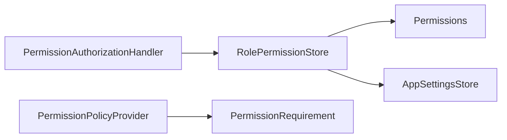

<!-- generated by docwizz: edits are overwritten -->
# src/Connector.Api/Authorization

Layer **api** · project `Connector.Api`

Project navigation: [Connector.Api](../projects/Connector-Api-4b7b11b2fa60.md)

## Overview 🤖

Manages authorization and permissions for the Connector API.

**Responsibilities.** Defines permission requirements, checks user permissions, and manages role-based permissions.

**Usage.** Used by the API endpoints to enforce permissions.

_AI draft from the facts on this page; review it, then write the module's documentation yourself._

## Key components

| Component | Kind | Used by | Summary |
|---|---|---|---|
| [RolePermissionStore](#rolepermissionstore) | class | 5 | What each non-Admin role may do, stored as one `RolePermissions` row ({ "User": ["exportJobs.view", ...] }) and cached in memory, since it is checked on nearly every request. The cache is dropped on every save, so an Admin's change applies to the next request rather than after the affected users' tokens expire. Singleton: reads go through a fresh scope's `ExportLogDbContext`. |
| [PermissionRequirement](#permissionrequirement) | class | 1 | Met when the user holds at least one of `AnyOf` (Admins hold all of them). |
| [Permissions](#permissions) | class | 1 | Everything a non-Admin role can be allowed to see and do, grouped by menu item. Admins always hold every permission, plus the admin-only areas that aren't grantable at all (Connect, Users, Permissions). The keys are stored in the database (`RolePermissionStore`), so renaming one silently revokes it. |
| [PermissionAuthorizationHandler](#permissionauthorizationhandler) | class | 0 | Checks a `PermissionRequirement` against the role claim that Program.cs's OnTokenValidated loads from the user table on every request. |
| [PermissionEndpointExtensions](#permissionendpointextensions) | class | 0 |  |
| [PermissionGroup](#permissiongroup) | record | 0 | The permissions belonging to one menu item. When the group has a .view permission, it decides whether the menu item is shown at all, and every other permission in the group implies it. |
| [PermissionInfo](#permissioninfo) | record | 0 | One grantable permission: its key (sent to and from the UI), a short label and what it allows. |
| [PermissionPolicyProvider](#permissionpolicyprovider) | class | 0 | Builds a policy for every perm:a\|b name on demand (see `PermissionEndpointExtensions`), so the endpoints don't need one registered policy per permission or combination of permissions. |

## Flows through this module

- `GET /api/auth/me`: RolePermissionStore → Permissions
- `POST /api/exports/{seqNo:int}/release`: AuditService, ExportLogDbContext, FourEyesReview → ErrorSanitizer, RolePermissionStore, SQLite, UserStore → Permissions
- `POST /api/import-runs/{id:int}/release`: AuditService, DataSourceProviderResolver, ExportLogDbContext, FourEyesReview, ImportRunEndpoints, ImportRunReleaser → AppSettingsStore, DynamicExportService, ErrorSanitizer, ImportConnection, ImportPlanJson, MariaDbDialect, +4 more → MariaDbDataSourceProvider, MeteredDataSourceProvider, Permissions, PostgreSqlDataSourceProvider → MariaDbConnectionFactory, PostgreSQL, ServiceNowTableApiProvider → MySQL
- `GET /api/settings/permissions`: RolePermissionStore → Permissions
- `PUT /api/settings/permissions`: AuditService, ExportLogDbContext, RolePermissionStore → AppSettingsStore, ErrorSanitizer, Permissions, SQLite

## Dependencies

Depends on: [src/Connector.Infrastructure](src-Connector.Infrastructure.md)

Used by: [src/Connector.Api/Endpoints](src-Connector.Api-Endpoints.md)

## Components

### PermissionAuthorizationHandler

_class_ · [PermissionAuthorization.cs](../../src/Connector.Api/Authorization/PermissionAuthorization.cs#L16)

Checks a `PermissionRequirement` against the role claim that Program.cs's OnTokenValidated loads from the user table on every request.

| Member | Summary | Derived from code | Complexity |
|---|---|---|---|
| [`HandleRequirementAsync(AuthorizationHandlerContext, Connector.Api.Authorization.PermissionRequirement)`](../../src/Connector.Api/Authorization/PermissionAuthorization.cs#L19) |  |  | 3 |

### PermissionEndpointExtensions

_class_ · [PermissionAuthorization.cs](../../src/Connector.Api/Authorization/PermissionAuthorization.cs#L56)

| Member | Summary | Derived from code | Complexity |
|---|---|---|---|
| [`RequirePermission<TBuilder>(TBuilder, params string[])`](../../src/Connector.Api/Authorization/PermissionAuthorization.cs#L62) | Requires at least one of `anyOf`; replaces a plain RequireAuthorization(). |  | 1 |
| [`RequireAdmin<TBuilder>(TBuilder)`](../../src/Connector.Api/Authorization/PermissionAuthorization.cs#L67) | Requires the Admin role. |  | 1 |
| [`AddPermissionAuthorization(IServiceCollection)`](../../src/Connector.Api/Authorization/PermissionAuthorization.cs#L71) | Registers the permission handler, the on-demand policy provider and `AdminPolicy`. |  | 1 |

### PermissionGroup

_record_ · [Permissions.cs](../../src/Connector.Api/Authorization/Permissions.cs#L8)

The permissions belonging to one menu item. When the group has a .view permission, it decides whether the menu item is shown at all, and every other permission in the group implies it.

### PermissionInfo

_record_ · [Permissions.cs](../../src/Connector.Api/Authorization/Permissions.cs#L4)

One grantable permission: its key (sent to and from the UI), a short label and what it allows.

### PermissionPolicyProvider

_class_ · [PermissionAuthorization.cs](../../src/Connector.Api/Authorization/PermissionAuthorization.cs#L34)

Builds a policy for every perm:a|b name on demand (see `PermissionEndpointExtensions`), so the endpoints don't need one registered policy per permission or combination of permissions.

| Member | Summary | Derived from code | Complexity |
|---|---|---|---|
| [`GetPolicyAsync(string)`](../../src/Connector.Api/Authorization/PermissionAuthorization.cs#L39) |  |  | 3 |

### PermissionRequirement

_class_ · [PermissionAuthorization.cs](../../src/Connector.Api/Authorization/PermissionAuthorization.cs#L9)

Met when the user holds at least one of `AnyOf` (Admins hold all of them).

### Permissions

_class_ · [Permissions.cs](../../src/Connector.Api/Authorization/Permissions.cs#L15)

Everything a non-Admin role can be allowed to see and do, grouped by menu item. Admins always hold every permission, plus the admin-only areas that aren't grantable at all (Connect, Users, Permissions). The keys are stored in the database (`RolePermissionStore`), so renaming one silently revokes it.

_Reached from:_ [`GET /api/auth/me`](../api.md#flows), [`POST /api/exports/{seqNo:int}/release`](../api.md#flows), [`POST /api/import-runs/{id:int}/release`](../api.md#flows), [`GET /api/settings/permissions`](../api.md#flows), [`PUT /api/settings/permissions`](../api.md#flows)

| Member | Summary | Derived from code | Complexity |
|---|---|---|---|
| [`Normalize(System.Collections.Generic.IEnumerable<string>)`](../../src/Connector.Api/Authorization/Permissions.cs#L149) | The effective set for `granted`: unknown keys are dropped (so a renamed or removed permission can't grant anything), and every permission adds its group's .view permission, since e.g. editing an export job you can't open makes no sense. |  | 3 |

### RolePermissionStore

_class_ · [RolePermissionStore.cs](../../src/Connector.Api/Authorization/RolePermissionStore.cs#L11)

What each non-Admin role may do, stored as one `RolePermissions` row ({ "User": ["exportJobs.view", ...] }) and cached in memory, since it is checked on nearly every request. The cache is dropped on every save, so an Admin's change applies to the next request rather than after the affected users' tokens expire. Singleton: reads go through a fresh scope's `ExportLogDbContext`.

_Reached from:_ [`GET /api/auth/me`](../api.md#flows), [`POST /api/exports/{seqNo:int}/release`](../api.md#flows), [`POST /api/import-runs/{id:int}/release`](../api.md#flows), [`GET /api/settings/permissions`](../api.md#flows), [`PUT /api/settings/permissions`](../api.md#flows) · _Linked tests:_ `FourEyesReviewTests.NewAsync`, `FourEyesReviewTests.ApproverGrantedReleasePermission_Accepted` (via `RolePermissionStore.SaveAsync(ExportLogDbContext, string, IEnumerable<string>)`) — test code that uses it, not coverage

| Member | Summary | Derived from code | Complexity |
|---|---|---|---|
| [`GetAsync(string?)`](../../src/Connector.Api/Authorization/RolePermissionStore.cs#L17) | The effective permissions of `role`: every permission for an Admin, the saved set (or `DefaultUserPermissions` before the first save) for a User, nothing otherwise. |  | 5 |
| [`HasAsync(string?, string)`](../../src/Connector.Api/Authorization/RolePermissionStore.cs#L28) |  |  | 1 |
| [`SaveAsync(Connector.Infrastructure.ExportLogDbContext, string, System.Collections.Generic.IEnumerable<string>)`](../../src/Connector.Api/Authorization/RolePermissionStore.cs#L32) | Replaces `role`'s permissions with the normalized `granted` set and returns it. |  | 2 |

---
_Generated from 20 symbols in [src/Connector.Api/Authorization/PermissionAuthorization.cs](../../src/Connector.Api/Authorization/PermissionAuthorization.cs), [src/Connector.Api/Authorization/Permissions.cs](../../src/Connector.Api/Authorization/Permissions.cs), [src/Connector.Api/Authorization/RolePermissionStore.cs](../../src/Connector.Api/Authorization/RolePermissionStore.cs) (commit `b3fcbdc`, profile `default`). Sections marked _fact_ are read from the code, _inferred_ come from heuristics, 🤖 marks AI drafts._
