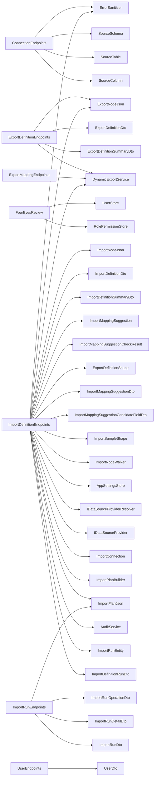

<!-- generated by docwizz: edits are overwritten -->
# src/Connector.Api/Endpoints

Layer **api** · project `Connector.Api` · API endpoints: 71

Project navigation: [Connector.Api](../projects/Connector-Api-4b7b11b2fa60.md)

## Overview 🤖

Contains HTTP endpoints for various system functionalities, including authentication, branding, connection management, and export definitions.

**Responsibilities.** Manages HTTP requests for authentication, branding, connection settings, and export definitions.

**Usage.** The frontend's API client calls these endpoints to interact with the system's various functionalities.

_AI draft from the facts on this page; review it, then write the module's documentation yourself._

## Key components

| Component | Kind | Used by | Summary |
|---|---|---|---|
| [ExportDefinitionEndpoints](#exportdefinitionendpoints) | class | 8 | CRUD, manual trigger, test, preview, and run history for `ExportDefinitionEntity`: the generic, named, tree-based replacement for the legacy single export mapping (see knowledge/pipeline/export-definitions-2.0.md). This is the surface an external program uses to configure a saved export once and trigger it later via a single authenticated POST — POST /api/export-definitions/{id}/run returns the built artifact bytes directly. Deliberately does not reuse `ExportRunEntity`/`FileSystemExportSink`/four-eyes release: those model the legacy CI-to-vendor staging contract (sequence numbers, physical staging folder, approval workflow), which don't apply to generic exports. A run here is synchronous request/response plus one `ExportDefinitionRunEntity` history row — no separate storage or delivery mechanism is introduced. |
| [ImportDefinitionEndpoints](#importdefinitionendpoints) | class | 8 | CRUD, preview, and run history for `ImportDefinitionEntity` — the API surface the frontend and any external caller use to configure an inbound mapping and inspect what it would do. The four-eyes commit/reject endpoints (POST /api/import-runs/{id}/release and .../reject) live in `ImportRunEndpoints`. This file (the route registrations) is the entry point; request validation lives in ImportDefinitionEndpoints.Validation.cs and entity/DTO mapping plus the "create from export" suggestion in ImportDefinitionEndpoints.Mapping.cs — split across files, kept as one `partial` class rather than separate classes so the `internal` methods each already exposes to Connector.Integration.Tests keep working unchanged. The two save-time guardrails are the primary safety boundary of the import feature: `ValidateRequestAsync` rejects a TargetColumn outside `AllowedWritableColumns`, one that doesn't exist on its table per the live introspected ERP schema, or one that's a primary key, identity/computed column, or foreign key — and rejects any node whose OnMissingChild is "insert" outright, since child-row creation is not supported. |
| [UserEndpoints](#userendpoints) | class | 4 | Admin-only user management (Settings → Users): list, create, change role or reset password, delete. The last Admin can be neither demoted nor deleted, and an Admin can't change their own role or delete themselves, so the UI can never lock every Admin out. Every change is audited. |
| [ImportRunEndpoints](#importrunendpoints) | class | 3 | The four-eyes commit path for a staged ImportRunEntity: read, release and reject. CRUD, preview, and run history for ImportDefinitionEntity live in ImportDefinitionEndpoints.cs; a run reaches `PendingReview` via ImportWorker or the stage endpoint. The actual commit/rollback/audit logic lives in `ImportRunReleaser`, not here, so it's testable without going through HTTP — this file only does request validation and status-code mapping. |
| [ConnectionEndpoints](#connectionendpoints) | class | 2 |  |
| [ExportMappingEndpoints](#exportmappingendpoints) | class | 2 |  |
| [FourEyesReview](#foureyesreview) | class | 2 | The Operator/Approver-distinctness check shared by every release endpoint that commits a change under four-eyes review — export release (`ExportEndpoints`) and the import commit path (`ImportRunEndpoints`). |
| [BrandingEndpoints](#brandingendpoints) | class | 1 |  |

## API

| Endpoint | Summary | Authorization |
|---|---|---|
| `GET /api/audit` | Returns the most recent N audit entries (default 100) ordered newest-first. | — |
| `POST /api/auth/change-password` | Self-service password change. Requires the current password, and signs the user out everywhere afterwards (this session included), so a session opened with the old password doesn't outlive it. | required |
| `POST /api/auth/hash` | Dev-only: returns a BCrypt hash for a plaintext password (to seed appsettings for production users). | — |
| `POST /api/auth/login` | Exchanges username/password for a signed JWT (HS256, Auth:JwtExpiryHours, default 8h) and audits the login. Unknown usernames still pay a BCrypt verify so timing doesn't reveal which accounts exist. | — |
| `GET /api/auth/me` | The caller's identity, role and effective permissions — what the UI uses to decide which menu items, routes and buttons to show. The server checks every permission again on each request regardless. | required |
| `POST /api/auth/revoke-my-sessions` | Self-service "log me out everywhere" — invalidates every JWT issued to the caller (including, after this response, the very token used to call it) before its own expiry. Deliberately scoped to the caller's own sessions only; see SessionRevocationStore's doc comment for why an admin-triggered "revoke someone else's session" action isn't included here. | required |
| `GET /api/branding` | Unauthenticated: the login screen, browser tab title, and favicon all need this before sign-in. | — |
| `PUT /api/branding` | Validates and stores the app name and logo/favicon/background images as size-capped base64 data URLs. An empty value clears that asset back to the default. Audited as branding_updated. | — |
| `GET /api/connection` | Returns the stored connection — never the password itself, only whether one is set (HasPassword). See knowledge/architecture/data-source-configuration.md. | — |
| `POST /api/connection` | Tests the connection, persists it on success, and returns the live source schema. | — |
| `GET /api/connection/status` | Whether a connection is configured, and to which system — without host, account or TLS details, which only Admins (who own the Connect page) see. The dashboard and the route guard use this for every user. | required |
| `GET /api/export-definitions` | Lists all export definitions, ordered by name, as summaries (no node tree). | — |
| `POST /api/export-definitions` | Creates a definition after validating its node tree (identifiers, filters, GDPR denylist) and the IntegrationKey/ContractVersion pair; starts at ConfigVersion 1. Audited. | — |
| `DELETE /api/export-definitions/{id:int}` | Deletes a definition. Audited. | — |
| `GET /api/export-definitions/{id:int}` | Returns one definition including its full node tree. | — |
| `PUT /api/export-definitions/{id:int}` | Replaces a definition after the same validation as create and bumps its ConfigVersion. Audited. | — |
| `POST /api/export-definitions/{id:int}/duplicate` | Copies a definition under a new name (default "\<name> (Copy)"). The copy starts disabled, unscheduled, at ConfigVersion 1 and without the IntegrationKey/ContractVersion pair. Audited. | — |
| `PATCH /api/export-definitions/{id:int}/enable` | Enables or disables a definition. Enabling is refused when another enabled definition already claims the same IntegrationKey/ContractVersion pair. Audited. | — |
| `POST /api/export-definitions/{id:int}/preview` | Runs the definition's tree against the configured source and returns up to 50 records, GDPR-denied fields removed. Records no run history; returns an empty preview when no connection is configured. | — |
| `POST /api/export-definitions/{id:int}/run` | Runs the definition in full and returns the built file directly, with X-Export-Run-Id, X-Record-Count and X-Config-Version headers. Records a run-history row and an audit entry, success or failure. | — |
| `POST /api/export-definitions/{id:int}/run-selected` | Explicit ID selection is parameterized and intersects with the saved root WHERE clause. | — |
| `GET /api/export-definitions/{id:int}/runs` | Returns the definition's latest 200 runs (test and real), newest first. | — |
| `POST /api/export-definitions/{id:int}/test` | Test run capped at 50 records (TestRunLimit): records a run-history row flagged IsTestRun and returns the run result, not the file. Audited. | — |
| `GET /api/export-mapping` | Returns the stored export mapping config, or 404 if none saved. | — |
| `PUT /api/export-mapping` | Validates and persists a full export mapping config. | — |
| `GET /api/export-mapping/presets` | Returns all saved presets as a name→config dictionary. | — |
| `DELETE /api/export-mapping/presets/{name}` | Deletes a single named preset. Returns 404 when the name does not exist. | — |
| `PUT /api/export-mapping/presets/{name}` | Creates or updates a single named preset. | — |
| `GET /api/exports` | Returns the run list with an IsStale flag so the UI can warn about long-pending runs. | — |
| `GET /api/exports/{seqNo:int}` | Returns full detail including a gap warning when the preceding run has not been released. | — |
| `POST /api/exports/{seqNo:int}/deliver` | Records that a Released run reached the vendor: who delivered it, the imported record count and optional notes (max 2,000 chars). Can only be recorded once per run. | — |
| `POST /api/exports/{seqNo:int}/release` | Four-eyes release: a second user's credentials must approve moving a Pending run to Released. 409 if the run is not Pending or was changed concurrently; rate-limited and audited. | — |
| `POST /api/exports/{seqNo:int}/skip` | Marks a Pending or Failed run as Skipped so it no longer blocks the sequence; the optional reason is written to the audit log. | — |
| `GET /api/gdpr-denied-fields` | Returns the currently active GDPR denylist (DB value if set, else defaults). | — |
| `PATCH /api/gdpr-denied-fields` | Replaces the GDPR denylist. Validates and stores as JSON in AppSetting. | — |
| `GET /api/health` | Checks the log DB connection and that the staging directory is writable; 200 "healthy" when both pass, otherwise 503 "degraded" with per-check flags. | — |
| `GET /api/import-definitions` | Lists all import definitions, ordered by name, as summaries (no node tree). | — |
| `POST /api/import-definitions` | Creates a definition after the save-time guardrails in ValidateRequestAsync (writable-column allowlist checked against the live ERP schema, no key/identity/computed/FK targets, no child inserts) and the IntegrationKey/ContractVersion pair check; starts at ConfigVersion 1. Audited. | — |
| `DELETE /api/import-definitions/{id:int}` | Deletes a definition. Audited. | — |
| `GET /api/import-definitions/{id:int}` | Returns one definition including its full node tree and writable-column allowlist. | — |
| `PUT /api/import-definitions/{id:int}` | Replaces a definition after the same validation as create and bumps its ConfigVersion. Audited. | — |
| `POST /api/import-definitions/{id:int}/duplicate` | Copies a definition under a new name (default "\<name> (Copy)"). The copy starts disabled at ConfigVersion 1 and without the IntegrationKey/ContractVersion pair. Audited. | — |
| `PATCH /api/import-definitions/{id:int}/enable` | Enables or disables a definition. Enabling is refused when another enabled definition already claims the same IntegrationKey/ContractVersion pair. Audited. | — |
| `POST /api/import-definitions/{id:int}/preview` | Parses + walks + plans an inbound file against a saved definition with zero persistence: no ImportRunEntity row is created and nothing is written to the ERP (mirrors ExportDefinitionEndpoints' own untracked preview). The operator supplies the file content directly. | — |
| `POST /api/import-definitions/{id:int}/records` | Stages one or more JSON records using the same canonical import, diff and approval path as /runs. | — |
| `GET /api/import-definitions/{id:int}/runs` | Returns the definition's latest 200 import runs, newest first, with their match/change/reject counts. | — |
| `POST /api/import-definitions/{id:int}/runs` | The UI's manual "Run" action (import-definitions/{id} page): stages an operator-selected file as a real ImportRunEntity at PendingReview, the same way ImportWorker's inbound/ folder watcher would — same walk/plan logic as .../preview above, but persisted so it goes through the normal four-eyes release/reject flow instead of being thrown away. No manifest/checksum file needed: the checksum is computed from the posted content itself, and (definitionId, checksum) still dedupes against a re-submit of the same file. | — |
| `POST /api/import-definitions/suggest-from-export` | The "Create from export" suggestion the New Import Definition flow offers. Takes the same sample ImportEnvelope JSON the preview panel already accepts and looks for an ExportDefinition whose provenance pair matches it. No persistence, no ERP connection — this only ever reads ExportDefinitions. Always 200 OK — a miss is a normal lookup outcome, never a 4xx — but unlike the pure ImportMappingSuggestion.SuggestFrom, a miss here always carries a `Reason` explaining which gate stopped it (malformed/no-provenance sample, no export tagged with that key/version, one tagged but disabled, or one tagged and enabled but missing CorrelationKeySourceField) instead of a flat null, so the operator isn't left guessing why a provenance-carrying paste "wasn't recognized." | — |
| `GET /api/import-runs/{id:int}` | The frontend's review/diff view needs a run's full plan before an Approver can meaningfully decide anything — GET .../{id}/runs on ImportDefinitionEndpoints only returns the summary counts. This is a plain read, so unlike release/reject it's not restricted to PendingReview runs: revisiting a Released/Rejected/Failed run's plan after the fact is useful too, and costs nothing extra here. | — |
| `POST /api/import-runs/{id:int}/reject` | Discards a PendingReview run without writing anything to the target (no second approver needed). | — |
| `POST /api/import-runs/{id:int}/release` | Four-eyes commit of a PendingReview run: a second user's credentials must approve, then ImportRunReleaser writes the staged plan to the target. 500 with the error if the commit fails. | — |
| `GET /api/pipeline/preview` | Returns up to 50 records of what the saved export mapping would produce, nested or flat to match a JSON export, with GDPR-denied fields removed. Errors are reported in the body (status "error"), not as HTTP failures, so the mapping screen can show them inline. | — |
| `POST /api/pipeline/run` | "Run Now": builds the saved Step-3 export mapping (?format=json\|csv\|xlsx, default json), writes the package to the staging folder and records it as the next Pending ExportRun awaiting four-eyes release. Fails the run (400) when no mapping/connection is configured or the query returns 0 records. | — |
| `POST /api/pipeline/run/{name}` | Runs a named Step-3 preset (Save As…) and returns the built file directly in the response — the synchronous, external-system-friendly counterpart to /api/pipeline/run above. Unlike that endpoint this does NOT create an ExportRun, does not write to the staging folder, and is not subject to Four-Eyes Release: those model the legacy CI-to-vendor delivery contract specifically (see knowledge/operations/four-eyes-release.md), which a generic API-triggered pull is out of scope for — same reasoning ExportDefinitionEndpoints' /run already applies. Every call still writes one audit log entry (success or failure), so triggering is never silent. This is a deliberate exception to four-eyes, so it must only be reachable by a dedicated machine caller, never by a logged-in human's interactive session: ApiKey-only (X-Api-Key header, see ApiKeyAuthenticationHandler) — a JWT from a normal user login does not authenticate here. The frontend never calls this route (it uses the four-eyes-gated /api/pipeline/run instead). | required |
| `GET /api/schema` | Returns the fixed ICD export column contract (column, source, type, notes) with its schema version. | — |
| `GET /api/settings/instance` | This connector's identity as stamped into every export manifest (Producer): application, version and instance ID. Authenticated, unlike GET /api/version — the instance ID stays out of the login screen. | — |
| `POST /api/settings/instance/regenerate` | Gives this installation a new instance ID, for one set up from a copy of another's database (#233). The paired instance then sees a new producer ID; the old ID is kept so this installation's earlier exports are still rejected as its own. | — |
| `GET /api/settings/manifest-signing` | List manifest pairing policy and trusted instance IDs without secrets. | — |
| `DELETE /api/settings/manifest-signing/peers/{instanceId}` | Remove a trusted connector instance and its signing key. | — |
| `PUT /api/settings/manifest-signing/peers/{instanceId}` | Register or rotate a shared secret for a trusted connector instance. | — |
| `PUT /api/settings/manifest-signing/policy` | Require authenticated connector manifests for paired imports. | — |
| `GET /api/settings/permissions` | The grantable permissions, grouped by menu item, and the User role's current set. | — |
| `PUT /api/settings/permissions` | Replaces the User role's permissions. Unknown keys are dropped and each permission adds its menu item's "view" permission (Permissions.Normalize); the stored result is returned. Applies to the next request. | — |
| `GET /api/settings/scheduler` | Returns the effective scheduler config: DB value if saved, else appsettings defaults. | — |
| `PUT /api/settings/scheduler` | Validates and persists the scheduler config. Takes effect on the worker's next sleep cycle. | — |
| `GET /api/source-schema` | Returns schema from the persisted Postgres connection when one is configured, falling back to the hardcoded demo schema only when no connection has been stored yet. A stored connection that fails to introspect is reported as an error rather than silently substituting the demo schema, so a mapping can't be built against demo-only tables (e.g. "masterdata") that don't exist in the real database. | — |
| `GET /api/users` | Every user and their role, in username order. Password hashes never leave the server. | — |
| `POST /api/users` | Creates a user. 409 when the username (compared case-insensitively) is taken. | — |
| `DELETE /api/users/{username}` | Deletes a user; their open sessions stop working on their next request. Their audit entries stay. | — |
| `PUT /api/users/{username}` | Changes a user's role and/or resets their password. A password reset signs that user out everywhere. | — |
| `GET /api/version` | Unauthenticated — the login screen shows it so a deployment can be verified before sign-in. | — |

Contracts and callers: [API](../api.md).

## Data and persistence

- `DELETE /api/export-definitions/{id:int}`, `DELETE /api/export-mapping/presets/{name}`, `DELETE /api/import-definitions/{id:int}`, `DELETE /api/settings/manifest-signing/peers/{instanceId}`, `DELETE /api/users/{username}`, `GET /api/audit`, `GET /api/branding`, `GET /api/connection`, `GET /api/connection/status`, `GET /api/export-definitions`, `GET /api/export-definitions/{id:int}`, `GET /api/export-definitions/{id:int}/runs`, `GET /api/export-mapping`, `GET /api/export-mapping/presets`, `GET /api/exports`, `GET /api/exports/{seqNo:int}`, `GET /api/gdpr-denied-fields`, `GET /api/health`, `GET /api/import-definitions`, `GET /api/import-definitions/{id:int}`, `GET /api/import-definitions/{id:int}/runs`, `GET /api/import-runs/{id:int}`, `GET /api/pipeline/preview`, `GET /api/settings/instance`, `GET /api/settings/manifest-signing`, `GET /api/settings/scheduler`, `GET /api/source-schema`, `GET /api/users`, `PATCH /api/export-definitions/{id:int}/enable`, `PATCH /api/gdpr-denied-fields`, `PATCH /api/import-definitions/{id:int}/enable`, `POST /api/auth/change-password`, `POST /api/auth/login`, `POST /api/auth/revoke-my-sessions`, `POST /api/connection`, `POST /api/export-definitions`, `POST /api/export-definitions/{id:int}/duplicate`, `POST /api/export-definitions/{id:int}/preview`, `POST /api/export-definitions/{id:int}/run`, `POST /api/export-definitions/{id:int}/run-selected`, `POST /api/export-definitions/{id:int}/test`, `POST /api/exports/{seqNo:int}/deliver`, `POST /api/exports/{seqNo:int}/release`, `POST /api/exports/{seqNo:int}/skip`, `POST /api/import-definitions`, `POST /api/import-definitions/{id:int}/duplicate`, `POST /api/import-definitions/{id:int}/preview`, `POST /api/import-definitions/{id:int}/records`, `POST /api/import-definitions/{id:int}/runs`, `POST /api/import-definitions/suggest-from-export`, `POST /api/import-runs/{id:int}/reject`, `POST /api/import-runs/{id:int}/release`, `POST /api/pipeline/run`, `POST /api/pipeline/run/{name}`, `POST /api/settings/instance/regenerate`, `POST /api/users`, `PUT /api/branding`, `PUT /api/export-definitions/{id:int}`, `PUT /api/export-mapping`, `PUT /api/export-mapping/presets/{name}`, `PUT /api/import-definitions/{id:int}`, `PUT /api/settings/manifest-signing/peers/{instanceId}`, `PUT /api/settings/manifest-signing/policy`, `PUT /api/settings/permissions`, `PUT /api/settings/scheduler`, `PUT /api/users/{username}` use `ExportLogDbContext`

## External systems

- File system (storage, detected) — used by `HealthEndpoints`

See [system context](../views/context.md).

## Configuration

| Key | Read by | Status |
|---|---|---|
| `Auth:JwtExpiryHours` | AuthEndpoints | detected: defined and read |
| `Auth:JwtSecret` | AuthEndpoints, Connector.Api | detected: defined and read |

All keys: [deployment](../views/deployment.md#configuration).

## Flows through this module

- `/` → DashboardView → canOpen, Card, ConnectionStatusCard, HelpTooltip, Icon, listExportDefinitions, +3 more → authHeaders, GET /api/export-definitions, GET /api/import-definitions, getConnection, getConnectionStatus → GET /api/connection, GET /api/connection/status
- `/connect` → ConnectionView → Alert, Button, clearSession, ConnectionTlsSelect, emptyForm, formFromStored, +15 more → authHeaders, FieldShell, GET /api/connection, POST /api/connection
- `/export-definitions` → ExportDefinitionsView → Alert, Button, deleteExportDefinition, duplicateExportDefinition, EmptyState, HelpTooltip, +9 more → authHeaders, ConfirmAction, DELETE /api/export-definitions/{id:int}, GET /api/export-definitions, GET /api/export-definitions/{id:int}/runs, Icon, +3 more
- `/export-definitions/:id` → ExportDefinitionEditView → Alert, BackLink, blankRootNode, Button, columnsAsDisabledScalarFields, createExportDefinition, +13 more → authHeaders, blankFieldMapping, ConfirmAction, deleteExportDefinition, duplicateExportDefinition, ExportFormatPicker, +16 more → DELETE /api/export-definitions/{id:int}, POST /api/export-definitions/{id:int}/duplicate, POST /api/export-definitions/{id:int}/run, POST /api/export-definitions/{id:int}/test, PUT /api/export-definitions/{id:int}
- `/export-schema` → SchemaView → Alert, Button, ColumnMappingTable, ExportFormatPicker, findSuggestedRelations, getExportMapping, +12 more → authHeaders, deletePreset, FlatPreviewTable, GET /api/export-mapping, GET /api/pipeline/preview, GET /api/source-schema, +9 more → DELETE /api/export-mapping/presets/{name}, GET /api/export-mapping/presets, NestedGroupEditor, PUT /api/export-mapping/presets/{name}, RelationCard → FieldPickerTable, IssuesAlert
- `/exports` → ExportView → ActiveMappingSummary, Alert, Button, ExportRunsTable, getExportMapping, getPreview, +8 more → authHeaders, FlatPreviewTable, GET /api/export-mapping, GET /api/exports, GET /api/pipeline/preview, NestedPreviewList, +1 more
- `/exports/:seqNo` → ExportDetail → Alert, BackLink, DeliverRunForm, getExport, HelpTooltip, Icon, +6 more → Button, Card, deliverExport, GET /api/exports/{seqNo:int}, getUsername, Input, +5 more → FieldShell, POST /api/exports/{seqNo:int}/deliver, POST /api/exports/{seqNo:int}/release, POST /api/exports/{seqNo:int}/skip
- `/icd-schema` → IcdSchemaView → Alert, getSchema, HelpTooltip, IcdActiveColumnsTable, IcdExcludedFieldsList, PageHeader → authHeaders, GET /api/schema, Icon
- … 73 more in [API](../api.md#flows) and [frontend](../frontend.md#flows)

## Documentation gaps

1 items need documentation (0 critical):

- medium: `ImportDefinitionEndpoints.StageImportAsync(int, string, string?, HttpContext, ExportLogDbContext, AuditService, IDataSourceProviderResolver, CancellationToken, ImportDefinitionEntity?)` — missing summary (complexity 11; 9 params; side effects: db)

## Architecture observations

- 7 members have cyclomatic complexity ≥ 15 (many paths to test and explain): `ImportDefinitionEndpoints.ValidateRequestAsync(ImportDefinitionRequest, ExportLogDbContext, IDataSourceProviderResolver, CancellationToken, int?)` (30), `ExportDefinitionEndpoints.ValidateRequestAsync(ExportDefinitionRequest, ExportLogDbContext, CancellationToken, int?)` (28), `ExportMappingEndpoints.ValidateNestedGroup(ExportMappingNestedGroup, IReadOnlySet<string>, string, int)` (25), `ExportDefinitionEndpoints.ValidateNode(ExportNode, IReadOnlySet<string>, string, int)` (23), `ImportDefinitionEndpoints.ValidateNode(ImportNode, ImportNode, string, string, int, List<(string Table, string Column, string Path)>)` (23), … see [quality](../quality.md)
- `ImportDefinitionEndpoints` depends on 22 other components — high coupling, possibly several responsibilities
- `DELETE /api/export-definitions/{id:int}`, `DELETE /api/export-mapping/presets/{name}`, `DELETE /api/import-definitions/{id:int}`, `DELETE /api/settings/manifest-signing/peers/{instanceId}`, `DELETE /api/users/{username}`, `GET /api/audit`, `GET /api/branding`, `GET /api/connection`, `GET /api/connection/status`, `GET /api/export-definitions`, `GET /api/export-definitions/{id:int}`, `GET /api/export-definitions/{id:int}/runs`, `GET /api/export-mapping`, `GET /api/export-mapping/presets`, `GET /api/exports`, `GET /api/exports/{seqNo:int}`, `GET /api/gdpr-denied-fields`, `GET /api/health`, `GET /api/import-definitions`, `GET /api/import-definitions/{id:int}`, `GET /api/import-definitions/{id:int}/runs`, `GET /api/import-runs/{id:int}`, `GET /api/pipeline/preview`, `GET /api/settings/instance`, `GET /api/settings/manifest-signing`, `GET /api/settings/scheduler`, `GET /api/source-schema`, `GET /api/users`, `PATCH /api/export-definitions/{id:int}/enable`, `PATCH /api/gdpr-denied-fields`, `PATCH /api/import-definitions/{id:int}/enable`, `POST /api/auth/change-password`, `POST /api/auth/login`, `POST /api/auth/revoke-my-sessions`, `POST /api/connection`, `POST /api/export-definitions`, `POST /api/export-definitions/{id:int}/duplicate`, `POST /api/export-definitions/{id:int}/preview`, `POST /api/export-definitions/{id:int}/run`, `POST /api/export-definitions/{id:int}/run-selected`, `POST /api/export-definitions/{id:int}/test`, `POST /api/exports/{seqNo:int}/deliver`, `POST /api/exports/{seqNo:int}/release`, `POST /api/exports/{seqNo:int}/skip`, `POST /api/import-definitions`, `POST /api/import-definitions/{id:int}/duplicate`, `POST /api/import-definitions/{id:int}/preview`, `POST /api/import-definitions/{id:int}/records`, `POST /api/import-definitions/{id:int}/runs`, `POST /api/import-definitions/suggest-from-export`, `POST /api/import-runs/{id:int}/reject`, `POST /api/import-runs/{id:int}/release`, `POST /api/pipeline/run`, `POST /api/pipeline/run/{name}`, `POST /api/settings/instance/regenerate`, `POST /api/users`, `PUT /api/branding`, `PUT /api/export-definitions/{id:int}`, `PUT /api/export-mapping`, `PUT /api/export-mapping/presets/{name}`, `PUT /api/import-definitions/{id:int}`, `PUT /api/settings/manifest-signing/peers/{instanceId}`, `PUT /api/settings/manifest-signing/policy`, `PUT /api/settings/permissions`, `PUT /api/settings/scheduler`, `PUT /api/users/{username}` use `ExportLogDbContext` directly from the api layer — data access bypasses the application layer

## Dependencies

Depends on: [src/Connector.Api](src-Connector.Api.md), [src/Connector.Api/Authorization](src-Connector.Api-Authorization.md), [src/Connector.Core/DataSources](src-Connector.Core-DataSources.md), [src/Connector.Core/DynamicExport](src-Connector.Core-DynamicExport.md), [src/Connector.Core/DynamicImport](src-Connector.Core-DynamicImport.md), [src/Connector.Infrastructure](src-Connector.Infrastructure.md), [src/Connector.Infrastructure/DataSources](src-Connector.Infrastructure-DataSources.md)

Used by: [src/Connector.Api/Endpoints](src-Connector.Api-Endpoints.md)

## Components

### AuthEndpoints

_class_ · [AuthEndpoints.cs](../../src/Connector.Api/Endpoints/AuthEndpoints.cs#L10)

_Configuration:_ [`Auth:JwtExpiryHours`](../views/deployment.md#configuration), [`Auth:JwtSecret`](../views/deployment.md#configuration)

| Member | Summary | Derived from code | Complexity |
|---|---|---|---|
| [`MapAuthEndpoints(WebApplication)`](../../src/Connector.Api/Endpoints/AuthEndpoints.cs#L21) |  |  | 2 |

### BrandingEndpoints

_class_ · [BrandingEndpoints.cs](../../src/Connector.Api/Endpoints/BrandingEndpoints.cs#L7)

_Reached from:_ [`PUT /api/branding`](../api.md#flows)

| Member | Summary | Derived from code | Complexity |
|---|---|---|---|
| [`MapBrandingEndpoints(WebApplication)`](../../src/Connector.Api/Endpoints/BrandingEndpoints.cs#L14) |  |  | 1 |

### ConnectionEndpoints

_class_ · [ConnectionEndpoints.cs](../../src/Connector.Api/Endpoints/ConnectionEndpoints.cs#L10)

_Reached from:_ [`POST /api/connection`](../api.md#flows), [`GET /api/source-schema`](../api.md#flows) · _Linked tests:_ `ConnectionEndpointsHostValidationTests.BlockedMetadataAddress_Rejected` (via `ConnectionEndpoints.ValidateHostAsync(string, CancellationToken)`), `ConnectionEndpointsHostValidationTests.OrdinaryPrivateAddress_Allowed` (via `ConnectionEndpoints.ValidateHostAsync(string, CancellationToken)`), `ConnectionEndpointsPasswordRetentionTests.EmptyPassword_ChangedTarget_DoesNotReuseStoredPassword` (via `ConnectionEndpoints.WithStoredPasswordIfUnchanged(DataSourceConfig, DataSourceConfig?)`), `ConnectionEndpointsPasswordRetentionTests.EmptyPassword_NothingStored_StaysEmpty` (via `ConnectionEndpoints.WithStoredPasswordIfUnchanged(DataSourceConfig, DataSourceConfig?)`), `ConnectionEndpointsPasswordRetentionTests.EmptyPassword_SameTarget_KeepsStoredPassword` (via `ConnectionEndpoints.WithStoredPasswordIfUnchanged(DataSourceConfig, DataSourceConfig?)`), `ConnectionEndpointsPasswordRetentionTests.NewPassword_Wins` (via `ConnectionEndpoints.WithStoredPasswordIfUnchanged(DataSourceConfig, DataSourceConfig?)`), `TransportSecurityTests.AllowUnencrypted_DefaultsToFalseOnlyInProduction` (via `ConnectionEndpoints.AllowUnencryptedConnections(IConfiguration, IHostEnvironment)`) — test code that uses it, not coverage

| Member | Summary | Derived from code | Complexity |
|---|---|---|---|
| [`WithStoredPasswordIfUnchanged(Connector.Core.DataSources.DataSourceConfig, Connector.Core.DataSources.DataSourceConfig?)`](../../src/Connector.Api/Endpoints/ConnectionEndpoints.cs#L28) |  |  | 9 |
| [`ValidateHostAsync(string, System.Threading.CancellationToken)`](../../src/Connector.Api/Endpoints/ConnectionEndpoints.cs#L46) |  |  | 6 |
| [`AllowUnencryptedConnections(IConfiguration, IHostEnvironment)`](../../src/Connector.Api/Endpoints/ConnectionEndpoints.cs#L71) |  |  | 2 |
| [`MapConnectionEndpoints(WebApplication)`](../../src/Connector.Api/Endpoints/ConnectionEndpoints.cs#L74) |  |  | 1 |
| [`DemoSourceSchema()`](../../src/Connector.Api/Endpoints/ConnectionEndpoints.cs#L212) |  |  | 1 |

### ExportDefinitionEndpoints

_class_ · [ExportDefinitionEndpoints.cs](../../src/Connector.Api/Endpoints/ExportDefinitionEndpoints.cs#L27)

CRUD, manual trigger, test, preview, and run history for `ExportDefinitionEntity`: the generic, named, tree-based replacement for the legacy single export mapping (see knowledge/pipeline/export-definitions-2.0.md). This is the surface an external program uses to configure a saved export once and trigger it later via a single authenticated POST — POST /api/export-definitions/{id}/run returns the built artifact bytes directly. Deliberately does not reuse `ExportRunEntity`/`FileSystemExportSink`/four-eyes release: those model the legacy CI-to-vendor staging contract (sequence numbers, physical staging folder, approval workflow), which don't apply to generic exports. A run here is synchronous request/response plus one `ExportDefinitionRunEntity` history row — no separate storage or delivery mechanism is introduced.

_Reached from:_ [`POST /api/export-definitions`](../api.md#flows), [`GET /api/export-definitions/{id:int}`](../api.md#flows), [`PUT /api/export-definitions/{id:int}`](../api.md#flows), [`POST /api/export-definitions/{id:int}/duplicate`](../api.md#flows), [`PATCH /api/export-definitions/{id:int}/enable`](../api.md#flows), [`POST /api/export-definitions/{id:int}/run`](../api.md#flows), [`POST /api/export-definitions/{id:int}/run-selected`](../api.md#flows), [`POST /api/export-definitions/{id:int}/test`](../api.md#flows) · _Linked tests:_ `ConnectorImportEnvelopeTests.ValidateRequestAsync_TargetImportDefinition` (via `ExportDefinitionEndpoints.ValidateRequestAsync(ExportDefinitionRequest, ExportLogDbContext, CancellationToken, int?)`), `ExportFilterValidationTests.Export_SafeRootFilter_Accepted` (via `ExportDefinitionEndpoints.ValidateRequestAsync(ExportDefinitionRequest, ExportLogDbContext, CancellationToken, int?)`), `ExportFilterValidationTests.Export_UnsafeNestedNodeFilter_Rejected` (via `ExportDefinitionEndpoints.ValidateRequestAsync(ExportDefinitionRequest, ExportLogDbContext, CancellationToken, int?)`), `ExportFilterValidationTests.Export_UnsafeRootFilter_Rejected` (via `ExportDefinitionEndpoints.ValidateRequestAsync(ExportDefinitionRequest, ExportLogDbContext, CancellationToken, int?)`), `IntegrationKeyValidationTests.Export_ContractVersionWithoutIntegrationKey_Rejected` (via `ExportDefinitionEndpoints.ValidateRequestAsync(ExportDefinitionRequest, ExportLogDbContext, CancellationToken, int?)`), `IntegrationKeyValidationTests.Export_CorrelationKeySourceFieldNotAnIdentifier_Rejected` (via `ExportDefinitionEndpoints.ValidateRequestAsync(ExportDefinitionRequest, ExportLogDbContext, CancellationToken, int?)`), `IntegrationKeyValidationTests.Export_IntegrationKeyWithoutContractVersion_Rejected` (via `ExportDefinitionEndpoints.ValidateRequestAsync(ExportDefinitionRequest, ExportLogDbContext, CancellationToken, int?)`), `IntegrationKeyValidationTests.Export_SamePairOnADisabledDefinition_DoesNotConflict` (via `ExportDefinitionEndpoints.ValidateRequestAsync(ExportDefinitionRequest, ExportLogDbContext, CancellationToken, int?)`), +2 more — test code that uses it, not coverage

| Member | Summary | Derived from code | Complexity |
|---|---|---|---|
| [`MapExportDefinitionEndpoints(WebApplication)`](../../src/Connector.Api/Endpoints/ExportDefinitionEndpoints.cs#L33) |  |  | 1 |
| [`ValidateRequestAsync(Connector.Api.ExportDefinitionRequest, Connector.Infrastructure.ExportLogDbContext, System.Threading.CancellationToken, int?)`](../../src/Connector.Api/Endpoints/ExportDefinitionEndpoints.cs#L678) | Validates a create/update request: name, root table, output format, cron schedule, the IntegrationKey/ContractVersion pair (including uniqueness among enabled definitions), the root filter and the whole node tree via ValidateNode. Returns the normalized RootNode on success (null on failure) alongside the error, so callers store exactly the tree that was validated instead of re-normalizing (or re-validating null-prone raw input) a second time. `internal` rather than `private` so Connector.Integration.Tests can exercise the IntegrationKey/ContractVersion save-time guardrails directly, mirroring ImportDefinitionEndpoints.ValidateRequestAsync's own visibility. |  | 28 |

### ExportEndpoints

_class_ · [ExportEndpoints.cs](../../src/Connector.Api/Endpoints/ExportEndpoints.cs#L7)

| Member | Summary | Derived from code | Complexity |
|---|---|---|---|
| [`MapExportEndpoints(WebApplication)`](../../src/Connector.Api/Endpoints/ExportEndpoints.cs#L9) |  |  | 1 |

### ExportMappingEndpoints

_class_ · [ExportMappingEndpoints.cs](../../src/Connector.Api/Endpoints/ExportMappingEndpoints.cs#L16)

_Reached from:_ [`PUT /api/export-mapping`](../api.md#flows), [`PUT /api/export-mapping/presets/{name}`](../api.md#flows)

| Member | Summary | Derived from code | Complexity |
|---|---|---|---|
| [`MapExportMappingEndpoints(WebApplication)`](../../src/Connector.Api/Endpoints/ExportMappingEndpoints.cs#L18) |  |  | 1 |

### FourEyesReview

_class_ · [FourEyesReview.cs](../../src/Connector.Api/Endpoints/FourEyesReview.cs#L11)

The Operator/Approver-distinctness check shared by every release endpoint that commits a change under four-eyes review — export release (`ExportEndpoints`) and the import commit path (`ImportRunEndpoints`).

_Reached from:_ [`POST /api/exports/{seqNo:int}/release`](../api.md#flows), [`POST /api/import-runs/{id:int}/release`](../api.md#flows) · _Linked tests:_ `FourEyesReviewTests.ValidateAsync` (via `FourEyesReview.ValidateApproverAsync(string, string?, string?, string, ExportLogDbContext, RolePermissionStore)`) — test code that uses it, not coverage

| Member | Summary | Derived from code | Complexity |
|---|---|---|---|
| [`ValidateApproverAsync(string, string?, string?, string, Connector.Infrastructure.ExportLogDbContext, Connector.Api.Authorization.RolePermissionStore)`](../../src/Connector.Api/Endpoints/FourEyesReview.cs#L26) | Returns a client-facing error message if `approver` fails the four-eyes check against `operatorName`, or null if it passes. `approverPassword` is verified against the approver's own stored hash — without this, the operator's session alone could "approve" a release by typing any other registered username, which defeats the point of a dual-control check. Requiring their password here is a lightweight stand-in for a real second login. The approver must also hold `releasePermission` themselves — the operator's own is checked by the endpoint's policy. |  | 7 |

### HealthEndpoints

_class_ · [HealthEndpoints.cs](../../src/Connector.Api/Endpoints/HealthEndpoints.cs#L8)

_Reached from:_ [`GET /api/health`](../api.md#flows)

| Member | Summary | Derived from code | Complexity |
|---|---|---|---|
| [`MapHealthEndpoints(WebApplication)`](../../src/Connector.Api/Endpoints/HealthEndpoints.cs#L10) |  |  | 1 |

### ImportDefinitionEndpoints

_class_ · [ImportDefinitionEndpoints.Mapping.cs](../../src/Connector.Api/Endpoints/ImportDefinitionEndpoints.Mapping.cs#L12)

CRUD, preview, and run history for `ImportDefinitionEntity` — the API surface the frontend and any external caller use to configure an inbound mapping and inspect what it would do. The four-eyes commit/reject endpoints (POST /api/import-runs/{id}/release and .../reject) live in `ImportRunEndpoints`. This file (the route registrations) is the entry point; request validation lives in ImportDefinitionEndpoints.Validation.cs and entity/DTO mapping plus the "create from export" suggestion in ImportDefinitionEndpoints.Mapping.cs — split across files, kept as one `partial` class rather than separate classes so the `internal` methods each already exposes to Connector.Integration.Tests keep working unchanged. The two save-time guardrails are the primary safety boundary of the import feature: `ValidateRequestAsync` rejects a TargetColumn outside `AllowedWritableColumns`, one that doesn't exist on its table per the live introspected ERP schema, or one that's a primary key, identity/computed column, or foreign key — and rejects any node whose OnMissingChild is "insert" outright, since child-row creation is not supported.

_Reached from:_ [`POST /api/import-definitions`](../api.md#flows), [`GET /api/import-definitions/{id:int}`](../api.md#flows), [`PUT /api/import-definitions/{id:int}`](../api.md#flows), [`POST /api/import-definitions/{id:int}/duplicate`](../api.md#flows), [`PATCH /api/import-definitions/{id:int}/enable`](../api.md#flows), [`POST /api/import-definitions/{id:int}/records`](../api.md#flows), [`POST /api/import-definitions/{id:int}/runs`](../api.md#flows), [`POST /api/import-definitions/suggest-from-export`](../api.md#flows) · _Linked tests:_ `ImportDefinitionEndpointsPostgresTests.ValidateRequestAsync_AllowedWritableColumnsListsGdprDeniedField_RejectsBeforeTouchingTheErp` (via `ImportDefinitionEndpoints.ValidateRequestAsync(ImportDefinitionRequest, ExportLogDbContext, IDataSourceProviderResolver, CancellationToken, int?)`), `ImportDefinitionEndpointsPostgresTests.ValidateRequestAsync_ColumnDoesNotExistOnTable_RejectsWithSpecificError` (via `ImportDefinitionEndpoints.ValidateRequestAsync(ImportDefinitionRequest, ExportLogDbContext, IDataSourceProviderResolver, CancellationToken, int?)`), `ImportDefinitionEndpointsPostgresTests.ValidateRequestAsync_ColumnNotInAllowedWritableColumns_RejectsAsOutOfScope` (via `ImportDefinitionEndpoints.ValidateRequestAsync(ImportDefinitionRequest, ExportLogDbContext, IDataSourceProviderResolver, CancellationToken, int?)`), `ImportDefinitionEndpointsPostgresTests.ValidateRequestAsync_InsertPolicyWithRequiredColumnsCovered_Succeeds` (via `ImportDefinitionEndpoints.ValidateRequestAsync(ImportDefinitionRequest, ExportLogDbContext, IDataSourceProviderResolver, CancellationToken, int?)`), `ImportDefinitionEndpointsPostgresTests.ValidateRequestAsync_InsertPolicyWithUnmappedRequiredColumns_RejectsNamingThem` (via `ImportDefinitionEndpoints.ValidateRequestAsync(ImportDefinitionRequest, ExportLogDbContext, IDataSourceProviderResolver, CancellationToken, int?)`), `ImportDefinitionEndpointsPostgresTests.ValidateRequestAsync_OnMissingChildInsert_RejectsWithoutTouchingTheErp` (via `ImportDefinitionEndpoints.ValidateRequestAsync(ImportDefinitionRequest, ExportLogDbContext, IDataSourceProviderResolver, CancellationToken, int?)`), `ImportDefinitionEndpointsPostgresTests.ValidateRequestAsync_TargetIsForeignKey_Rejects` (via `ImportDefinitionEndpoints.ValidateRequestAsync(ImportDefinitionRequest, ExportLogDbContext, IDataSourceProviderResolver, CancellationToken, int?)`), `ImportDefinitionEndpointsPostgresTests.ValidateRequestAsync_TargetIsGeneratedColumn_Rejects` (via `ImportDefinitionEndpoints.ValidateRequestAsync(ImportDefinitionRequest, ExportLogDbContext, IDataSourceProviderResolver, CancellationToken, int?)`), +15 more — test code that uses it, not coverage

| Member | Summary | Derived from code | Complexity |
|---|---|---|---|
| [`ValidateRequestAsync(Connector.Api.ImportDefinitionRequest, Connector.Infrastructure.ExportLogDbContext, Connector.Core.DataSources.IDataSourceProviderResolver, System.Threading.CancellationToken, int?)`](../../src/Connector.Api/Endpoints/ImportDefinitionEndpoints.Validation.cs#L32) | Validates a create/update request end to end and returns the normalized `ImportNode` tree to persist. `internal` rather than `private` so Connector.Integration.Tests can exercise the schema-aware AllowedWritableColumns check directly against a real Postgres schema, asserting each specific rejection reason rather than just that *some* 400 comes back. |  | 30 |
| [`MapImportDefinitionEndpoints(WebApplication)`](../../src/Connector.Api/Endpoints/ImportDefinitionEndpoints.cs#L33) |  |  | 1 |
| [`BuildSuggestionAsync(string, Connector.Infrastructure.ExportLogDbContext, System.Threading.CancellationToken)`](../../src/Connector.Api/Endpoints/ImportDefinitionEndpoints.Mapping.cs#L57) | Loads every provenance-tagged `ExportDefinitionEntity` — enabled or not, so a disabled match can be named specifically rather than folded into "nothing matches" — extracts the sample's provenance pair and first record's field names from `inboundJson`, and delegates to `Evaluate`. `internal` (rather than `private`) so a unit test can exercise it directly against the in-memory Sqlite LocalDb fixture — this never opens an ERP connection, unlike `ValidateRequestAsync`, so it needs no Postgres testdb. |  | 20 |
| [`ValidateIntegrationKeyPairEnabledAsync(Connector.Infrastructure.ExportLogDbContext, string?, int?, int?, System.Threading.CancellationToken)`](../../src/Connector.Api/Endpoints/ImportDefinitionEndpoints.Validation.cs#L326) |  |  | 7 |

### ImportRunEndpoints

_class_ · [ImportRunEndpoints.cs](../../src/Connector.Api/Endpoints/ImportRunEndpoints.cs#L17)

The four-eyes commit path for a staged ImportRunEntity: read, release and reject. CRUD, preview, and run history for ImportDefinitionEntity live in ImportDefinitionEndpoints.cs; a run reaches `PendingReview` via ImportWorker or the stage endpoint. The actual commit/rollback/audit logic lives in `ImportRunReleaser`, not here, so it's testable without going through HTTP — this file only does request validation and status-code mapping.

_Reached from:_ [`GET /api/import-runs/{id:int}`](../api.md#flows), [`POST /api/import-runs/{id:int}/reject`](../api.md#flows), [`POST /api/import-runs/{id:int}/release`](../api.md#flows)

| Member | Summary | Derived from code | Complexity |
|---|---|---|---|
| [`MapImportRunEndpoints(WebApplication)`](../../src/Connector.Api/Endpoints/ImportRunEndpoints.cs#L19) |  |  | 1 |

### ManifestSigningEndpoints

_class_ · [ManifestSigningEndpoints.cs](../../src/Connector.Api/Endpoints/ManifestSigningEndpoints.cs#L7)

Manage encrypted per-peer HMAC keys without ever returning them to API clients.

| Member | Summary | Derived from code | Complexity |
|---|---|---|---|
| [`MapManifestSigningEndpoints(WebApplication)`](../../src/Connector.Api/Endpoints/ManifestSigningEndpoints.cs#L9) |  |  | 1 |

### PermissionEndpoints

_class_ · [PermissionEndpoints.cs](../../src/Connector.Api/Endpoints/PermissionEndpoints.cs#L7)

Admin-only Settings → Permissions: what the User role may see and do.

| Member | Summary | Derived from code | Complexity |
|---|---|---|---|
| [`MapPermissionEndpoints(WebApplication)`](../../src/Connector.Api/Endpoints/PermissionEndpoints.cs#L9) |  |  | 1 |

### PipelineEndpoints

_class_ · [PipelineEndpoints.cs](../../src/Connector.Api/Endpoints/PipelineEndpoints.cs#L15)

| Member | Summary | Derived from code | Complexity |
|---|---|---|---|
| [`MapPipelineEndpoints(WebApplication)`](../../src/Connector.Api/Endpoints/PipelineEndpoints.cs#L17) |  |  | 1 |

### SchemaEndpoints

_class_ · [SchemaEndpoints.cs](../../src/Connector.Api/Endpoints/SchemaEndpoints.cs#L10)

Read-only reference for the originally negotiated ICD export contract. Decoupled from the live dynamic export mapping (see ExportMappingEndpoints) — this is documentation, not config.

| Member | Summary | Derived from code | Complexity |
|---|---|---|---|
| [`MapSchemaEndpoints(WebApplication)`](../../src/Connector.Api/Endpoints/SchemaEndpoints.cs#L12) |  |  | 1 |

### SelectedRecordsExportRequest

_record_ · [ExportDefinitionEndpoints.cs](../../src/Connector.Api/Endpoints/ExportDefinitionEndpoints.cs#L560)

### SelectedRecordsImportRequest

_record_ · [ImportDefinitionEndpoints.cs](../../src/Connector.Api/Endpoints/ImportDefinitionEndpoints.cs#L456)

### SetManifestPeerRequest

_record_ · [ManifestSigningEndpoints.cs](../../src/Connector.Api/Endpoints/ManifestSigningEndpoints.cs#L127)

### SetManifestSigningPolicyRequest

_record_ · [ManifestSigningEndpoints.cs](../../src/Connector.Api/Endpoints/ManifestSigningEndpoints.cs#L129)

### SettingsEndpoints

_class_ · [SettingsEndpoints.cs](../../src/Connector.Api/Endpoints/SettingsEndpoints.cs#L9)

| Member | Summary | Derived from code | Complexity |
|---|---|---|---|
| [`MapSettingsEndpoints(WebApplication)`](../../src/Connector.Api/Endpoints/SettingsEndpoints.cs#L11) |  |  | 1 |

### UserEndpoints

_class_ · [UserEndpoints.cs](../../src/Connector.Api/Endpoints/UserEndpoints.cs#L13)

Admin-only user management (Settings → Users): list, create, change role or reset password, delete. The last Admin can be neither demoted nor deleted, and an Admin can't change their own role or delete themselves, so the UI can never lock every Admin out. Every change is audited.

_Reached from:_ [`POST /api/auth/change-password`](../api.md#flows), [`POST /api/users`](../api.md#flows), [`PUT /api/users/{username}`](../api.md#flows), [`DELETE /api/users/{username}`](../api.md#flows)

| Member | Summary | Derived from code | Complexity |
|---|---|---|---|
| [`ValidatePassword(string?)`](../../src/Connector.Api/Endpoints/UserEndpoints.cs#L25) |  |  | 4 |
| [`HashPassword(string)`](../../src/Connector.Api/Endpoints/UserEndpoints.cs#L34) |  |  | 1 |
| [`MapUserEndpoints(WebApplication)`](../../src/Connector.Api/Endpoints/UserEndpoints.cs#L37) |  |  | 1 |

---
_Generated from 151 symbols in [src/Connector.Api/Endpoints/AuthEndpoints.cs](../../src/Connector.Api/Endpoints/AuthEndpoints.cs), [src/Connector.Api/Endpoints/BrandingEndpoints.cs](../../src/Connector.Api/Endpoints/BrandingEndpoints.cs), [src/Connector.Api/Endpoints/ConnectionEndpoints.cs](../../src/Connector.Api/Endpoints/ConnectionEndpoints.cs), [src/Connector.Api/Endpoints/ExportDefinitionEndpoints.cs](../../src/Connector.Api/Endpoints/ExportDefinitionEndpoints.cs), [src/Connector.Api/Endpoints/ExportEndpoints.cs](../../src/Connector.Api/Endpoints/ExportEndpoints.cs), [src/Connector.Api/Endpoints/ExportMappingEndpoints.cs](../../src/Connector.Api/Endpoints/ExportMappingEndpoints.cs), [src/Connector.Api/Endpoints/FourEyesReview.cs](../../src/Connector.Api/Endpoints/FourEyesReview.cs), [src/Connector.Api/Endpoints/HealthEndpoints.cs](../../src/Connector.Api/Endpoints/HealthEndpoints.cs), [src/Connector.Api/Endpoints/ImportDefinitionEndpoints.cs](../../src/Connector.Api/Endpoints/ImportDefinitionEndpoints.cs), [src/Connector.Api/Endpoints/ImportDefinitionEndpoints.Mapping.cs](../../src/Connector.Api/Endpoints/ImportDefinitionEndpoints.Mapping.cs), [src/Connector.Api/Endpoints/ImportDefinitionEndpoints.Validation.cs](../../src/Connector.Api/Endpoints/ImportDefinitionEndpoints.Validation.cs), [src/Connector.Api/Endpoints/ImportRunEndpoints.cs](../../src/Connector.Api/Endpoints/ImportRunEndpoints.cs), [src/Connector.Api/Endpoints/ManifestSigningEndpoints.cs](../../src/Connector.Api/Endpoints/ManifestSigningEndpoints.cs), [src/Connector.Api/Endpoints/PermissionEndpoints.cs](../../src/Connector.Api/Endpoints/PermissionEndpoints.cs), [src/Connector.Api/Endpoints/PipelineEndpoints.cs](../../src/Connector.Api/Endpoints/PipelineEndpoints.cs), [src/Connector.Api/Endpoints/SchemaEndpoints.cs](../../src/Connector.Api/Endpoints/SchemaEndpoints.cs), [src/Connector.Api/Endpoints/SettingsEndpoints.cs](../../src/Connector.Api/Endpoints/SettingsEndpoints.cs), [src/Connector.Api/Endpoints/UserEndpoints.cs](../../src/Connector.Api/Endpoints/UserEndpoints.cs) (commit `b3fcbdc`, profile `default`). Sections marked _fact_ are read from the code, _inferred_ come from heuristics, 🤖 marks AI drafts._
