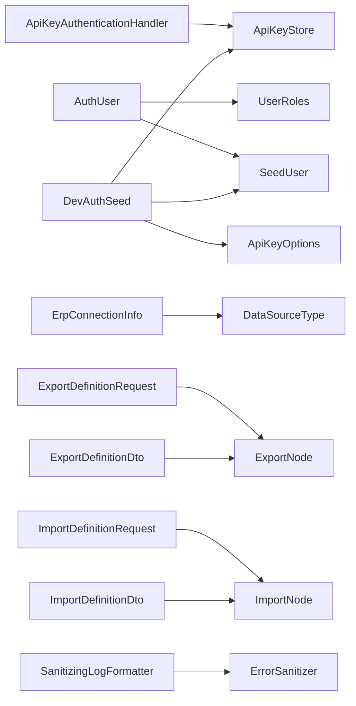

<!-- generated by docwizz: edits are overwritten -->
# src/Connector.Api

Layer **api** · project `Connector.Api` · Options: 2

Project navigation: [Connector.Api](../projects/Connector-Api-4b7b11b2fa60.md)

## Overview 🤖

Contains authentication handlers, user management records, and DTOs for various API endpoints.

**Responsibilities.** Manages API key authentication and user-related data for the Connector API.

**Usage.** Used by the Connector API endpoints for authentication and user management.

_AI draft from the facts on this page; review it, then write the module's documentation yourself._

## Key components

| Component | Kind | Used by | Summary |
|---|---|---|---|
| [BrandingConfig](#brandingconfig) | record | 2 | Body for GET/PUT /api/branding — connector-wide white-label assets. Each image field is a full "data:image/\<type>;base64,…" data URL (validated and size-capped in BrandingEndpoints) or null to fall back to the built-in default. GET is unauthenticated so the login screen and browser tab can render custom branding before the user signs in. |
| [ImportDefinitionRunDto](#importdefinitionrundto) | record | 2 | One row returned by GET /api/import-definitions/{id}/runs — the full count breakdown plus the four-eyes fields, mirroring `ImportRunDto` with the run-history fields `ExportDefinitionRunDto` also carries (StartedAt/FinishedAt/TriggeredBy). |
| [RolePermissionsDto](#rolepermissionsdto) | record | 2 | GET /api/settings/permissions: the grantable permissions, grouped by menu item, and what the User role currently holds. |
| [ApiKeyOptions](#apikeyoptions) | options | 1 |  |
| [AuditEntryDto](#auditentrydto) | record | 1 | Single row returned by GET /api/audit. |
| [ConnectionStatusDto](#connectionstatusdto) | record | 1 | GET /api/connection/status: whether a connection is configured, its type and a display name (database or instance URL). |
| [CurrentUserDto](#currentuserdto) | record | 1 | GET /api/auth/me: who is signed in, their role and their effective permissions. |
| [ErpConnectionInfo](#erpconnectioninfo) | record | 1 | Public view of the stored connection — no password field, ever. `HasPassword` is the most any API response is allowed to say about it. Host/Port/Database are populated for a relational source (`PostgreSql`/`MariaDb`), InstanceUrl for an HTTP API source (`ServiceNowTableApi`/ `ServiceNowSqlApi`) — never both. |

## External systems

- Identity provider (OpenID Connect / JWT) (identity, detected) — used by `Connector.Api`

See [system context](../views/context.md).

## Configuration

| Key | Read by | Status |
|---|---|---|
| `AllowedOrigins` | Connector.Api | detected: defined and read |
| `Auth` | AuthOptions (binds) | detected: defined and read |
| `Auth:ApiKeys` | Connector.Api | detected: defined and read |
| `Auth:JwtSecret` | AuthEndpoints, Connector.Api | detected: defined and read |
| `Auth:Users` | Connector.Api | detected: defined and read |
| `DataProtection:KeysDirectory` | Connector.Api | detected: defined and read |

All keys: [deployment](../views/deployment.md#configuration).

## Dependencies

Depends on: [src/Connector.Core/DataSources](src-Connector.Core-DataSources.md), [src/Connector.Core/DynamicExport](src-Connector.Core-DynamicExport.md), [src/Connector.Core/DynamicImport](src-Connector.Core-DynamicImport.md), [src/Connector.Infrastructure](src-Connector.Infrastructure.md)

Used by: [src/Connector.Api/Endpoints](src-Connector.Api-Endpoints.md)

## Components

### ApiKeyAuthenticationHandler

_class_ · [ApiKeyAuthenticationHandler.cs](../../src/Connector.Api/ApiKeyAuthenticationHandler.cs#L17)

Authenticates a request via the X-Api-Key header against `ApiKeyStore`, as an alternative to the interactive JWT login flow (`AuthEndpoints`) for a "dedicated API user" — a machine calling a specific endpoint directly (e.g. an external system triggering a saved export preset). Registered as its own scheme ("ApiKey") alongside the default JWT Bearer scheme, so only endpoints that opt in via RequireAuthorization(policy => policy.AddAuthenticationSchemes(...)) accept it — every other endpoint keeps requiring a JWT exactly as before.

| Member | Summary | Derived from code | Complexity |
|---|---|---|---|
| [`HandleAuthenticateAsync()`](../../src/Connector.Api/ApiKeyAuthenticationHandler.cs#L27) |  |  | 5 |

### ApiKeyOptions

_class_ · [Auth.cs](../../src/Connector.Api/Auth.cs#L52)

### AuditEntryDto

_record_ · [Dtos.cs](../../src/Connector.Api/Dtos.cs#L128)

Single row returned by GET /api/audit.

### AuthOptions

_class_ · [Auth.cs](../../src/Connector.Api/Auth.cs#L5)

_Configuration:_ [`Auth`](../views/deployment.md#configuration)

### AuthUser

_class_ · [Auth.cs](../../src/Connector.Api/Auth.cs#L20)

| Member | Summary | Derived from code | Complexity |
|---|---|---|---|
| [`ToSeed(System.Collections.Generic.IEnumerable<Connector.Api.AuthUser>, ILogger)`](../../src/Connector.Api/Auth.cs#L33) | Converts the configured users into `SeedUser`s. An unknown role is a startup error rather than a silent downgrade or upgrade. |  | 3 |

### BrandingConfig

_record_ · [Dtos.cs](../../src/Connector.Api/Dtos.cs#L136)

Body for GET/PUT /api/branding — connector-wide white-label assets. Each image field is a full "data:image/\<type>;base64,…" data URL (validated and size-capped in BrandingEndpoints) or null to fall back to the built-in default. GET is unauthenticated so the login screen and browser tab can render custom branding before the user signs in.

### ChangePasswordRequest

_record_ · [Dtos.cs](../../src/Connector.Api/Dtos.cs#L58)

### ConnectionStatusDto

_record_ · [Dtos.cs](../../src/Connector.Api/Dtos.cs#L85)

GET /api/connection/status: whether a connection is configured, its type and a display name (database or instance URL).

### CreateUserRequest

_record_ · [Dtos.cs](../../src/Connector.Api/Dtos.cs#L62)

### CurrentUserDto

_record_ · [Dtos.cs](../../src/Connector.Api/Dtos.cs#L56)

GET /api/auth/me: who is signed in, their role and their effective permissions.

### DeliverRequest

_record_ · [Dtos.cs](../../src/Connector.Api/Dtos.cs#L47)

Body for POST …/deliver. ImportedRecordCount and Notes are optional confirmation data.

### DevAuthSeed

_class_ · [DevAuthSeed.cs](../../src/Connector.Api/DevAuthSeed.cs#L9)

Provides hard-coded dev users and an API key so Development mode works out of the box without pre-computing BCrypt hashes or a SHA-256 key hash. Do not call in Production.

_Linked tests:_ `FourEyesReviewTests.NewAsync` (via `DevAuthSeed.CreateUsers()`) — test code that uses it, not coverage

| Member | Summary | Derived from code | Complexity |
|---|---|---|---|
| [`CreateUsers()`](../../src/Connector.Api/DevAuthSeed.cs#L22) | alice / alice123 and bob / bob123 (Admins, so the four-eyes flows work out of the box) and carol / carol123 (User, for trying out permissions), with BCrypt work-factor 4 (fast for dev). |  | 1 |
| [`CreateApiKeys()`](../../src/Connector.Api/DevAuthSeed.cs#L29) |  |  | 1 |

### DuplicateExportDefinitionRequest

_record_ · [Dtos.cs](../../src/Connector.Api/Dtos.cs#L197)

Body for POST .../duplicate. Name is optional — defaults to "{original} (Copy)".

### DuplicateImportDefinitionRequest

_record_ · [Dtos.cs](../../src/Connector.Api/Dtos.cs#L357)

Body for POST .../duplicate. Name is optional — defaults to "{original} (Copy)".

### EnableRequest

_record_ · [Dtos.cs](../../src/Connector.Api/Dtos.cs#L200)

Body for PATCH .../enable.

### ErpConnectionInfo

_record_ · [Dtos.cs](../../src/Connector.Api/Dtos.cs#L110)

Public view of the stored connection — no password field, ever. `HasPassword` is the most any API response is allowed to say about it. Host/Port/Database are populated for a relational source (`PostgreSql`/`MariaDb`), InstanceUrl for an HTTP API source (`ServiceNowTableApi`/ `ServiceNowSqlApi`) — never both.

### ExportDefinitionDto

_record_ · [Dtos.cs](../../src/Connector.Api/Dtos.cs#L159)

Full view of a saved export definition, returned by GET/POST/PUT .../{id}.

### ExportDefinitionPreviewDto

_record_ · [Dtos.cs](../../src/Connector.Api/Dtos.cs#L231)

Response for POST .../preview: capped, tree-shaped rows for on-screen inspection — never written to run history (see `ExportDefinitionEndpoints`).

### ExportDefinitionRequest

_record_ · [Dtos.cs](../../src/Connector.Api/Dtos.cs#L144)

Body for POST/PUT /api/export-definitions — everything an operator configures for one saved, independently triggerable export. RootNode must be a "root"-kind `ExportNode`. IntegrationKey/ContractVersion/CorrelationKeySourceField are optional and only used by the import-mapping suggestion feature (knowledge/pipeline/import-mapping-presets.md) — set together or not at all, validated at save time by `ExportDefinitionEndpoints`.

_Linked tests:_ `ConnectorImportEnvelopeTests.Request`, `ExportFilterValidationTests.Request`, `IntegrationKeyValidationTests.ExportRequest` — test code that uses it, not coverage

### ExportDefinitionRunDto

_record_ · [Dtos.cs](../../src/Connector.Api/Dtos.cs#L215)

One row returned by GET .../{id}/runs.

### ExportDefinitionRunResultDto

_record_ · [Dtos.cs](../../src/Connector.Api/Dtos.cs#L203)

Result of a run/test — the tracked ExportDefinitionRunEntity row as an API-facing shape.

### ExportDefinitionSummaryDto

_record_ · [Dtos.cs](../../src/Connector.Api/Dtos.cs#L181)

Lightweight list-view row for GET /api/export-definitions — omits RootNode, which can be arbitrarily deep and isn't needed to identify/trigger a definition.

### ExportDetailDto

_record_ · [Dtos.cs](../../src/Connector.Api/Dtos.cs#L20)

Full export run detail. SequenceGapWarning is non-null when a Pending run has a gap relative to the last released run — operators should investigate before releasing. Delivery fields are null until the physical handover is recorded via POST …/deliver.

### ExportRunSummary

_record_ · [Dtos.cs](../../src/Connector.Api/Dtos.cs#L5)

### GdprDenylistRequest

_record_ · [Dtos.cs](../../src/Connector.Api/Dtos.cs#L125)

Body for PATCH /api/gdpr-denied-fields.

### HashRequest

_record_ · [Dtos.cs](../../src/Connector.Api/Dtos.cs#L53)

### ImportDefinitionDto

_record_ · [Dtos.cs](../../src/Connector.Api/Dtos.cs#L321)

Full view of a saved import definition, returned by GET/POST/PUT .../{id}.

### ImportDefinitionPreviewRequest

_record_ · [Dtos.cs](../../src/Connector.Api/Dtos.cs#L394)

Body for POST .../preview: the raw inbound file content — an operator pastes/uploads the vendor JSON directly to preview against a saved definition without going through the inbound/ folder. Must be a well-formed ImportEnvelope (schemaVersion + records) per ImportNodeWalker.SupportedSchemaVersion.

### ImportDefinitionRequest

_record_ · [Dtos.cs](../../src/Connector.Api/Dtos.cs#L307)

Body for POST/PUT /api/import-definitions — everything an operator configures for one saved inbound mapping. RootNode must be a "root"-kind `ImportNode`, and must have an enabled scalar-field child whose TargetColumn equals RootMatchColumn (see ImportNodeWalker.FindMatchField). AllowedWritableColumns is validated against the live ERP schema at save time — see `ImportDefinitionEndpoints`. IntegrationKey/ContractVersion are optional and only used by the import-mapping suggestion feature — set together or not at all, validated at save time by the same endpoints class.

_Linked tests:_ `ImportDefinitionEndpointsPostgresTests.InsertRequestFor`, `ImportDefinitionEndpointsPostgresTests.RequestFor`, `IntegrationKeyValidationTests.ImportRequest` — test code that uses it, not coverage

### ImportDefinitionRunDto

_record_ · [Dtos.cs](../../src/Connector.Api/Dtos.cs#L405)

One row returned by GET /api/import-definitions/{id}/runs — the full count breakdown plus the four-eyes fields, mirroring `ImportRunDto` with the run-history fields `ExportDefinitionRunDto` also carries (StartedAt/FinishedAt/TriggeredBy).

### ImportDefinitionStageRequest

_record_ · [Dtos.cs](../../src/Connector.Api/Dtos.cs#L400)

Body for POST .../runs: same inbound content as .../preview, but this one persists — an operator-selected file, staged as a real ImportRunEntity at PendingReview the same way the inbound/ folder watcher would, without needing a dropped file + manifest. SourceFileName is cosmetic (shown in run history); falls back to a placeholder when omitted.

### ImportDefinitionSummaryDto

_record_ · [Dtos.cs](../../src/Connector.Api/Dtos.cs#L342)

Lightweight list-view row for GET /api/import-definitions — omits RootNode/AllowedWritableColumns, which aren't needed to identify or enable/disable a definition.

### ImportMappingSuggestionCandidateFieldDto

_record_ · [Dtos.cs](../../src/Connector.Api/Dtos.cs#L365)

One best-effort candidate field, projected from Connector.Core.DynamicImport.ImportMappingCandidateField verbatim for the wire.

### ImportMappingSuggestionCheckResult

_record_ · [Dtos.cs](../../src/Connector.Api/Dtos.cs#L388)

Response for POST .../suggest-from-export. Exactly one of Suggestion/Reason is set: a hit carries Suggestion with Reason null, and a miss carries a null Suggestion with an operator-facing explanation of which of ImportMappingSuggestion.Evaluate's gates stopped it (no provenance in the pasted sample, no export tagged with that key/version at all, one tagged but disabled, or one tagged and enabled but missing CorrelationKeySourceField) — never a flat, unexplained "no match," and never a 4xx: this is a lookup that can legitimately come up empty, not a client error.

### ImportMappingSuggestionDto

_record_ · [Dtos.cs](../../src/Connector.Api/Dtos.cs#L370)

RootMatchSourceKey is the matched export's own JSON key for the correlation field (its TargetKey) — not necessarily the same string as RootMatchColumn, which is a column name.

### ImportMappingSuggestionRequest

_record_ · [Dtos.cs](../../src/Connector.Api/Dtos.cs#L361)

Body for POST /api/import-definitions/suggest-from-export — the same sample ImportEnvelope JSON the preview panel already accepts, pasted before any ImportDefinition exists yet.

### ImportRunDetailDto

_record_ · [Dtos.cs](../../src/Connector.Api/Dtos.cs#L272)

Response for GET /api/import-runs/{id}: everything the review/diff view needs to render a PendingReview run before an Approver commits — the count breakdown plus the persisted PlanJson operations (empty once none exist, e.g. a Failed run that never produced a plan). Not returned by the release/reject endpoints themselves, which stay on the smaller `ImportRunDto` shape — this is a read, not a mutation response.

### ImportRunDto

_record_ · [Dtos.cs](../../src/Connector.Api/Dtos.cs#L237)

Response for the import-run release/reject endpoints (`ImportRunEndpoints`) — the post-action state of one ImportRunEntity (Connector.Infrastructure), including the six run counts and, once released, the conflict count from the commit's optimistic-concurrency check.

### ImportRunOperationDto

_record_ · [Dtos.cs](../../src/Connector.Api/Dtos.cs#L256)

One `ImportPlanOperation`, projected verbatim for the review UI's field-level diff — see `ImportRunDetailDto`.

### LoginRequest

_record_ · [Dtos.cs](../../src/Connector.Api/Dtos.cs#L49)

### LoginResponse

_record_ · [Dtos.cs](../../src/Connector.Api/Dtos.cs#L51)

### PreviewResult

_record_ · [Dtos.cs](../../src/Connector.Api/Dtos.cs#L94)

Source is "dynamic" for a flat mapping (Columns/Records populated), "dynamic-nested" for a mapping with nested JSON groups (NestedRecords populated instead — arbitrary object/array shape, not a flat table), or "error" when nothing could be previewed.

### Program

_class_ · [Program.cs](../../src/Connector.Api/Program.cs#L454)

### ReleaseRequest

_record_ · [Dtos.cs](../../src/Connector.Api/Dtos.cs#L44)

Operator is taken from the JWT; the approver's own name and password are supplied in the body. ApproverPassword proves the named approver actually participated in the release — see `ValidateApprover` — rather than letting the operator unilaterally release by typing a colleague's username with nothing to back it.

### RolePermissionsDto

_record_ · [Dtos.cs](../../src/Connector.Api/Dtos.cs#L69)

GET /api/settings/permissions: the grantable permissions, grouped by menu item, and what the User role currently holds.

### RolePermissionsRequest

_record_ · [Dtos.cs](../../src/Connector.Api/Dtos.cs#L74)

### RunNowResult

_record_ · [Dtos.cs](../../src/Connector.Api/Dtos.cs#L87)

### SanitizingLogFormatter

_class_ · [SanitizingLogFormatter.cs](../../src/Connector.Api/SanitizingLogFormatter.cs#L14)

The last stop before a log line is written. Wraps the real formatter and hands it a copy of each event with credentials scrubbed — from the exception (`ForLogging`; Npgsql can echo a connection string, password included, in an exception message) and from every string property — and any destructured property named Password dropped. One choke point for every logger in the process, so no call site has to remember it.

_Linked tests:_ `SanitizingLogFormatterTests.Render` — test code that uses it, not coverage

| Member | Summary | Derived from code | Complexity |
|---|---|---|---|
| [`Format(LogEvent, System.IO.TextWriter)`](../../src/Connector.Api/SanitizingLogFormatter.cs#L16) |  |  | 2 |

### SchemaColumnDto

_record_ · [Dtos.cs](../../src/Connector.Api/Dtos.cs#L76)

### SchemaDto

_record_ · [Dtos.cs](../../src/Connector.Api/Dtos.cs#L78)

### SkipRequest

_record_ · [Dtos.cs](../../src/Connector.Api/Dtos.cs#L122)

Body for POST /api/exports/{seqNo}/skip. Reason is stored in the audit log.

### UpdateUserRequest

_record_ · [Dtos.cs](../../src/Connector.Api/Dtos.cs#L65)

PUT /api/users/{username}: each field is optional; a null one is left unchanged.

### UserDto

_record_ · [Dtos.cs](../../src/Connector.Api/Dtos.cs#L60)

---
_Generated from 69 symbols in [src/Connector.Api/ApiKeyAuthenticationHandler.cs](../../src/Connector.Api/ApiKeyAuthenticationHandler.cs), [src/Connector.Api/Auth.cs](../../src/Connector.Api/Auth.cs), [src/Connector.Api/DevAuthSeed.cs](../../src/Connector.Api/DevAuthSeed.cs), [src/Connector.Api/Dtos.cs](../../src/Connector.Api/Dtos.cs), [src/Connector.Api/Program.cs](../../src/Connector.Api/Program.cs), [src/Connector.Api/SanitizingLogFormatter.cs](../../src/Connector.Api/SanitizingLogFormatter.cs) (commit `b3fcbdc`, profile `default`). Sections marked _fact_ are read from the code, _inferred_ come from heuristics, 🤖 marks AI drafts._
