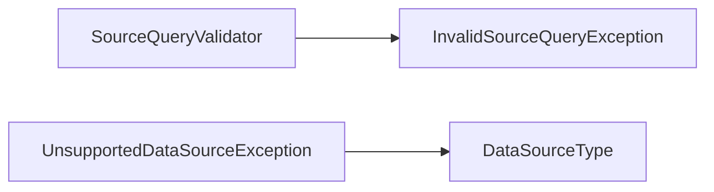

<!-- generated by docwizz: edits are overwritten -->
# src/Connector.Core/DataSources

Layer **domain** · project `Connector.Core`

Project navigation: [Connector.Core](../projects/Connector-Core-67ea6c7c243a.md)

## Overview 🤖

Manages data source configurations, capabilities, and operations for various ERP data sources.

**Responsibilities.** Provides a unified interface for interacting with different ERP data sources, including validation, connection testing, and query execution.

**Usage.** Used by various parts of the application to interact with different ERP data sources, ensuring consistent data access and management.

_AI draft from the facts on this page; review it, then write the module's documentation yourself._

## Key components

| Component | Kind | Used by | Summary |
|---|---|---|---|
| [IDataSourceProviderResolver](#idatasourceproviderresolver) | interface | 19 | Resolves a `DataSourceType` to the `IDataSourceProvider` that implements it. The single seam a caller (e.g. Connector.Infrastructure.DynamicExportService, ConnectionEndpoints) goes through instead of constructing a concrete provider itself. |
| [IDataSourceProvider](#idatasourceprovider) | interface | 9 | Abstraction over one kind of ERP data source backend — see knowledge/architecture/data-source-abstraction.md. Implemented for PostgreSQL, MariaDB and the ServiceNow Table API (Connector.Infrastructure.DataSources.*); obtained via `IDataSourceProviderResolver`, never constructed directly outside DI registration. Where providers differ, `Capabilities` says so. |
| [UnsupportedDataSourceException](#unsupporteddatasourceexception) | class | 6 | Thrown by `Resolve` when no `IDataSourceProvider` is registered for the requested `DataSourceType` (e.g. `ServiceNowTableApi`/ `ServiceNowSqlApi`, or an out-of-range value), and wherever a code path only supports some source types. |
| [InvalidSourceQueryException](#invalidsourcequeryexception) | class | 4 | Thrown by `Validate` (and so by any provider compiling a `SourceQuery`) when the query names a table or column the schema doesn't know, or is otherwise malformed. Raised before anything reaches the data source. |
| [QueryResult](#queryresult) | record | 4 | Generic, provider-agnostic row set returned by `ExecuteAsync`/ `ExecuteNativeAsync`. Every value is already stringified by the provider (e.g. a Postgres date/timestamp column is coerced to ISO-8601) so callers never need provider-specific type information; a null value means the source column was NULL. Each row's `Values` lines up index-for-index with `Columns`. |
| [SourceColumn](#sourcecolumn) | record | 4 | One column of a `SourceTable`, as reported by `ReadSchemaAsync`. |
| [SourceSchema](#sourceschema) | record | 4 | The live (or demo-fallback) schema of the configured data source, as returned by `ReadSchemaAsync`/`TestConnectionAsync`. |
| [SourceTable](#sourcetable) | record | 4 | One table of a `SourceSchema`. |

## Flows through this module

- `POST /api/connection`: AppSettingsStore, ConnectionEndpoints, DataSourceProviderResolver, ErrorSanitizer, ExportLogDbContext, MariaDbDataSourceProvider, +4 more → MariaDbConnectionFactory, MariaDbSchemaReader, PostgreSQL, RelationalConnectionRules, ServiceNowClient, ServiceNowSchemaReader, +2 more → MySQL, ServiceNowQueryCompiler → ServiceNowClientOptions
- `GET /api/connection/status`: AppSettingsStore, DataSourceType, ExportLogDbContext → SQLite
- `POST /api/export-definitions/{id:int}/preview`: AppSettingsStore, DataSourceProviderResolver, DynamicExportService, ErrorSanitizer, ExportLogDbContext, ExportNodeJson → DataSourceCapabilities, FieldMapping, MariaDbDataSourceProvider, MariaDbDialect, MeteredDataSourceProvider, PostgreSqlDataSourceProvider, +3 more → MariaDbConnectionFactory, PostgreSQL, PostgreSqlJsonValues → MySQL
- `POST /api/export-definitions/{id:int}/run`: AuditService, DataSourceProviderResolver, DynamicExportService, ExportDefinitionEndpoints, ExportDefinitionRunner, ExportLogDbContext → AppSettingsStore, ErrorSanitizer, ExportNodeJson, FileSystemExportSink, ManifestSigningPolicy, SQLite → CsvExportFormatWriter, DataSourceCapabilities, ExcelExportFormatWriter, ExportFormatWriterFactory, ExportSchema, FieldMapping, +9 more → MariaDbConnectionFactory, PostgreSQL, PostgreSqlJsonValues → MySQL
- `POST /api/export-definitions/{id:int}/run-selected`: AuditService, DataSourceProviderResolver, DynamicExportService, ExportDefinitionEndpoints, ExportDefinitionRunner, ExportLogDbContext, +1 more → AppSettingsStore, ErrorSanitizer, FieldMapping, FileSystemExportSink, ManifestSigningPolicy, SQLite → CsvExportFormatWriter, DataSourceCapabilities, ExcelExportFormatWriter, ExportFormatWriterFactory, ExportSchema, File system, +8 more → MariaDbConnectionFactory, PostgreSQL, PostgreSqlJsonValues → MySQL
- `POST /api/export-definitions/{id:int}/test`: AuditService, DataSourceProviderResolver, ExportDefinitionEndpoints, ExportDefinitionRunner, ExportLogDbContext → AppSettingsStore, DynamicExportService, ErrorSanitizer, ExportNodeJson, FileSystemExportSink, ManifestSigningPolicy, +1 more → CsvExportFormatWriter, DataSourceCapabilities, ExcelExportFormatWriter, ExportFormatWriterFactory, ExportSchema, FieldMapping, +9 more → MariaDbConnectionFactory, PostgreSQL, PostgreSqlJsonValues → MySQL
- `GET /api/pipeline/preview`: AppSettingsStore, DataSourceProviderResolver, DynamicExportService, ErrorSanitizer, ExportLogDbContext, ExportMappingJson → DataSourceCapabilities, ExportJsonWrapperConfig, MariaDbDataSourceProvider, MariaDbDialect, MeteredDataSourceProvider, PostgreSqlDataSourceProvider, +4 more → MariaDbConnectionFactory, PostgreSQL, PostgreSqlJsonValues → MySQL
- `POST /api/pipeline/run`: AppSettingsStore, AuditService, DataSourceProviderResolver, DynamicExportService, ErrorSanitizer, ExportLogDbContext, +3 more → DataSourceCapabilities, ExportJsonWrapperConfig, ExportQueryMetrics, File system, MariaDbDataSourceProvider, MariaDbDialect, +6 more → MariaDbConnectionFactory, PostgreSQL, PostgreSqlJsonValues → MySQL
- … 1 more in [API](../api.md#flows) and [frontend](../frontend.md#flows)

## Dependencies

Used by: [src/Connector.Api](src-Connector.Api.md), [src/Connector.Api/Endpoints](src-Connector.Api-Endpoints.md), [src/Connector.Infrastructure](src-Connector.Infrastructure.md), [src/Connector.Infrastructure/DataSources](src-Connector.Infrastructure-DataSources.md), [src/Connector.Infrastructure/DataSources/MariaDb](src-Connector.Infrastructure-DataSources-MariaDb.md), [src/Connector.Infrastructure/DataSources/PostgreSql](src-Connector.Infrastructure-DataSources-PostgreSql.md), [src/Connector.Infrastructure/DataSources/ServiceNow](src-Connector.Infrastructure-DataSources-ServiceNow.md)

## Components

### DataSourceCapabilities

_record_ · [DataSourceCapabilities.cs](../../src/Connector.Core/DataSources/DataSourceCapabilities.cs#L10)

What a provider can and can't do, stated explicitly — so callers and the shared provider contract tests branch on a named capability, never on provider.Type == …. Only differences that exist between the implemented providers are modeled; everything else in `IDataSourceProvider` (connection test, schema with relations, projection, filters, null checks, limit, joins, cancellation, sanitized errors) is required of every provider.

_Reached from:_ [`POST /api/export-definitions/{id:int}/preview`](../api.md#flows), [`POST /api/export-definitions/{id:int}/run`](../api.md#flows), [`POST /api/export-definitions/{id:int}/run-selected`](../api.md#flows), [`POST /api/export-definitions/{id:int}/test`](../api.md#flows), [`GET /api/pipeline/preview`](../api.md#flows), [`POST /api/pipeline/run`](../api.md#flows), [`POST /api/pipeline/run/{name}`](../api.md#flows)

### DataSourceConfig

_record_ · [DataSourceConfig.cs](../../src/Connector.Core/DataSources/DataSourceConfig.cs#L21)

Connection parameters for the configured ERP data source. Provider-agnostic by design: `Type` says which `IDataSourceProvider` (resolved via `IDataSourceProviderResolver`) interprets the rest of these fields — a relational source (`PostgreSql`/ `MariaDb`) uses `Host`/`Port`/`Database`, an HTTP API source (`ServiceNowTableApi`/ `ServiceNowSqlApi`) uses `InstanceUrl` instead. See knowledge/architecture/data-source-configuration.md for the full design and back-compat contract.

_Linked tests:_ `DataSourceConfigTests.ExplicitTypeDefault_MatchesOmittedType`, `DataSourceConfigTests.HasPassword_ReflectsWhetherAPasswordIsSet`, `DataSourceConfigTests.NewPostgreSqlConfigWithType_RoundTripsThroughJson`, `DataSourceConfigTests.ToString_NeverContainsThePasswordValue`, `DataSourceConfigTests.ToString_NoPassword_ReportsHasPasswordFalse`, `ConnectionEndpointsHttpTests.GetConnection_StoredConnectionHasPassword_ResponseNeverContainsIt`, `ConnectionEndpointsHttpTests.GetConnection_StoredConnectionWithoutPassword_HasPasswordIsFalse`, `DataSourceConfigValidationTests.MissingRelationalFields`, +11 more — test code that uses it, not coverage

| Member | Summary | Derived from code | Complexity |
|---|---|---|---|
| [`ToString()`](../../src/Connector.Core/DataSources/DataSourceConfig.cs#L64) | Overridden so the compiler-generated, all-properties ToString() a bare record would otherwise get can never print `Password` in plaintext — e.g. into a log via {Config}/ $"{config}", or a debugger's default display. Redacts `Password` to a fixed marker and reports `HasPassword` instead, mirroring the API's own "hasPassword, never the value" contract. |  | 1 |

### DataSourceQueryException

_class_ · [DataSourceQueryException.cs](../../src/Connector.Core/DataSources/DataSourceQueryException.cs#L10)

Provider-agnostic wrapper for a query execution failure that a caller needs to inspect, not just log or surface verbatim — e.g. to recognize a specific SQL error without referencing Npgsql.PostgresException/ SqlState directly. `ErrorCode` is the provider's own error-code string verbatim (the Postgres SQLSTATE, for PostgreSqlDataSourceProvider) — opaque to callers unless they know the specific code they're looking for.

### DataSourceType

_enum_ · [DataSourceType.cs](../../src/Connector.Core/DataSources/DataSourceType.cs#L13)

Identifies which backend an `IDataSourceProvider` implementation targets. Resolved to a concrete provider via `IDataSourceProviderResolver`.

_Reached from:_ [`GET /api/connection/status`](../api.md#flows)

### IDataSourceProvider

_interface_ · [IDataSourceProvider.cs](../../src/Connector.Core/DataSources/IDataSourceProvider.cs#L9)

Abstraction over one kind of ERP data source backend — see knowledge/architecture/data-source-abstraction.md. Implemented for PostgreSQL, MariaDB and the ServiceNow Table API (Connector.Infrastructure.DataSources.*); obtained via `IDataSourceProviderResolver`, never constructed directly outside DI registration. Where providers differ, `Capabilities` says so.

_Linked tests:_ `DataSourceConfigValidationTests.Relational_AllRequiredFieldsPresent_IsValid` (via `IDataSourceProvider.ValidateConfig(DataSourceConfig)`), `DataSourceConfigValidationTests.Relational_IsAlwaysEncrypted_OnlyForMandatoryTls` (via `IDataSourceProvider.IsAlwaysEncrypted(DataSourceConfig)`), `DataSourceConfigValidationTests.Relational_KnownOrUnsetSslMode_IsValid` (via `IDataSourceProvider.ValidateConfig(DataSourceConfig)`), `DataSourceConfigValidationTests.Relational_MissingRequiredField_IsInvalid` (via `IDataSourceProvider.ValidateConfig(DataSourceConfig)`), `DataSourceConfigValidationTests.Relational_UnknownSslMode_IsInvalid` (via `IDataSourceProvider.ValidateConfig(DataSourceConfig)`), `DataSourceConfigValidationTests.ServiceNow_MissingInstanceUrlOrUsername_IsInvalid` (via `IDataSourceProvider.ValidateConfig(DataSourceConfig)`), `DataSourceConfigValidationTests.ServiceNow_NonHttpsInstanceUrl_IsInvalid` (via `IDataSourceProvider.ValidateConfig(DataSourceConfig)`), `DataSourceConfigValidationTests.ServiceNow_ValidConfig_IsValidAndAlwaysEncrypted` (via `IDataSourceProvider.ValidateConfig(DataSourceConfig)`), +25 more — test code that uses it, not coverage

| Member | Summary | Derived from code | Complexity |
|---|---|---|---|
| [`ValidateConfig(Connector.Core.DataSources.DataSourceConfig)`](../../src/Connector.Core/DataSources/IDataSourceProvider.cs#L21) | Whether `config` has what this provider needs to connect (required fields, a valid TLS mode or instance URL): a user-facing message, or null when it's usable. Checked before any connection attempt; the only place per-source-type config rules live. |  | 1 |
| [`TargetHost(Connector.Core.DataSources.DataSourceConfig)`](../../src/Connector.Core/DataSources/IDataSourceProvider.cs#L25) | The host a connection with the (validated) `config` reaches — what the SSRF check in POST /api/connection resolves. |  | 1 |
| [`IsAlwaysEncrypted(Connector.Core.DataSources.DataSourceConfig)`](../../src/Connector.Core/DataSources/IDataSourceProvider.cs#L29) | True when `config` can only ever reach the source encrypted — never falling back to plaintext. |  | 1 |
| [`TestConnectionAsync(Connector.Core.DataSources.DataSourceConfig, System.Threading.CancellationToken)`](../../src/Connector.Core/DataSources/IDataSourceProvider.cs#L35) | Opens a connection against `config` and reads back its schema, without persisting anything. Never throws for a reachability/credential failure — that's reported via `Success`/`Error` instead, sanitized of any connection-string/credential detail. |  | 1 |
| [`ReadSchemaAsync(Connector.Core.DataSources.DataSourceConfig, System.Threading.CancellationToken)`](../../src/Connector.Core/DataSources/IDataSourceProvider.cs#L40) | Reads the live schema (tables/columns/PK/FK) of the data source described by `config`. Throws on failure — unlike `TestConnectionAsync`, this is called once a connection is already known-good and a failure here is a real, reportable error. |  | 1 |
| [`ExecuteAsync(Connector.Core.DataSources.DataSourceConfig, Connector.Core.DataSources.SourceQuery, System.Threading.CancellationToken)`](../../src/Connector.Core/DataSources/IDataSourceProvider.cs#L48) | Validates `query` against the data source's live schema (`SourceQueryValidator`), compiles it into the provider's own dialect with every filter value bound as a parameter, executes it, and returns its rows generically. Throws `InvalidSourceQueryException` — before touching any data — for an unknown table/column or a malformed query; an execution failure the caller needs to inspect surfaces as `DataSourceQueryException`. |  | 1 |
| [`ExecuteNativeAsync(Connector.Core.DataSources.DataSourceConfig, Connector.Core.DataSources.NativeSqlQuery, System.Threading.CancellationToken)`](../../src/Connector.Core/DataSources/IDataSourceProvider.cs#L54) | Executes caller-built, provider-native SQL as-is and returns its rows generically — the path DynamicExportService's JSON-tree builders still use for what `SourceQuery` cannot express yet (knowledge/architecture/source-query-model.md §5). Same error contract as `ExecuteAsync`, minus schema validation. |  | 1 |

### IDataSourceProviderResolver

_interface_ · [IDataSourceProviderResolver.cs](../../src/Connector.Core/DataSources/IDataSourceProviderResolver.cs#L8)

Resolves a `DataSourceType` to the `IDataSourceProvider` that implements it. The single seam a caller (e.g. Connector.Infrastructure.DynamicExportService, ConnectionEndpoints) goes through instead of constructing a concrete provider itself.

_Linked tests:_ `DataSourceConfigValidationTests.ImportConnection_ProviderWithoutImportsCapability_IsRefused` (via `Connector.Infrastructure.DataSources.DataSourceProviderResolver`), `DataSourceProviderResolverTests.Resolve_MariaDb_ReturnsTheRegisteredMariaDbProvider` (via `Connector.Infrastructure.DataSources.DataSourceProviderResolver`), `DataSourceProviderResolverTests.Resolve_NoProvidersRegisteredAtAll_ThrowsForPostgreSqlToo` (via `Connector.Infrastructure.DataSources.DataSourceProviderResolver`), `DataSourceProviderResolverTests.Resolve_OutOfRangeType_ThrowsUnsupportedDataSourceException` (via `Connector.Infrastructure.DataSources.DataSourceProviderResolver`), `DataSourceProviderResolverTests.Resolve_PostgreSql_ReturnsTheRegisteredPostgreSqlProvider` (via `Connector.Infrastructure.DataSources.DataSourceProviderResolver`), `DataSourceProviderResolverTests.Resolve_UnregisteredType_ThrowsUnsupportedDataSourceException` (via `Connector.Infrastructure.DataSources.DataSourceProviderResolver`), `FixedServiceProvider.GetService` (via `Connector.Infrastructure.DataSources.DataSourceProviderResolver`) — test code that uses it, not coverage

| Member | Summary | Derived from code | Complexity |
|---|---|---|---|
| [`Resolve(Connector.Core.DataSources.DataSourceType)`](../../src/Connector.Core/DataSources/IDataSourceProviderResolver.cs#L12) | Returns the registered provider for `type`, or throws `UnsupportedDataSourceException` if none is registered. |  | 1 |

### InvalidSourceQueryException

_class_ · [InvalidSourceQueryException.cs](../../src/Connector.Core/DataSources/InvalidSourceQueryException.cs#L8)

Thrown by `Validate` (and so by any provider compiling a `SourceQuery`) when the query names a table or column the schema doesn't know, or is otherwise malformed. Raised before anything reaches the data source.

### NativeSqlQuery

_record_ · [NativeSqlQuery.cs](../../src/Connector.Core/DataSources/NativeSqlQuery.cs#L19)

Provider-native SQL text (plus optional named parameters) for `ExecuteNativeAsync`. The database-neutral counterpart is `SourceQuery`.

_Linked tests:_ `DataSourceProviderContractTests.NativeSql_MatchesCapability`, `MariaDbDataSourceProviderTests.ExecuteNativeAsync_Cancellation_Aborts`, `MariaDbDataSourceProviderTests.ExecuteNativeAsync_CommandTimeout_Aborts`, `MariaDbDataSourceProviderTests.ExecuteNativeAsync_DefaultFormatting_DatesAsIsoAndNullsAsNull`, `MariaDbDataSourceProviderTests.ExecuteNativeAsync_MissingTable_ThrowsDataSourceQueryExceptionWithSqlState`, `MariaDbExportParityTests.Timeout_AbortsOnBoth`, `PostgreSqlDataSourceProviderTests.ExecuteNativeAsync_CardinalityViolation_ThrowsDataSourceQueryExceptionWithSqlState21000`, `PostgreSqlDataSourceProviderTests.ExecuteNativeAsync_DateColumn_CoercesToIso8601`, +4 more — test code that uses it, not coverage

### QueryColumn

_record_ · [SourceQuery.cs](../../src/Connector.Core/DataSources/SourceQuery.cs#L33)

One projected column of a `SourceQuery`.

_Linked tests:_ `SourceQueryValidatorTests.Validate_ColumnOfTableThatIsNotJoined_Throws`, `SourceQueryValidatorTests.Validate_DuplicateOutputName_Throws`, `SourceQueryValidatorTests.Validate_UnknownColumn_Throws`, `SourceQueryValidatorTests.Validate_WellFormedQuery_DoesNotThrow`, `DataSourceProviderContractTests.Join_OverRelationMetadata_Works`, `DataSourceProviderContractTests.Orders`, `MariaDbDataSourceProviderTests.ExecuteAsync_JoinWhereAndLimit_WithBoundParameters`, `MariaDbQueryCompilerTests.Compile_SelectWithJoinConditionsAndLimit`, +15 more — test code that uses it, not coverage

### QueryCondition

_record_ · [SourceQuery.cs](../../src/Connector.Core/DataSources/SourceQuery.cs#L84)

One filter predicate of a `SourceQuery`. The operand is always a value, never an expression: `Value` for the binary operators, `Values` for `In`, and neither for `IsNull`/`IsNotNull`.

_Linked tests:_ `SourceQueryValidatorTests.Validate_BinaryOperatorWithoutValue_Throws`, `SourceQueryValidatorTests.Validate_InWithoutValues_Throws`, `SourceQueryValidatorTests.Validate_IsNullWithValue_Throws`, `SourceQueryValidatorTests.Validate_NonScalarValue_Throws`, `SourceQueryValidatorTests.Validate_StartsWithNonString_Throws`, `SourceQueryValidatorTests.Validate_WellFormedQuery_DoesNotThrow`, `DataSourceProviderContractTests.ConditionOnLeftJoinedTable_MatchesCapability`, `DataSourceProviderContractTests.Filter_Works`, +14 more — test code that uses it, not coverage

### QueryJoin

_record_ · [SourceQuery.cs](../../src/Connector.Core/DataSources/SourceQuery.cs#L63)

An equi-join Table.Column = ParentTable.ParentColumn. Deliberately no free-form ON expression — the only thing a caller chooses is which known columns to match.

_Linked tests:_ `SourceQueryValidatorTests.Validate_JoinReferencingLaterJoin_Throws`, `SourceQueryValidatorTests.Validate_WellFormedQuery_DoesNotThrow`, `DataSourceProviderContractTests.ConditionOnLeftJoinedTable_MatchesCapability`, `DataSourceProviderContractTests.Join_OverRelationMetadata_Works`, `DataSourceSecurityTests.InjectionInJoinField_IsRejectedAsUnknown`, `MariaDbDataSourceProviderTests.ExecuteAsync_JoinWhereAndLimit_WithBoundParameters`, `MariaDbQueryCompilerTests.Compile_SelectWithJoinConditionsAndLimit`, `PostgreSqlDataSourceProviderTests.ExecuteAsync_JoinInNullCheckLikeAndLimit_RunAgainstRealPostgres`, +3 more — test code that uses it, not coverage

### QueryJoinType

_enum_ · [SourceQuery.cs](../../src/Connector.Core/DataSources/SourceQuery.cs#L50)

How a `QueryJoin` treats a parent row with no matching row in the joined table.

### QueryOperator

_enum_ · [SourceQuery.cs](../../src/Connector.Core/DataSources/SourceQuery.cs#L106)

The comparison a `QueryCondition` applies.

### QueryResult

_record_ · [QueryResult.cs](../../src/Connector.Core/DataSources/QueryResult.cs#L10)

Generic, provider-agnostic row set returned by `ExecuteAsync`/ `ExecuteNativeAsync`. Every value is already stringified by the provider (e.g. a Postgres date/timestamp column is coerced to ISO-8601) so callers never need provider-specific type information; a null value means the source column was NULL. Each row's `Values` lines up index-for-index with `Columns`.

_Reached from:_ [`GET /api/pipeline/preview`](../api.md#flows), [`POST /api/pipeline/run`](../api.md#flows), [`POST /api/pipeline/run/{name}`](../api.md#flows) · _Linked tests:_ `DataSourceProviderContractTests.EmptyVersusNull_MatchesCapability` (via `QueryResult.ToDictionaries()`), `DataSourceProviderContractTests.Ids` (via `QueryResult.ToDictionaries()`), `DataSourceProviderContractTests.Join_OverRelationMetadata_Works` (via `QueryResult.ToDictionaries()`), `DataSourceProviderContractTests.NullHandling_Works` (via `QueryResult.ToDictionaries()`), `MariaDbDataSourceProviderTests.ExecuteAsync_JoinWhereAndLimit_WithBoundParameters` (via `QueryResult.ToDictionaries()`), `MariaDbDataSourceProviderTests.ExecuteNativeAsync_DefaultFormatting_DatesAsIsoAndNullsAsNull` (via `QueryResult.ToDictionaries()`), `PostgreSqlDataSourceProviderTests.ExecuteAsync_JoinInNullCheckLikeAndLimit_RunAgainstRealPostgres` (via `QueryResult.ToDictionaries()`), `PostgreSqlDataSourceProviderTests.ExecuteNativeAsync_DateColumn_CoercesToIso8601` (via `QueryResult.ToDictionaries()`), +6 more — test code that uses it, not coverage

| Member | Summary | Derived from code | Complexity |
|---|---|---|---|
| [`ToDictionaries()`](../../src/Connector.Core/DataSources/QueryResult.cs#L17) | Each row keyed by column name. If two columns share a name the later one wins. |  | 3 |

### QueryResultColumn

_record_ · [QueryResult.cs](../../src/Connector.Core/DataSources/QueryResult.cs#L30)

One column of a `QueryResult`.

### QueryResultRow

_record_ · [QueryResult.cs](../../src/Connector.Core/DataSources/QueryResult.cs#L41)

One row of a `QueryResult`.

### SourceColumn

_record_ · [SourceSchema.cs](../../src/Connector.Core/DataSources/SourceSchema.cs#L10)

One column of a `SourceTable`, as reported by `ReadSchemaAsync`.

### SourceQuery

_record_ · [SourceQuery.cs](../../src/Connector.Core/DataSources/SourceQuery.cs#L11)

Database-neutral description of one read query: a root table, the columns to project, equi-joins to further tables, and AND-combined filter conditions. Carries no SQL at all — every table and column is a plain name that `SourceQueryValidator` checks against a known `SourceSchema`, and every filter value stays a value (never text spliced into a query), so a provider's compiler can always bind it as a parameter. Only providers know a dialect; the PostgreSQL one is Connector.Infrastructure.DataSources.PostgreSql.PostgreSqlQueryCompiler. See knowledge/architecture/source-query-model.md.

_Linked tests:_ `SourceQueryValidatorTests.Validate_ColumnOfTableThatIsNotJoined_Throws`, `SourceQueryValidatorTests.Validate_DuplicateOutputName_Throws`, `SourceQueryValidatorTests.Validate_JoinReferencingLaterJoin_Throws`, `SourceQueryValidatorTests.Validate_NegativeLimit_Throws`, `SourceQueryValidatorTests.Validate_TableJoinedTwice_Throws`, `SourceQueryValidatorTests.Validate_UnknownColumn_Throws`, `SourceQueryValidatorTests.Validate_UnknownJoinColumn_Throws`, `SourceQueryValidatorTests.Validate_UnknownRootTable_Throws`, +41 more — test code that uses it, not coverage

### SourceQueryValidator

_class_ · [SourceQueryValidator.cs](../../src/Connector.Core/DataSources/SourceQueryValidator.cs#L11)

Checks a `SourceQuery` against a known `SourceSchema` before any provider compiles it: every table and column must exist in the schema (matched exactly, case-sensitively), joins must build on the root table or an earlier join, every table appears at most once, output names are unique, and each condition's operand fits its operator. Dialect-free on purpose, so every provider's compiler shares it — a compiler may assume any query that passes is safe to turn into native syntax (every name it quotes is one the schema itself reported).

_Linked tests:_ `SourceQueryValidatorTests.Validate` (via `SourceQueryValidator.Validate(SourceQuery, SourceSchema)`) — test code that uses it, not coverage

| Member | Summary | Derived from code | Complexity |
|---|---|---|---|
| [`Validate(Connector.Core.DataSources.SourceQuery, Connector.Core.DataSources.SourceSchema)`](../../src/Connector.Core/DataSources/SourceQueryValidator.cs#L14) | Throws `InvalidSourceQueryException` describing the first problem found. |  | 11 |

### SourceSchema

_record_ · [SourceSchema.cs](../../src/Connector.Core/DataSources/SourceSchema.cs#L27)

The live (or demo-fallback) schema of the configured data source, as returned by `ReadSchemaAsync`/`TestConnectionAsync`.

### SourceTable

_record_ · [SourceSchema.cs](../../src/Connector.Core/DataSources/SourceSchema.cs#L23)

One table of a `SourceSchema`.

### TestConnectionResult

_record_ · [TestConnectionResult.cs](../../src/Connector.Core/DataSources/TestConnectionResult.cs#L9)

Result of `TestConnectionAsync`: either the live `Schema` on success, or a sanitized, user-facing `Error` on failure — never both. A provider must never let a raw exception (which can echo connection-string/credential detail) reach `Error` unsanitized.

_Reached from:_ [`POST /api/connection`](../api.md#flows)

| Member | Summary | Derived from code | Complexity |
|---|---|---|---|
| [`Ok(Connector.Core.DataSources.SourceSchema)`](../../src/Connector.Core/DataSources/TestConnectionResult.cs#L11) |  |  | 1 |
| [`Failed(string)`](../../src/Connector.Core/DataSources/TestConnectionResult.cs#L13) |  |  | 1 |

### UnsupportedDataSourceException

_class_ · [UnsupportedDataSourceException.cs](../../src/Connector.Core/DataSources/UnsupportedDataSourceException.cs#L9)

Thrown by `Resolve` when no `IDataSourceProvider` is registered for the requested `DataSourceType` (e.g. `ServiceNowTableApi`/ `ServiceNowSqlApi`, or an out-of-range value), and wherever a code path only supports some source types.

---
_Generated from 95 symbols in [src/Connector.Core/DataSources/DataSourceCapabilities.cs](../../src/Connector.Core/DataSources/DataSourceCapabilities.cs), [src/Connector.Core/DataSources/DataSourceConfig.cs](../../src/Connector.Core/DataSources/DataSourceConfig.cs), [src/Connector.Core/DataSources/DataSourceQueryException.cs](../../src/Connector.Core/DataSources/DataSourceQueryException.cs), [src/Connector.Core/DataSources/DataSourceType.cs](../../src/Connector.Core/DataSources/DataSourceType.cs), [src/Connector.Core/DataSources/IDataSourceProvider.cs](../../src/Connector.Core/DataSources/IDataSourceProvider.cs), [src/Connector.Core/DataSources/IDataSourceProviderResolver.cs](../../src/Connector.Core/DataSources/IDataSourceProviderResolver.cs), [src/Connector.Core/DataSources/InvalidSourceQueryException.cs](../../src/Connector.Core/DataSources/InvalidSourceQueryException.cs), [src/Connector.Core/DataSources/NativeSqlQuery.cs](../../src/Connector.Core/DataSources/NativeSqlQuery.cs), [src/Connector.Core/DataSources/QueryResult.cs](../../src/Connector.Core/DataSources/QueryResult.cs), [src/Connector.Core/DataSources/SourceQuery.cs](../../src/Connector.Core/DataSources/SourceQuery.cs), [src/Connector.Core/DataSources/SourceQueryValidator.cs](../../src/Connector.Core/DataSources/SourceQueryValidator.cs), [src/Connector.Core/DataSources/SourceSchema.cs](../../src/Connector.Core/DataSources/SourceSchema.cs), [src/Connector.Core/DataSources/TestConnectionResult.cs](../../src/Connector.Core/DataSources/TestConnectionResult.cs), [src/Connector.Core/DataSources/UnsupportedDataSourceException.cs](../../src/Connector.Core/DataSources/UnsupportedDataSourceException.cs) (commit `b3fcbdc`, profile `default`). Sections marked _fact_ are read from the code, _inferred_ come from heuristics, 🤖 marks AI drafts._
