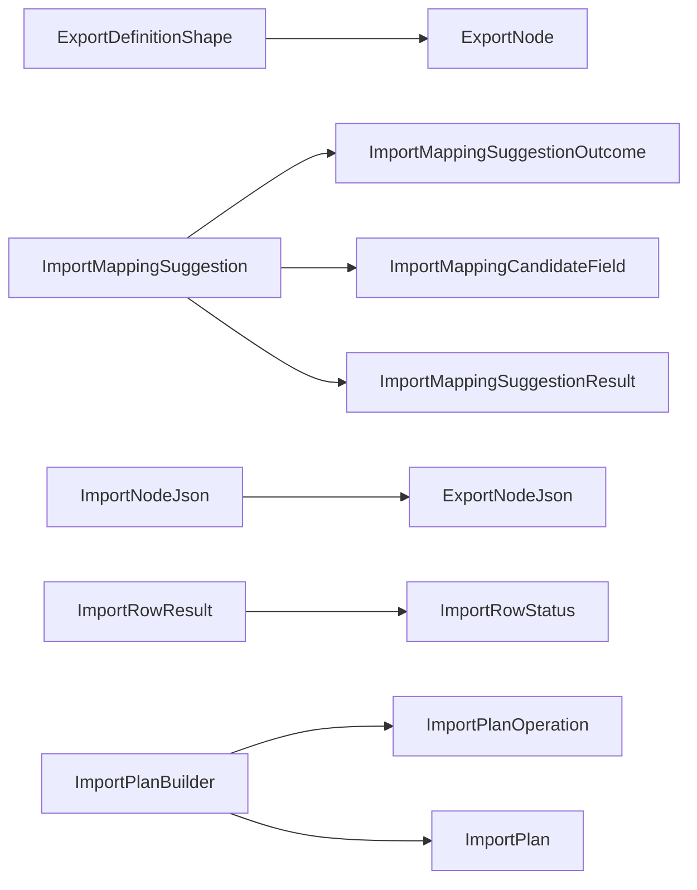

<!-- generated by docwizz: edits are overwritten -->
# src/Connector.Core/DynamicImport

Layer **domain** · project `Connector.Core`

Project navigation: [Connector.Core](../projects/Connector-Core-67ea6c7c243a.md)

## Overview 🤖

Contains classes and records for handling dynamic import operations, including suggestions, evaluations, and plans.

**Responsibilities.** Manages the logic for suggesting, evaluating, and building plans for dynamic import operations.

**Usage.** Used by the API and infrastructure modules to handle dynamic import operations.

_AI draft from the facts on this page; review it, then write the module's documentation yourself._

## Key components

| Component | Kind | Used by | Summary |
|---|---|---|---|
| [ImportNodeJson](#importnodejson) | class | 5 | Deserializes an `ImportNode` tree stored as JSON (on ImportDefinitionEntity.RootNode), backfilling missing properties the same way `ExportNodeJson` does: a tree saved before a property existed must not crash every consumer that dereferences it. Every read of a persisted `ImportNode` tree must go through this instead of a raw `Deserialize`\<T>` call. |
| [ImportPlanJson](#importplanjson) | class | 4 | Serializes/deserializes `ImportPlan` for ImportRunEntity.PlanJson (Connector.Infrastructure) — a thin wrapper (matching `ImportNodeJson`'s role for RootNode) so every read/write of that column goes through one place, even though, unlike `ImportNode`, `ImportPlan` has no recursive shape needing missing-property backfill. |
| [ImportPlanBuilder](#importplanbuilder) | class | 3 | Reshapes an `ImportWalkResult` (a per-row diff tree, built for preview/review) into an `ImportPlan` (a flat, structured write list plus the six ImportRunEntity (Connector.Infrastructure) statistics). Pure and DB-free: everything it needs is already in the walk result. Only root-row fields become operations.`ImportChildResult` diffs (an object-kind child like maintenancePlan) stay visible in the walk result for the review UI, but are never turned into a write here: AllowedWritableColumns covers root-entity columns only. A child-row write path would need a stable single-row key for an object child (`ImportChildResult` confirms a child matched but doesn't carry the matched row's own key value out of the walker) and a per-item key for an array child, which the data model doesn't have. |
| [ImportNode](#importnode) | record | 2 | One node in a recursive import tree — the write-side mirror of `ExportNode`: same shape (root/scalar-field/object/array, arbitrarily nested via `Children`, reusing `FieldMapping` verbatim for value coercion), walked in the opposite direction. Deliberately its own type rather than merged into `ExportNode`: `SourceKey` reads from inbound JSON where ExportNode.SourceField reads from SQL, `TargetColumn` writes to SQL where ExportNode.TargetKey writes to JSON, and `OnMissingChild` is a write-only policy with no export-side analogue — forcing both into one type would mean nullable fields that are meaningless half the time. |
| [ExportDefinitionShape](#exportdefinitionshape) | record | 1 | The subset of a persisted ExportDefinitionEntity (Connector.Infrastructure) that `SuggestFrom` needs. A plain Core-level record because Connector.Core has no dependency on Connector.Infrastructure. The caller loads it from ExportLogDbContext.ExportDefinitions and deserializes RootNode via `ExportNodeJson` first — this type does no I/O of its own. |
| [ImportChildResult](#importchildresult) | record | 1 | One `Object`/`Array` child's resolution result for one parent row: whether its JoinKey resolved to an existing related row, and — for `Object` children only, where "the related row" is unambiguous — the field-level diff for that row. `Array` children only get the existence check: no ImportDefinition writes to a child table, and matching individual array items to individual existing rows needs a per-item identity key the data model doesn't have. |
| [ImportFieldDiff](#importfielddiff) | record | 1 | One column-level change a walked row would make: the value currently stored in the ERP versus the (already `FieldMapping`-coerced) value the inbound record supplies. Only emitted when the two differ — an unchanged column contributes no entry, since "diff" means "what would actually change." `OldValue` is not just display data: the commit-time concurrency check uses it as the conditional write's expectedOldValue — an UPDATE guarded on the target column still matching this value — so a row whose ERP state moved on since this diff was computed is caught, not silently overwritten. |
| [ImportMappingCandidateField](#importmappingcandidatefield) | record | 1 | One best-effort candidate field offered alongside the deterministic root prefill — unchecked/disabled by default. The operator must explicitly enable it, and it still goes through the schema-aware AllowedWritableColumns validator before it can be saved as writable; matching a key name back to the same underlying column is a name-based heuristic, not a proven contract. |

## Flows through this module

- `POST /api/import-definitions`: AuditService, DataSourceProviderResolver, ExportLogDbContext, ImportDefinitionEndpoints, ImportNodeJson → AppSettingsStore, DynamicExportService, ErrorSanitizer, ImportNodeWalker, MariaDbDataSourceProvider, MeteredDataSourceProvider, +3 more → ExportNodeJson, FieldMapping, MariaDbConnectionFactory, MariaDbSchemaReader, PostgreSQL, ServiceNowClient, +1 more → MySQL, ServiceNowQueryCompiler → ServiceNowClientOptions
- `GET /api/import-definitions/{id:int}`: ExportLogDbContext, ImportDefinitionEndpoints → ImportNodeJson, SQLite → ExportNodeJson, FieldMapping
- `PUT /api/import-definitions/{id:int}`: AuditService, DataSourceProviderResolver, ExportLogDbContext, ImportDefinitionEndpoints, ImportNodeJson → AppSettingsStore, DynamicExportService, ErrorSanitizer, ImportNodeWalker, MariaDbDataSourceProvider, MeteredDataSourceProvider, +3 more → ExportNodeJson, FieldMapping, MariaDbConnectionFactory, MariaDbSchemaReader, PostgreSQL, ServiceNowClient, +1 more → MySQL, ServiceNowQueryCompiler → ServiceNowClientOptions
- `POST /api/import-definitions/{id:int}/duplicate`: AuditService, ExportLogDbContext, ImportDefinitionEndpoints → ErrorSanitizer, ImportNodeJson, SQLite → ExportNodeJson, FieldMapping
- `PATCH /api/import-definitions/{id:int}/enable`: AuditService, ExportLogDbContext, ImportDefinitionEndpoints → ErrorSanitizer, ImportNodeJson, SQLite → ExportNodeJson, FieldMapping
- `POST /api/import-definitions/{id:int}/preview`: AppSettingsStore, DataSourceProviderResolver, ErrorSanitizer, ExportLogDbContext, ImportConnection, ImportNodeJson, +2 more → DynamicExportService, ExportNodeJson, FieldMapping, MariaDbDataSourceProvider, MariaDbDialect, MeteredDataSourceProvider, +3 more → MariaDbConnectionFactory, PostgreSQL, ServiceNowTableApiProvider → MySQL
- `POST /api/import-definitions/{id:int}/records`: AuditService, DataSourceProviderResolver, ExportLogDbContext, ImportDefinitionEndpoints → AppSettingsStore, DynamicExportService, ErrorSanitizer, ImportConnection, ImportNodeJson, ImportNodeWalker, +3 more → ExportNodeJson, FieldMapping, MariaDbDataSourceProvider, MariaDbDialect, MeteredDataSourceProvider, PostgreSqlDataSourceProvider, +1 more → MariaDbConnectionFactory, PostgreSQL, ServiceNowTableApiProvider → MySQL
- `POST /api/import-definitions/{id:int}/runs`: AuditService, DataSourceProviderResolver, ExportLogDbContext, ImportDefinitionEndpoints → AppSettingsStore, DynamicExportService, ErrorSanitizer, ImportConnection, ImportNodeJson, ImportNodeWalker, +3 more → ExportNodeJson, FieldMapping, MariaDbDataSourceProvider, MariaDbDialect, MeteredDataSourceProvider, PostgreSqlDataSourceProvider, +1 more → MariaDbConnectionFactory, PostgreSQL, ServiceNowTableApiProvider → MySQL
- … 3 more in [API](../api.md#flows) and [frontend](../frontend.md#flows)

## Dependencies

Depends on: [src/Connector.Core/DynamicExport](src-Connector.Core-DynamicExport.md)

Used by: [src/Connector.Api](src-Connector.Api.md), [src/Connector.Api/Endpoints](src-Connector.Api-Endpoints.md), [src/Connector.Infrastructure](src-Connector.Infrastructure.md)

## Components

### ExportDefinitionShape

_record_ · [ImportMappingSuggestion.cs](../../src/Connector.Core/DynamicImport/ImportMappingSuggestion.cs#L12)

The subset of a persisted ExportDefinitionEntity (Connector.Infrastructure) that `SuggestFrom` needs. A plain Core-level record because Connector.Core has no dependency on Connector.Infrastructure. The caller loads it from ExportLogDbContext.ExportDefinitions and deserializes RootNode via `ExportNodeJson` first — this type does no I/O of its own.

_Linked tests:_ `ImportMappingSuggestionTests.Export` — test code that uses it, not coverage

### ImportChildResult

_record_ · [ImportNodeWalkResult.cs](../../src/Connector.Core/DynamicImport/ImportNodeWalkResult.cs#L42)

One `Object`/`Array` child's resolution result for one parent row: whether its JoinKey resolved to an existing related row, and — for `Object` children only, where "the related row" is unambiguous — the field-level diff for that row. `Array` children only get the existence check: no ImportDefinition writes to a child table, and matching individual array items to individual existing rows needs a per-item identity key the data model doesn't have.

_Linked tests:_ `ImportPlanBuilderTests.Build_ObjectChildFieldDiff_IsNotEmittedAsAnOperation` — test code that uses it, not coverage

### ImportFieldDiff

_record_ · [ImportNodeWalkResult.cs](../../src/Connector.Core/DynamicImport/ImportNodeWalkResult.cs#L10)

One column-level change a walked row would make: the value currently stored in the ERP versus the (already `FieldMapping`-coerced) value the inbound record supplies. Only emitted when the two differ — an unchanged column contributes no entry, since "diff" means "what would actually change." `OldValue` is not just display data: the commit-time concurrency check uses it as the conditional write's expectedOldValue — an UPDATE guarded on the target column still matching this value — so a row whose ERP state moved on since this diff was computed is caught, not silently overwritten.

_Linked tests:_ `ImportPlanBuilderTests.Build_AcceptedRowWithFieldDiff_CountsAsChangedAndEmitsOneOperationPerField`, `ImportPlanBuilderTests.Build_InsertedRow_CountsAsInsertAndEmitsInsertOperations`, `ImportPlanBuilderTests.Build_MultipleRowsMixedOutcomes_CountsEachExactlyOnce`, `ImportPlanBuilderTests.Build_ObjectChildFieldDiff_IsNotEmittedAsAnOperation`, `ImportNodeWalkerPostgresTests.WalkAsync_UnmatchedCorrelationKey_InsertPolicy_RowIsInsertedWithAllColumns` — test code that uses it, not coverage

### ImportMappingCandidateField

_record_ · [ImportMappingSuggestion.cs](../../src/Connector.Core/DynamicImport/ImportMappingSuggestion.cs#L39)

One best-effort candidate field offered alongside the deterministic root prefill — unchecked/disabled by default. The operator must explicitly enable it, and it still goes through the schema-aware AllowedWritableColumns validator before it can be saved as writable; matching a key name back to the same underlying column is a name-based heuristic, not a proven contract.

### ImportMappingSuggestion

_class_ · [ImportMappingSuggestion.cs](../../src/Connector.Core/DynamicImport/ImportMappingSuggestion.cs#L86)

An authoring convenience that suggests a starting ImportDefinition from a paired, provenance-tagged ExportDefinition (see knowledge/pipeline/import-mapping-presets.md). Pure: no I/O, no side effects. Never called by Connector.Infrastructure.ImportNodeWalker/ImportWorker at processing time — a matched pair only saves the operator typing at authoring time; it is never a trust or routing mechanism.

_Reached from:_ [`POST /api/import-definitions/suggest-from-export`](../api.md#flows) · _Linked tests:_ `ImportMappingSuggestionTests.Evaluate_ExactMatch_ReturnsResultWithNoMissReason` (via `ImportMappingSuggestion.Evaluate(IReadOnlyList<ExportDefinitionShape>, ImportSampleShape)`), `ImportMappingSuggestionTests.Evaluate_MatchedExportHasNoCorrelationKeySourceField_NamesMissingCorrelationKeySourceField` (via `ImportMappingSuggestion.Evaluate(IReadOnlyList<ExportDefinitionShape>, ImportSampleShape)`), `ImportMappingSuggestionTests.Evaluate_MatchingPairButDisabled_NamesDefinitionDisabled` (via `ImportMappingSuggestion.Evaluate(IReadOnlyList<ExportDefinitionShape>, ImportSampleShape)`), `ImportMappingSuggestionTests.Evaluate_NoCandidateSharesThePair_NamesNoDefinitionForPair` (via `ImportMappingSuggestion.Evaluate(IReadOnlyList<ExportDefinitionShape>, ImportSampleShape)`), `ImportMappingSuggestionTests.Evaluate_NoProvenanceOnSample_NamesNoProvenance` (via `ImportMappingSuggestion.Evaluate(IReadOnlyList<ExportDefinitionShape>, ImportSampleShape)`), `ImportMappingSuggestionTests.SuggestFrom_AmbiguousCandidates_NeverThrows_PicksOneDeterministically` (via `ImportMappingSuggestion.SuggestFrom(IReadOnlyList<ExportDefinitionShape>, ImportSampleShape)`), `ImportMappingSuggestionTests.SuggestFrom_CorrelationKeyFieldItself_NotDuplicatedAsACandidate` (via `ImportMappingSuggestion.SuggestFrom(IReadOnlyList<ExportDefinitionShape>, ImportSampleShape)`), `ImportMappingSuggestionTests.SuggestFrom_DifferentContractVersion_NoMatch` (via `ImportMappingSuggestion.SuggestFrom(IReadOnlyList<ExportDefinitionShape>, ImportSampleShape)`), +10 more — test code that uses it, not coverage

| Member | Summary | Derived from code | Complexity |
|---|---|---|---|
| [`SuggestFrom(System.Collections.Generic.IReadOnlyList<Connector.Core.DynamicImport.ExportDefinitionShape>, Connector.Core.DynamicImport.ImportSampleShape)`](../../src/Connector.Core/DynamicImport/ImportMappingSuggestion.cs#L94) | Finds the (at most one, per the save-time uniqueness constraint) enabled export among `candidates` whose (IntegrationKey, ContractVersion) equals `sample`'s pair, then builds the suggestion from it. Returns null — never throws — whenever there is nothing to suggest. Thin wrapper over `Evaluate` that drops the miss reason. |  | 1 |
| [`Evaluate(System.Collections.Generic.IReadOnlyList<Connector.Core.DynamicImport.ExportDefinitionShape>, Connector.Core.DynamicImport.ImportSampleShape)`](../../src/Connector.Core/DynamicImport/ImportMappingSuggestion.cs#L105) | Same lookup as `SuggestFrom`, but on a miss names *which* gate stopped it (`ImportMappingSuggestionMiss`) instead of collapsing every reason into a bare null — the API layer uses this to turn "no match found" into an operator-facing explanation (a candidate exists but is disabled, or exists but has no CorrelationKeySourceField, vs. no candidate at all). |  | 12 |

### ImportMappingSuggestionMiss

_enum_ · [ImportMappingSuggestion.cs](../../src/Connector.Core/DynamicImport/ImportMappingSuggestion.cs#L56)

Why `Evaluate` found nothing to suggest — every gate the lookup can silently fail on, named so the API layer (which has the entity `Name`s `Evaluate` itself never sees, per Core's no-Infrastructure-dependency rule) can turn a miss into an operator-facing explanation instead of a flat "no match." Ordered by how far the sample got.

### ImportMappingSuggestionOutcome

_record_ · [ImportMappingSuggestion.cs](../../src/Connector.Core/DynamicImport/ImportMappingSuggestion.cs#L74)

Full outcome of `Evaluate`: exactly one of `Result`/`Miss` is set.

### ImportMappingSuggestionResult

_record_ · [ImportMappingSuggestion.cs](../../src/Connector.Core/DynamicImport/ImportMappingSuggestion.cs#L44)

Result of `SuggestFrom`: the deterministic root prefill (the export's correlation key, so both sides are the same field by contract) plus the best-effort candidate list.

### ImportNode

_record_ · [ImportNode.cs](../../src/Connector.Core/DynamicImport/ImportNode.cs#L56)

One node in a recursive import tree — the write-side mirror of `ExportNode`: same shape (root/scalar-field/object/array, arbitrarily nested via `Children`, reusing `FieldMapping` verbatim for value coercion), walked in the opposite direction. Deliberately its own type rather than merged into `ExportNode`: `SourceKey` reads from inbound JSON where ExportNode.SourceField reads from SQL, `TargetColumn` writes to SQL where ExportNode.TargetKey writes to JSON, and `OnMissingChild` is a write-only policy with no export-side analogue — forcing both into one type would mean nullable fields that are meaningless half the time.

_Linked tests:_ `ImportNodeTests.Serialize_ThenDeserialize_PreservesTreeShape`, `ConnectorAlignmentPostgresTests.ImportDefinition`, `ConnectorAlignmentPostgresTests.ImportScalar`, `ImportDefinitionEndpointsPostgresTests.Root`, `ImportDefinitionEndpointsPostgresTests.Scalar`, `ImportDefinitionEndpointsPostgresTests.ValidateRequestAsync_OnMissingChildInsert_RejectsWithoutTouchingTheErp`, `ImportNodeWalkerPostgresTests.AddressesChild`, `ImportNodeWalkerPostgresTests.MaintenancePlanChild`, +10 more — test code that uses it, not coverage

### ImportNodeJson

_class_ · [ImportNode.cs](../../src/Connector.Core/DynamicImport/ImportNode.cs#L76)

Deserializes an `ImportNode` tree stored as JSON (on ImportDefinitionEntity.RootNode), backfilling missing properties the same way `ExportNodeJson` does: a tree saved before a property existed must not crash every consumer that dereferences it. Every read of a persisted `ImportNode` tree must go through this instead of a raw `Deserialize`\<T>` call.

_Reached from:_ [`POST /api/import-definitions`](../api.md#flows), [`GET /api/import-definitions/{id:int}`](../api.md#flows), [`PUT /api/import-definitions/{id:int}`](../api.md#flows), [`POST /api/import-definitions/{id:int}/duplicate`](../api.md#flows), [`PATCH /api/import-definitions/{id:int}/enable`](../api.md#flows), [`POST /api/import-definitions/{id:int}/preview`](../api.md#flows), [`POST /api/import-definitions/{id:int}/records`](../api.md#flows), [`POST /api/import-definitions/{id:int}/runs`](../api.md#flows) · _Linked tests:_ `ImportNodeTests.Deserialize_MappingMissingTransformAndDataType_BackfilledToDefaults` (via `ImportNodeJson.Deserialize(string)`), `ImportNodeTests.Deserialize_MissingKindAndOnMissingChildAndChildren_BackfilledRecursively` (via `ImportNodeJson.Deserialize(string)`), `ImportNodeTests.Deserialize_NoMapping_StaysNull` (via `ImportNodeJson.Deserialize(string)`), `ImportNodeTests.Serialize_ThenDeserialize_PreservesTreeShape` (via `ImportNodeJson.Deserialize(string)`), `ConnectorAlignmentPostgresTests.ImportDefinition` (via `ImportNodeJson.Serialize(ImportNode)`), `ImportWorkerPostgresTests.SeedDefinitionAsync` (via `ImportNodeJson.Serialize(ImportNode)`), `IntegrationKeyValidationTests.Import_DifferentContractVersionOfSameKey_DoesNotConflict` (via `ImportNodeJson.Serialize(ImportNode)`), `IntegrationKeyValidationTests.Import_SecondEnabledDefinitionWithSamePair_Rejected` (via `ImportNodeJson.Serialize(ImportNode)`) — test code that uses it, not coverage

| Member | Summary | Derived from code | Complexity |
|---|---|---|---|
| [`Deserialize(string)`](../../src/Connector.Core/DynamicImport/ImportNode.cs#L78) |  |  | 2 |
| [`Serialize(Connector.Core.DynamicImport.ImportNode)`](../../src/Connector.Core/DynamicImport/ImportNode.cs#L84) |  |  | 1 |

### ImportNodeKind

_class_ · [ImportNode.cs](../../src/Connector.Core/DynamicImport/ImportNode.cs#L10)

Discriminator values for `Kind` — same set as `ExportNodeKind`, kept as its own type since `ImportNode` intentionally doesn't merge into `ExportNode` (see that record's doc comment for why).

### ImportPlan

_record_ · [ImportPlan.cs](../../src/Connector.Core/DynamicImport/ImportPlan.cs#L38)

The persisted write protocol for one ImportRunEntity (Connector.Infrastructure): `Operations` is the structured, versioned list ImportRunReleaser commits from, and the only authoritative source for what a release actually writes — a UI diff or audit-log line is a read projection of this, never a second independently-computed shape. The five counts mirror ImportRunEntity's own (`MatchedCount` = `ChangedCount` + `UnchangedCount`) so the entity can be populated by copying this record's fields verbatim.

_Linked tests:_ `ImportRunEndpointsHttpTests.Release_ValidApprovalButNoDataSourceConfigured_MarksRunFailedAndReturns500`, `ImportRunReleaserPostgresTests.InsertPlan`, `ImportRunReleaserPostgresTests.ReleaseAsync_UnrelatedFailureMidCommit_RollsBackEverythingAndMarksFailed`, `ImportRunReleaserPostgresTests.ReleaseAsync_UpdateOfDateAndTextColumns_ConvertsToColumnTypes`, `ImportRunReleaserPostgresTests.SingleOperationPlan` — test code that uses it, not coverage

### ImportPlanBuilder

_class_ · [ImportPlanBuilder.cs](../../src/Connector.Core/DynamicImport/ImportPlanBuilder.cs#L16)

Reshapes an `ImportWalkResult` (a per-row diff tree, built for preview/review) into an `ImportPlan` (a flat, structured write list plus the six ImportRunEntity (Connector.Infrastructure) statistics). Pure and DB-free: everything it needs is already in the walk result. Only root-row fields become operations.`ImportChildResult` diffs (an object-kind child like maintenancePlan) stay visible in the walk result for the review UI, but are never turned into a write here: AllowedWritableColumns covers root-entity columns only. A child-row write path would need a stable single-row key for an object child (`ImportChildResult` confirms a child matched but doesn't carry the matched row's own key value out of the walker) and a per-item key for an array child, which the data model doesn't have.

_Reached from:_ [`POST /api/import-definitions/{id:int}/preview`](../api.md#flows), [`POST /api/import-definitions/{id:int}/records`](../api.md#flows), [`POST /api/import-definitions/{id:int}/runs`](../api.md#flows) · _Linked tests:_ `ImportPlanBuilderTests.Build_AcceptedRowWithFieldDiff_CountsAsChangedAndEmitsOneOperationPerField` (via `ImportPlanBuilder.Build(ImportWalkResult, string, string)`), `ImportPlanBuilderTests.Build_AcceptedRowWithNoFieldDiff_CountsAsUnchangedAndEmitsNoOperation` (via `ImportPlanBuilder.Build(ImportWalkResult, string, string)`), `ImportPlanBuilderTests.Build_InsertedRow_CountsAsInsertAndEmitsInsertOperations` (via `ImportPlanBuilder.Build(ImportWalkResult, string, string)`), `ImportPlanBuilderTests.Build_InvalidRow_CountsSeparatelyFromRejected` (via `ImportPlanBuilder.Build(ImportWalkResult, string, string)`), `ImportPlanBuilderTests.Build_MultipleRowsMixedOutcomes_CountsEachExactlyOnce` (via `ImportPlanBuilder.Build(ImportWalkResult, string, string)`), `ImportPlanBuilderTests.Build_ObjectChildFieldDiff_IsNotEmittedAsAnOperation` (via `ImportPlanBuilder.Build(ImportWalkResult, string, string)`), `ImportPlanBuilderTests.Build_QuarantinedRow_FoldsIntoRejectedCount` (via `ImportPlanBuilder.Build(ImportWalkResult, string, string)`), `ImportPlanBuilderTests.Build_RejectedRow_CountsAsRejectedNotMatched` (via `ImportPlanBuilder.Build(ImportWalkResult, string, string)`) — test code that uses it, not coverage

| Member | Summary | Derived from code | Complexity |
|---|---|---|---|
| [`Build(Connector.Core.DynamicImport.ImportWalkResult, string, string)`](../../src/Connector.Core/DynamicImport/ImportPlanBuilder.cs#L24) | Builds the commit-ready `ImportPlan` for one `walkResult`, addressing every operation's row via `rootTable`/`rootMatchColumn` — the same pair ImportNodeWalker.WalkAsync matched each row against, so the commit step can never target a row the walker didn't actually resolve. |  | 9 |

### ImportPlanJson

_class_ · [ImportPlan.cs](../../src/Connector.Core/DynamicImport/ImportPlan.cs#L57)

Serializes/deserializes `ImportPlan` for ImportRunEntity.PlanJson (Connector.Infrastructure) — a thin wrapper (matching `ImportNodeJson`'s role for RootNode) so every read/write of that column goes through one place, even though, unlike `ImportNode`, `ImportPlan` has no recursive shape needing missing-property backfill.

_Reached from:_ [`POST /api/import-definitions/{id:int}/records`](../api.md#flows), [`POST /api/import-definitions/{id:int}/runs`](../api.md#flows), [`GET /api/import-runs/{id:int}`](../api.md#flows), [`POST /api/import-runs/{id:int}/release`](../api.md#flows) · _Linked tests:_ `ImportPlanBuilderTests.PlanJson_StoredBeforeInserts_ReadsAsUpdatesWithZeroInserts` (via `ImportPlanJson.Deserialize(string)`), `ImportRunEndpointsHttpTests.Release_ValidApprovalButNoDataSourceConfigured_MarksRunFailedAndReturns500` (via `ImportPlanJson.Serialize(ImportPlan)`), `ImportRunReleaserPostgresTests.SeedRunAsync` (via `ImportPlanJson.Serialize(ImportPlan)`) — test code that uses it, not coverage

| Member | Summary | Derived from code | Complexity |
|---|---|---|---|
| [`Deserialize(string)`](../../src/Connector.Core/DynamicImport/ImportPlan.cs#L59) |  |  | 1 |
| [`Serialize(Connector.Core.DynamicImport.ImportPlan)`](../../src/Connector.Core/DynamicImport/ImportPlan.cs#L61) |  |  | 1 |

### ImportPlanOperation

_record_ · [ImportPlan.cs](../../src/Connector.Core/DynamicImport/ImportPlan.cs#L17)

One column-level write the commit step makes: the value observed on the ERP row when the plan was built (`ExpectedOldValue`) and the value to write in its place. This is the same value `OldValue` already carries — the field is renamed here, not re-derived, to make its second job explicit: ImportRunReleaser's (Connector.Infrastructure) conditional UPDATE ... WHERE ... IS NOT DISTINCT FROM @expectedOldValue guard uses this exact value, so a row whose ERP state moved on since staging is excluded from the commit rather than silently overwritten. `CorrelationValue` is carried for audit/troubleshooting only — the commit itself addresses the row via `Table`/`KeyColumn`/`KeyValue`, which are always RootTable/RootMatchColumn/the matched root row's correlation value (see `ImportPlanBuilder` for why child-table writes aren't emitted here).

_Linked tests:_ `ImportRunReleaserPostgresTests.InsertPlan`, `ImportRunReleaserPostgresTests.ReleaseAsync_UnrelatedFailureMidCommit_RollsBackEverythingAndMarksFailed`, `ImportRunReleaserPostgresTests.ReleaseAsync_UpdateOfDateAndTextColumns_ConvertsToColumnTypes`, `ImportRunReleaserPostgresTests.SingleOperationPlan` — test code that uses it, not coverage

### ImportRowResult

_record_ · [ImportNodeWalkResult.cs](../../src/Connector.Core/DynamicImport/ImportNodeWalkResult.cs#L55)

One inbound record's full walk result: whether its root row was matched, the field-level diff if so, and the resolution of every object/array child under it. `CorrelationValue` is kept even for a rejected/quarantined row (null only when the record had no readable correlation value at all) so a review UI can show which vendor record failed to match, not just a bare count.

_Linked tests:_ `ImportPlanBuilderTests.AcceptedRow`, `ImportPlanBuilderTests.Build_InsertedRow_CountsAsInsertAndEmitsInsertOperations`, `ImportPlanBuilderTests.Build_InvalidRow_CountsSeparatelyFromRejected`, `ImportPlanBuilderTests.Build_MultipleRowsMixedOutcomes_CountsEachExactlyOnce`, `ImportPlanBuilderTests.Build_ObjectChildFieldDiff_IsNotEmittedAsAnOperation`, `ImportPlanBuilderTests.Build_QuarantinedRow_FoldsIntoRejectedCount`, `ImportPlanBuilderTests.Build_RejectedRow_CountsAsRejectedNotMatched` — test code that uses it, not coverage

### ImportRowStatus

_enum_ · [ImportNodeWalkResult.cs](../../src/Connector.Core/DynamicImport/ImportNodeWalkResult.cs#L24)

Outcome of matching one inbound record's correlation key against RootTable/ RootMatchColumn. `Rejected` and `Quarantined` both mean "excluded from the accepted set" (see `UnmatchedRootPolicy`) — kept distinct here so a review UI can show which policy fired, not just that the record didn't match; `ImportPlanBuilder` folds both into ImportRunEntity.RejectedCount, since that entity has no separate quarantine counter. `Invalid` is for a record that isn't even a well-formed row to evaluate a policy against (e.g. not a JSON object) — distinct from `Rejected`, which means the row parsed fine but its correlation key didn't match anything. `Accepted` covers both "matched/changed" and "matched/unchanged" — a row whose target fields already equal the incoming values is still `Accepted` here, just with an empty `Fields` diff; `ImportPlanBuilder` is what splits that back out into ChangedCount/ UnchangedCount.

### ImportSampleShape

_record_ · [ImportMappingSuggestion.cs](../../src/Connector.Core/DynamicImport/ImportMappingSuggestion.cs#L27)

The inbound sample a suggestion is built from: the provenance pair read off the sample ImportEnvelope (null when the sample carries no provenance block, which yields no suggestion, never an error) and the top-level JSON key names of one sample record, used only for the best-effort candidate-field scan.

_Linked tests:_ `ImportMappingSuggestionTests.Sample` — test code that uses it, not coverage

### ImportValidationException

_class_ · [ImportNodeWalkResult.cs](../../src/Connector.Core/DynamicImport/ImportNodeWalkResult.cs#L78)

Thrown for a structural problem with the saved ImportDefinition itself (a TargetColumn outside AllowedWritableColumns, a missing root match field, malformed inbound JSON) — never for an individual record's data, which is reported via `ImportRowResult` instead. Distinguishing the two matters to the caller: a thrown exception means "this run cannot proceed at all," while a rejected/quarantined row is a normal, expected part of a successful walk.

### ImportWalkResult

_record_ · [ImportNodeWalkResult.cs](../../src/Connector.Core/DynamicImport/ImportNodeWalkResult.cs#L66)

Full result of walking one inbound JSON file against one `ImportNode` tree: a diff-only shape for preview/review. The persisted write list (PlanJson) is built from it by `ImportPlanBuilder`.

_Linked tests:_ `ImportPlanBuilderTests.Build_AcceptedRowWithFieldDiff_CountsAsChangedAndEmitsOneOperationPerField`, `ImportPlanBuilderTests.Build_AcceptedRowWithNoFieldDiff_CountsAsUnchangedAndEmitsNoOperation`, `ImportPlanBuilderTests.Build_InsertedRow_CountsAsInsertAndEmitsInsertOperations`, `ImportPlanBuilderTests.Build_InvalidRow_CountsSeparatelyFromRejected`, `ImportPlanBuilderTests.Build_MultipleRowsMixedOutcomes_CountsEachExactlyOnce`, `ImportPlanBuilderTests.Build_ObjectChildFieldDiff_IsNotEmittedAsAnOperation`, `ImportPlanBuilderTests.Build_QuarantinedRow_FoldsIntoRejectedCount`, `ImportPlanBuilderTests.Build_RejectedRow_CountsAsRejectedNotMatched` — test code that uses it, not coverage

### OnMissingChildPolicy

_class_ · [ImportNode.cs](../../src/Connector.Core/DynamicImport/ImportNode.cs#L29)

Discriminator values for `OnMissingChild`: what happens to an object/array child node whose `JoinKey` doesn't resolve to an existing row. Only meaningful for `Object`/`Array` nodes — root rows are match-only unless the definition opts into `Insert`.

### UnmatchedRootPolicy

_class_ · [ImportNode.cs](../../src/Connector.Core/DynamicImport/ImportNode.cs#L39)

Discriminator values for ImportDefinitionEntity.UnmatchedRootPolicy: what happens to an inbound record whose correlation key matches no root row. `Insert` creates the row, and is only accepted on a definition with an IntegrationKey (a connector-to-connector contract, never a vendor file).

---
_Generated from 33 symbols in [src/Connector.Core/DynamicImport/ImportMappingSuggestion.cs](../../src/Connector.Core/DynamicImport/ImportMappingSuggestion.cs), [src/Connector.Core/DynamicImport/ImportNode.cs](../../src/Connector.Core/DynamicImport/ImportNode.cs), [src/Connector.Core/DynamicImport/ImportNodeWalkResult.cs](../../src/Connector.Core/DynamicImport/ImportNodeWalkResult.cs), [src/Connector.Core/DynamicImport/ImportPlan.cs](../../src/Connector.Core/DynamicImport/ImportPlan.cs), [src/Connector.Core/DynamicImport/ImportPlanBuilder.cs](../../src/Connector.Core/DynamicImport/ImportPlanBuilder.cs) (commit `b3fcbdc`, profile `default`). Sections marked _fact_ are read from the code, _inferred_ come from heuristics, 🤖 marks AI drafts._
