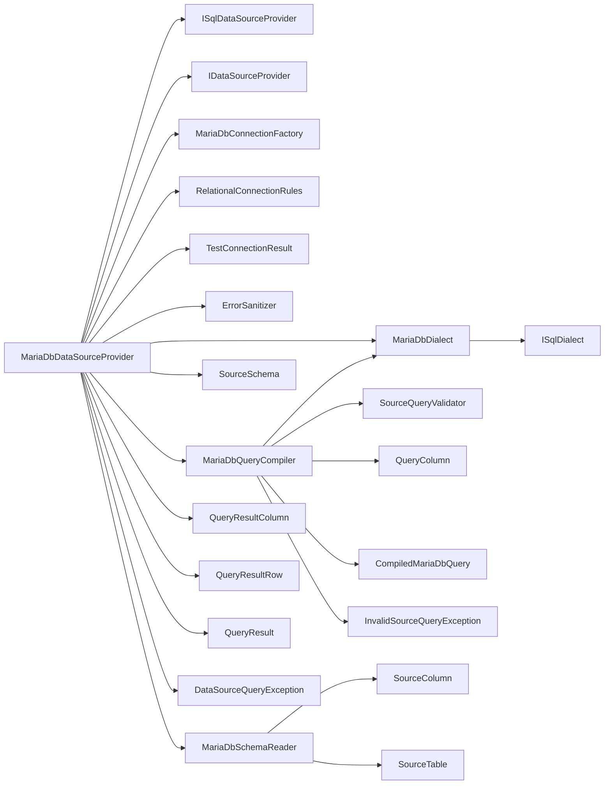

<!-- generated by docwizz: edits are overwritten -->
# src/Connector.Infrastructure/DataSources/MariaDb

Layer **infrastructure** · project `Connector.Infrastructure`

Project navigation: [Connector.Infrastructure](../projects/Connector-Infrastructure-1bd055e8121e.md)

## Overview 🤖

Manages MariaDB data source connections and queries.

**Responsibilities.** Provides connection factory and data source provider for MariaDB, handling connection management, query compilation, and schema reading.

_AI draft from the facts on this page; review it, then write the module's documentation yourself._

## Key components

| Component | Kind | Used by | Summary |
|---|---|---|---|
| [MariaDbDialect](#mariadbdialect) | class | 2 | `ISqlDialect` for MariaDB — every MariaDB-specific fragment the generic query builders emit: backtick identifier quoting, @pN parameter placeholders (MySqlConnector's named-parameter syntax), LIMIT n, CAST(… AS CHAR), \<=>, GROUP_CONCAT, and how a value in `MariaDbDataSourceProvider`'s native text format maps to JSON. Stateless; use `Instance`. |
| [CompiledMariaDbQuery](#compiledmariadbquery) | record | 1 | A `SourceQuery` compiled to MariaDB: SQL text plus the @p0, @p1, … parameters it references. |
| [MariaDbConnectionFactory](#mariadbconnectionfactory) | class | 1 | Builds and opens `MySqlConnection`s for a `MariaDb``DataSourceConfig`. Every field is set as a typed builder property, never interpolated into the connection-string text, so no value (e.g. a password containing ;Server=evil) can add or override a key — the same rule as PostgreSqlDataSourceProvider.BuildConnectionString. |
| [MariaDbQueryCompiler](#mariadbquerycompiler) | class | 1 | Compiles the database-neutral `SourceQuery` into MariaDB SQL — the MariaDB counterpart of PostgreSqlQueryCompiler, with the same guarantees: validated against the given `SourceSchema` first (`SourceQueryValidator`), so every emitted identifier is one the schema reported (backtick-quoted by `MariaDbDialect`); synthetic table aliases (t0, t1, …); every filter value a bound parameter; `Limit` an `Int32` rendered by the dialect. |
| [MariaDbSchemaReader](#mariadbschemareader) | class | 1 | Reads the tables of the connection's current database (DATABASE()) from information_schema (TABLES, COLUMNS, KEY_COLUMN_USAGE, REFERENTIAL_CONSTRAINTS) into the same `SourceTable` shape the PostgreSQL provider returns. |
| [MariaDbDataSourceProvider](#mariadbdatasourceprovider) | class | 0 | The `IDataSourceProvider` for `MariaDb`, over MySqlConnector — the same contract as PostgreSqlDataSourceProvider: connection test and schema read (`MariaDbSchemaReader`), neutral queries (`MariaDbQueryCompiler`) and native SQL the export builders render with `MariaDbDialect`. Stateless singleton; every call opens and disposes its own connection (`MariaDbConnectionFactory`). |

## External systems

- MySQL (database, detected) — used by `MariaDbConnectionFactory`

See [system context](../views/context.md).

## Flows through this module

- `POST /api/connection`: AppSettingsStore, ConnectionEndpoints, DataSourceProviderResolver, ErrorSanitizer, ExportLogDbContext, MariaDbDataSourceProvider, +4 more → MariaDbConnectionFactory, MariaDbSchemaReader, PostgreSQL, RelationalConnectionRules, ServiceNowClient, ServiceNowSchemaReader, +2 more → MySQL, ServiceNowQueryCompiler → ServiceNowClientOptions
- `POST /api/export-definitions/{id:int}/preview`: AppSettingsStore, DataSourceProviderResolver, DynamicExportService, ErrorSanitizer, ExportLogDbContext, ExportNodeJson → DataSourceCapabilities, FieldMapping, MariaDbDataSourceProvider, MariaDbDialect, MeteredDataSourceProvider, PostgreSqlDataSourceProvider, +3 more → MariaDbConnectionFactory, PostgreSQL, PostgreSqlJsonValues → MySQL
- `POST /api/export-definitions/{id:int}/run`: AuditService, DataSourceProviderResolver, DynamicExportService, ExportDefinitionEndpoints, ExportDefinitionRunner, ExportLogDbContext → AppSettingsStore, ErrorSanitizer, ExportNodeJson, FileSystemExportSink, ManifestSigningPolicy, SQLite → CsvExportFormatWriter, DataSourceCapabilities, ExcelExportFormatWriter, ExportFormatWriterFactory, ExportSchema, FieldMapping, +9 more → MariaDbConnectionFactory, PostgreSQL, PostgreSqlJsonValues → MySQL
- `POST /api/export-definitions/{id:int}/run-selected`: AuditService, DataSourceProviderResolver, DynamicExportService, ExportDefinitionEndpoints, ExportDefinitionRunner, ExportLogDbContext, +1 more → AppSettingsStore, ErrorSanitizer, FieldMapping, FileSystemExportSink, ManifestSigningPolicy, SQLite → CsvExportFormatWriter, DataSourceCapabilities, ExcelExportFormatWriter, ExportFormatWriterFactory, ExportSchema, File system, +8 more → MariaDbConnectionFactory, PostgreSQL, PostgreSqlJsonValues → MySQL
- `POST /api/export-definitions/{id:int}/test`: AuditService, DataSourceProviderResolver, ExportDefinitionEndpoints, ExportDefinitionRunner, ExportLogDbContext → AppSettingsStore, DynamicExportService, ErrorSanitizer, ExportNodeJson, FileSystemExportSink, ManifestSigningPolicy, +1 more → CsvExportFormatWriter, DataSourceCapabilities, ExcelExportFormatWriter, ExportFormatWriterFactory, ExportSchema, FieldMapping, +9 more → MariaDbConnectionFactory, PostgreSQL, PostgreSqlJsonValues → MySQL
- `POST /api/import-definitions`: AuditService, DataSourceProviderResolver, ExportLogDbContext, ImportDefinitionEndpoints, ImportNodeJson → AppSettingsStore, DynamicExportService, ErrorSanitizer, ImportNodeWalker, MariaDbDataSourceProvider, MeteredDataSourceProvider, +3 more → ExportNodeJson, FieldMapping, MariaDbConnectionFactory, MariaDbSchemaReader, PostgreSQL, ServiceNowClient, +1 more → MySQL, ServiceNowQueryCompiler → ServiceNowClientOptions
- `PUT /api/import-definitions/{id:int}`: AuditService, DataSourceProviderResolver, ExportLogDbContext, ImportDefinitionEndpoints, ImportNodeJson → AppSettingsStore, DynamicExportService, ErrorSanitizer, ImportNodeWalker, MariaDbDataSourceProvider, MeteredDataSourceProvider, +3 more → ExportNodeJson, FieldMapping, MariaDbConnectionFactory, MariaDbSchemaReader, PostgreSQL, ServiceNowClient, +1 more → MySQL, ServiceNowQueryCompiler → ServiceNowClientOptions
- `POST /api/import-definitions/{id:int}/preview`: AppSettingsStore, DataSourceProviderResolver, ErrorSanitizer, ExportLogDbContext, ImportConnection, ImportNodeJson, +2 more → DynamicExportService, ExportNodeJson, FieldMapping, MariaDbDataSourceProvider, MariaDbDialect, MeteredDataSourceProvider, +3 more → MariaDbConnectionFactory, PostgreSQL, ServiceNowTableApiProvider → MySQL
- … 7 more in [API](../api.md#flows) and [frontend](../frontend.md#flows)

## Architecture observations

- `MariaDbDataSourceProvider` depends on 14 other components — high coupling, possibly several responsibilities

## Dependencies

Depends on: [src/Connector.Core/DataSources](src-Connector.Core-DataSources.md), [src/Connector.Infrastructure](src-Connector.Infrastructure.md), [src/Connector.Infrastructure/DataSources](src-Connector.Infrastructure-DataSources.md)

## Components

### CompiledMariaDbQuery

_record_ · [MariaDbQueryCompiler.cs](../../src/Connector.Infrastructure/DataSources/MariaDb/MariaDbQueryCompiler.cs#L9)

A `SourceQuery` compiled to MariaDB: SQL text plus the @p0, @p1, … parameters it references.

### MariaDbConnectionFactory

_class_ · [MariaDbConnectionFactory.cs](../../src/Connector.Infrastructure/DataSources/MariaDb/MariaDbConnectionFactory.cs#L12)

Builds and opens `MySqlConnection`s for a `MariaDb``DataSourceConfig`. Every field is set as a typed builder property, never interpolated into the connection-string text, so no value (e.g. a password containing ;Server=evil) can add or override a key — the same rule as PostgreSqlDataSourceProvider.BuildConnectionString.

_Reached from:_ [`POST /api/connection`](../api.md#flows), [`POST /api/export-definitions/{id:int}/preview`](../api.md#flows), [`POST /api/export-definitions/{id:int}/run`](../api.md#flows), [`POST /api/export-definitions/{id:int}/run-selected`](../api.md#flows), [`POST /api/export-definitions/{id:int}/test`](../api.md#flows), [`POST /api/import-definitions`](../api.md#flows), [`PUT /api/import-definitions/{id:int}`](../api.md#flows), [`POST /api/import-definitions/{id:int}/preview`](../api.md#flows), +7 more · _Linked tests:_ `ExportLoadTests.SeedMariaDbAsync` (via `MariaDbConnectionFactory.OpenAsync(DataSourceConfig, CancellationToken)`), `MariaDbDataSourceProviderTests.BuildConnectionString_InjectionPayloadInPassword_DoesNotOverrideServer` (via `MariaDbConnectionFactory.BuildConnectionString(DataSourceConfig)`), `MariaDbDataSourceProviderTests.BuildConnectionString_MapsSharedSslModeNames` (via `MariaDbConnectionFactory.BuildConnectionString(DataSourceConfig)`), `MariaDbDataSourceProviderTests.BuildConnectionString_UnsetPort_DefaultsTo3306` (via `MariaDbConnectionFactory.BuildConnectionString(DataSourceConfig)`), `MariaDbTestFixture.IsAvailableAsync` (via `MariaDbConnectionFactory.OpenAsync(DataSourceConfig, CancellationToken)`) — test code that uses it, not coverage

| Member | Summary | Derived from code | Complexity |
|---|---|---|---|
| [`BuildConnectionString(Connector.Core.DataSources.DataSourceConfig)`](../../src/Connector.Infrastructure/DataSources/MariaDb/MariaDbConnectionFactory.cs#L16) |  |  | 2 |
| [`OpenAsync(Connector.Core.DataSources.DataSourceConfig, System.Threading.CancellationToken)`](../../src/Connector.Infrastructure/DataSources/MariaDb/MariaDbConnectionFactory.cs#L36) | Opens a MariaDB/MySQL connection from the stored config (5s connect timeout, zero dates read as DateTime.MinValue). The connection is disposed if opening fails; on success the caller owns it. |  | 2 |

### MariaDbDataSourceProvider

_class_ · [MariaDbDataSourceProvider.cs](../../src/Connector.Infrastructure/DataSources/MariaDb/MariaDbDataSourceProvider.cs#L14)

The `IDataSourceProvider` for `MariaDb`, over MySqlConnector — the same contract as PostgreSqlDataSourceProvider: connection test and schema read (`MariaDbSchemaReader`), neutral queries (`MariaDbQueryCompiler`) and native SQL the export builders render with `MariaDbDialect`. Stateless singleton; every call opens and disposes its own connection (`MariaDbConnectionFactory`).

_Reached from:_ [`POST /api/connection`](../api.md#flows), [`POST /api/export-definitions/{id:int}/preview`](../api.md#flows), [`POST /api/export-definitions/{id:int}/run`](../api.md#flows), [`POST /api/export-definitions/{id:int}/run-selected`](../api.md#flows), [`POST /api/export-definitions/{id:int}/test`](../api.md#flows), [`POST /api/import-definitions`](../api.md#flows), [`PUT /api/import-definitions/{id:int}`](../api.md#flows), [`POST /api/import-definitions/{id:int}/preview`](../api.md#flows), +7 more · _Linked tests:_ `DataSourceConfigValidationTests.ImportConnection_ProviderWithoutImportsCapability_IsRefused`, `DataSourceConfigValidationTests.Relational`, `DataSourceProviderResolverTests.Resolve_MariaDb_ReturnsTheRegisteredMariaDbProvider`, `DataSourceSecurityTests.BackendAsync`, `ExportLoadTests.OrderLinesTree_QueryCountIsIndependentOfRecordCount`, `MariaDbProviderContractTests.CreateProvider`, `DataSourceSecurityTests.RecordingProvider` (via `Connector.Infrastructure.DataSources.ISqlDataSourceProvider`), `MariaDbDataSourceProviderTests.ExecuteAsync_JoinWhereAndLimit_WithBoundParameters` (via `MariaDbDataSourceProvider.ExecuteAsync(DataSourceConfig, SourceQuery, CancellationToken)`), +10 more — test code that uses it, not coverage

| Member | Summary | Derived from code | Complexity |
|---|---|---|---|
| [`OpenConnectionAsync(Connector.Core.DataSources.DataSourceConfig, System.Threading.CancellationToken)`](../../src/Connector.Infrastructure/DataSources/MariaDb/MariaDbDataSourceProvider.cs#L24) | An open ADO.NET connection for callers that need more than one query per call — the import path's multi-statement transaction. The caller disposes it. |  | 1 |
| [`ValidateConfig(Connector.Core.DataSources.DataSourceConfig)`](../../src/Connector.Infrastructure/DataSources/MariaDb/MariaDbDataSourceProvider.cs#L29) | Whether `config` has what this provider needs to connect (required fields, a valid TLS mode or instance URL): a user-facing message, or null when it's usable. Checked before any connection attempt; the only place per-source-type config rules live. |  | 1 |
| [`TargetHost(Connector.Core.DataSources.DataSourceConfig)`](../../src/Connector.Infrastructure/DataSources/MariaDb/MariaDbDataSourceProvider.cs#L31) | The host a connection with the (validated) `config` reaches — what the SSRF check in POST /api/connection resolves. |  | 1 |
| [`IsAlwaysEncrypted(Connector.Core.DataSources.DataSourceConfig)`](../../src/Connector.Infrastructure/DataSources/MariaDb/MariaDbDataSourceProvider.cs#L33) | True when `config` can only ever reach the source encrypted — never falling back to plaintext. |  | 1 |
| [`TestConnectionAsync(Connector.Core.DataSources.DataSourceConfig, System.Threading.CancellationToken)`](../../src/Connector.Infrastructure/DataSources/MariaDb/MariaDbDataSourceProvider.cs#L39) | Never throws for a reachability/credential failure — reported, sanitized, via `Failed` instead. |  | 2 |
| [`ReadSchemaAsync(Connector.Core.DataSources.DataSourceConfig, System.Threading.CancellationToken)`](../../src/Connector.Infrastructure/DataSources/MariaDb/MariaDbDataSourceProvider.cs#L54) | Reads the live schema (tables/columns/PK/FK) of the data source described by `config`. Throws on failure — unlike `TestConnectionAsync`, this is called once a connection is already known-good and a failure here is a real, reportable error. |  | 1 |
| [`ExecuteAsync(Connector.Core.DataSources.DataSourceConfig, Connector.Core.DataSources.SourceQuery, System.Threading.CancellationToken)`](../../src/Connector.Infrastructure/DataSources/MariaDb/MariaDbDataSourceProvider.cs#L63) | Compiles against the live schema (read fresh, so a dropped column fails as `InvalidSourceQueryException` before any SQL runs) and executes. |  | 1 |
| [`ExecuteNativeAsync(Connector.Core.DataSources.DataSourceConfig, Connector.Core.DataSources.NativeSqlQuery, System.Threading.CancellationToken)`](../../src/Connector.Infrastructure/DataSources/MariaDb/MariaDbDataSourceProvider.cs#L81) | Executes caller-built, provider-native SQL as-is and returns its rows generically — the path DynamicExportService's JSON-tree builders still use for what `SourceQuery` cannot express yet (knowledge/architecture/source-query-model.md §5). Same error contract as `ExecuteAsync`, minus schema validation. |  | 4 |

### MariaDbDialect

_class_ · [MariaDbDialect.cs](../../src/Connector.Infrastructure/DataSources/MariaDb/MariaDbDialect.cs#L13)

`ISqlDialect` for MariaDB — every MariaDB-specific fragment the generic query builders emit: backtick identifier quoting, @pN parameter placeholders (MySqlConnector's named-parameter syntax), LIMIT n, CAST(… AS CHAR), \<=>, GROUP_CONCAT, and how a value in `MariaDbDataSourceProvider`'s native text format maps to JSON. Stateless; use `Instance`.

_Reached from:_ [`POST /api/export-definitions/{id:int}/preview`](../api.md#flows), [`POST /api/export-definitions/{id:int}/run`](../api.md#flows), [`POST /api/export-definitions/{id:int}/run-selected`](../api.md#flows), [`POST /api/export-definitions/{id:int}/test`](../api.md#flows), [`POST /api/import-definitions/{id:int}/preview`](../api.md#flows), [`POST /api/import-definitions/{id:int}/records`](../api.md#flows), [`POST /api/import-definitions/{id:int}/runs`](../api.md#flows), [`POST /api/import-runs/{id:int}/release`](../api.md#flows), +3 more

| Member | Summary | Derived from code | Complexity |
|---|---|---|---|
| [`QuoteIdentifier(string)`](../../src/Connector.Infrastructure/DataSources/MariaDb/MariaDbDialect.cs#L20) | Quotes a table/column/alias name so it is always read as an identifier, never as syntax. |  | 1 |
| [`BuildParameterName(int)`](../../src/Connector.Infrastructure/DataSources/MariaDb/MariaDbDialect.cs#L22) | The placeholder for the `index`-th bound parameter, as it appears in SQL text. Also a valid parameter name for the matching driver's parameter collection. |  | 1 |
| [`BuildLimit(int)`](../../src/Connector.Infrastructure/DataSources/MariaDb/MariaDbDialect.cs#L24) | The clause appended to a SELECT to cap its row count at `limit`. |  | 1 |
| [`QuoteStringLiteral(string)`](../../src/Connector.Infrastructure/DataSources/MariaDb/MariaDbDialect.cs#L28) | A string literal holding `value` verbatim — for constant text that has to be part of the statement itself (a JSON object key, an aggregation delimiter) rather than a parameter. |  | 1 |
| [`CastToText(string)`](../../src/Connector.Infrastructure/DataSources/MariaDb/MariaDbDialect.cs#L30) | Converts `expression` to text, so it can be compared with a text value or emitted as text regardless of the column's own type. |  | 1 |
| [`BuildNullSafeEquals(string, string)`](../../src/Connector.Infrastructure/DataSources/MariaDb/MariaDbDialect.cs#L32) | A null-safe equality test: true when both sides are equal or both are null. |  | 1 |
| [`BuildMatchesAny(string, System.Collections.Generic.IReadOnlyList<string>, System.Collections.Generic.IDictionary<string, object?>)`](../../src/Connector.Infrastructure/DataSources/MariaDb/MariaDbDialect.cs#L36) | True when `expression` equals any of `values` — how the export tree engine fetches every child row of a whole level in one query instead of one query per parent. Binds the values into `parameters` (named from `BuildParameterName`, continuing at its current count) in whatever shape the backend needs: one array parameter, or one parameter per value. |  | 2 |
| [`ConvertNativeTextToJson(string, string)`](../../src/Connector.Infrastructure/DataSources/MariaDb/MariaDbDialect.cs#L59) | Maps a value in `MariaDbDataSourceProvider`'s native text format (see its FormatNative) to the JSON value PostgreSQL's to_json gives the equivalent column, so a nested export is the same document against either backend: numeric types → JSON numbers with the same digits, BOOL (TINYINT(1)) → true/false, JSON → embedded, DATETIME/TIMESTAMP → ISO 8601 with a T, everything else → a string. |  | 7 |
| [`FormatValue(object, string)`](../../src/Connector.Infrastructure/DataSources/MariaDb/MariaDbDialect.cs#L73) | The connector's string form of a non-null column `value` as the driver returned it, for a column the backend calls `dataType`: date/timestamp columns as yyyy-MM-dd, everything else the value's own ToString(). Shared by the provider's row materialization and the import walker, so old values read for a diff match exported values exactly. |  | 4 |
| [`BuildStringAggregate(string, string)`](../../src/Connector.Infrastructure/DataSources/MariaDb/MariaDbDialect.cs#L80) | Aggregates `expression` (as text) over the rows of the enclosing SELECT into one string joined by `delimiter`; null values are skipped. |  | 1 |
| [`BuildSetClause(string, System.Collections.Generic.IReadOnlyList<string>, System.Collections.Generic.IReadOnlyList<string?>, System.Collections.Generic.IDictionary<string, object?>)`](../../src/Connector.Infrastructure/DataSources/MariaDb/MariaDbDialect.cs#L84) | The SET clause (without the keyword) of an UPDATE on `table` that assigns each of `columns` the matching text value in `values`, converted by the backend to the column's own type. Binds the values into `parameters` (named from `BuildParameterName`, continuing at its current count). Used by the import releaser's updates. |  | 2 |
| [`BuildInsertRow(string, System.Collections.Generic.IReadOnlyList<string>, System.Collections.Generic.IReadOnlyList<string?>, System.Collections.Generic.IDictionary<string, object?>)`](../../src/Connector.Infrastructure/DataSources/MariaDb/MariaDbDialect.cs#L101) | An INSERT of one row into `table`, setting each of `columns` to the matching text value in `values`, converted by the backend to the column's own type (uuid, date, number…). Binds the values into `parameters` (named from `BuildParameterName`, continuing at its current count). Used by the import releaser's root-row inserts. |  | 2 |

### MariaDbQueryCompiler

_class_ · [MariaDbQueryCompiler.cs](../../src/Connector.Infrastructure/DataSources/MariaDb/MariaDbQueryCompiler.cs#L18)

Compiles the database-neutral `SourceQuery` into MariaDB SQL — the MariaDB counterpart of PostgreSqlQueryCompiler, with the same guarantees: validated against the given `SourceSchema` first (`SourceQueryValidator`), so every emitted identifier is one the schema reported (backtick-quoted by `MariaDbDialect`); synthetic table aliases (t0, t1, …); every filter value a bound parameter; `Limit` an `Int32` rendered by the dialect.

_Linked tests:_ `MariaDbQueryCompilerTests.Compile_NoColumns_SelectsEveryRootColumn` (via `MariaDbQueryCompiler.Compile(SourceQuery, SourceSchema)`), `MariaDbQueryCompilerTests.Compile_SelectWithJoinConditionsAndLimit` (via `MariaDbQueryCompiler.Compile(SourceQuery, SourceSchema)`), `MariaDbQueryCompilerTests.Compile_UnknownColumn_IsRejectedBeforeAnySql` (via `MariaDbQueryCompiler.Compile(SourceQuery, SourceSchema)`), `MariaDbQueryCompilerTests.Compile_UnknownTable_IsRejectedBeforeAnySql` (via `MariaDbQueryCompiler.Compile(SourceQuery, SourceSchema)`) — test code that uses it, not coverage

| Member | Summary | Derived from code | Complexity |
|---|---|---|---|
| [`Compile(Connector.Core.DataSources.SourceQuery, Connector.Core.DataSources.SourceSchema)`](../../src/Connector.Infrastructure/DataSources/MariaDb/MariaDbQueryCompiler.cs#L26) | Validates the query against the schema, then renders it as MariaDB SQL plus its bound parameters. Throws InvalidSourceQueryException when the query fails that validation. |  | 8 |

### MariaDbSchemaReader

_class_ · [MariaDbSchemaReader.cs](../../src/Connector.Infrastructure/DataSources/MariaDb/MariaDbSchemaReader.cs#L12)

Reads the tables of the connection's current database (DATABASE()) from information_schema (TABLES, COLUMNS, KEY_COLUMN_USAGE, REFERENTIAL_CONSTRAINTS) into the same `SourceTable` shape the PostgreSQL provider returns.

_Reached from:_ [`POST /api/connection`](../api.md#flows), [`POST /api/import-definitions`](../api.md#flows), [`PUT /api/import-definitions/{id:int}`](../api.md#flows), [`GET /api/source-schema`](../api.md#flows)

| Member | Summary | Derived from code | Complexity |
|---|---|---|---|
| [`ReadTablesAsync(MySqlConnection, System.Threading.CancellationToken)`](../../src/Connector.Infrastructure/DataSources/MariaDb/MariaDbSchemaReader.cs#L56) |  |  | 5 |

---
_Generated from 41 symbols in [src/Connector.Infrastructure/DataSources/MariaDb/MariaDbConnectionFactory.cs](../../src/Connector.Infrastructure/DataSources/MariaDb/MariaDbConnectionFactory.cs), [src/Connector.Infrastructure/DataSources/MariaDb/MariaDbDataSourceProvider.cs](../../src/Connector.Infrastructure/DataSources/MariaDb/MariaDbDataSourceProvider.cs), [src/Connector.Infrastructure/DataSources/MariaDb/MariaDbDialect.cs](../../src/Connector.Infrastructure/DataSources/MariaDb/MariaDbDialect.cs), [src/Connector.Infrastructure/DataSources/MariaDb/MariaDbQueryCompiler.cs](../../src/Connector.Infrastructure/DataSources/MariaDb/MariaDbQueryCompiler.cs), [src/Connector.Infrastructure/DataSources/MariaDb/MariaDbSchemaReader.cs](../../src/Connector.Infrastructure/DataSources/MariaDb/MariaDbSchemaReader.cs) (commit `b3fcbdc`, profile `default`). Sections marked _fact_ are read from the code, _inferred_ come from heuristics, 🤖 marks AI drafts._
