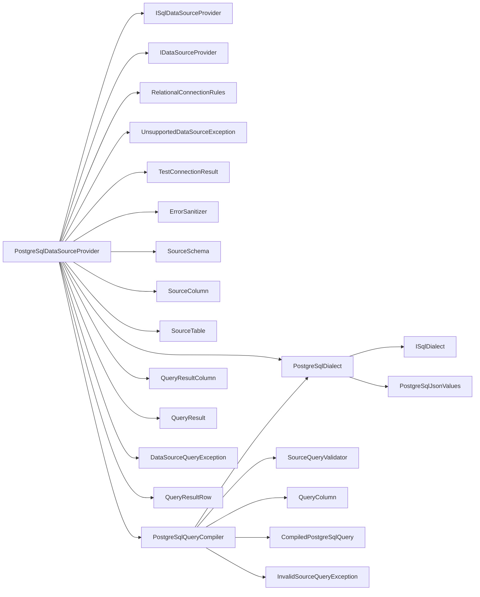

<!-- generated by docwizz: edits are overwritten -->
# src/Connector.Infrastructure/DataSources/PostgreSql

Layer **infrastructure** · project `Connector.Infrastructure`

Project navigation: [Connector.Infrastructure](../projects/Connector-Infrastructure-1bd055e8121e.md)

## Key components

| Component | Kind | Used by | Summary |
|---|---|---|---|
| [PostgreSqlDialect](#postgresqldialect) | class | 2 | `ISqlDialect` for PostgreSQL — the single home of every PostgreSQL-specific fragment the generic query builders emit: double-quote identifier quoting, @pN parameter placeholders (Npgsql's named-parameter syntax), LIMIT n, ::text casts, = ANY(@array), IS NOT DISTINCT FROM, string_agg, and how a PostgreSQL text value maps to JSON (`PostgreSqlJsonValues`). Stateless; use `Instance`. |
| [CompiledPostgreSqlQuery](#compiledpostgresqlquery) | record | 1 | A `SourceQuery` compiled to PostgreSQL: SQL text plus the positional-named (@p0, @p1, …) parameters it references. |
| [PostgreSqlJsonValues](#postgresqljsonvalues) | class | 1 | Turns a PostgreSQL value in its text output format into the JSON value PostgreSQL's own to_json would produce for it — so the export tree engine can assemble JSON in C# that is identical to what the database would build with json_build_object. Follows to_json's type categories: smallint/integer/bigint/real/double precision/numeric → a JSON number with the exact same digits (NaN/Infinity stay strings, as in Postgres);boolean → true/false; json/jsonb → embedded as JSON;date → unchanged; timestamp/timestamptz → ISO 8601 with a T separator and a ±HH:MM offset;arrays → JSON arrays, element by element (nested arrays nest);everything else (text, uuid, time, interval, enums, …) → a JSON string of the text as-is. Assumes the server's default DateStyle (ISO), which is what makes date/timestamp text ISO-shaped. Composite (row) types and types with a custom cast to json aren't special-cased — they come out as strings; no exported column in this codebase uses either. |
| [PostgreSqlQueryCompiler](#postgresqlquerycompiler) | class | 1 | Compiles the database-neutral `SourceQuery` into PostgreSQL — the only place that model meets a SQL dialect. Validates against the given `SourceSchema` first (`SourceQueryValidator`), so every identifier emitted is one the schema reported, double-quoted by `PostgreSqlDialect`, and table aliases are synthetic (t0, t1, …). No caller-supplied text other than those identifiers and output aliases ever becomes SQL: every filter value is a bound parameter, and `Limit` is an `Int32` rendered by the dialect. |
| [PostgreSqlDataSourceProvider](#postgresqldatasourceprovider) | class | 0 | The `IDataSourceProvider` for `PostgreSql`. Owns every piece of PostgreSQL-specific connection/schema/query logic: building an Npgsql connection string, introspecting information_schema, and executing a caller-built SQL query generically. Registered as a singleton (see Program.cs) — it holds no per-call state; every method opens and disposes its own `NpgsqlConnection`. |

## External systems

- PostgreSQL (database, detected) — used by `PostgreSqlDataSourceProvider`

See [system context](../views/context.md).

## Flows through this module

- `POST /api/connection`: AppSettingsStore, ConnectionEndpoints, DataSourceProviderResolver, ErrorSanitizer, ExportLogDbContext, MariaDbDataSourceProvider, +4 more → MariaDbConnectionFactory, MariaDbSchemaReader, PostgreSQL, RelationalConnectionRules, ServiceNowClient, ServiceNowSchemaReader, +2 more → MySQL, ServiceNowQueryCompiler → ServiceNowClientOptions
- `POST /api/export-definitions/{id:int}/preview`: AppSettingsStore, DataSourceProviderResolver, DynamicExportService, ErrorSanitizer, ExportLogDbContext, ExportNodeJson → DataSourceCapabilities, FieldMapping, MariaDbDataSourceProvider, MariaDbDialect, MeteredDataSourceProvider, PostgreSqlDataSourceProvider, +3 more → MariaDbConnectionFactory, PostgreSQL, PostgreSqlJsonValues → MySQL
- `POST /api/export-definitions/{id:int}/run`: AuditService, DataSourceProviderResolver, DynamicExportService, ExportDefinitionEndpoints, ExportDefinitionRunner, ExportLogDbContext → AppSettingsStore, ErrorSanitizer, ExportNodeJson, FileSystemExportSink, ManifestSigningPolicy, SQLite → CsvExportFormatWriter, DataSourceCapabilities, ExcelExportFormatWriter, ExportFormatWriterFactory, ExportSchema, FieldMapping, +9 more → MariaDbConnectionFactory, PostgreSQL, PostgreSqlJsonValues → MySQL
- `POST /api/export-definitions/{id:int}/run-selected`: AuditService, DataSourceProviderResolver, DynamicExportService, ExportDefinitionEndpoints, ExportDefinitionRunner, ExportLogDbContext, +1 more → AppSettingsStore, ErrorSanitizer, FieldMapping, FileSystemExportSink, ManifestSigningPolicy, SQLite → CsvExportFormatWriter, DataSourceCapabilities, ExcelExportFormatWriter, ExportFormatWriterFactory, ExportSchema, File system, +8 more → MariaDbConnectionFactory, PostgreSQL, PostgreSqlJsonValues → MySQL
- `POST /api/export-definitions/{id:int}/test`: AuditService, DataSourceProviderResolver, ExportDefinitionEndpoints, ExportDefinitionRunner, ExportLogDbContext → AppSettingsStore, DynamicExportService, ErrorSanitizer, ExportNodeJson, FileSystemExportSink, ManifestSigningPolicy, +1 more → CsvExportFormatWriter, DataSourceCapabilities, ExcelExportFormatWriter, ExportFormatWriterFactory, ExportSchema, FieldMapping, +9 more → MariaDbConnectionFactory, PostgreSQL, PostgreSqlJsonValues → MySQL
- `POST /api/import-definitions`: AuditService, DataSourceProviderResolver, ExportLogDbContext, ImportDefinitionEndpoints, ImportNodeJson → AppSettingsStore, DynamicExportService, ErrorSanitizer, ImportNodeWalker, MariaDbDataSourceProvider, MeteredDataSourceProvider, +3 more → ExportNodeJson, FieldMapping, MariaDbConnectionFactory, MariaDbSchemaReader, PostgreSQL, ServiceNowClient, +1 more → MySQL, ServiceNowQueryCompiler → ServiceNowClientOptions
- `PUT /api/import-definitions/{id:int}`: AuditService, DataSourceProviderResolver, ExportLogDbContext, ImportDefinitionEndpoints, ImportNodeJson → AppSettingsStore, DynamicExportService, ErrorSanitizer, ImportNodeWalker, MariaDbDataSourceProvider, MeteredDataSourceProvider, +3 more → ExportNodeJson, FieldMapping, MariaDbConnectionFactory, MariaDbSchemaReader, PostgreSQL, ServiceNowClient, +1 more → MySQL, ServiceNowQueryCompiler → ServiceNowClientOptions
- `POST /api/import-definitions/{id:int}/preview`: AppSettingsStore, DataSourceProviderResolver, ErrorSanitizer, ExportLogDbContext, ImportConnection, ImportNodeJson, +2 more → DynamicExportService, ExportNodeJson, FieldMapping, MariaDbDataSourceProvider, MariaDbDialect, MeteredDataSourceProvider, +3 more → MariaDbConnectionFactory, PostgreSQL, ServiceNowTableApiProvider → MySQL
- … 7 more in [API](../api.md#flows) and [frontend](../frontend.md#flows)

## Architecture observations

- `PostgreSqlDataSourceProvider` depends on 15 other components — high coupling, possibly several responsibilities

## Dependencies

Depends on: [src/Connector.Core/DataSources](src-Connector.Core-DataSources.md), [src/Connector.Infrastructure](src-Connector.Infrastructure.md), [src/Connector.Infrastructure/DataSources](src-Connector.Infrastructure-DataSources.md)

## Components

### CompiledPostgreSqlQuery

_record_ · [PostgreSqlQueryCompiler.cs](../../src/Connector.Infrastructure/DataSources/PostgreSql/PostgreSqlQueryCompiler.cs#L10)

A `SourceQuery` compiled to PostgreSQL: SQL text plus the positional-named (@p0, @p1, …) parameters it references.

### PostgreSqlDataSourceProvider

_class_ · [PostgreSqlDataSourceProvider.cs](../../src/Connector.Infrastructure/DataSources/PostgreSql/PostgreSqlDataSourceProvider.cs#L13)

The `IDataSourceProvider` for `PostgreSql`. Owns every piece of PostgreSQL-specific connection/schema/query logic: building an Npgsql connection string, introspecting information_schema, and executing a caller-built SQL query generically. Registered as a singleton (see Program.cs) — it holds no per-call state; every method opens and disposes its own `NpgsqlConnection`.

_Reached from:_ [`POST /api/connection`](../api.md#flows), [`POST /api/export-definitions/{id:int}/preview`](../api.md#flows), [`POST /api/export-definitions/{id:int}/run`](../api.md#flows), [`POST /api/export-definitions/{id:int}/run-selected`](../api.md#flows), [`POST /api/export-definitions/{id:int}/test`](../api.md#flows), [`POST /api/import-definitions`](../api.md#flows), [`PUT /api/import-definitions/{id:int}`](../api.md#flows), [`POST /api/import-definitions/{id:int}/preview`](../api.md#flows), +7 more · _Linked tests:_ `DataSourceConfigValidationTests.Relational`, `DataSourceProviderResolverTests.Resolve_MariaDb_ReturnsTheRegisteredMariaDbProvider`, `DataSourceProviderResolverTests.Resolve_OutOfRangeType_ThrowsUnsupportedDataSourceException`, `DataSourceProviderResolverTests.Resolve_PostgreSql_ReturnsTheRegisteredPostgreSqlProvider`, `DataSourceProviderResolverTests.Resolve_UnregisteredType_ThrowsUnsupportedDataSourceException`, `DataSourceSecurityTests.BackendAsync`, `ExportLoadTests.Cancellation_StopsALargeExport`, `ExportLoadTests.OrderLinesTree_QueryCountIsIndependentOfRecordCount`, +28 more — test code that uses it, not coverage

| Member | Summary | Derived from code | Complexity |
|---|---|---|---|
| [`OpenConnectionAsync(Connector.Core.DataSources.DataSourceConfig, System.Threading.CancellationToken)`](../../src/Connector.Infrastructure/DataSources/PostgreSql/PostgreSqlDataSourceProvider.cs#L19) | An open ADO.NET connection for callers that need more than one query per call — the import path's multi-statement transaction. The caller disposes it. |  | 2 |
| [`ValidateConfig(Connector.Core.DataSources.DataSourceConfig)`](../../src/Connector.Infrastructure/DataSources/PostgreSql/PostgreSqlDataSourceProvider.cs#L37) | Whether `config` has what this provider needs to connect (required fields, a valid TLS mode or instance URL): a user-facing message, or null when it's usable. Checked before any connection attempt; the only place per-source-type config rules live. |  | 1 |
| [`TargetHost(Connector.Core.DataSources.DataSourceConfig)`](../../src/Connector.Infrastructure/DataSources/PostgreSql/PostgreSqlDataSourceProvider.cs#L39) | The host a connection with the (validated) `config` reaches — what the SSRF check in POST /api/connection resolves. |  | 1 |
| [`IsAlwaysEncrypted(Connector.Core.DataSources.DataSourceConfig)`](../../src/Connector.Infrastructure/DataSources/PostgreSql/PostgreSqlDataSourceProvider.cs#L41) | True when `config` can only ever reach the source encrypted — never falling back to plaintext. |  | 1 |
| [`BuildConnectionString(Connector.Core.DataSources.DataSourceConfig)`](../../src/Connector.Infrastructure/DataSources/PostgreSql/PostgreSqlDataSourceProvider.cs#L54) |  |  | 3 |
| [`TestConnectionAsync(Connector.Core.DataSources.DataSourceConfig, System.Threading.CancellationToken)`](../../src/Connector.Infrastructure/DataSources/PostgreSql/PostgreSqlDataSourceProvider.cs#L83) | Opens a connection and reads its schema; never throws for a reachability/credential failure — that's reported via `Failed` instead, sanitized of any connection-string/credential detail by `Detail` (Npgsql can echo the offending connection string, password included, back inside an exception message). |  | 2 |
| [`ReadSchemaAsync(Connector.Core.DataSources.DataSourceConfig, System.Threading.CancellationToken)`](../../src/Connector.Infrastructure/DataSources/PostgreSql/PostgreSqlDataSourceProvider.cs#L99) | Reads the live schema (tables/columns/PK/FK) of the data source described by `config`. Throws on failure — unlike `TestConnectionAsync`, this is called once a connection is already known-good and a failure here is a real, reportable error. |  | 1 |
| [`ExecuteAsync(Connector.Core.DataSources.DataSourceConfig, Connector.Core.DataSources.SourceQuery, System.Threading.CancellationToken)`](../../src/Connector.Infrastructure/DataSources/PostgreSql/PostgreSqlDataSourceProvider.cs#L187) | Compiles `query` with `PostgreSqlQueryCompiler` against the live schema (read fresh on every call, so a column dropped since a definition was saved is reported as unknown rather than failing inside Postgres) and executes it — same row materialization as `ExecuteNativeAsync`. |  | 1 |
| [`ExecuteNativeAsync(Connector.Core.DataSources.DataSourceConfig, Connector.Core.DataSources.NativeSqlQuery, System.Threading.CancellationToken)`](../../src/Connector.Infrastructure/DataSources/PostgreSql/PostgreSqlDataSourceProvider.cs#L208) | Executes `query`'s SQL generically: the provider does not parse or understand the text itself, only materializes rows. Date/timestamp columns are coerced to ISO-8601 (yyyy-MM-dd) the same way the pre-abstraction row-reading loop in DynamicExportService did, so every existing caller's output is unchanged. |  | 4 |

### PostgreSqlDialect

_class_ · [PostgreSqlDialect.cs](../../src/Connector.Infrastructure/DataSources/PostgreSql/PostgreSqlDialect.cs#L13)

`ISqlDialect` for PostgreSQL — the single home of every PostgreSQL-specific fragment the generic query builders emit: double-quote identifier quoting, @pN parameter placeholders (Npgsql's named-parameter syntax), LIMIT n, ::text casts, = ANY(@array), IS NOT DISTINCT FROM, string_agg, and how a PostgreSQL text value maps to JSON (`PostgreSqlJsonValues`). Stateless; use `Instance`.

_Reached from:_ [`POST /api/export-definitions/{id:int}/preview`](../api.md#flows), [`POST /api/export-definitions/{id:int}/run`](../api.md#flows), [`POST /api/export-definitions/{id:int}/run-selected`](../api.md#flows), [`POST /api/export-definitions/{id:int}/test`](../api.md#flows), [`POST /api/import-definitions/{id:int}/preview`](../api.md#flows), [`POST /api/import-definitions/{id:int}/records`](../api.md#flows), [`POST /api/import-definitions/{id:int}/runs`](../api.md#flows), [`POST /api/import-runs/{id:int}/release`](../api.md#flows), +3 more

| Member | Summary | Derived from code | Complexity |
|---|---|---|---|
| [`QuoteIdentifier(string)`](../../src/Connector.Infrastructure/DataSources/PostgreSql/PostgreSqlDialect.cs#L21) | Quotes a table/column/alias name so it is always read as an identifier, never as syntax. |  | 1 |
| [`BuildParameterName(int)`](../../src/Connector.Infrastructure/DataSources/PostgreSql/PostgreSqlDialect.cs#L23) | The placeholder for the `index`-th bound parameter, as it appears in SQL text. Also a valid parameter name for the matching driver's parameter collection. |  | 1 |
| [`BuildLimit(int)`](../../src/Connector.Infrastructure/DataSources/PostgreSql/PostgreSqlDialect.cs#L25) | The clause appended to a SELECT to cap its row count at `limit`. |  | 1 |
| [`QuoteStringLiteral(string)`](../../src/Connector.Infrastructure/DataSources/PostgreSql/PostgreSqlDialect.cs#L30) | A string literal holding `value` verbatim — for constant text that has to be part of the statement itself (a JSON object key, an aggregation delimiter) rather than a parameter. |  | 1 |
| [`CastToText(string)`](../../src/Connector.Infrastructure/DataSources/PostgreSql/PostgreSqlDialect.cs#L32) | Converts `expression` to text, so it can be compared with a text value or emitted as text regardless of the column's own type. |  | 1 |
| [`BuildNullSafeEquals(string, string)`](../../src/Connector.Infrastructure/DataSources/PostgreSql/PostgreSqlDialect.cs#L34) | A null-safe equality test: true when both sides are equal or both are null. |  | 1 |
| [`BuildMatchesAny(string, System.Collections.Generic.IReadOnlyList<string>, System.Collections.Generic.IDictionary<string, object?>)`](../../src/Connector.Infrastructure/DataSources/PostgreSql/PostgreSqlDialect.cs#L37) | True when `expression` equals any of `values` — how the export tree engine fetches every child row of a whole level in one query instead of one query per parent. Binds the values into `parameters` (named from `BuildParameterName`, continuing at its current count) in whatever shape the backend needs: one array parameter, or one parameter per value. |  | 1 |
| [`ConvertNativeTextToJson(string, string)`](../../src/Connector.Infrastructure/DataSources/PostgreSql/PostgreSqlDialect.cs#L48) | Renders `nativeText` — a value in the backend's own text format, as returned for a `ReturnNativeText` query — as the JSON value the backend's own JSON encoding would give a column of type `dataType` (`DataType`): numbers as JSON numbers, booleans as JSON booleans, JSON columns embedded as JSON, arrays as JSON arrays, anything else as a string. |  | 1 |
| [`FormatValue(object, string)`](../../src/Connector.Infrastructure/DataSources/PostgreSql/PostgreSqlDialect.cs#L51) | The connector's string form of a non-null column `value` as the driver returned it, for a column the backend calls `dataType`: date/timestamp columns as yyyy-MM-dd, everything else the value's own ToString(). Shared by the provider's row materialization and the import walker, so old values read for a diff match exported values exactly. |  | 5 |
| [`BuildStringAggregate(string, string)`](../../src/Connector.Infrastructure/DataSources/PostgreSql/PostgreSqlDialect.cs#L59) | Aggregates `expression` (as text) over the rows of the enclosing SELECT into one string joined by `delimiter`; null values are skipped. |  | 1 |
| [`BuildSetClause(string, System.Collections.Generic.IReadOnlyList<string>, System.Collections.Generic.IReadOnlyList<string?>, System.Collections.Generic.IDictionary<string, object?>)`](../../src/Connector.Infrastructure/DataSources/PostgreSql/PostgreSqlDialect.cs#L84) | The SET clause (without the keyword) of an UPDATE on `table` that assigns each of `columns` the matching text value in `values`, converted by the backend to the column's own type. Binds the values into `parameters` (named from `BuildParameterName`, continuing at its current count). Used by the import releaser's updates. |  | 1 |
| [`BuildInsertRow(string, System.Collections.Generic.IReadOnlyList<string>, System.Collections.Generic.IReadOnlyList<string?>, System.Collections.Generic.IDictionary<string, object?>)`](../../src/Connector.Infrastructure/DataSources/PostgreSql/PostgreSqlDialect.cs#L91) | An INSERT of one row into `table`, setting each of `columns` to the matching text value in `values`, converted by the backend to the column's own type (uuid, date, number…). Binds the values into `parameters` (named from `BuildParameterName`, continuing at its current count). Used by the import releaser's root-row inserts. |  | 1 |

### PostgreSqlJsonValues

_class_ · [PostgreSqlJsonValues.cs](../../src/Connector.Infrastructure/DataSources/PostgreSql/PostgreSqlJsonValues.cs#L24)

Turns a PostgreSQL value in its text output format into the JSON value PostgreSQL's own to_json would produce for it — so the export tree engine can assemble JSON in C# that is identical to what the database would build with json_build_object. Follows to_json's type categories: smallint/integer/bigint/real/double precision/numeric → a JSON number with the exact same digits (NaN/Infinity stay strings, as in Postgres);boolean → true/false; json/jsonb → embedded as JSON;date → unchanged; timestamp/timestamptz → ISO 8601 with a T separator and a ±HH:MM offset;arrays → JSON arrays, element by element (nested arrays nest);everything else (text, uuid, time, interval, enums, …) → a JSON string of the text as-is. Assumes the server's default DateStyle (ISO), which is what makes date/timestamp text ISO-shaped. Composite (row) types and types with a custom cast to json aren't special-cased — they come out as strings; no exported column in this codebase uses either.

_Reached from:_ [`POST /api/export-definitions/{id:int}/preview`](../api.md#flows), [`POST /api/export-definitions/{id:int}/run`](../api.md#flows), [`POST /api/export-definitions/{id:int}/run-selected`](../api.md#flows), [`POST /api/export-definitions/{id:int}/test`](../api.md#flows), [`GET /api/pipeline/preview`](../api.md#flows), [`POST /api/pipeline/run`](../api.md#flows), [`POST /api/pipeline/run/{name}`](../api.md#flows)

| Member | Summary | Derived from code | Complexity |
|---|---|---|---|
| [`FromNativeText(string, string)`](../../src/Connector.Infrastructure/DataSources/PostgreSql/PostgreSqlJsonValues.cs#L30) | Converts one value, given in PostgreSQL's text output format, to the JSON node to_json would produce for a column of dataType (rules in the class summary). |  | 8 |

### PostgreSqlQueryCompiler

_class_ · [PostgreSqlQueryCompiler.cs](../../src/Connector.Infrastructure/DataSources/PostgreSql/PostgreSqlQueryCompiler.cs#L20)

Compiles the database-neutral `SourceQuery` into PostgreSQL — the only place that model meets a SQL dialect. Validates against the given `SourceSchema` first (`SourceQueryValidator`), so every identifier emitted is one the schema reported, double-quoted by `PostgreSqlDialect`, and table aliases are synthetic (t0, t1, …). No caller-supplied text other than those identifiers and output aliases ever becomes SQL: every filter value is a bound parameter, and `Limit` is an `Int32` rendered by the dialect.

_Linked tests:_ `PostgreSqlQueryCompilerTests.Compile` (via `PostgreSqlQueryCompiler.Compile(SourceQuery, SourceSchema)`) — test code that uses it, not coverage

| Member | Summary | Derived from code | Complexity |
|---|---|---|---|
| [`Compile(Connector.Core.DataSources.SourceQuery, Connector.Core.DataSources.SourceSchema)`](../../src/Connector.Infrastructure/DataSources/PostgreSql/PostgreSqlQueryCompiler.cs#L28) | Validates the query against the schema, then renders it as PostgreSQL SQL plus its bound parameters. Throws InvalidSourceQueryException when the query fails that validation. |  | 8 |

---
_Generated from 51 symbols in [src/Connector.Infrastructure/DataSources/PostgreSql/PostgreSqlDataSourceProvider.cs](../../src/Connector.Infrastructure/DataSources/PostgreSql/PostgreSqlDataSourceProvider.cs), [src/Connector.Infrastructure/DataSources/PostgreSql/PostgreSqlDialect.cs](../../src/Connector.Infrastructure/DataSources/PostgreSql/PostgreSqlDialect.cs), [src/Connector.Infrastructure/DataSources/PostgreSql/PostgreSqlJsonValues.cs](../../src/Connector.Infrastructure/DataSources/PostgreSql/PostgreSqlJsonValues.cs), [src/Connector.Infrastructure/DataSources/PostgreSql/PostgreSqlQueryCompiler.cs](../../src/Connector.Infrastructure/DataSources/PostgreSql/PostgreSqlQueryCompiler.cs) (commit `b3fcbdc`, profile `default`). Sections marked _fact_ are read from the code, _inferred_ come from heuristics, 🤖 marks AI drafts._
