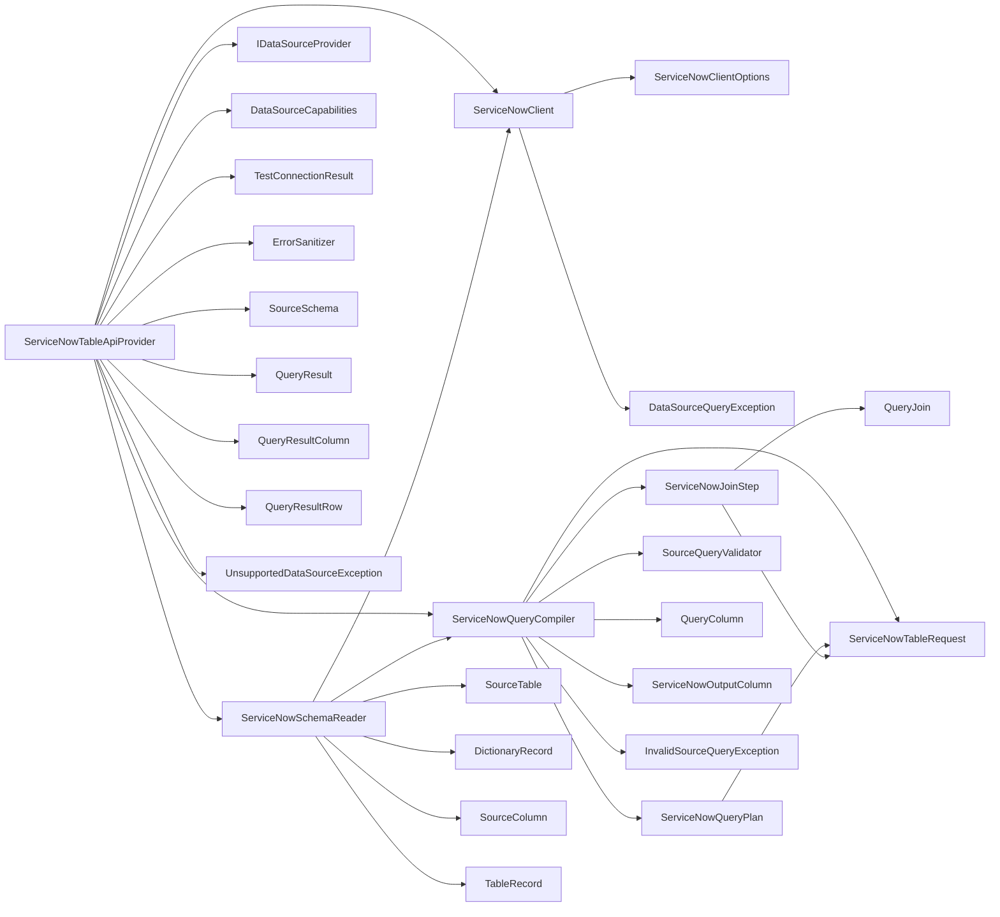

<!-- generated by docwizz: edits are overwritten -->
# src/Connector.Infrastructure/DataSources/ServiceNow

Layer **infrastructure** · project `Connector.Infrastructure` · Options: 1

Project navigation: [Connector.Infrastructure](../projects/Connector-Infrastructure-1bd055e8121e.md)

## Overview 🤖

Manages interactions with ServiceNow's Table API, providing a layer for reading data and compiling queries.

**Responsibilities.** Handles HTTP requests to ServiceNow, parses responses, and compiles queries into ServiceNow's encoded-query syntax.

**Usage.** Used by the data source provider to fetch data from ServiceNow and compile queries for execution.

_AI draft from the facts on this page; review it, then write the module's documentation yourself._

## Key components

| Component | Kind | Used by | Summary |
|---|---|---|---|
| [ServiceNowTableRequest](#servicenowtablerequest) | record | 3 | One Table API read: the table, its sysparm_query (ServiceNow encoded query) and the sysparm_fields projection. |
| [ServiceNowClient](#servicenowclient) | class | 2 | The only code that talks HTTP to ServiceNow: authenticated, paginated GET /api/now/table/{table} reads over HTTPS. Everything above it (`ServiceNowSchemaReader`, `ServiceNowTableApiProvider`) sees records as string dictionaries. Retries only transient failures (429/502/503) a bounded number of times; maps every other failure to a `DataSourceQueryException` whose message never contains the credentials (they only ever travel in the Authorization header). |
| [ServiceNowQueryCompiler](#servicenowquerycompiler) | class | 2 | Compiles the database-neutral `SourceQuery` into Table API reads. ServiceNow's encoded-query syntax exists only here — never in Connector.Core or stored configuration. Validates against the schema first (`SourceQueryValidator`), so every field name is one ServiceNow reported; every value is checked for the encoded-query separators (^, and , inside IN) and rejected rather than escaped, so a value can never add a condition of its own. Conditions are sent server-side as the filter of the table they belong to; the Table API can't join, so joins become a second read keyed by the parent rows' values (see `ServiceNowTableApiProvider`). |
| [DictionaryRecord](#dictionaryrecord) | record | 1 |  |
| [ServiceNowClientOptions](#servicenowclientoptions) | options | 1 | Tuning knobs for `ServiceNowClient`; the defaults are what production uses, tests shrink the delays. |
| [ServiceNowJoinStep](#servicenowjoinstep) | record | 1 | A `QueryJoin` resolved in C#: `Request` reads the joined table (filtered by its own conditions, if any), and its rows are matched on Join.Column = ParentTable.ParentColumn. |
| [ServiceNowOutputColumn](#servicenowoutputcolumn) | record | 1 | An output column of the result: which table's field, under which name. |
| [ServiceNowQueryPlan](#servicenowqueryplan) | record | 1 | A compiled `SourceQuery`: a root read, joins resolved in C#, the output columns, and the limit (applied to the root read directly when no inner join can drop root rows). |

## Flows through this module

- `POST /api/connection`: AppSettingsStore, ConnectionEndpoints, DataSourceProviderResolver, ErrorSanitizer, ExportLogDbContext, MariaDbDataSourceProvider, +4 more → MariaDbConnectionFactory, MariaDbSchemaReader, PostgreSQL, RelationalConnectionRules, ServiceNowClient, ServiceNowSchemaReader, +2 more → MySQL, ServiceNowQueryCompiler → ServiceNowClientOptions
- `POST /api/export-definitions/{id:int}/preview`: AppSettingsStore, DataSourceProviderResolver, DynamicExportService, ErrorSanitizer, ExportLogDbContext, ExportNodeJson → DataSourceCapabilities, FieldMapping, MariaDbDataSourceProvider, MariaDbDialect, MeteredDataSourceProvider, PostgreSqlDataSourceProvider, +3 more → MariaDbConnectionFactory, PostgreSQL, PostgreSqlJsonValues → MySQL
- `POST /api/export-definitions/{id:int}/run`: AuditService, DataSourceProviderResolver, DynamicExportService, ExportDefinitionEndpoints, ExportDefinitionRunner, ExportLogDbContext → AppSettingsStore, ErrorSanitizer, ExportNodeJson, FileSystemExportSink, ManifestSigningPolicy, SQLite → CsvExportFormatWriter, DataSourceCapabilities, ExcelExportFormatWriter, ExportFormatWriterFactory, ExportSchema, FieldMapping, +9 more → MariaDbConnectionFactory, PostgreSQL, PostgreSqlJsonValues → MySQL
- `POST /api/export-definitions/{id:int}/run-selected`: AuditService, DataSourceProviderResolver, DynamicExportService, ExportDefinitionEndpoints, ExportDefinitionRunner, ExportLogDbContext, +1 more → AppSettingsStore, ErrorSanitizer, FieldMapping, FileSystemExportSink, ManifestSigningPolicy, SQLite → CsvExportFormatWriter, DataSourceCapabilities, ExcelExportFormatWriter, ExportFormatWriterFactory, ExportSchema, File system, +8 more → MariaDbConnectionFactory, PostgreSQL, PostgreSqlJsonValues → MySQL
- `POST /api/export-definitions/{id:int}/test`: AuditService, DataSourceProviderResolver, ExportDefinitionEndpoints, ExportDefinitionRunner, ExportLogDbContext → AppSettingsStore, DynamicExportService, ErrorSanitizer, ExportNodeJson, FileSystemExportSink, ManifestSigningPolicy, +1 more → CsvExportFormatWriter, DataSourceCapabilities, ExcelExportFormatWriter, ExportFormatWriterFactory, ExportSchema, FieldMapping, +9 more → MariaDbConnectionFactory, PostgreSQL, PostgreSqlJsonValues → MySQL
- `POST /api/import-definitions`: AuditService, DataSourceProviderResolver, ExportLogDbContext, ImportDefinitionEndpoints, ImportNodeJson → AppSettingsStore, DynamicExportService, ErrorSanitizer, ImportNodeWalker, MariaDbDataSourceProvider, MeteredDataSourceProvider, +3 more → ExportNodeJson, FieldMapping, MariaDbConnectionFactory, MariaDbSchemaReader, PostgreSQL, ServiceNowClient, +1 more → MySQL, ServiceNowQueryCompiler → ServiceNowClientOptions
- `PUT /api/import-definitions/{id:int}`: AuditService, DataSourceProviderResolver, ExportLogDbContext, ImportDefinitionEndpoints, ImportNodeJson → AppSettingsStore, DynamicExportService, ErrorSanitizer, ImportNodeWalker, MariaDbDataSourceProvider, MeteredDataSourceProvider, +3 more → ExportNodeJson, FieldMapping, MariaDbConnectionFactory, MariaDbSchemaReader, PostgreSQL, ServiceNowClient, +1 more → MySQL, ServiceNowQueryCompiler → ServiceNowClientOptions
- `POST /api/import-definitions/{id:int}/preview`: AppSettingsStore, DataSourceProviderResolver, ErrorSanitizer, ExportLogDbContext, ImportConnection, ImportNodeJson, +2 more → DynamicExportService, ExportNodeJson, FieldMapping, MariaDbDataSourceProvider, MariaDbDialect, MeteredDataSourceProvider, +3 more → MariaDbConnectionFactory, PostgreSQL, ServiceNowTableApiProvider → MySQL
- … 7 more in [API](../api.md#flows) and [frontend](../frontend.md#flows)

## Architecture observations

- `ServiceNowTableApiProvider` depends on 12 other components — high coupling, possibly several responsibilities

## Dependencies

Depends on: [src/Connector.Core/DataSources](src-Connector.Core-DataSources.md), [src/Connector.Infrastructure](src-Connector.Infrastructure.md)

## Components

### DictionaryRecord

_record_ · [ServiceNowSchemaReader.cs](../../src/Connector.Infrastructure/DataSources/ServiceNow/ServiceNowSchemaReader.cs#L146)

### ServiceNowClient

_class_ · [ServiceNowClient.cs](../../src/Connector.Infrastructure/DataSources/ServiceNow/ServiceNowClient.cs#L37)

The only code that talks HTTP to ServiceNow: authenticated, paginated GET /api/now/table/{table} reads over HTTPS. Everything above it (`ServiceNowSchemaReader`, `ServiceNowTableApiProvider`) sees records as string dictionaries. Retries only transient failures (429/502/503) a bounded number of times; maps every other failure to a `DataSourceQueryException` whose message never contains the credentials (they only ever travel in the Authorization header).

_Reached from:_ [`POST /api/connection`](../api.md#flows), [`POST /api/import-definitions`](../api.md#flows), [`PUT /api/import-definitions/{id:int}`](../api.md#flows), [`GET /api/source-schema`](../api.md#flows) · _Linked tests:_ `FakeServiceNow.CreateProvider` — test code that uses it, not coverage

| Member | Summary | Derived from code | Complexity |
|---|---|---|---|
| [`ParseInstanceUrl(string?)`](../../src/Connector.Infrastructure/DataSources/ServiceNow/ServiceNowClient.cs#L52) | Validates `instanceUrl` as an absolute HTTPS URL (no plain HTTP, ever) and returns its base (scheme + authority). |  | 5 |
| [`GetRecordsAsync(Connector.Core.DataSources.DataSourceConfig, string, string?, System.Collections.Generic.IReadOnlyCollection<string>?, int?, System.Threading.CancellationToken)`](../../src/Connector.Infrastructure/DataSources/ServiceNow/ServiceNowClient.cs#L65) | Reads every record of `table` matching `encodedQuery`, page by page, until a short page or `maxRecords` is reached. |  | 5 |

### ServiceNowClientOptions

_record_ · [ServiceNowClient.cs](../../src/Connector.Infrastructure/DataSources/ServiceNow/ServiceNowClient.cs#L12)

Tuning knobs for `ServiceNowClient`; the defaults are what production uses, tests shrink the delays.

_Reached from:_ [`POST /api/connection`](../api.md#flows), [`POST /api/import-definitions`](../api.md#flows), [`PUT /api/import-definitions/{id:int}`](../api.md#flows), [`GET /api/source-schema`](../api.md#flows) · _Linked tests:_ `FakeServiceNow.CreateProvider`, `ServiceNowTableApiProviderTests.ExecuteAsync_Limit_StopsReading`, `ServiceNowTableApiProviderTests.ExecuteAsync_Pagination_ReadsEveryPage`, `ServiceNowTableApiProviderTests.RateLimit_GivesUpAfterMaxRetries`, `ServiceNowTableApiProviderTests.SlowResponse_TimesOut` — test code that uses it, not coverage

### ServiceNowJoinStep

_record_ · [ServiceNowQueryCompiler.cs](../../src/Connector.Infrastructure/DataSources/ServiceNow/ServiceNowQueryCompiler.cs#L13)

A `QueryJoin` resolved in C#: `Request` reads the joined table (filtered by its own conditions, if any), and its rows are matched on Join.Column = ParentTable.ParentColumn.

### ServiceNowOutputColumn

_record_ · [ServiceNowQueryCompiler.cs](../../src/Connector.Infrastructure/DataSources/ServiceNow/ServiceNowQueryCompiler.cs#L16)

An output column of the result: which table's field, under which name.

### ServiceNowQueryCompiler

_class_ · [ServiceNowQueryCompiler.cs](../../src/Connector.Infrastructure/DataSources/ServiceNow/ServiceNowQueryCompiler.cs#L39)

Compiles the database-neutral `SourceQuery` into Table API reads. ServiceNow's encoded-query syntax exists only here — never in Connector.Core or stored configuration. Validates against the schema first (`SourceQueryValidator`), so every field name is one ServiceNow reported; every value is checked for the encoded-query separators (^, and , inside IN) and rejected rather than escaped, so a value can never add a condition of its own. Conditions are sent server-side as the filter of the table they belong to; the Table API can't join, so joins become a second read keyed by the parent rows' values (see `ServiceNowTableApiProvider`).

_Reached from:_ [`POST /api/connection`](../api.md#flows), [`POST /api/import-definitions`](../api.md#flows), [`PUT /api/import-definitions/{id:int}`](../api.md#flows), [`GET /api/source-schema`](../api.md#flows)

| Member | Summary | Derived from code | Complexity |
|---|---|---|---|
| [`Compile(Connector.Core.DataSources.SourceQuery, Connector.Core.DataSources.SourceSchema)`](../../src/Connector.Infrastructure/DataSources/ServiceNow/ServiceNowQueryCompiler.cs#L46) | Validates the query against the schema, then plans it as Table API reads: one encoded-query read for the root table plus one follow-up read per join. Throws InvalidSourceQueryException when validation fails, including for a value containing an encoded-query separator. |  | 11 |
| [`In(string, System.Collections.Generic.IEnumerable<string>)`](../../src/Connector.Infrastructure/DataSources/ServiceNow/ServiceNowQueryCompiler.cs#L96) | fieldINa,b,c — the batched key match for joins and metadata lookups. |  | 1 |
| [`IsIdentifier(string)`](../../src/Connector.Infrastructure/DataSources/ServiceNow/ServiceNowQueryCompiler.cs#L100) | True for a plain ServiceNow table/field name (letters, digits, underscore). |  | 1 |

### ServiceNowQueryPlan

_record_ · [ServiceNowQueryCompiler.cs](../../src/Connector.Infrastructure/DataSources/ServiceNow/ServiceNowQueryCompiler.cs#L20)

A compiled `SourceQuery`: a root read, joins resolved in C#, the output columns, and the limit (applied to the root read directly when no inner join can drop root rows).

### ServiceNowSchemaReader

_class_ · [ServiceNowSchemaReader.cs](../../src/Connector.Infrastructure/DataSources/ServiceNow/ServiceNowSchemaReader.cs#L17)

Reads ServiceNow's table/field metadata through the ordinary Table API — sys_db_object (tables and their super_class inheritance) and sys_dictionary (fields) — into the same `SourceSchema` shape the SQL providers return. Needs read access to those two tables (e.g. the personalize_dictionary role), not admin; like every Table API read, the result only contains what the account's ACLs allow.

_Reached from:_ [`POST /api/connection`](../api.md#flows), [`POST /api/import-definitions`](../api.md#flows), [`PUT /api/import-definitions/{id:int}`](../api.md#flows), [`GET /api/source-schema`](../api.md#flows)

| Member | Summary | Derived from code | Complexity |
|---|---|---|---|
| [`ReadTablesAsync(Connector.Core.DataSources.DataSourceConfig, System.Collections.Generic.IReadOnlyCollection<string>?, System.Threading.CancellationToken)`](../../src/Connector.Infrastructure/DataSources/ServiceNow/ServiceNowSchemaReader.cs#L24) | Every table the account can see, or — with `tableNames` — just those (plus the ancestors their inherited fields come from), which is what a query needs. |  | 8 |

### ServiceNowTableApiProvider

_class_ · [ServiceNowTableApiProvider.cs](../../src/Connector.Infrastructure/DataSources/ServiceNow/ServiceNowTableApiProvider.cs#L18)

The `IDataSourceProvider` for `ServiceNowTableApi`: ServiceNow read over its REST Table API, behind the same interface as the SQL providers — callers see `SourceSchema`, `SourceQuery` and `QueryResult`, never HTTP. Not an `ISqlDataSourceProvider`: there is no SQL to run, so `ExecuteNativeAsync` and the SQL-rendering export builders refuse it with `UnsupportedDataSourceException`.

_Reached from:_ [`POST /api/connection`](../api.md#flows), [`POST /api/export-definitions/{id:int}/preview`](../api.md#flows), [`POST /api/export-definitions/{id:int}/run`](../api.md#flows), [`POST /api/export-definitions/{id:int}/run-selected`](../api.md#flows), [`POST /api/export-definitions/{id:int}/test`](../api.md#flows), [`POST /api/import-definitions`](../api.md#flows), [`PUT /api/import-definitions/{id:int}`](../api.md#flows), [`POST /api/import-definitions/{id:int}/preview`](../api.md#flows), +7 more · _Linked tests:_ `FakeServiceNow.CreateProvider`, `ServiceNowTableApiProviderTests.BadRequest_IsNotRetried` (via `ServiceNowTableApiProvider.ReadSchemaAsync(DataSourceConfig, CancellationToken)`), `ServiceNowTableApiProviderTests.Cancellation_AbortsTheRequest` (via `ServiceNowTableApiProvider.ExecuteAsync(DataSourceConfig, SourceQuery, CancellationToken)`), `ServiceNowTableApiProviderTests.ExecuteAsync_Filter_IsSentServerSideAsEncodedQuery` (via `ServiceNowTableApiProvider.ExecuteAsync(DataSourceConfig, SourceQuery, CancellationToken)`), `ServiceNowTableApiProviderTests.ExecuteAsync_JoinOverReferenceField_OneBatchedReadForTheJoinedTable` (via `ServiceNowTableApiProvider.ExecuteAsync(DataSourceConfig, SourceQuery, CancellationToken)`), `ServiceNowTableApiProviderTests.ExecuteAsync_Limit_StopsReading` (via `ServiceNowTableApiProvider.ExecuteAsync(DataSourceConfig, SourceQuery, CancellationToken)`), `ServiceNowTableApiProviderTests.ExecuteAsync_Pagination_ReadsEveryPage` (via `ServiceNowTableApiProvider.ExecuteAsync(DataSourceConfig, SourceQuery, CancellationToken)`), `ServiceNowTableApiProviderTests.ExecuteAsync_Projection_RequestsOnlyTheSelectedFields` (via `ServiceNowTableApiProvider.ExecuteAsync(DataSourceConfig, SourceQuery, CancellationToken)`), +14 more — test code that uses it, not coverage

| Member | Summary | Derived from code | Complexity |
|---|---|---|---|
| [`ValidateConfig(Connector.Core.DataSources.DataSourceConfig)`](../../src/Connector.Infrastructure/DataSources/ServiceNow/ServiceNowTableApiProvider.cs#L33) | Whether `config` has what this provider needs to connect (required fields, a valid TLS mode or instance URL): a user-facing message, or null when it's usable. Checked before any connection attempt; the only place per-source-type config rules live. |  | 4 |
| [`TargetHost(Connector.Core.DataSources.DataSourceConfig)`](../../src/Connector.Infrastructure/DataSources/ServiceNow/ServiceNowTableApiProvider.cs#L48) | The host a connection with the (validated) `config` reaches — what the SSRF check in POST /api/connection resolves. |  | 1 |
| [`IsAlwaysEncrypted(Connector.Core.DataSources.DataSourceConfig)`](../../src/Connector.Infrastructure/DataSources/ServiceNow/ServiceNowTableApiProvider.cs#L51) | True when `config` can only ever reach the source encrypted — never falling back to plaintext. |  | 1 |
| [`TestConnectionAsync(Connector.Core.DataSources.DataSourceConfig, System.Threading.CancellationToken)`](../../src/Connector.Infrastructure/DataSources/ServiceNow/ServiceNowTableApiProvider.cs#L78) | Never throws for a reachability/credential/permission failure — reported via `Failed`. |  | 2 |
| [`ReadSchemaAsync(Connector.Core.DataSources.DataSourceConfig, System.Threading.CancellationToken)`](../../src/Connector.Infrastructure/DataSources/ServiceNow/ServiceNowTableApiProvider.cs#L93) | Reads the live schema (tables/columns/PK/FK) of the data source described by `config`. Throws on failure — unlike `TestConnectionAsync`, this is called once a connection is already known-good and a failure here is a real, reportable error. |  | 1 |
| [`ExecuteAsync(Connector.Core.DataSources.DataSourceConfig, Connector.Core.DataSources.SourceQuery, System.Threading.CancellationToken)`](../../src/Connector.Infrastructure/DataSources/ServiceNow/ServiceNowTableApiProvider.cs#L99) | Validates `query` against the data source's live schema (`SourceQueryValidator`), compiles it into the provider's own dialect with every filter value bound as a parameter, executes it, and returns its rows generically. Throws `InvalidSourceQueryException` — before touching any data — for an unknown table/column or a malformed query; an execution failure the caller needs to inspect surfaces as `DataSourceQueryException`. |  | 5 |
| [`ExecuteNativeAsync(Connector.Core.DataSources.DataSourceConfig, Connector.Core.DataSources.NativeSqlQuery, System.Threading.CancellationToken)`](../../src/Connector.Infrastructure/DataSources/ServiceNow/ServiceNowTableApiProvider.cs#L140) | Executes caller-built, provider-native SQL as-is and returns its rows generically — the path DynamicExportService's JSON-tree builders still use for what `SourceQuery` cannot express yet (knowledge/architecture/source-query-model.md §5). Same error contract as `ExecuteAsync`, minus schema validation. |  | 1 |

### ServiceNowTableRequest

_record_ · [ServiceNowQueryCompiler.cs](../../src/Connector.Infrastructure/DataSources/ServiceNow/ServiceNowQueryCompiler.cs#L9)

One Table API read: the table, its sysparm_query (ServiceNow encoded query) and the sysparm_fields projection.

### TableRecord

_record_ · [ServiceNowSchemaReader.cs](../../src/Connector.Infrastructure/DataSources/ServiceNow/ServiceNowSchemaReader.cs#L144)

---
_Generated from 55 symbols in [src/Connector.Infrastructure/DataSources/ServiceNow/ServiceNowClient.cs](../../src/Connector.Infrastructure/DataSources/ServiceNow/ServiceNowClient.cs), [src/Connector.Infrastructure/DataSources/ServiceNow/ServiceNowQueryCompiler.cs](../../src/Connector.Infrastructure/DataSources/ServiceNow/ServiceNowQueryCompiler.cs), [src/Connector.Infrastructure/DataSources/ServiceNow/ServiceNowSchemaReader.cs](../../src/Connector.Infrastructure/DataSources/ServiceNow/ServiceNowSchemaReader.cs), [src/Connector.Infrastructure/DataSources/ServiceNow/ServiceNowTableApiProvider.cs](../../src/Connector.Infrastructure/DataSources/ServiceNow/ServiceNowTableApiProvider.cs) (commit `b3fcbdc`, profile `default`). Sections marked _fact_ are read from the code, _inferred_ come from heuristics, 🤖 marks AI drafts._
