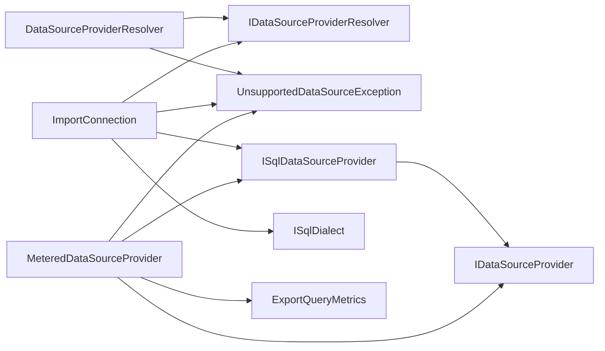

<!-- generated by docwizz: edits are overwritten -->
# src/Connector.Infrastructure/DataSources

Layer **infrastructure** · project `Connector.Infrastructure`

Project navigation: [Connector.Infrastructure](../projects/Connector-Infrastructure-1bd055e8121e.md)

## Overview 🤖

Manages SQL data sources and provides SQL dialect implementations.

**Responsibilities.** Resolves data source providers and implements SQL dialects for different relational databases.

**Usage.** Used by API endpoints and other infrastructure modules to interact with SQL data sources.

_AI draft from the facts on this page; review it, then write the module's documentation yourself._

## Key components

| Component | Kind | Used by | Summary |
|---|---|---|---|
| [ISqlDialect](#isqldialect) | interface | 6 | The SQL syntax that differs between relational backends, as far as this codebase actually uses it — not a general-purpose SQL abstraction (no SQL framework, no AST, no ORM). Generic query builders (`DynamicExportService`, `ImportNodeWalker`, `ImportRunReleaser`) assemble statements from plain ANSI keywords (SELECT/FROM/WHERE/AND/AS) plus these members; everything else is a dialect's job. Implementations: `PostgreSqlDialect` and `MariaDbDialect`. See knowledge/architecture/sql-dialect.md. |
| [ImportConnection](#importconnection) | class | 4 | The import path's handle on the ERP: an open ADO.NET connection plus the SQL dialect to render statements with, both from the configured provider — so `ImportNodeWalker` and `ImportRunReleaser` never name a database driver. Only a provider with the `Imports` capability hands one out. |
| [ISqlDataSourceProvider](#isqldatasourceprovider) | interface | 4 | An `IDataSourceProvider` whose backend speaks SQL, and so can run the SQL a generic builder assembles with its `Dialect`. Lives here rather than in Connector.Core because SQL dialects are an Infrastructure concern — a non-SQL provider (e.g. ServiceNow's Table API) simply doesn't implement it. |
| [ExportQueryMetrics](#exportquerymetrics) | record | 2 | What one export read from its source: how many queries it sent, how many rows came back, and how long the whole build took (queries, assembly and writing the output). |
| [RelationalConnectionRules](#relationalconnectionrules) | class | 2 | The connection rules every relational (Host/Port/Database) provider shares, so PostgreSQL and MariaDB validate and judge a `DataSourceConfig` identically: the required fields, and one SslMode vocabulary (the Npgsql names — each provider maps them onto its own driver's modes). |
| [MeteredDataSourceProvider](#metereddatasourceprovider) | class | 1 | Wraps a provider for the duration of one export build and counts every query sent through it and every row it returned — the data behind `ExportQueryMetrics`. Behaves exactly like the wrapped provider otherwise, including its `Capabilities` and SQL `Dialect`. Not thread-safe: one instance per build, and the export builders run their queries one after another. |
| [TransportSecurity](#transportsecurity) | class | 1 | The production transport rule: POST /api/connection refuses a config its provider doesn't report as always encrypted (`IsAlwaysEncrypted`) unless DataSources:AllowUnencryptedConnections is explicitly true. |
| [DataSourceProviderResolver](#datasourceproviderresolver) | class | 0 | Resolves every DI-registered `IDataSourceProvider` by its own `Type` — adding a provider is a DI registration in Program.cs, never a change to this resolver. |

## Flows through this module

- `POST /api/connection`: AppSettingsStore, ConnectionEndpoints, DataSourceProviderResolver, ErrorSanitizer, ExportLogDbContext, MariaDbDataSourceProvider, +4 more → MariaDbConnectionFactory, MariaDbSchemaReader, PostgreSQL, RelationalConnectionRules, ServiceNowClient, ServiceNowSchemaReader, +2 more → MySQL, ServiceNowQueryCompiler → ServiceNowClientOptions
- `POST /api/export-definitions/{id:int}/preview`: AppSettingsStore, DataSourceProviderResolver, DynamicExportService, ErrorSanitizer, ExportLogDbContext, ExportNodeJson → DataSourceCapabilities, FieldMapping, MariaDbDataSourceProvider, MariaDbDialect, MeteredDataSourceProvider, PostgreSqlDataSourceProvider, +3 more → MariaDbConnectionFactory, PostgreSQL, PostgreSqlJsonValues → MySQL
- `POST /api/export-definitions/{id:int}/run`: AuditService, DataSourceProviderResolver, DynamicExportService, ExportDefinitionEndpoints, ExportDefinitionRunner, ExportLogDbContext → AppSettingsStore, ErrorSanitizer, ExportNodeJson, FileSystemExportSink, ManifestSigningPolicy, SQLite → CsvExportFormatWriter, DataSourceCapabilities, ExcelExportFormatWriter, ExportFormatWriterFactory, ExportSchema, FieldMapping, +9 more → MariaDbConnectionFactory, PostgreSQL, PostgreSqlJsonValues → MySQL
- `POST /api/export-definitions/{id:int}/run-selected`: AuditService, DataSourceProviderResolver, DynamicExportService, ExportDefinitionEndpoints, ExportDefinitionRunner, ExportLogDbContext, +1 more → AppSettingsStore, ErrorSanitizer, FieldMapping, FileSystemExportSink, ManifestSigningPolicy, SQLite → CsvExportFormatWriter, DataSourceCapabilities, ExcelExportFormatWriter, ExportFormatWriterFactory, ExportSchema, File system, +8 more → MariaDbConnectionFactory, PostgreSQL, PostgreSqlJsonValues → MySQL
- `POST /api/export-definitions/{id:int}/test`: AuditService, DataSourceProviderResolver, ExportDefinitionEndpoints, ExportDefinitionRunner, ExportLogDbContext → AppSettingsStore, DynamicExportService, ErrorSanitizer, ExportNodeJson, FileSystemExportSink, ManifestSigningPolicy, +1 more → CsvExportFormatWriter, DataSourceCapabilities, ExcelExportFormatWriter, ExportFormatWriterFactory, ExportSchema, FieldMapping, +9 more → MariaDbConnectionFactory, PostgreSQL, PostgreSqlJsonValues → MySQL
- `POST /api/import-definitions`: AuditService, DataSourceProviderResolver, ExportLogDbContext, ImportDefinitionEndpoints, ImportNodeJson → AppSettingsStore, DynamicExportService, ErrorSanitizer, ImportNodeWalker, MariaDbDataSourceProvider, MeteredDataSourceProvider, +3 more → ExportNodeJson, FieldMapping, MariaDbConnectionFactory, MariaDbSchemaReader, PostgreSQL, ServiceNowClient, +1 more → MySQL, ServiceNowQueryCompiler → ServiceNowClientOptions
- `PUT /api/import-definitions/{id:int}`: AuditService, DataSourceProviderResolver, ExportLogDbContext, ImportDefinitionEndpoints, ImportNodeJson → AppSettingsStore, DynamicExportService, ErrorSanitizer, ImportNodeWalker, MariaDbDataSourceProvider, MeteredDataSourceProvider, +3 more → ExportNodeJson, FieldMapping, MariaDbConnectionFactory, MariaDbSchemaReader, PostgreSQL, ServiceNowClient, +1 more → MySQL, ServiceNowQueryCompiler → ServiceNowClientOptions
- `POST /api/import-definitions/{id:int}/preview`: AppSettingsStore, DataSourceProviderResolver, ErrorSanitizer, ExportLogDbContext, ImportConnection, ImportNodeJson, +2 more → DynamicExportService, ExportNodeJson, FieldMapping, MariaDbDataSourceProvider, MariaDbDialect, MeteredDataSourceProvider, +3 more → MariaDbConnectionFactory, PostgreSQL, ServiceNowTableApiProvider → MySQL
- … 7 more in [API](../api.md#flows) and [frontend](../frontend.md#flows)

## Dependencies

Depends on: [src/Connector.Core/DataSources](src-Connector.Core-DataSources.md)

Used by: [src/Connector.Api/Endpoints](src-Connector.Api-Endpoints.md), [src/Connector.Infrastructure](src-Connector.Infrastructure.md), [src/Connector.Infrastructure/DataSources/MariaDb](src-Connector.Infrastructure-DataSources-MariaDb.md), [src/Connector.Infrastructure/DataSources/PostgreSql](src-Connector.Infrastructure-DataSources-PostgreSql.md)

## Components

### DataSourceProviderResolver

_class_ · [DataSourceProviderResolver.cs](../../src/Connector.Infrastructure/DataSources/DataSourceProviderResolver.cs#L9)

Resolves every DI-registered `IDataSourceProvider` by its own `Type` — adding a provider is a DI registration in Program.cs, never a change to this resolver.

_Reached from:_ [`POST /api/connection`](../api.md#flows), [`POST /api/export-definitions/{id:int}/preview`](../api.md#flows), [`POST /api/export-definitions/{id:int}/run`](../api.md#flows), [`POST /api/export-definitions/{id:int}/run-selected`](../api.md#flows), [`POST /api/export-definitions/{id:int}/test`](../api.md#flows), [`POST /api/import-definitions`](../api.md#flows), [`PUT /api/import-definitions/{id:int}`](../api.md#flows), [`POST /api/import-definitions/{id:int}/preview`](../api.md#flows), +7 more · _Linked tests:_ `DataSourceConfigValidationTests.ImportConnection_ProviderWithoutImportsCapability_IsRefused`, `DataSourceProviderResolverTests.Resolve_MariaDb_ReturnsTheRegisteredMariaDbProvider`, `DataSourceProviderResolverTests.Resolve_NoProvidersRegisteredAtAll_ThrowsForPostgreSqlToo`, `DataSourceProviderResolverTests.Resolve_OutOfRangeType_ThrowsUnsupportedDataSourceException`, `DataSourceProviderResolverTests.Resolve_PostgreSql_ReturnsTheRegisteredPostgreSqlProvider`, `DataSourceProviderResolverTests.Resolve_UnregisteredType_ThrowsUnsupportedDataSourceException`, `FixedServiceProvider.GetService` — test code that uses it, not coverage

| Member | Summary | Derived from code | Complexity |
|---|---|---|---|
| [`Resolve(Connector.Core.DataSources.DataSourceType)`](../../src/Connector.Infrastructure/DataSources/DataSourceProviderResolver.cs#L16) | Returns the registered provider for `type`, or throws `UnsupportedDataSourceException` if none is registered. |  | 2 |

### ExportQueryMetrics

_record_ · [MeteredDataSourceProvider.cs](../../src/Connector.Infrastructure/DataSources/MeteredDataSourceProvider.cs#L8)

What one export read from its source: how many queries it sent, how many rows came back, and how long the whole build took (queries, assembly and writing the output).

_Reached from:_ [`POST /api/pipeline/run`](../api.md#flows), [`POST /api/pipeline/run/{name}`](../api.md#flows)

### ImportConnection

_class_ · [ImportConnection.cs](../../src/Connector.Infrastructure/DataSources/ImportConnection.cs#L12)

The import path's handle on the ERP: an open ADO.NET connection plus the SQL dialect to render statements with, both from the configured provider — so `ImportNodeWalker` and `ImportRunReleaser` never name a database driver. Only a provider with the `Imports` capability hands one out.

_Reached from:_ [`POST /api/import-definitions/{id:int}/preview`](../api.md#flows), [`POST /api/import-definitions/{id:int}/records`](../api.md#flows), [`POST /api/import-definitions/{id:int}/runs`](../api.md#flows), [`POST /api/import-runs/{id:int}/release`](../api.md#flows) · _Linked tests:_ `ImportNodeWalkerPostgresTests.Pg`, `DataSourceConfigValidationTests.ImportConnection_ProviderWithoutImportsCapability_IsRefused` (via `ImportConnection.OpenAsync(IDataSourceProviderResolver, DataSourceConfig, CancellationToken)`) — test code that uses it, not coverage

| Member | Summary | Derived from code | Complexity |
|---|---|---|---|
| [`OpenAsync(Connector.Core.DataSources.IDataSourceProviderResolver, Connector.Core.DataSources.DataSourceConfig, System.Threading.CancellationToken)`](../../src/Connector.Infrastructure/DataSources/ImportConnection.cs#L22) | Opens a connection to the configured data source for an import, paired with that provider's SQL dialect. Throws UnsupportedDataSourceException when the provider isn't SQL-based or lacks the Imports capability. |  | 3 |
| [`DisposeAsync()`](../../src/Connector.Infrastructure/DataSources/ImportConnection.cs#L36) |  |  | 1 |

### ISqlDataSourceProvider

_interface_ · [ISqlDialect.cs](../../src/Connector.Infrastructure/DataSources/ISqlDialect.cs#L102)

An `IDataSourceProvider` whose backend speaks SQL, and so can run the SQL a generic builder assembles with its `Dialect`. Lives here rather than in Connector.Core because SQL dialects are an Infrastructure concern — a non-SQL provider (e.g. ServiceNow's Table API) simply doesn't implement it.

_Linked tests:_ `DataSourceSecurityTests.RecordingProvider`, `DataSourceConfigValidationTests.ImportConnection_ProviderWithoutImportsCapability_IsRefused` (via `Connector.Infrastructure.DataSources.MariaDb.MariaDbDataSourceProvider`), `DataSourceConfigValidationTests.Relational` (via `Connector.Infrastructure.DataSources.MariaDb.MariaDbDataSourceProvider`), `DataSourceProviderResolverTests.Resolve_MariaDb_ReturnsTheRegisteredMariaDbProvider` (via `Connector.Infrastructure.DataSources.MariaDb.MariaDbDataSourceProvider`), `DataSourceProviderResolverTests.Resolve_OutOfRangeType_ThrowsUnsupportedDataSourceException` (via `Connector.Infrastructure.DataSources.PostgreSql.PostgreSqlDataSourceProvider`), `DataSourceProviderResolverTests.Resolve_PostgreSql_ReturnsTheRegisteredPostgreSqlProvider` (via `Connector.Infrastructure.DataSources.PostgreSql.PostgreSqlDataSourceProvider`), `DataSourceProviderResolverTests.Resolve_UnregisteredType_ThrowsUnsupportedDataSourceException` (via `Connector.Infrastructure.DataSources.PostgreSql.PostgreSqlDataSourceProvider`), `DataSourceSecurityTests.BackendAsync` (via `Connector.Infrastructure.DataSources.MariaDb.MariaDbDataSourceProvider`), +9 more — test code that uses it, not coverage

| Member | Summary | Derived from code | Complexity |
|---|---|---|---|
| [`OpenConnectionAsync(Connector.Core.DataSources.DataSourceConfig, System.Threading.CancellationToken)`](../../src/Connector.Infrastructure/DataSources/ISqlDialect.cs#L108) | An open ADO.NET connection for callers that need more than one query per call — the import path's multi-statement transaction. The caller disposes it. |  | 1 |

### ISqlDialect

_interface_ · [ISqlDialect.cs](../../src/Connector.Infrastructure/DataSources/ISqlDialect.cs#L22)

The SQL syntax that differs between relational backends, as far as this codebase actually uses it — not a general-purpose SQL abstraction (no SQL framework, no AST, no ORM). Generic query builders (`DynamicExportService`, `ImportNodeWalker`, `ImportRunReleaser`) assemble statements from plain ANSI keywords (SELECT/FROM/WHERE/AND/AS) plus these members; everything else is a dialect's job. Implementations: `PostgreSqlDialect` and `MariaDbDialect`. See knowledge/architecture/sql-dialect.md.

_Linked tests:_ `DataSourceSecurityTests.GdprDenylist_ExcludesRootChildAndNestedFields_FromEverySelect` (via `ISqlDialect.QuoteIdentifier(string)`), `MariaDbDialectTests.BuildInsertRow_BindsOneParameterPerColumn` (via `ISqlDialect.BuildInsertRow(string, IReadOnlyList<string>, IReadOnlyList<string?>, IDictionary<string, object?>)`), `MariaDbDialectTests.BuildLimit_RendersLimitClause` (via `ISqlDialect.BuildLimit(int)`), `MariaDbDialectTests.BuildMatchesAny_BindsOneParameterPerValue` (via `ISqlDialect.BuildMatchesAny(string, IReadOnlyList<string>, IDictionary<string, object?>)`), `MariaDbDialectTests.BuildNullSafeEquals_UsesSpaceshipOperator` (via `ISqlDialect.BuildNullSafeEquals(string, string)`), `MariaDbDialectTests.BuildParameterName_UsesAtPrefixedIndex` (via `ISqlDialect.BuildParameterName(int)`), `MariaDbDialectTests.BuildSetClause_BindsOneParameterPerColumn` (via `ISqlDialect.BuildSetClause(string, IReadOnlyList<string>, IReadOnlyList<string?>, IDictionary<string, object?>)`), `MariaDbDialectTests.BuildStringAggregate_UsesGroupConcatWithSeparator` (via `ISqlDialect.BuildStringAggregate(string, string)`), +15 more — test code that uses it, not coverage

| Member | Summary | Derived from code | Complexity |
|---|---|---|---|
| [`QuoteIdentifier(string)`](../../src/Connector.Infrastructure/DataSources/ISqlDialect.cs#L25) | Quotes a table/column/alias name so it is always read as an identifier, never as syntax. |  | 1 |
| [`BuildParameterName(int)`](../../src/Connector.Infrastructure/DataSources/ISqlDialect.cs#L29) | The placeholder for the `index`-th bound parameter, as it appears in SQL text. Also a valid parameter name for the matching driver's parameter collection. |  | 1 |
| [`BuildLimit(int)`](../../src/Connector.Infrastructure/DataSources/ISqlDialect.cs#L32) | The clause appended to a SELECT to cap its row count at `limit`. |  | 1 |
| [`QuoteStringLiteral(string)`](../../src/Connector.Infrastructure/DataSources/ISqlDialect.cs#L36) | A string literal holding `value` verbatim — for constant text that has to be part of the statement itself (a JSON object key, an aggregation delimiter) rather than a parameter. |  | 1 |
| [`CastToText(string)`](../../src/Connector.Infrastructure/DataSources/ISqlDialect.cs#L40) | Converts `expression` to text, so it can be compared with a text value or emitted as text regardless of the column's own type. |  | 1 |
| [`BuildNullSafeEquals(string, string)`](../../src/Connector.Infrastructure/DataSources/ISqlDialect.cs#L43) | A null-safe equality test: true when both sides are equal or both are null. |  | 1 |
| [`BuildMatchesAny(string, System.Collections.Generic.IReadOnlyList<string>, System.Collections.Generic.IDictionary<string, object?>)`](../../src/Connector.Infrastructure/DataSources/ISqlDialect.cs#L50) | True when `expression` equals any of `values` — how the export tree engine fetches every child row of a whole level in one query instead of one query per parent. Binds the values into `parameters` (named from `BuildParameterName`, continuing at its current count) in whatever shape the backend needs: one array parameter, or one parameter per value. |  | 1 |
| [`ConvertNativeTextToJson(string, string)`](../../src/Connector.Infrastructure/DataSources/ISqlDialect.cs#L59) | Renders `nativeText` — a value in the backend's own text format, as returned for a `ReturnNativeText` query — as the JSON value the backend's own JSON encoding would give a column of type `dataType` (`DataType`): numbers as JSON numbers, booleans as JSON booleans, JSON columns embedded as JSON, arrays as JSON arrays, anything else as a string. |  | 1 |
| [`FormatValue(object, string)`](../../src/Connector.Infrastructure/DataSources/ISqlDialect.cs#L65) | The connector's string form of a non-null column `value` as the driver returned it, for a column the backend calls `dataType`: date/timestamp columns as yyyy-MM-dd, everything else the value's own ToString(). Shared by the provider's row materialization and the import walker, so old values read for a diff match exported values exactly. |  | 1 |
| [`BuildStringAggregate(string, string)`](../../src/Connector.Infrastructure/DataSources/ISqlDialect.cs#L69) | Aggregates `expression` (as text) over the rows of the enclosing SELECT into one string joined by `delimiter`; null values are skipped. |  | 1 |
| [`BuildSetClause(string, System.Collections.Generic.IReadOnlyList<string>, System.Collections.Generic.IReadOnlyList<string?>, System.Collections.Generic.IDictionary<string, object?>)`](../../src/Connector.Infrastructure/DataSources/ISqlDialect.cs#L76) | The SET clause (without the keyword) of an UPDATE on `table` that assigns each of `columns` the matching text value in `values`, converted by the backend to the column's own type. Binds the values into `parameters` (named from `BuildParameterName`, continuing at its current count). Used by the import releaser's updates. |  | 1 |
| [`BuildInsertRow(string, System.Collections.Generic.IReadOnlyList<string>, System.Collections.Generic.IReadOnlyList<string?>, System.Collections.Generic.IDictionary<string, object?>)`](../../src/Connector.Infrastructure/DataSources/ISqlDialect.cs#L88) | An INSERT of one row into `table`, setting each of `columns` to the matching text value in `values`, converted by the backend to the column's own type (uuid, date, number…). Binds the values into `parameters` (named from `BuildParameterName`, continuing at its current count). Used by the import releaser's root-row inserts. |  | 1 |

### MeteredDataSourceProvider

_class_ · [MeteredDataSourceProvider.cs](../../src/Connector.Infrastructure/DataSources/MeteredDataSourceProvider.cs#L16)

Wraps a provider for the duration of one export build and counts every query sent through it and every row it returned — the data behind `ExportQueryMetrics`. Behaves exactly like the wrapped provider otherwise, including its `Capabilities` and SQL `Dialect`. Not thread-safe: one instance per build, and the export builders run their queries one after another.

_Reached from:_ [`POST /api/connection`](../api.md#flows), [`POST /api/export-definitions/{id:int}/preview`](../api.md#flows), [`POST /api/export-definitions/{id:int}/run`](../api.md#flows), [`POST /api/export-definitions/{id:int}/run-selected`](../api.md#flows), [`POST /api/export-definitions/{id:int}/test`](../api.md#flows), [`POST /api/import-definitions`](../api.md#flows), [`PUT /api/import-definitions/{id:int}`](../api.md#flows), [`POST /api/import-definitions/{id:int}/preview`](../api.md#flows), +7 more · _Linked tests:_ `MeteredDataSourceProviderTests.CountsQueriesAndRows_AndForwardsCapabilities`, `DataSourceSecurityTests.RecordingProvider` (via `Connector.Infrastructure.DataSources.ISqlDataSourceProvider`) — test code that uses it, not coverage

| Member | Summary | Derived from code | Complexity |
|---|---|---|---|
| [`ValidateConfig(Connector.Core.DataSources.DataSourceConfig)`](../../src/Connector.Infrastructure/DataSources/MeteredDataSourceProvider.cs#L30) | Whether `config` has what this provider needs to connect (required fields, a valid TLS mode or instance URL): a user-facing message, or null when it's usable. Checked before any connection attempt; the only place per-source-type config rules live. |  | 1 |
| [`TargetHost(Connector.Core.DataSources.DataSourceConfig)`](../../src/Connector.Infrastructure/DataSources/MeteredDataSourceProvider.cs#L32) | The host a connection with the (validated) `config` reaches — what the SSRF check in POST /api/connection resolves. |  | 1 |
| [`IsAlwaysEncrypted(Connector.Core.DataSources.DataSourceConfig)`](../../src/Connector.Infrastructure/DataSources/MeteredDataSourceProvider.cs#L34) | True when `config` can only ever reach the source encrypted — never falling back to plaintext. |  | 1 |
| [`OpenConnectionAsync(Connector.Core.DataSources.DataSourceConfig, System.Threading.CancellationToken)`](../../src/Connector.Infrastructure/DataSources/MeteredDataSourceProvider.cs#L40) | An open ADO.NET connection for callers that need more than one query per call — the import path's multi-statement transaction. The caller disposes it. |  | 3 |
| [`TestConnectionAsync(Connector.Core.DataSources.DataSourceConfig, System.Threading.CancellationToken)`](../../src/Connector.Infrastructure/DataSources/MeteredDataSourceProvider.cs#L47) | Opens a connection against `config` and reads back its schema, without persisting anything. Never throws for a reachability/credential failure — that's reported via `Success`/`Error` instead, sanitized of any connection-string/credential detail. |  | 1 |
| [`ReadSchemaAsync(Connector.Core.DataSources.DataSourceConfig, System.Threading.CancellationToken)`](../../src/Connector.Infrastructure/DataSources/MeteredDataSourceProvider.cs#L52) | Reads the live schema (tables/columns/PK/FK) of the data source described by `config`. Throws on failure — unlike `TestConnectionAsync`, this is called once a connection is already known-good and a failure here is a real, reportable error. |  | 1 |
| [`ExecuteAsync(Connector.Core.DataSources.DataSourceConfig, Connector.Core.DataSources.SourceQuery, System.Threading.CancellationToken)`](../../src/Connector.Infrastructure/DataSources/MeteredDataSourceProvider.cs#L55) | Validates `query` against the data source's live schema (`SourceQueryValidator`), compiles it into the provider's own dialect with every filter value bound as a parameter, executes it, and returns its rows generically. Throws `InvalidSourceQueryException` — before touching any data — for an unknown table/column or a malformed query; an execution failure the caller needs to inspect surfaces as `DataSourceQueryException`. |  | 1 |
| [`ExecuteNativeAsync(Connector.Core.DataSources.DataSourceConfig, Connector.Core.DataSources.NativeSqlQuery, System.Threading.CancellationToken)`](../../src/Connector.Infrastructure/DataSources/MeteredDataSourceProvider.cs#L61) | Executes caller-built, provider-native SQL as-is and returns its rows generically — the path DynamicExportService's JSON-tree builders still use for what `SourceQuery` cannot express yet (knowledge/architecture/source-query-model.md §5). Same error contract as `ExecuteAsync`, minus schema validation. |  | 1 |

### RelationalConnectionRules

_class_ · [RelationalConnectionRules.cs](../../src/Connector.Infrastructure/DataSources/RelationalConnectionRules.cs#L10)

The connection rules every relational (Host/Port/Database) provider shares, so PostgreSQL and MariaDB validate and judge a `DataSourceConfig` identically: the required fields, and one SslMode vocabulary (the Npgsql names — each provider maps them onto its own driver's modes).

_Reached from:_ [`POST /api/connection`](../api.md#flows)

| Member | Summary | Derived from code | Complexity |
|---|---|---|---|
| [`Validate(Connector.Core.DataSources.DataSourceConfig)`](../../src/Connector.Infrastructure/DataSources/RelationalConnectionRules.cs#L30) |  |  | 7 |
| [`IsAlwaysEncrypted(Connector.Core.DataSources.DataSourceConfig)`](../../src/Connector.Infrastructure/DataSources/RelationalConnectionRules.cs#L46) | Only Require/VerifyCA/VerifyFull make TLS mandatory; unset/Prefer/ Allow silently fall back to plaintext and Disable never encrypts. |  | 2 |

### TransportSecurity

_class_ · [TransportSecurity.cs](../../src/Connector.Infrastructure/DataSources/TransportSecurity.cs#L10)

The production transport rule: POST /api/connection refuses a config its provider doesn't report as always encrypted (`IsAlwaysEncrypted`) unless DataSources:AllowUnencryptedConnections is explicitly true.

_Reached from:_ [`POST /api/connection`](../api.md#flows) · _Linked tests:_ `TransportSecurityTests.Refusal_NamesTheModeAndTheOptOut` (via `TransportSecurity.UnencryptedRefusal(DataSourceConfig)`) — test code that uses it, not coverage

| Member | Summary | Derived from code | Complexity |
|---|---|---|---|
| [`UnencryptedRefusal(Connector.Core.DataSources.DataSourceConfig)`](../../src/Connector.Infrastructure/DataSources/TransportSecurity.cs#L14) |  |  | 2 |

---
_Generated from 46 symbols in [src/Connector.Infrastructure/DataSources/DataSourceProviderResolver.cs](../../src/Connector.Infrastructure/DataSources/DataSourceProviderResolver.cs), [src/Connector.Infrastructure/DataSources/ImportConnection.cs](../../src/Connector.Infrastructure/DataSources/ImportConnection.cs), [src/Connector.Infrastructure/DataSources/ISqlDialect.cs](../../src/Connector.Infrastructure/DataSources/ISqlDialect.cs), [src/Connector.Infrastructure/DataSources/MeteredDataSourceProvider.cs](../../src/Connector.Infrastructure/DataSources/MeteredDataSourceProvider.cs), [src/Connector.Infrastructure/DataSources/RelationalConnectionRules.cs](../../src/Connector.Infrastructure/DataSources/RelationalConnectionRules.cs), [src/Connector.Infrastructure/DataSources/TransportSecurity.cs](../../src/Connector.Infrastructure/DataSources/TransportSecurity.cs) (commit `b3fcbdc`, profile `default`). Sections marked _fact_ are read from the code, _inferred_ come from heuristics, 🤖 marks AI drafts._
