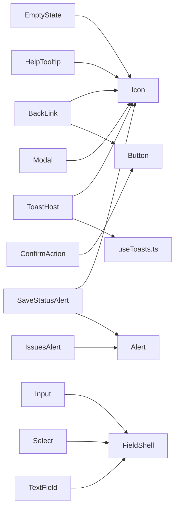

<!-- generated by docwizz: edits are overwritten -->
# src/connector-ui/src/components/ui

Layer **ui** · project `connector-ui` · UI components: 19

Project navigation: [connector-ui](../projects/connector-ui-f36e97198b9e.md)

## Overview 🤖

Contains reusable UI components for the connector UI.

**Responsibilities.** Provides a set of standardized UI components for building consistent and accessible user interfaces.

**Usage.** Used by various parts of the connector UI to create consistent and accessible user interfaces.

_AI draft from the facts on this page; review it, then write the module's documentation yourself._

## Key components

| Component | Kind | Used by | Summary |
|---|---|---|---|
| [HelpTooltip](#helptooltip) | component | 35 | A small "?" affordance for explaining a non-obvious field, section, or concept in place — click (or Enter/Space) to open a short explanation, Escape or an outside click to dismiss. Content is plain semantic markup in the default slot (p/strong/code/ul); :slotted() below gives it consistent typography so call sites don't have to repeat utility classes every time. |
| [Button](#button) | component | 32 | Standard button in four visual variants. While `loading`, it shows a spinner (hiding the `icon` slot) and is disabled; the default slot is the label. |
| [Icon](#icon) | component | 29 |  |
| [Alert](#alert) | component | 18 |  |
| [PageHeader](#pageheader) | component | 13 | Consolidates the "eyebrow + \<h1> + trailing actions" block repeated (with minor drift) at the top of every list/detail view, so it converges on the --text-page-title token instead of each view picking its own text-xl/arbitrary-value heading size. |
| [Input](#input) | component | 12 | Labelled text input bound with v-model (string or number), built on FieldShell. Wires aria-invalid and aria-describedby to the error or help text; the id is generated when not given. |
| [Card](#card) | component | 6 |  |
| [ConfirmAction](#confirmaction) | component | 5 | De-duplicates the "click Delete → inline Confirm/Cancel" pattern repeated across run-controls panels and definition list rows. Renders as a fragment (no wrapping element) so it drops straight into whatever flex row the trigger button already lived in — `confirming` swaps the trigger slot for a prompt + confirm/cancel pair in place, matching how each call site already laid things out. |

## Flows through this module

- `/` → DashboardView → canOpen, Card, ConnectionStatusCard, HelpTooltip, Icon, listExportDefinitions, +3 more → authHeaders, GET /api/export-definitions, GET /api/import-definitions, getConnection, getConnectionStatus → GET /api/connection, GET /api/connection/status
- `/audit` → AuditView → Alert, AuditLogTable, Button, EmptyState, getAuditLog, HelpTooltip, +1 more → authHeaders, Icon
- `/connect` → ConnectionView → Alert, Button, clearSession, ConnectionTlsSelect, emptyForm, formFromStored, +15 more → authHeaders, FieldShell, GET /api/connection, POST /api/connection
- `/export-definitions` → ExportDefinitionsView → Alert, Button, deleteExportDefinition, duplicateExportDefinition, EmptyState, HelpTooltip, +9 more → authHeaders, ConfirmAction, DELETE /api/export-definitions/{id:int}, GET /api/export-definitions, GET /api/export-definitions/{id:int}/runs, Icon, +3 more
- `/export-definitions/:id` → ExportDefinitionEditView → Alert, BackLink, blankRootNode, Button, columnsAsDisabledScalarFields, createExportDefinition, +13 more → authHeaders, blankFieldMapping, ConfirmAction, deleteExportDefinition, duplicateExportDefinition, ExportFormatPicker, +16 more → DELETE /api/export-definitions/{id:int}, POST /api/export-definitions/{id:int}/duplicate, POST /api/export-definitions/{id:int}/run, POST /api/export-definitions/{id:int}/test, PUT /api/export-definitions/{id:int}
- `/export-schema` → SchemaView → Alert, Button, ColumnMappingTable, ExportFormatPicker, findSuggestedRelations, getExportMapping, +12 more → authHeaders, deletePreset, FlatPreviewTable, GET /api/export-mapping, GET /api/pipeline/preview, GET /api/source-schema, +9 more → DELETE /api/export-mapping/presets/{name}, GET /api/export-mapping/presets, NestedGroupEditor, PUT /api/export-mapping/presets/{name}, RelationCard → FieldPickerTable, IssuesAlert
- `/exports` → ExportView → ActiveMappingSummary, Alert, Button, ExportRunsTable, getExportMapping, getPreview, +8 more → authHeaders, FlatPreviewTable, GET /api/export-mapping, GET /api/exports, GET /api/pipeline/preview, NestedPreviewList, +1 more
- `/exports/:seqNo` → ExportDetail → Alert, BackLink, DeliverRunForm, getExport, HelpTooltip, Icon, +6 more → Button, Card, deliverExport, GET /api/exports/{seqNo:int}, getUsername, Input, +5 more → FieldShell, POST /api/exports/{seqNo:int}/deliver, POST /api/exports/{seqNo:int}/release, POST /api/exports/{seqNo:int}/skip
- … 6 more in [API](../api.md#flows) and [frontend](../frontend.md#flows)

## Dependencies

Depends on: [src/connector-ui/src/composables](src-connector-ui-src-composables.md)

Used by: [src/connector-ui/src](src-connector-ui-src.md), [src/connector-ui/src/components](src-connector-ui-src-components.md), [src/connector-ui/src/views](src-connector-ui-src-views.md)

## Components

### Alert

_component_ · [Alert.vue](../../src/connector-ui/src/components/ui/Alert.vue#L1)

Props: variant: 'success' | 'warning' | 'danger' | 'info', title: string

_Reached from:_ [`/audit`](../frontend.md#flows), [`/connect`](../frontend.md#flows), [`/export-definitions`](../frontend.md#flows), [`/export-definitions/:id`](../frontend.md#flows), [`/export-schema`](../frontend.md#flows), [`/exports`](../frontend.md#flows), [`/exports/:seqNo`](../frontend.md#flows), [`/icd-schema`](../frontend.md#flows), +4 more · _Linked tests:_ `Alert.test.ts` — test code that uses it, not coverage

### BackLink

_component_ · [BackLink.vue](../../src/connector-ui/src/components/ui/BackLink.vue#L1)

Props: to: RouteLocationRaw

_Reached from:_ [`/export-definitions/:id`](../frontend.md#flows), [`/exports/:seqNo`](../frontend.md#flows), [`/import-definitions/:id`](../frontend.md#flows)

### Badge

_component_ · [Badge.vue](../../src/connector-ui/src/components/ui/Badge.vue#L1)

Generic status/count pill. Consolidates the ad-hoc "rounded-full px-2 py-0.5 text-xs" spans that were hand-rolled per view (count summaries, preview panels, ...) — StatusBadge stays the icon+label variant for run/import statuses specifically; this is the plain no-icon pill for everything else.

Props: variant: 'neutral' | 'success' | 'warning' | 'danger' | 'info' | 'brand'

_Reached from:_ [`/import-definitions/:id`](../frontend.md#flows) · _Linked tests:_ `Badge.test.ts` — test code that uses it, not coverage

### Button

_component_ · [Button.vue](../../src/connector-ui/src/components/ui/Button.vue#L1)

Standard button in four visual variants. While `loading`, it shows a spinner (hiding the `icon` slot) and is disabled; the default slot is the label.

Props: variant: 'primary' | 'secondary' | 'ghost' | 'danger', type: 'button' | 'submit', disabled: boolean, loading: boolean

- **dependencies** _(fact)_: none

_Reached from:_ [`/audit`](../frontend.md#flows), [`/connect`](../frontend.md#flows), [`/export-definitions`](../frontend.md#flows), [`/export-definitions/:id`](../frontend.md#flows), [`/export-schema`](../frontend.md#flows), [`/exports`](../frontend.md#flows), [`/exports/:seqNo`](../frontend.md#flows), [`/import-definitions`](../frontend.md#flows), +4 more · _Linked tests:_ `Button.test.ts` — test code that uses it, not coverage

_Evidence:_ [src/connector-ui/src/components/ui/Button.vue:1-45](../../src/connector-ui/src/components/ui/Button.vue#L1)

### Card

_component_ · [Card.vue](../../src/connector-ui/src/components/ui/Card.vue#L1)

Props: elevated: boolean

_Reached from:_ [`/`](../frontend.md#flows), [`/exports/:seqNo`](../frontend.md#flows), [`/login`](../frontend.md#flows), [`/settings`](../frontend.md#flows) · _Linked tests:_ `Card.test.ts` — test code that uses it, not coverage

### ConfirmAction

_component_ · [ConfirmAction.vue](../../src/connector-ui/src/components/ui/ConfirmAction.vue#L1)

De-duplicates the "click Delete → inline Confirm/Cancel" pattern repeated across run-controls panels and definition list rows. Renders as a fragment (no wrapping element) so it drops straight into whatever flex row the trigger button already lived in — `confirming` swaps the trigger slot for a prompt + confirm/cancel pair in place, matching how each call site already laid things out.

Props: busy: boolean, prompt: string, confirmLabel: string, cancelLabel: string, variant: 'button' | 'link'

Emits: confirm

- **dependencies** _(fact)_: Button
- **events** _(fact)_: confirm

_Reached from:_ [`/export-definitions`](../frontend.md#flows), [`/export-definitions/:id`](../frontend.md#flows), [`/import-definitions`](../frontend.md#flows), [`/import-definitions/:id`](../frontend.md#flows), [`/settings`](../frontend.md#flows) · _Linked tests:_ `ConfirmAction.test.ts` — test code that uses it, not coverage

_Evidence:_ [src/connector-ui/src/components/ui/ConfirmAction.vue:1-61](../../src/connector-ui/src/components/ui/ConfirmAction.vue#L1), [src/connector-ui/src/components/ui/Button.vue:1-45](../../src/connector-ui/src/components/ui/Button.vue#L1)

### EmptyState

_component_ · [EmptyState.vue](../../src/connector-ui/src/components/ui/EmptyState.vue#L1)

Shared "nothing here yet" block for lists/tables — replaces the one-off `
No … yet.
` lines duplicated across views with a consistent, slightly more prominent treatment, while staying just as easy to drop in.

Props: icon: Component, title: string, description: string

- **dependencies** _(fact)_: Icon

_Reached from:_ [`/audit`](../frontend.md#flows), [`/export-definitions`](../frontend.md#flows), [`/import-definitions`](../frontend.md#flows) · _Linked tests:_ `EmptyState.test.ts` — test code that uses it, not coverage

_Evidence:_ [src/connector-ui/src/components/ui/EmptyState.vue:1-29](../../src/connector-ui/src/components/ui/EmptyState.vue#L1), [src/connector-ui/src/components/ui/Icon.vue:1-10](../../src/connector-ui/src/components/ui/Icon.vue#L1)

### FieldShell

_component_ · [FieldShell.vue](../../src/connector-ui/src/components/ui/FieldShell.vue#L1)

Layout shared by Input and Select: label (with a required marker), the control in the default slot, then either the error or the help text underneath. The ids let the control reference its label, help and error for accessibility.

Props: id: string, helpId: string, errorId: string, label: string, required: boolean, helpText: string, error: string

- **dependencies** _(fact)_: none

_Reached from:_ [`/connect`](../frontend.md#flows), [`/exports/:seqNo`](../frontend.md#flows), [`/import-definitions/:id`](../frontend.md#flows), [`/login`](../frontend.md#flows), [`/settings`](../frontend.md#flows)

_Evidence:_ [src/connector-ui/src/components/ui/FieldShell.vue:1-33](../../src/connector-ui/src/components/ui/FieldShell.vue#L1)

### HelpTooltip

_component_ · [HelpTooltip.vue](../../src/connector-ui/src/components/ui/HelpTooltip.vue#L1)

A small "?" affordance for explaining a non-obvious field, section, or concept in place — click (or Enter/Space) to open a short explanation, Escape or an outside click to dismiss. Content is plain semantic markup in the default slot (p/strong/code/ul); :slotted() below gives it consistent typography so call sites don't have to repeat utility classes every time.

Props: label: string, title: string, align: 'left' | 'right' | 'center'

- **dependencies** _(fact)_: Icon
- **state** _(fact)_: open, rootRef, watch open

_Reached from:_ [`/`](../frontend.md#flows), [`/audit`](../frontend.md#flows), [`/connect`](../frontend.md#flows), [`/export-definitions`](../frontend.md#flows), [`/export-definitions/:id`](../frontend.md#flows), [`/export-schema`](../frontend.md#flows), [`/exports`](../frontend.md#flows), [`/exports/:seqNo`](../frontend.md#flows), +5 more

_Evidence:_ [src/connector-ui/src/components/ui/HelpTooltip.vue:1-124](../../src/connector-ui/src/components/ui/HelpTooltip.vue#L1), [src/connector-ui/src/components/ui/Icon.vue:1-10](../../src/connector-ui/src/components/ui/Icon.vue#L1)

### Icon

_component_ · [Icon.vue](../../src/connector-ui/src/components/ui/Icon.vue#L1)

Props: icon: Component, size: 16 | 20 | 24

_Reached from:_ [`/`](../frontend.md#flows), [`/audit`](../frontend.md#flows), [`/connect`](../frontend.md#flows), [`/export-definitions`](../frontend.md#flows), [`/export-definitions/:id`](../frontend.md#flows), [`/export-schema`](../frontend.md#flows), [`/exports`](../frontend.md#flows), [`/exports/:seqNo`](../frontend.md#flows), +5 more · _Linked tests:_ `Icon.test.ts` — test code that uses it, not coverage

### Input

_component_ · [Input.vue](../../src/connector-ui/src/components/ui/Input.vue#L1)

Labelled text input bound with v-model (string or number), built on FieldShell. Wires aria-invalid and aria-describedby to the error or help text; the id is generated when not given.

Props: id: string, label: string, helpText: string, error: string, type: string, placeholder: string, disabled: boolean, required: boolean, autocomplete: string, maxlength: number, min: number, max: number

- **dependencies** _(fact)_: FieldShell
- **state** _(fact)_: id (computed)

_Reached from:_ [`/connect`](../frontend.md#flows), [`/exports/:seqNo`](../frontend.md#flows), [`/import-definitions/:id`](../frontend.md#flows), [`/login`](../frontend.md#flows), [`/settings`](../frontend.md#flows) · _Linked tests:_ `Input.test.ts` — test code that uses it, not coverage

_Evidence:_ [src/connector-ui/src/components/ui/Input.vue:1-73](../../src/connector-ui/src/components/ui/Input.vue#L1), [src/connector-ui/src/components/ui/FieldShell.vue:1-33](../../src/connector-ui/src/components/ui/FieldShell.vue#L1)

### IssuesAlert

_component_ · [IssuesAlert.vue](../../src/connector-ui/src/components/ui/IssuesAlert.vue#L1)

Props: issues: string[]

_Reached from:_ [`/export-schema`](../frontend.md#flows)

### Modal

_component_ · [Modal.vue](../../src/connector-ui/src/components/ui/Modal.vue#L1)

Accessible dialog shown while v-model:open is true: traps Tab focus inside, closes on Escape (and optionally on a backdrop click), and returns focus to the previously focused element when it closes. Default slot is the body; the `footer` slot holds the actions.

Props: title: string, closeOnBackdrop: boolean

- **dependencies** _(fact)_: Icon
- **state** _(fact)_: dialogRef, watch open

_Reached from:_ [`/exports/:seqNo`](../frontend.md#flows), [`/import-definitions/:id`](../frontend.md#flows), [`/settings`](../frontend.md#flows) · _Linked tests:_ `Modal.test.ts` — test code that uses it, not coverage

_Evidence:_ [src/connector-ui/src/components/ui/Modal.vue:1-125](../../src/connector-ui/src/components/ui/Modal.vue#L1), [src/connector-ui/src/components/ui/Icon.vue:1-10](../../src/connector-ui/src/components/ui/Icon.vue#L1)

### PageHeader

_component_ · [PageHeader.vue](../../src/connector-ui/src/components/ui/PageHeader.vue#L1)

Consolidates the "eyebrow + \<h1> + trailing actions" block repeated (with minor drift) at the top of every list/detail view, so it converges on the --text-page-title token instead of each view picking its own text-xl/arbitrary-value heading size.

Props: title: string, eyebrow: string

_Reached from:_ [`/`](../frontend.md#flows), [`/audit`](../frontend.md#flows), [`/connect`](../frontend.md#flows), [`/export-definitions`](../frontend.md#flows), [`/export-definitions/:id`](../frontend.md#flows), [`/export-schema`](../frontend.md#flows), [`/exports`](../frontend.md#flows), [`/exports/:seqNo`](../frontend.md#flows), +5 more · _Linked tests:_ `PageHeader.test.ts` — test code that uses it, not coverage

### SaveStatusAlert

_component_ · [SaveStatusAlert.vue](../../src/connector-ui/src/components/ui/SaveStatusAlert.vue#L1)

Props: status: 'idle' | 'ok' | 'error', message: string

_Reached from:_ [`/settings`](../frontend.md#flows) · _Linked tests:_ `SaveStatusAlert.test.ts` — test code that uses it, not coverage

### SectionHeader

_component_ · [SectionHeader.vue](../../src/connector-ui/src/components/ui/SectionHeader.vue#L1)

The sub-heading counterpart to PageHeader — for the \<h2>-level section titles ("Presets", "Allowed Writable Columns", ...) that sit above a card or toolbar within a view, converged on the --text-section-heading token.

Props: title: string

_Reached from:_ [`/export-schema`](../frontend.md#flows), [`/import-definitions/:id`](../frontend.md#flows), [`/settings`](../frontend.md#flows) · _Linked tests:_ `SectionHeader.test.ts` — test code that uses it, not coverage

### Select

_component_ · [Select.vue](../../src/connector-ui/src/components/ui/Select.vue#L1)

Labelled native select bound with v-model, built on FieldShell; the options go in the default slot. Wires aria-invalid and aria-describedby like Input.

Props: id: string, label: string, helpText: string, error: string, disabled: boolean, required: boolean

- **dependencies** _(fact)_: FieldShell
- **state** _(fact)_: id (computed)

_Reached from:_ [`/connect`](../frontend.md#flows), [`/settings`](../frontend.md#flows) · _Linked tests:_ `Select.test.ts` — test code that uses it, not coverage

_Evidence:_ [src/connector-ui/src/components/ui/Select.vue:1-57](../../src/connector-ui/src/components/ui/Select.vue#L1), [src/connector-ui/src/components/ui/FieldShell.vue:1-33](../../src/connector-ui/src/components/ui/FieldShell.vue#L1)

### TextField

_component_ · [TextField.vue](../../src/connector-ui/src/components/ui/TextField.vue#L1)

Props: id: string, label: string, helpText: string, error: string, placeholder: string, disabled: boolean, required: boolean, rows: number, maxlength: number

_Reached from:_ [`/exports/:seqNo`](../frontend.md#flows) · _Linked tests:_ `TextField.test.ts` — test code that uses it, not coverage

### ToastHost

_component_ · [ToastHost.vue](../../src/connector-ui/src/components/ui/ToastHost.vue#L1)

_Linked tests:_ `ToastHost.test.ts` — test code that uses it, not coverage

---
_Generated from 19 symbols in [src/connector-ui/src/components/ui/Alert.vue](../../src/connector-ui/src/components/ui/Alert.vue), [src/connector-ui/src/components/ui/BackLink.vue](../../src/connector-ui/src/components/ui/BackLink.vue), [src/connector-ui/src/components/ui/Badge.vue](../../src/connector-ui/src/components/ui/Badge.vue), [src/connector-ui/src/components/ui/Button.vue](../../src/connector-ui/src/components/ui/Button.vue), [src/connector-ui/src/components/ui/Card.vue](../../src/connector-ui/src/components/ui/Card.vue), [src/connector-ui/src/components/ui/ConfirmAction.vue](../../src/connector-ui/src/components/ui/ConfirmAction.vue), [src/connector-ui/src/components/ui/EmptyState.vue](../../src/connector-ui/src/components/ui/EmptyState.vue), [src/connector-ui/src/components/ui/FieldShell.vue](../../src/connector-ui/src/components/ui/FieldShell.vue), [src/connector-ui/src/components/ui/HelpTooltip.vue](../../src/connector-ui/src/components/ui/HelpTooltip.vue), [src/connector-ui/src/components/ui/Icon.vue](../../src/connector-ui/src/components/ui/Icon.vue), [src/connector-ui/src/components/ui/Input.vue](../../src/connector-ui/src/components/ui/Input.vue), [src/connector-ui/src/components/ui/IssuesAlert.vue](../../src/connector-ui/src/components/ui/IssuesAlert.vue), [src/connector-ui/src/components/ui/Modal.vue](../../src/connector-ui/src/components/ui/Modal.vue), [src/connector-ui/src/components/ui/PageHeader.vue](../../src/connector-ui/src/components/ui/PageHeader.vue), [src/connector-ui/src/components/ui/SaveStatusAlert.vue](../../src/connector-ui/src/components/ui/SaveStatusAlert.vue), [src/connector-ui/src/components/ui/SectionHeader.vue](../../src/connector-ui/src/components/ui/SectionHeader.vue), [src/connector-ui/src/components/ui/Select.vue](../../src/connector-ui/src/components/ui/Select.vue), [src/connector-ui/src/components/ui/TextField.vue](../../src/connector-ui/src/components/ui/TextField.vue), [src/connector-ui/src/components/ui/ToastHost.vue](../../src/connector-ui/src/components/ui/ToastHost.vue) (commit `b3fcbdc`, profile `default`). Sections marked _fact_ are read from the code, _inferred_ come from heuristics, 🤖 marks AI drafts._
