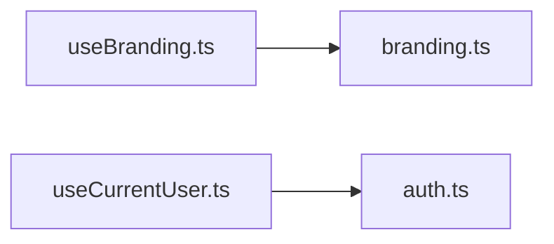

<!-- generated by docwizz: edits are overwritten -->
# src/connector-ui/src/composables

Layer **state** · project `connector-ui`

Project navigation: [connector-ui](../projects/connector-ui-f36e97198b9e.md)

## Overview 🤖

Contains Vue composables for managing various application states and utilities.

**Responsibilities.** Manages branding, current user, save status, theme, and toasts across the application.

**Usage.** Used by various components and views in the connector-ui module.

_AI draft from the facts on this page; review it, then write the module's documentation yourself._

## Flows through this module

- `/` → DashboardView → canOpen, Card, ConnectionStatusCard, HelpTooltip, Icon, listExportDefinitions, +3 more → authHeaders, GET /api/export-definitions, GET /api/import-definitions, getConnection, getConnectionStatus → GET /api/connection, GET /api/connection/status
- `/connect` → ConnectionView → Alert, Button, clearSession, ConnectionTlsSelect, emptyForm, formFromStored, +15 more → authHeaders, FieldShell, GET /api/connection, POST /api/connection
- `/export-definitions` → ExportDefinitionsView → Alert, Button, deleteExportDefinition, duplicateExportDefinition, EmptyState, HelpTooltip, +9 more → authHeaders, ConfirmAction, DELETE /api/export-definitions/{id:int}, GET /api/export-definitions, GET /api/export-definitions/{id:int}/runs, Icon, +3 more
- `/export-definitions/:id` → ExportDefinitionEditView → Alert, BackLink, blankRootNode, Button, columnsAsDisabledScalarFields, createExportDefinition, +13 more → authHeaders, blankFieldMapping, ConfirmAction, deleteExportDefinition, duplicateExportDefinition, ExportFormatPicker, +16 more → DELETE /api/export-definitions/{id:int}, POST /api/export-definitions/{id:int}/duplicate, POST /api/export-definitions/{id:int}/run, POST /api/export-definitions/{id:int}/test, PUT /api/export-definitions/{id:int}
- `/export-schema` → SchemaView → Alert, Button, ColumnMappingTable, ExportFormatPicker, findSuggestedRelations, getExportMapping, +12 more → authHeaders, deletePreset, FlatPreviewTable, GET /api/export-mapping, GET /api/pipeline/preview, GET /api/source-schema, +9 more → DELETE /api/export-mapping/presets/{name}, GET /api/export-mapping/presets, NestedGroupEditor, PUT /api/export-mapping/presets/{name}, RelationCard → FieldPickerTable, IssuesAlert
- `/exports` → ExportView → ActiveMappingSummary, Alert, Button, ExportRunsTable, getExportMapping, getPreview, +8 more → authHeaders, FlatPreviewTable, GET /api/export-mapping, GET /api/exports, GET /api/pipeline/preview, NestedPreviewList, +1 more
- `/exports/:seqNo` → ExportDetail → Alert, BackLink, DeliverRunForm, getExport, HelpTooltip, Icon, +6 more → Button, Card, deliverExport, GET /api/exports/{seqNo:int}, getUsername, Input, +5 more → FieldShell, POST /api/exports/{seqNo:int}/deliver, POST /api/exports/{seqNo:int}/release, POST /api/exports/{seqNo:int}/skip
- `/import-definitions` → ImportDefinitionsView → Alert, Button, deleteImportDefinition, duplicateImportDefinition, EmptyState, HelpTooltip, +8 more → authHeaders, ConfirmAction, DELETE /api/import-definitions/{id:int}, GET /api/import-definitions, GET /api/import-definitions/{id:int}/runs, Icon, +2 more
- … 3 more in [API](../api.md#flows) and [frontend](../frontend.md#flows)

## Dependencies

Depends on: [src/connector-ui/src/api](src-connector-ui-src-api.md)

Used by: [src/connector-ui/src](src-connector-ui-src.md), [src/connector-ui/src/components](src-connector-ui-src-components.md), [src/connector-ui/src/components/ui](src-connector-ui-src-components-ui.md), [src/connector-ui/src/router](src-connector-ui-src-router.md), [src/connector-ui/src/views](src-connector-ui-src-views.md)

## Components

### ThemePreference

_type_ · [useTheme.ts](../../src/connector-ui/src/composables/useTheme.ts#L3)

### useBranding.ts

_module_ · [useBranding.ts](../../src/connector-ui/src/composables/useBranding.ts#L1)

| Member | Summary | Derived from code | Complexity |
|---|---|---|---|
| [`useBranding`](../../src/connector-ui/src/composables/useBranding.ts#L53) | Shared branding state. First call kicks off the load; later calls (including after saving new branding in Settings) reuse the same refs and can force a fresh `reload()`. |  | 2 |

### useCurrentUser.ts

_module_ · [useCurrentUser.ts](../../src/connector-ui/src/composables/useCurrentUser.ts#L1)

_Linked tests:_ `signInAs.ts`, `signInAs.ts` (via `useCurrentUser.ts.loadCurrentUser`) — test code that uses it, not coverage

| Member | Summary | Derived from code | Complexity |
|---|---|---|---|
| [`loadCurrentUser`](../../src/connector-ui/src/composables/useCurrentUser.ts#L12) | Reloads the current user; resolves to null when the session is no longer valid. |  | 1 |
| [`resetCurrentUser`](../../src/connector-ui/src/composables/useCurrentUser.ts#L17) |  |  | 1 |
| [`canAccess`](../../src/connector-ui/src/composables/useCurrentUser.ts#L26) | Whether the current user may open a route with this access rule. |  | 4 |
| [`canOpen`](../../src/connector-ui/src/composables/useCurrentUser.ts#L34) | Whether the current user may open a resolved route: its `meta.access`, or `meta.createAccess` when its :id param is "new" (the page creates something). |  | 3 |
| [`useCurrentUser`](../../src/connector-ui/src/composables/useCurrentUser.ts#L38) |  |  | 1 |

### useSaveStatus.ts

_module_ · [useSaveStatus.ts](../../src/connector-ui/src/composables/useSaveStatus.ts#L1)

| Member | Summary | Derived from code | Complexity |
|---|---|---|---|
| [`useSaveStatus`](../../src/connector-ui/src/composables/useSaveStatus.ts#L6) | The saving/saveStatus/saveMessage triad duplicated identically across several definition/settings save forms — factored out once a third copy (SchedulerSettingsForm.vue) pushed the clone past fallow's duplicate-detection threshold. |  | 1 |

### useTheme.ts

_module_ · [useTheme.ts](../../src/connector-ui/src/composables/useTheme.ts#L1)

| Member | Summary | Derived from code | Complexity |
|---|---|---|---|
| [`useTheme`](../../src/connector-ui/src/composables/useTheme.ts#L46) | Shared app-wide theme preference: 'light' \| 'dark' follow a manual choice, 'system' follows prefers-color-scheme. |  | 2 |

### useToasts.ts

_module_ · [useToasts.ts](../../src/connector-ui/src/composables/useToasts.ts#L1)

_Linked tests:_ `BrandingSettingsForm.test.ts`, `ConnectionView.test.ts`, `ExportDefinitionsView.test.ts`, `ExportView.test.ts`, `GdprDenylistEditor.test.ts`, `ImportDefinitionsView.test.ts`, `ReleaseDialog.test.ts`, `SchemaView.test.ts`, +3 more — test code that uses it, not coverage

| Member | Summary | Derived from code | Complexity |
|---|---|---|---|
| [`useToasts`](../../src/connector-ui/src/composables/useToasts.ts#L35) | App-wide toast queue for confirming saves/deletes/etc. — a reactive singleton in the same module-scope-ref style as useTheme, rendered by the single \<ToastHost/> mounted in App.vue. |  | 1 |

---
_Generated from 15 symbols in [src/connector-ui/src/composables/useBranding.ts](../../src/connector-ui/src/composables/useBranding.ts), [src/connector-ui/src/composables/useCurrentUser.ts](../../src/connector-ui/src/composables/useCurrentUser.ts), [src/connector-ui/src/composables/useSaveStatus.ts](../../src/connector-ui/src/composables/useSaveStatus.ts), [src/connector-ui/src/composables/useTheme.ts](../../src/connector-ui/src/composables/useTheme.ts), [src/connector-ui/src/composables/useToasts.ts](../../src/connector-ui/src/composables/useToasts.ts) (commit `b3fcbdc`, profile `default`). Sections marked _fact_ are read from the code, _inferred_ come from heuristics, 🤖 marks AI drafts._
