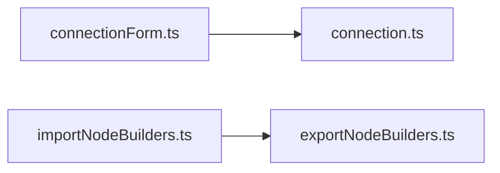

<!-- generated by docwizz: edits are overwritten -->
# src/connector-ui/src/lib

project `connector-ui`

Project navigation: [connector-ui](../projects/connector-ui-f36e97198b9e.md)

## Overview 🤖

Contains utility functions and types for handling connections, dates, exports, imports, permissions, and suggested relations in the connector UI.

**Responsibilities.** Provides functions and types for managing connection forms, date formatting, export and import configurations, permission checks, and relation suggestions.

**Usage.** Used by various components, the router, and views in the connector UI to handle user interactions, data formatting, and system permissions.

_AI draft from the facts on this page; review it, then write the module's documentation yourself._

## Key components

| Component | Kind | Used by | Summary |
|---|---|---|---|
| [AccessMethod](#accessmethod) | type | 0 |  |
| [ConnectionForm](#connectionform) | interface | 0 |  |
| [DetectedExportFile](#detectedexportfile) | interface | 0 |  |
| [Permission](#permission) | type | 0 |  |
| [RouteAccess](#routeaccess) | interface | 0 | What a route needs: Admin, or at least one of `anyOf`. A route without this is open to every signed-in user. |
| [SourceType](#sourcetype) | type | 0 |  |

## Flows through this module

- `/connect` → ConnectionView → Alert, Button, clearSession, ConnectionTlsSelect, emptyForm, formFromStored, +15 more → authHeaders, FieldShell, GET /api/connection, POST /api/connection
- `/export-definitions/:id` → ExportDefinitionEditView → Alert, BackLink, blankRootNode, Button, columnsAsDisabledScalarFields, createExportDefinition, +13 more → authHeaders, blankFieldMapping, ConfirmAction, deleteExportDefinition, duplicateExportDefinition, ExportFormatPicker, +16 more → DELETE /api/export-definitions/{id:int}, POST /api/export-definitions/{id:int}/duplicate, POST /api/export-definitions/{id:int}/run, POST /api/export-definitions/{id:int}/test, PUT /api/export-definitions/{id:int}
- `/export-schema` → SchemaView → Alert, Button, ColumnMappingTable, ExportFormatPicker, findSuggestedRelations, getExportMapping, +12 more → authHeaders, deletePreset, FlatPreviewTable, GET /api/export-mapping, GET /api/pipeline/preview, GET /api/source-schema, +9 more → DELETE /api/export-mapping/presets/{name}, GET /api/export-mapping/presets, NestedGroupEditor, PUT /api/export-mapping/presets/{name}, RelationCard → FieldPickerTable, IssuesAlert
- `/import-definitions/:id` → ImportDefinitionEditView → Alert, applyImportMappingSuggestion, BackLink, blankRootNode, Button, collectWritableTargets, +19 more → authHeaders, blankFieldMapping, ConfirmAction, deleteImportDefinition, detectExportFile, duplicateImportDefinition, +29 more → Badge, DELETE /api/import-definitions/{id:int}, FieldShell, GET /api/import-runs/{id:int}, ImportDiffValue, POST /api/import-definitions/{id:int}/duplicate, +4 more

## Dependencies

Depends on: [src/connector-ui/src/api](src-connector-ui-src-api.md)

Used by: [src/connector-ui/src/components](src-connector-ui-src-components.md), [src/connector-ui/src/router](src-connector-ui-src-router.md), [src/connector-ui/src/views](src-connector-ui-src-views.md)

## Components

### AccessMethod

_type_ · [connectionForm.ts](../../src/connector-ui/src/lib/connectionForm.ts#L7)

### ConnectionForm

_interface_ · [connectionForm.ts](../../src/connector-ui/src/lib/connectionForm.ts#L11)

### connectionForm.ts

_module_ · [connectionForm.ts](../../src/connector-ui/src/lib/connectionForm.ts#L1)

_Linked tests:_ `connectionForm.test.ts` — test code that uses it, not coverage

| Member | Summary | Derived from code | Complexity |
|---|---|---|---|
| [`emptyForm`](../../src/connector-ui/src/lib/connectionForm.ts#L24) |  |  | 1 |
| [`isRelational`](../../src/connector-ui/src/lib/connectionForm.ts#L38) |  |  | 1 |
| [`withSourceType`](../../src/connector-ui/src/lib/connectionForm.ts#L42) | Switches the source type. The port follows the new type's default unless the user typed their own, and a TLS mode the new type doesn't offer (MariaDB has no "Allow") falls back to the default. |  | 6 |
| [`formFromStored`](../../src/connector-ui/src/lib/connectionForm.ts#L58) | Form state for a stored connection. The password is never part of GET responses, so it stays empty. |  | 7 |
| [`storedConnectionLabel`](../../src/connector-ui/src/lib/connectionForm.ts#L74) |  |  | 3 |
| [`toConnectionConfig`](../../src/connector-ui/src/lib/connectionForm.ts#L85) | The POST body: only the fields the chosen source type uses, everything else null. |  | 6 |
| [`portError`](../../src/connector-ui/src/lib/connectionForm.ts#L99) |  |  | 5 |
| [`validateConnectionForm`](../../src/connector-ui/src/lib/connectionForm.ts#L106) | Per-field messages for missing/invalid required fields of the chosen source type. |  | 5 |

### dates.ts

_module_ · [dates.ts](../../src/connector-ui/src/lib/dates.ts#L1)

_Linked tests:_ `dates.test.ts` — test code that uses it, not coverage

| Member | Summary | Derived from code | Complexity |
|---|---|---|---|
| [`formatDate`](../../src/connector-ui/src/lib/dates.ts#L6) | Formats a backend timestamp for display, treating an offset-less ISO string as UTC (the backend sometimes serializes DateTimeKind.Unspecified values without a 'Z' or offset suffix). Detects an existing 'Z' or +/-HH:mm offset rather than a bare `.includes('Z')` check, since that naive check mistakes a `+00:00`-style offset for "no timezone" and appends a second one, producing "Invalid Date". |  | 3 |

### DetectedExportFile

_interface_ · [exportedFileDetection.ts](../../src/connector-ui/src/lib/exportedFileDetection.ts#L13)

### exportedFileDetection.ts

_module_ · [exportedFileDetection.ts](../../src/connector-ui/src/lib/exportedFileDetection.ts#L1)

_Linked tests:_ `exportedFileDetection.test.ts` — test code that uses it, not coverage

| Member | Summary | Derived from code | Complexity |
|---|---|---|---|
| [`detectExportFile`](../../src/connector-ui/src/lib/exportedFileDetection.ts#L25) | Detects the specific confusion Connector.Infrastructure.ImportNodeWalker.ParseRecords now names explicitly server-side (its schema_version/schemaVersion branch, added alongside this): a pasted file carrying "schema_version" (snake_case) but no "schemaVersion" is the connector's own export output (JsonExportFormatWriter), not an ImportEnvelope — an unrelated shape that happens to share "records"/"provenance" vocabulary. Returns null for anything else (not JSON, already envelope-shaped, or some other malformed input) — detection must never guess at a shape it doesn't recognize; an unrelated parse/shape problem still surfaces through the normal Preview error path. |  | 9 |
| [`toImportEnvelope`](../../src/connector-ui/src/lib/exportedFileDetection.ts#L49) | Rewraps a detected export file as a minimal ImportEnvelope: the same records array, the same provenance block carried through untouched (ImportNodeWalker ignores it entirely — see the regression test WalkAsync_ProvenanceBlockOnEnvelope_HasNoEffectOnTheWalk), just the wrapper the walker actually reads. Never touches AllowedWritableColumns or field data — a pure reshape of already-pasted JSON, not a new trust boundary. |  | 2 |
| [`hasIntegrationKeyProvenance`](../../src/connector-ui/src/lib/exportedFileDetection.ts#L62) | True when a detected export's provenance block carries a non-empty integrationKey — the signal that "Create Import Definition from this export" has anything to work with. This never claims a match itself: ImportMappingSuggestion.Evaluate still does the real (IntegrationKey, ContractVersion) lookup server-side once the operator follows through. |  | 4 |

### exportNodeBuilders.ts

_module_ · [exportNodeBuilders.ts](../../src/connector-ui/src/lib/exportNodeBuilders.ts#L1)

| Member | Summary | Derived from code | Complexity |
|---|---|---|---|
| [`blankFieldMapping`](../../src/connector-ui/src/lib/exportNodeBuilders.ts#L7) | A neutral starting point for a new scalar-field node's transform config — every FieldMapping member at its backend default (Connector.Core.DynamicExport.FieldTransform.None / FieldDataType.String). |  | 1 |
| [`columnsAsDisabledScalarFields`](../../src/connector-ui/src/lib/exportNodeBuilders.ts#L15) | One disabled scalar-field node per column of `tableName` — the "pick columns via checkbox" UX shown when a table is selected for the export root or a related entity, shared by ExportDefinitionEditView.vue (root table) and ExportNodeTreeEditor.vue (nested related tables) so both populate exactly the same way. |  | 2 |
| [`blankRootNode`](../../src/connector-ui/src/lib/exportNodeBuilders.ts#L35) | An empty root node — the starting tree for a brand-new export definition. |  | 1 |

### importNodeBuilders.ts

_module_ · [importNodeBuilders.ts](../../src/connector-ui/src/lib/importNodeBuilders.ts#L1)

| Member | Summary | Derived from code | Complexity |
|---|---|---|---|
| [`blankRootNode`](../../src/connector-ui/src/lib/importNodeBuilders.ts#L6) | An empty root node — the starting tree for a brand-new import definition. |  | 1 |
| [`collectWritableTargets`](../../src/connector-ui/src/lib/importNodeBuilders.ts#L26) | Every enabled scalar-field TargetColumn the tree currently references, excluding the root match field — the backend only ever looks for it among the root's direct children (ImportNodeWalker.FindMatchField) and never treats it as a write target. Feeds ImportAllowedColumnsEditor.vue's "missing from allowlist" hint, mirroring the recursive collection ImportDefinitionEndpoints.ValidateNode does server-side. |  | 8 |
| [`columnsAsDisabledScalarFields`](../../src/connector-ui/src/lib/importNodeBuilders.ts#L43) | One disabled scalar-field node per column of `tableName` — the same "pick columns via checkbox" UX ExportNodeTreeEditor.vue gives, shown when a related table is picked for an object/array node. |  | 2 |
| [`applyImportMappingSuggestion`](../../src/connector-ui/src/lib/importNodeBuilders.ts#L70) | "Create from export": builds the root node a New Import Definition starts from once an operator accepts a suggestion. Same starting point as picking the root table by hand (one disabled scalar-field node per column), except the deterministic root match field is pre-enabled and correctly keyed to the export's own JSON field name, and every best-effort candidate field (still unchecked/disabled — the operator must explicitly enable each one) gets its SourceKey pre-filled so accepting it later is a checkbox, not a retype. |  | 4 |

### importPreviewHints.ts

_module_ · [importPreviewHints.ts](../../src/connector-ui/src/lib/importPreviewHints.ts#L1)

_Linked tests:_ `importPreviewHints.test.ts` — test code that uses it, not coverage

| Member | Summary | Derived from code | Complexity |
|---|---|---|---|
| [`findUnmappedRootFields`](../../src/connector-ui/src/lib/importPreviewHints.ts#L11) | Best-effort, client-side-only mirror of what ImportNodeWalker.DiffScalarFields actually looks at: for each record in a pasted ImportEnvelope, only a property whose key equals some enabled scalar-field child's SourceKey is ever read — any other key on the record is invisible to the walker, no matter what value it carries. Used solely to warn an operator in ImportDefinitionPreviewPanel.vue that editing such a key can never move the "changed" count; never sent to the server and never affects what Preview runs. Returns [] for anything short of a parseable object with a `records` array — malformed/unrelated input still surfaces through the normal Preview error path, this hint must never guess at it. |  | 13 |

### Permission

_type_ · [permissions.ts](../../src/connector-ui/src/lib/permissions.ts#L31)

### permissions.ts

_module_ · [permissions.ts](../../src/connector-ui/src/lib/permissions.ts#L1)

_Linked tests:_ `signInAs.ts` — test code that uses it, not coverage

### RouteAccess

_interface_ · [permissions.ts](../../src/connector-ui/src/lib/permissions.ts#L41)

What a route needs: Admin, or at least one of `anyOf`. A route without this is open to every signed-in user.

### SourceType

_type_ · [connectionForm.ts](../../src/connector-ui/src/lib/connectionForm.ts#L6)

### suggestedRelations.ts

_module_ · [suggestedRelations.ts](../../src/connector-ui/src/lib/suggestedRelations.ts#L1)

_Linked tests:_ `suggestedRelations.test.ts` — test code that uses it, not coverage

| Member | Summary | Derived from code | Complexity |
|---|---|---|---|
| [`findSuggestedRelations`](../../src/connector-ui/src/lib/suggestedRelations.ts#L36) | FK-based relation suggestions for a given table, in both directions the schema's foreign keys actually express (see {@link findForwardRelations} and {@link findReverseRelations}). Shared by the legacy mapping tree (SchemaView.vue, which only wants the reverse/array shape — see its `.filter(s => s.kind === 'array')`) and the Export Definitions tree builder (ExportNodeTreeEditor.vue), so both editors detect relations from one piece of logic instead of two copies drifting apart. |  | 5 |

---
_Generated from 35 symbols in [src/connector-ui/src/lib/connectionForm.ts](../../src/connector-ui/src/lib/connectionForm.ts), [src/connector-ui/src/lib/dates.ts](../../src/connector-ui/src/lib/dates.ts), [src/connector-ui/src/lib/exportedFileDetection.ts](../../src/connector-ui/src/lib/exportedFileDetection.ts), [src/connector-ui/src/lib/exportNodeBuilders.ts](../../src/connector-ui/src/lib/exportNodeBuilders.ts), [src/connector-ui/src/lib/importNodeBuilders.ts](../../src/connector-ui/src/lib/importNodeBuilders.ts), [src/connector-ui/src/lib/importPreviewHints.ts](../../src/connector-ui/src/lib/importPreviewHints.ts), [src/connector-ui/src/lib/permissions.ts](../../src/connector-ui/src/lib/permissions.ts), [src/connector-ui/src/lib/suggestedRelations.ts](../../src/connector-ui/src/lib/suggestedRelations.ts) (commit `b3fcbdc`, profile `default`). Sections marked _fact_ are read from the code, _inferred_ come from heuristics, 🤖 marks AI drafts._
