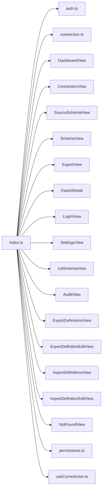

<!-- generated by docwizz: edits are overwritten -->
# src/connector-ui/src/router

project `connector-ui`

Project navigation: [connector-ui](../projects/connector-ui-f36e97198b9e.md)

## Flows through this module

- `/` → DashboardView → canOpen, Card, ConnectionStatusCard, HelpTooltip, Icon, listExportDefinitions, +3 more → authHeaders, GET /api/export-definitions, GET /api/import-definitions, getConnection, getConnectionStatus → GET /api/connection, GET /api/connection/status
- `/:pathMatch(.*)*` → NotFoundView
- `/audit` → AuditView → Alert, AuditLogTable, Button, EmptyState, getAuditLog, HelpTooltip, +1 more → authHeaders, Icon
- `/connect` → ConnectionView → Alert, Button, clearSession, ConnectionTlsSelect, emptyForm, formFromStored, +15 more → authHeaders, FieldShell, GET /api/connection, POST /api/connection
- `/export-definitions` → ExportDefinitionsView → Alert, Button, deleteExportDefinition, duplicateExportDefinition, EmptyState, HelpTooltip, +9 more → authHeaders, ConfirmAction, DELETE /api/export-definitions/{id:int}, GET /api/export-definitions, GET /api/export-definitions/{id:int}/runs, Icon, +3 more
- `/export-definitions/:id` → ExportDefinitionEditView → Alert, BackLink, blankRootNode, Button, columnsAsDisabledScalarFields, createExportDefinition, +13 more → authHeaders, blankFieldMapping, ConfirmAction, deleteExportDefinition, duplicateExportDefinition, ExportFormatPicker, +16 more → DELETE /api/export-definitions/{id:int}, POST /api/export-definitions/{id:int}/duplicate, POST /api/export-definitions/{id:int}/run, POST /api/export-definitions/{id:int}/test, PUT /api/export-definitions/{id:int}
- `/export-schema` → SchemaView → Alert, Button, ColumnMappingTable, ExportFormatPicker, findSuggestedRelations, getExportMapping, +12 more → authHeaders, deletePreset, FlatPreviewTable, GET /api/export-mapping, GET /api/pipeline/preview, GET /api/source-schema, +9 more → DELETE /api/export-mapping/presets/{name}, GET /api/export-mapping/presets, NestedGroupEditor, PUT /api/export-mapping/presets/{name}, RelationCard → FieldPickerTable, IssuesAlert
- `/exports` → ExportView → ActiveMappingSummary, Alert, Button, ExportRunsTable, getExportMapping, getPreview, +8 more → authHeaders, FlatPreviewTable, GET /api/export-mapping, GET /api/exports, GET /api/pipeline/preview, NestedPreviewList, +1 more
- … 7 more in [API](../api.md#flows) and [frontend](../frontend.md#flows)

## Architecture observations

- `index.ts` depends on 19 other components — high coupling, possibly several responsibilities

## Dependencies

Depends on: [src/connector-ui/src/api](src-connector-ui-src-api.md), [src/connector-ui/src/composables](src-connector-ui-src-composables.md), [src/connector-ui/src/lib](src-connector-ui-src-lib.md), [src/connector-ui/src/views](src-connector-ui-src-views.md)

Used by: [src/connector-ui/src](src-connector-ui-src.md)

## Components

### index.ts

_module_ · [index.ts](../../src/connector-ui/src/router/index.ts#L1)

---
_Generated from 1 symbols in [src/connector-ui/src/router/index.ts](../../src/connector-ui/src/router/index.ts) (commit `b3fcbdc`, profile `default`). Sections marked _fact_ are read from the code, _inferred_ come from heuristics, 🤖 marks AI drafts._
