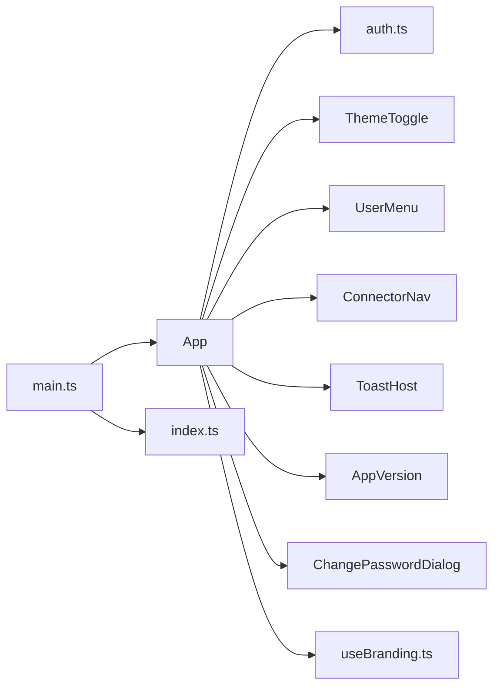

<!-- generated by docwizz: edits are overwritten -->
# src/connector-ui/src

Layer **ui** · project `connector-ui` · UI components: 1

Project navigation: [connector-ui](../projects/connector-ui-f36e97198b9e.md)

## Dependencies

Depends on: [src/connector-ui/src/api](src-connector-ui-src-api.md), [src/connector-ui/src/components](src-connector-ui-src-components.md), [src/connector-ui/src/components/ui](src-connector-ui-src-components-ui.md), [src/connector-ui/src/composables](src-connector-ui-src-composables.md), [src/connector-ui/src/router](src-connector-ui-src-router.md)

## Components

### App

_component_ · [App.vue](../../src/connector-ui/src/App.vue#L1)

App shell: a header with the branded logo and app name and the theme toggle, plus (when signed in) the navigation and a user menu for changing the password, signing out or signing out of all sessions; then the current route's view, toasts and, when signed in, the app version.

- **dependencies** _(fact)_: auth.ts, ThemeToggle, UserMenu, ConnectorNav, ToastHost, AppVersion, ChangePasswordDialog, useBranding.ts
- **state** _(fact)_: loggedIn (computed), username (computed), changingPassword

_Linked tests:_ `App.test.ts` — test code that uses it, not coverage

_Evidence:_ [src/connector-ui/src/App.vue:1-95](../../src/connector-ui/src/App.vue#L1), [src/connector-ui/src/api/auth.ts:1](../../src/connector-ui/src/api/auth.ts#L1), [src/connector-ui/src/components/ThemeToggle.vue:1-36](../../src/connector-ui/src/components/ThemeToggle.vue#L1), [src/connector-ui/src/components/UserMenu.vue:1-138](../../src/connector-ui/src/components/UserMenu.vue#L1), [src/connector-ui/src/components/ConnectorNav.vue:1-128](../../src/connector-ui/src/components/ConnectorNav.vue#L1), [src/connector-ui/src/components/ui/ToastHost.vue:1-51](../../src/connector-ui/src/components/ui/ToastHost.vue#L1), [src/connector-ui/src/components/AppVersion.vue:1-18](../../src/connector-ui/src/components/AppVersion.vue#L1), [src/connector-ui/src/components/ChangePasswordDialog.vue:1-102](../../src/connector-ui/src/components/ChangePasswordDialog.vue#L1), [src/connector-ui/src/composables/useBranding.ts:1](../../src/connector-ui/src/composables/useBranding.ts#L1)

### main.ts

_module_ · [main.ts](../../src/connector-ui/src/main.ts#L1)

---
_Generated from 2 symbols in [src/connector-ui/src/App.vue](../../src/connector-ui/src/App.vue), [src/connector-ui/src/main.ts](../../src/connector-ui/src/main.ts) (commit `b3fcbdc`, profile `default`). Sections marked _fact_ are read from the code, _inferred_ come from heuristics, 🤖 marks AI drafts._
