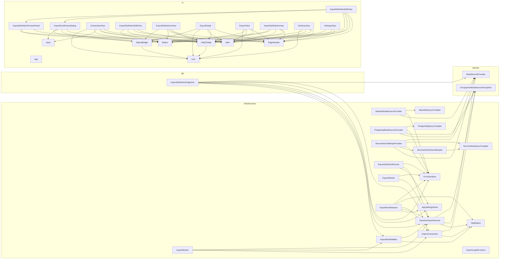

<!-- generated by docwizz: edits are overwritten -->
# Components

Top-level building blocks by layer and the dependencies between them (the 40 most connected; every module page has the full picture).

| Component | Kind | Layer | Depends on | Used by | Summary |
|---|---|---|---|---|---|
| [ImportDefinitionEndpoints](../modules/src-Connector.Api-Endpoints.md#importdefinitionendpoints) | class | api | AppSettingsStore, AuditService, DynamicExportService, ErrorSanitizer, ExportDefinitionShape, ExportNodeJson, IDataSourceProvider, IDataSourceProviderResolver, ImportConnection, ImportDefinitionDto, ImportDefinitionRunDto, ImportDefinitionSummaryDto, ImportMappingSuggestion, ImportMappingSuggestionCandidateFieldDto, ImportMappingSuggestionCheckResult, ImportMappingSuggestionDto, ImportNodeJson, ImportNodeWalker, ImportPlanBuilder, ImportPlanJson, ImportRunEntity, ImportSampleShape |  | CRUD, preview, and run history for `ImportDefinitionEntity` — the API surface the frontend and any external caller use to configure an inbound mapping and inspect what it would do. The four-eyes commit/reject endpoints (POST /api/import-runs/{id}/release and .../reject) live in `ImportRunEndpoints`. This file (the route registrations) is the entry point; request validation lives in ImportDefinitionEndpoints.Validation.cs and entity/DTO mapping plus the "create from export" suggestion in ImportDefinitionEndpoints.Mapping.cs — split across files, kept as one `partial` class rather than separate classes so the `internal` methods each already exposes to Connector.Integration.Tests keep working unchanged. The two save-time guardrails are the primary safety boundary of the import feature: `ValidateRequestAsync` rejects a TargetColumn outside `AllowedWritableColumns`, one that doesn't exist on its table per the live introspected ERP schema, or one that's a primary key, identity/computed column, or foreign key — and rejects any node whose OnMissingChild is "insert" outright, since child-row creation is not supported. |
| [IDataSourceProvider](../modules/src-Connector.Core-DataSources.md#idatasourceprovider) | interface | domain |  | DynamicExportService, ImportDefinitionEndpoints, ISqlDataSourceProvider, MariaDbDataSourceProvider, MeteredDataSourceProvider, PostgreSqlDataSourceProvider, ServiceNowTableApiProvider | Abstraction over one kind of ERP data source backend — see knowledge/architecture/data-source-abstraction.md. Implemented for PostgreSQL, MariaDB and the ServiceNow Table API (Connector.Infrastructure.DataSources.*); obtained via `IDataSourceProviderResolver`, never constructed directly outside DI registration. Where providers differ, `Capabilities` says so. |
| [UnsupportedDataSourceException](../modules/src-Connector.Core-DataSources.md#unsupporteddatasourceexception) | class | domain | DataSourceType | DataSourceProviderResolver, DynamicExportService, ImportConnection, MeteredDataSourceProvider, PostgreSqlDataSourceProvider, ServiceNowTableApiProvider | Thrown by `Resolve` when no `IDataSourceProvider` is registered for the requested `DataSourceType` (e.g. `ServiceNowTableApi`/ `ServiceNowSqlApi`, or an out-of-range value), and wherever a code path only supports some source types. |
| [AppSettingsStore](../modules/src-Connector.Infrastructure.md#appsettingsstore) | class | infrastructure | AppSettingEntity, ExportProducer | ExportDefinitionMigrator, ExportDefinitionRunner, ImportDefinitionEndpoints, ImportRunReleaser, ManifestSigningPolicy, RolePermissionStore, SessionRevocationStore | Typed find/deserialize/upsert helpers over `AppSettings`: one place for the find-null-check-deserialize (read) and find-null-check-add-or-mutate-save (write) pattern. |
| [DynamicExportService](../modules/src-Connector.Infrastructure.md#dynamicexportservice) | class | infrastructure | ExportBuildResult, ExportFormatWriterFactory, IDataSourceProvider, IExportFormatWriter, ISqlDialect, MeteredDataSourceProvider, NativeSqlQuery, QueryResult, TreeChild, TreePlan, TreeRow, TreeScalar, UnsupportedDataSourceException | CsvExportFormatWriter, ExcelExportFormatWriter, ExportDefinitionEndpoints, ExportDefinitionRunner, ExportMappingEndpoints, ExportWorker, ImportDefinitionEndpoints, ImportNodeWalker, ImportRunReleaser, ImportWorker, JsonExportFormatWriter | Query/build engine behind the connector's export paths: the legacy single-mapping flat/nested-JSON pipeline (`ExportMappingConfig`, still served by /api/pipeline/* — see DynamicExportService.LegacyMapping.cs) and the `ExportNode` tree engine (Export Definitions 2.0 — see DynamicExportService.ExportNode.cs) side by side, plus the shared GDPR denylist (DynamicExportService.Gdpr.cs) and output-format writers (DynamicExportService.Output.cs) both paths use. Kept as one partial class split across files by responsibility, rather than separate classes, so every existing DynamicExportService.* call site across the API/Infrastructure/test projects keeps working unchanged. This file holds the members shared across every other part: the nesting-depth cap, the build-result shape, the connection fingerprint, and the dialect lookup both query engines build on. |
| [ErrorSanitizer](../modules/src-Connector.Infrastructure.md#errorsanitizer) | class | infrastructure |  | AuditService, ConnectionEndpoints, ExportDefinitionRunner, ExportWorker, ImportDefinitionEndpoints, ImportRunReleaser, MariaDbDataSourceProvider, PostgreSqlDataSourceProvider, SanitizingLogFormatter, ServiceNowTableApiProvider | Strips credentials from error text. Several endpoints return an exception's message to the caller (a "test connection"/preview action is only useful if it says why it failed), but Npgsql can echo the offending connection string — including the ERP password — back inside an exception message. `Detail` is the single choke point every such call site routes through, so the diagnostic value survives but a credential can't leak through it. `ForLogging` does the same for logged exceptions, and `Scrub` for any other text such as audit details. |
| [ExportDefinitionRunner](../modules/src-Connector.Infrastructure.md#exportdefinitionrunner) | class | infrastructure | AppSettingsStore, DynamicExportService, ErrorSanitizer, ExportDefinitionRunEntity, ExportManifest, ExportNodeJson, ExportPackage, ExportProvenance, FileSystemExportSink, IDataSourceProviderResolver, ManifestSigningPolicy | ExportDefinitionWorker | The one execution path behind every trigger of an `ExportDefinitionEntity` — manual run/test (ExportDefinitionEndpoints) and scheduled runs (`ExportDefinitionWorker`) all call `ExecuteAsync`, so every run — scheduled or manual — writes exactly one `ExportDefinitionRunEntity` row, with identical Failed/error-message semantics regardless of trigger. |
| [ExportLogDbContext](../modules/src-Connector.Infrastructure.md#exportlogdbcontext) | class | infrastructure | AppSettingEntity, AuditLogEntry, EncryptedStringConverter, ExportDefinitionEntity, ExportDefinitionRunEntity, ExportRunEntity, ImportDefinitionEntity, ImportRunEntity, UserEntity | AuditService | EF Core DbContext for the export log (SQLite). Tables: ExportRun, AppSetting (key/value config store), AuditLog. Schema is managed via EF Core migrations in Connector.Infrastructure/Migrations/. Startup calls Database.MigrateAsync() — add new changes via dotnet ef migrations add. |
| [ExportWorker](../modules/src-Connector.Infrastructure.md#exportworker) | class | infrastructure | DynamicExportService, ErrorSanitizer, ExportManifest, ExportMappingJson, ExportPackage, ExportRunEntity, ExportSchema, FileSystemExportSink, ManifestSigningPolicy |  | Daily background service: runs the export pipeline once per day at the configured time. |
| [ImportConnection](../modules/src-Connector.Infrastructure-DataSources.md#importconnection) | class | infrastructure | IDataSourceProviderResolver, ISqlDataSourceProvider, ISqlDialect, UnsupportedDataSourceException | ImportDefinitionEndpoints, ImportRunReleaser, ImportWorker | The import path's handle on the ERP: an open ADO.NET connection plus the SQL dialect to render statements with, both from the configured provider — so `ImportNodeWalker` and `ImportRunReleaser` never name a database driver. Only a provider with the `Imports` capability hands one out. |
| [ImportNodeWalker](../modules/src-Connector.Infrastructure.md#importnodewalker) | class | infrastructure | DynamicExportService, ImportChildResult, ImportFieldDiff, ImportRowResult, ImportValidationException, ImportWalkResult, ISqlDialect | ImportDefinitionEndpoints, ImportWorker | The write-side mirror of `DynamicExportService`'s tree walker: parses an inbound ImportEnvelope against a saved `ImportNode` tree, and produces a field-level diff per accepted row plus a rejected-row list — with zero write capability. Every method here only ever issues SQL SELECTs; the conditional UPDATE path is `ImportRunReleaser`, which commits the plan built from this same walk result (`ImportPlanBuilder`), so preview and commit can never disagree about what a row means. |
| [ImportRunReleaser](../modules/src-Connector.Infrastructure.md#importrunreleaser) | class | infrastructure | AppSettingsStore, AuditService, DynamicExportService, ErrorSanitizer, ImportConnection, ImportPlanJson, ISqlDialect |  | Commits an approved `ImportRunEntity` to the ERP under the same Operator/Approver four-eyes contract the export release flow already enforces — the write-side counterpart to `ExportDefinitionRunner`. `ReleaseAsync` and `RejectAsync` take an already-loaded `ImportRunEntity` (the caller — an API endpoint — owns fetching it and checking its `ImportRunStatus`) and finalize it; neither method opens its own DbContext scope, matching every other run-mutating helper in this codebase (`ExecuteAsync`, the inline export release handler). |
| [ImportWorker](../modules/src-Connector.Infrastructure.md#importworker) | class | infrastructure | DynamicExportService, ExportSchema, ImportConnection, ImportNodeJson, ImportNodeWalker, ImportPlanBuilder, ImportPlanJson, ImportRunEntity, ManifestSigningPolicy |  | A sibling of `ExportWorker` that polls an inbound/ staging folder instead of writing to one. Every vendor-supplied file dropped there is manifest-checked, idempotency-checked against (ImportDefinitionId, Sha256Checksum), walked by `ImportNodeWalker` against the ImportEnvelope — the definition field says which saved `ImportDefinitionEntity` to use — and staged as an `ImportRunEntity` at `PendingReview`, with `ImportDefinitionEntity` frozen onto it as `DefinitionSnapshotJson`. This worker never writes to the ERP itself — that's `ImportRunReleaser`'s job, once a human approves the staged plan. |
| [ISqlDialect](../modules/src-Connector.Infrastructure-DataSources.md#isqldialect) | interface | infrastructure |  | DynamicExportService, ImportConnection, ImportNodeWalker, ImportRunReleaser, MariaDbDialect, PostgreSqlDialect | The SQL syntax that differs between relational backends, as far as this codebase actually uses it — not a general-purpose SQL abstraction (no SQL framework, no AST, no ORM). Generic query builders (`DynamicExportService`, `ImportNodeWalker`, `ImportRunReleaser`) assemble statements from plain ANSI keywords (SELECT/FROM/WHERE/AND/AS) plus these members; everything else is a dialect's job. Implementations: `PostgreSqlDialect` and `MariaDbDialect`. See knowledge/architecture/sql-dialect.md. |
| [MariaDbDataSourceProvider](../modules/src-Connector.Infrastructure-DataSources-MariaDb.md#mariadbdatasourceprovider) | class | infrastructure | DataSourceQueryException, ErrorSanitizer, IDataSourceProvider, ISqlDataSourceProvider, MariaDbConnectionFactory, MariaDbDialect, MariaDbQueryCompiler, MariaDbSchemaReader, QueryResult, QueryResultColumn, QueryResultRow, RelationalConnectionRules, SourceSchema, TestConnectionResult |  | The `IDataSourceProvider` for `MariaDb`, over MySqlConnector — the same contract as PostgreSqlDataSourceProvider: connection test and schema read (`MariaDbSchemaReader`), neutral queries (`MariaDbQueryCompiler`) and native SQL the export builders render with `MariaDbDialect`. Stateless singleton; every call opens and disposes its own connection (`MariaDbConnectionFactory`). |
| [MariaDbQueryCompiler](../modules/src-Connector.Infrastructure-DataSources-MariaDb.md#mariadbquerycompiler) | class | infrastructure | CompiledMariaDbQuery, InvalidSourceQueryException, MariaDbDialect, QueryColumn, SourceQueryValidator | MariaDbDataSourceProvider | Compiles the database-neutral `SourceQuery` into MariaDB SQL — the MariaDB counterpart of PostgreSqlQueryCompiler, with the same guarantees: validated against the given `SourceSchema` first (`SourceQueryValidator`), so every emitted identifier is one the schema reported (backtick-quoted by `MariaDbDialect`); synthetic table aliases (t0, t1, …); every filter value a bound parameter; `Limit` an `Int32` rendered by the dialect. |
| [PostgreSqlDataSourceProvider](../modules/src-Connector.Infrastructure-DataSources-PostgreSql.md#postgresqldatasourceprovider) | class | infrastructure | DataSourceQueryException, ErrorSanitizer, IDataSourceProvider, ISqlDataSourceProvider, PostgreSqlDialect, PostgreSqlQueryCompiler, QueryResult, QueryResultColumn, QueryResultRow, RelationalConnectionRules, SourceColumn, SourceSchema, SourceTable, TestConnectionResult, UnsupportedDataSourceException |  | The `IDataSourceProvider` for `PostgreSql`. Owns every piece of PostgreSQL-specific connection/schema/query logic: building an Npgsql connection string, introspecting information_schema, and executing a caller-built SQL query generically. Registered as a singleton (see Program.cs) — it holds no per-call state; every method opens and disposes its own `NpgsqlConnection`. |
| [PostgreSqlQueryCompiler](../modules/src-Connector.Infrastructure-DataSources-PostgreSql.md#postgresqlquerycompiler) | class | infrastructure | CompiledPostgreSqlQuery, InvalidSourceQueryException, PostgreSqlDialect, QueryColumn, SourceQueryValidator | PostgreSqlDataSourceProvider | Compiles the database-neutral `SourceQuery` into PostgreSQL — the only place that model meets a SQL dialect. Validates against the given `SourceSchema` first (`SourceQueryValidator`), so every identifier emitted is one the schema reported, double-quoted by `PostgreSqlDialect`, and table aliases are synthetic (t0, t1, …). No caller-supplied text other than those identifiers and output aliases ever becomes SQL: every filter value is a bound parameter, and `Limit` is an `Int32` rendered by the dialect. |
| [ServiceNowQueryCompiler](../modules/src-Connector.Infrastructure-DataSources-ServiceNow.md#servicenowquerycompiler) | class | infrastructure | InvalidSourceQueryException, QueryColumn, ServiceNowJoinStep, ServiceNowOutputColumn, ServiceNowQueryPlan, ServiceNowTableRequest, SourceQueryValidator | ServiceNowSchemaReader, ServiceNowTableApiProvider | Compiles the database-neutral `SourceQuery` into Table API reads. ServiceNow's encoded-query syntax exists only here — never in Connector.Core or stored configuration. Validates against the schema first (`SourceQueryValidator`), so every field name is one ServiceNow reported; every value is checked for the encoded-query separators (^, and , inside IN) and rejected rather than escaped, so a value can never add a condition of its own. Conditions are sent server-side as the filter of the table they belong to; the Table API can't join, so joins become a second read keyed by the parent rows' values (see `ServiceNowTableApiProvider`). |
| [ServiceNowSchemaReader](../modules/src-Connector.Infrastructure-DataSources-ServiceNow.md#servicenowschemareader) | class | infrastructure | DictionaryRecord, ServiceNowClient, ServiceNowQueryCompiler, SourceColumn, SourceTable, TableRecord | ServiceNowTableApiProvider | Reads ServiceNow's table/field metadata through the ordinary Table API — sys_db_object (tables and their super_class inheritance) and sys_dictionary (fields) — into the same `SourceSchema` shape the SQL providers return. Needs read access to those two tables (e.g. the personalize_dictionary role), not admin; like every Table API read, the result only contains what the account's ACLs allow. |
| [ServiceNowTableApiProvider](../modules/src-Connector.Infrastructure-DataSources-ServiceNow.md#servicenowtableapiprovider) | class | infrastructure | DataSourceCapabilities, ErrorSanitizer, IDataSourceProvider, QueryResult, QueryResultColumn, QueryResultRow, ServiceNowClient, ServiceNowQueryCompiler, ServiceNowSchemaReader, SourceSchema, TestConnectionResult, UnsupportedDataSourceException |  | The `IDataSourceProvider` for `ServiceNowTableApi`: ServiceNow read over its REST Table API, behind the same interface as the SQL providers — callers see `SourceSchema`, `SourceQuery` and `QueryResult`, never HTTP. Not an `ISqlDataSourceProvider`: there is no SQL to run, so `ExecuteNativeAsync` and the SQL-rendering export builders refuse it with `UnsupportedDataSourceException`. |
| [Alert](../modules/src-connector-ui-src-components-ui.md#alert) | component | ui |  | AuditView, ConnectionView, ExportDefinitionEditView, ExportDefinitionsView, ExportDetail, ExportView, IcdSchemaView, ImportDefinitionEditView, ImportDefinitionPreviewPanel, ImportDefinitionsView, ImportUnmappedFieldsWarning, IssuesAlert, PermissionsSettings, SaveStatusAlert, SchemaView, SettingsView, SourceSchemaView, UsersSettings |  |
| [App](../modules/src-connector-ui-src.md#app) | component | ui | AppVersion, ChangePasswordDialog, ConnectorNav, ThemeToggle, ToastHost, UserMenu |  | App shell: a header with the branded logo and app name and the theme toggle, plus (when signed in) the navigation and a user menu for changing the password, signing out or signing out of all sessions; then the current route's view, toasts and, when signed in, the app version. |
| [Button](../modules/src-connector-ui-src-components-ui.md#button) | component | ui |  | AddUserForm, AuditView, BackLink, BrandingImageField, BrandingSettingsForm, ChangePasswordDialog, ConfirmAction, ConnectionView, ConnectorInstanceInfo, DeliverRunForm, ExportDefinitionEditView, ExportDefinitionRunControls, ExportDefinitionsView, ExportRunsTable, ExportView, GdprDenylistEditor, ImportDefinitionEditView, ImportDefinitionPreviewPanel, ImportDefinitionRunControls, ImportDefinitionsView, ImportMappingSuggestionPanel, ImportRunReviewDialog, LoginView, PermissionsSettings, PreviewTable, ReleaseDialog, ResetPasswordDialog, RunHistoryFrame, SchedulerSettingsForm, SchemaView, SkipRunForm, SourceSchemaView | Standard button in four visual variants. While `loading`, it shows a spinner (hiding the `icon` slot) and is disabled; the default slot is the label. |
| [ConnectionView](../modules/src-connector-ui-src-views.md#connectionview) | component | ui | Alert, Button, ConnectionTlsSelect, HelpTooltip, Icon, Input, PageHeader, Select |  | Step 1, /connect: the source-system connection form (PostgreSQL, MariaDB or ServiceNow). "Test Connection" validates the form, saves it and reports how many tables the connection exposes; an empty password keeps the one already stored. A 401 ends the session and returns to login. Continues to /source-schema. |
| [ExportDefinitionEditView](../modules/src-connector-ui-src-views.md#exportdefinitioneditview) | component | ui | Alert, BackLink, Button, ExportDefinitionBasicFields, ExportDefinitionPreviewPanel, ExportDefinitionRunControls, ExportDefinitionRunsTable, ExportNodeTreeEditor, HelpTooltip, PageHeader |  | /export-definitions/:id ("new" to create): editor for one export job. Basic fields, the node tree built from the root table's columns, a preview panel and run history; a new job is created first, after which ExportDefinitionRunControls handles save/test/run/duplicate/delete. Without the edit permission a saved job opens read-only. |
| [ExportDefinitionsView](../modules/src-connector-ui-src-views.md#exportdefinitionsview) | component | ui | Alert, Button, EmptyState, HelpTooltip, JobRowActions, PageHeader, StatusBadge |  | /export-definitions: the list of export jobs with each job's last run status, plus per-row enable/disable, test run, duplicate and delete (with confirm) — each only for a user holding its permission. |
| [ExportDetail](../modules/src-connector-ui-src-views.md#exportdetail) | component | ui | Alert, BackLink, DeliverRunForm, HelpTooltip, Icon, PageHeader, ReleaseDialog, RunDetailTable, SkipRunForm, StatusBadge |  | /exports/:seqNo: one managed export run: status, a sequence-gap warning when an earlier run wasn't released, and the run details. Offers the next step for its state: four-eyes release, skip (pending or failed runs), or record delivery (released, not yet delivered) — each only with its permission. |
| [ExportView](../modules/src-connector-ui-src-views.md#exportview) | component | ui | ActiveMappingSummary, Alert, Button, ExportRunsTable, HelpTooltip, Icon, PageHeader, PreviewTable |  | /exports ("Managed Export"): the CMDB pipeline's run page. Summarises the active mapping, previews its output, runs an export now in the chosen format (remembered per browser), and lists past runs with links to each run's detail page. Running needs the run permission. |
| [HelpTooltip](../modules/src-connector-ui-src-components-ui.md#helptooltip) | component | ui | Icon | AuditView, BrandingSettingsForm, ConnectionView, ConnectorInstanceInfo, DashboardView, ExportDefinitionBasicFields, ExportDefinitionEditView, ExportDefinitionPreviewPanel, ExportDefinitionsView, ExportDetail, ExportFormatPicker, ExportNodeMappingEditor, ExportScheduleField, ExportView, GdprDenylistEditor, IcdSchemaView, ImportAllowedColumnsEditor, ImportDefinitionBasicFields, ImportDefinitionEditView, ImportDefinitionPreviewPanel, ImportDefinitionsView, ImportMappingSuggestionPanel, ImportRunCountSummary, ImportRunReviewDialog, JsonEnvelopeEditor, NestedGroupsSection, PermissionsSettings, PresetsToolbar, RelationsSection, ReleaseDialog, SchedulerSettingsForm, SchemaView, SettingsView, SourceSchemaView, UsersSettings | A small "?" affordance for explaining a non-obvious field, section, or concept in place — click (or Enter/Space) to open a short explanation, Escape or an outside click to dismiss. Content is plain semantic markup in the default slot (p/strong/code/ul); :slotted() below gives it consistent typography so call sites don't have to repeat utility classes every time. |
| [Icon](../modules/src-connector-ui-src-components-ui.md#icon) | component | ui |  | BackLink, BrandingImageField, ConnectionStatusCard, ConnectionView, ConnectorInstanceInfo, ConnectorNav, DashboardView, EmptyState, ExportDetail, ExportNodeTreeEditor, ExportRunsTable, ExportView, GdprDenylistEditor, HelpTooltip, ImportAllowedColumnsEditor, ImportNodeTreeEditor, JsonEnvelopeEditor, Modal, NestedGroupEditor, RelationCard, RunDetailTable, SaveStatusAlert, SchemaView, SourceColumnsTable, SourceSchemaView, StatusBadge, ThemeToggle, ToastHost, UserMenu |  |
| [ImportDefinitionEditView](../modules/src-connector-ui-src-views.md#importdefinitioneditview) | component | ui | Alert, BackLink, Button, HelpTooltip, ImportAllowedColumnsEditor, ImportDefinitionBasicFields, ImportDefinitionPreviewPanel, ImportDefinitionRunControls, ImportDefinitionRunsTable, ImportMappingSuggestionPanel, ImportNodeTreeEditor, ImportRunReviewDialog, PageHeader |  | /import-definitions/:id ("new" to create): editor for one import job. Basic fields, the writable-column allowlist, the node tree, a preview of the plan for a pasted sample, and run history. A new job can start from a matching export's suggestion (including a sample handed over via sessionStorage). "Run" stages the sample as a PendingReview run and opens the four-eyes review dialog. Without the edit permission a saved job opens read-only. |
| [ImportDefinitionPreviewPanel](../modules/src-connector-ui-src-components.md#importdefinitionpreviewpanel) | component | ui | Alert, Button, HelpTooltip, ImportPlanDiffTable, ImportPlanSummaryBadges, ImportUnmappedFieldsWarning, SectionHeader | ImportDefinitionEditView | Preview runs POST .../preview — parses + walks + plans a sample inbound file against this saved definition with zero persistence (no ImportRunEntity, nothing written to the ERP). Run instead posts to .../runs, which stages a real ImportRunEntity at PendingReview the same way the inbound/ folder watcher would — the parent view owns that call so it can refresh run history / open the review dialog. |
| [ImportDefinitionsView](../modules/src-connector-ui-src-views.md#importdefinitionsview) | component | ui | Alert, Button, EmptyState, HelpTooltip, JobRowActions, PageHeader, StatusBadge |  | /import-definitions: the list of import jobs with each job's last run status, plus per-row enable/disable, duplicate and delete (with confirm) — each only for a user holding its permission. |
| [ImportRunReviewDialog](../modules/src-connector-ui-src-components.md#importrunreviewdialog) | component | ui | Button, HelpTooltip, ImportPlanDiffTable, ImportRunCountSummary, ImportRunOutcome, Input, Modal, StatusBadge | ImportDefinitionEditView | The import run review/diff view: reuses ReleaseDialog.vue's Operator/Approver form pattern, extended with the full count breakdown and a field-level diff of the matched/changed rows PlanJson actually carries — a run's plan is the write-side source of truth, so this dialog only ever displays it, never recomputes its own. |
| [Input](../modules/src-connector-ui-src-components-ui.md#input) | component | ui | FieldShell | AddUserForm, BrandingSettingsForm, ChangePasswordDialog, ConnectionView, DeliverRunForm, GdprDenylistEditor, ImportRunReviewDialog, LoginView, ReleaseDialog, ResetPasswordDialog, SchedulerSettingsForm, SkipRunForm | Labelled text input bound with v-model (string or number), built on FieldShell. Wires aria-invalid and aria-describedby to the error or help text; the id is generated when not given. |
| [PageHeader](../modules/src-connector-ui-src-components-ui.md#pageheader) | component | ui |  | AuditView, ConnectionView, DashboardView, ExportDefinitionEditView, ExportDefinitionsView, ExportDetail, ExportView, IcdSchemaView, ImportDefinitionEditView, ImportDefinitionsView, SchemaView, SettingsView, SourceSchemaView | Consolidates the "eyebrow + \<h1> + trailing actions" block repeated (with minor drift) at the top of every list/detail view, so it converges on the --text-page-title token instead of each view picking its own text-xl/arbitrary-value heading size. |
| [SchemaView](../modules/src-connector-ui-src-views.md#schemaview) | component | ui | Alert, Button, ColumnMappingTable, ExportFormatPicker, HelpTooltip, Icon, JsonExportOptionsPanel, PageHeader, PresetsToolbar, PreviewTable, RelatedJoinsPanel, SuggestedRelations |  | Step 3, /export-schema: the legacy single export mapping editor. Pick a source table, then map columns, flattened relations, nested JSON groups and the JSON wrapper; preview the result, load or save presets, and save the mapping that /api/pipeline/run uses. Warns before leaving with unsaved changes. Without the edit permission the mapping and its preview are shown read-only, with no presets or save. |
| [SettingsView](../modules/src-connector-ui-src-views.md#settingsview) | component | ui | Alert, BrandingSettingsForm, ConnectorInstanceInfo, GdprDenylistEditor, HelpTooltip, PageHeader, PermissionsSettings, SchedulerSettingsForm, UsersSettings |  | /settings: the settings forms (managed-export scheduler, GDPR denylist, branding) and this connector's instance identity — each only for a user holding its permission — plus Users and Permissions for Admins. |
| [StatusBadge](../modules/src-connector-ui-src-components.md#statusbadge) | component | ui | Icon | ExportDefinitionRunsTable, ExportDefinitionsView, ExportDetail, ExportRunsTable, ImportDefinitionRunsTable, ImportDefinitionsView, ImportRunReviewDialog | Data-driven instead of a switch/ternary chain: a status maps to one (icon, color) pair here, and every consumer — export runs, export/import definition runs, import-run four-eyes review — funnels through the same table rather than each growing its own branch. |
