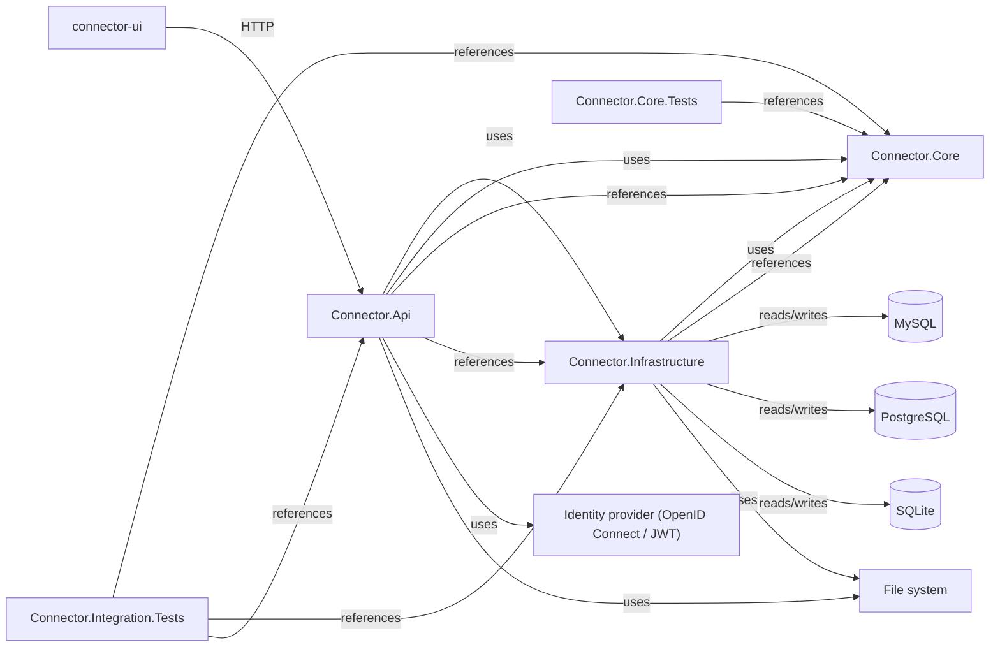

<!-- generated by docwizz: edits are overwritten -->
# Containers

Separately built/deployed units (projects) and how they talk to each other.

| Container | Kind | Source files | Packages |
|---|---|---|---|
| [connector-ui](../projects/connector-ui-f36e97198b9e.md) | npm | 134 | @playwright/test, @tailwindcss/vite, @tsconfig/node24, @types/node, @vitejs/plugin-vue, @vitest/coverage-v8, @vue/test-utils, @vue/tsconfig, fallow, happy-dom, lucide-vue-next, npm-run-all2, tailwindcss, typescript, vite, vite-plugin-vue-devtools, vitest, vue, vue-router, vue-tsc |
| [Connector.Api](../projects/Connector-Api-4b7b11b2fa60.md) | dotnet, Microsoft.NET.Sdk.Web, net10.0, executable, sln:src | 27 | BCrypt.Net-Next, Microsoft.AspNetCore.Authentication.JwtBearer, Microsoft.EntityFrameworkCore.Design, Serilog.AspNetCore |
| [Connector.Core](../projects/Connector-Core-67ea6c7c243a.md) | dotnet, Microsoft.NET.Sdk, net10.0, library, sln:src | 28 | — |
| [Connector.Infrastructure](../projects/Connector-Infrastructure-1bd055e8121e.md) | dotnet, Microsoft.NET.Sdk, net10.0, library, sln:src | 70 | ClosedXML, Microsoft.AspNetCore.DataProtection.Abstractions, Microsoft.EntityFrameworkCore.Sqlite, Microsoft.Extensions.Hosting, Microsoft.Extensions.Logging.Abstractions, MySqlConnector, Npgsql |
| SQL scripts |  | 1 | — |
