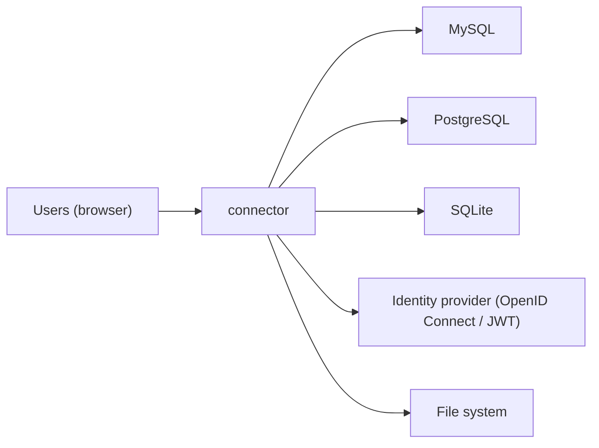

<!-- generated by docwizz: edits are overwritten -->
# System context

The system as one box: who uses it and what it relies on outside its own code.

## External systems

_Detected_: a call in the code shows it. _Inferred_: only a package reference (or a single candidate) points to it. _Unknown_: something is there, but the code doesn't say what.

| System | Kind | Certainty | Used by | Configured by | Evidence | Provisioned by |
|---|---|---|---|---|---|---|
| MySQL | database | detected | MariaDbConnectionFactory.OpenAsync(DataSourceConfig, CancellationToken) |  | [src/Connector.Infrastructure/DataSources/MariaDb/MariaDbConnectionFactory.cs:38](../../src/Connector.Infrastructure/DataSources/MariaDb/MariaDbConnectionFactory.cs#L38) |  |
| PostgreSQL | database | detected | PostgreSqlDataSourceProvider.OpenConnectionAsync(DataSourceConfig, CancellationToken), PostgreSqlDataSourceProvider.ReadSchemaAsync(DataSourceConfig, CancellationToken), PostgreSqlDataSourceProvider.RunAsync(DataSourceConfig, string, IEnumerable<NpgsqlParameter>, int, CancellationToken, bool) |  | [src/Connector.Infrastructure/DataSources/PostgreSql/PostgreSqlDataSourceProvider.cs:24](../../src/Connector.Infrastructure/DataSources/PostgreSql/PostgreSqlDataSourceProvider.cs#L24) |  |
| SQLite | database | detected | ExportLogDbContext | `ConnectionStrings:ExportLog` | [src/Connector.Api/Program.cs:219](../../src/Connector.Api/Program.cs#L219) |  |
| Identity provider (OpenID Connect / JWT) | identity | detected | Connector.Api |  | [src/Connector.Api/Program.cs:83](../../src/Connector.Api/Program.cs#L83) |  |
| File system | storage | detected | ExportWorker.PurgeStagingFiles(DateTimeOffset), FileSystemExportSink.TryDelete(string), FileSystemExportSink.WriteAsync(ExportPackage, CancellationToken), HealthEndpoints.IsStagingWritable(string), ImportWorker.MoveFiles(string, string, string), ImportWorker.PollOnceAsync(CancellationToken), ImportWorker.ProcessFileAsync(string, string, string, CancellationToken) |  | [src/Connector.Api/Endpoints/HealthEndpoints.cs:57](../../src/Connector.Api/Endpoints/HealthEndpoints.cs#L57) |  |

## External packages

- **npm** (20): `@playwright/test`, `@tailwindcss/vite`, `@tsconfig/node24`, `@types/node`, `@vitejs/plugin-vue`, `@vitest/coverage-v8`, `@vue/test-utils`, `@vue/tsconfig`, `fallow`, `happy-dom`, `lucide-vue-next`, `npm-run-all2`, `tailwindcss`, `typescript`, `vite-plugin-vue-devtools`, `vite`, `vitest`, `vue-router`, `vue-tsc`, `vue`
- **nuget** (18): `BCrypt.Net-Next`, `ClosedXML`, `coverlet.collector`, `Microsoft.AspNetCore.Authentication.JwtBearer`, `Microsoft.AspNetCore.DataProtection.Abstractions`, `Microsoft.AspNetCore.Mvc.Testing`, `Microsoft.Data.Sqlite`, `Microsoft.EntityFrameworkCore.Design`, `Microsoft.EntityFrameworkCore.Sqlite`, `Microsoft.Extensions.Hosting`, `Microsoft.Extensions.Logging.Abstractions`, `Microsoft.Extensions.Options`, `Microsoft.NET.Test.Sdk`, `MySqlConnector`, `Npgsql`, `Serilog.AspNetCore`, `xunit.runner.visualstudio`, `xunit`

Declared versions and the manifests that declare them: [packages](packages.md).

