<!-- generated by docwizz: edits are overwritten -->
# Data

Persisted entities, the context that stores them, and the code that accesses that context.

```mermaid
graph LR
    n0["POST /api/auth/login"]
    n1["ExportLogDbContext"]
    n2["POST /api/auth/revoke-my-sessions"]
    n3["POST /api/auth/change-password"]
    n4["GET /api/branding"]
    n5["PUT /api/branding"]
    n6["GET /api/connection/status"]
    n7["GET /api/connection"]
    n8["POST /api/connection"]
    n9["GET /api/source-schema"]
    n10["GET /api/export-definitions"]
    n11["POST /api/export-definitions"]
    n12["GET /api/export-definitions/{id:int}"]
    n13["PUT /api/export-definitions/{id:int}"]
    n14["DELETE /api/export-definitions/{id:int}"]
    n15["POST /api/export-definitions/{id:int}/duplicate"]
    n16["PATCH /api/export-definitions/{id:int}/enable"]
    n17["POST /api/export-definitions/{id:int}/preview"]
    n18["POST /api/export-definitions/{id:int}/run"]
    n19["POST /api/export-definitions/{id:int}/run-selected"]
    n20["POST /api/export-definitions/{id:int}/test"]
    n21["GET /api/export-definitions/{id:int}/runs"]
    n22["GET /api/exports"]
    n23["GET /api/exports/{seqNo:int}"]
    n24["POST /api/exports/{seqNo:int}/release"]
    n25["POST /api/exports/{seqNo:int}/deliver"]
    n26["POST /api/exports/{seqNo:int}/skip"]
    n27["GET /api/export-mapping"]
    n28["PUT /api/export-mapping"]
    n29["GET /api/export-mapping/presets"]
    n30["PUT /api/export-mapping/presets/{name}"]
    n31["DELETE /api/export-mapping/presets/{name}"]
    n32["GET /api/health"]
    n33["GET /api/import-definitions"]
    n34["POST /api/import-definitions"]
    n35["GET /api/import-definitions/{id:int}"]
    n36["PUT /api/import-definitions/{id:int}"]
    n37["DELETE /api/import-definitions/{id:int}"]
    n38["POST /api/import-definitions/{id:int}/duplicate"]
    n39["PATCH /api/import-definitions/{id:int}/enable"]
    n40["POST /api/import-definitions/{id:int}/preview"]
    n41["POST /api/import-definitions/suggest-from-export"]
    n42["GET /api/import-definitions/{id:int}/runs"]
    n43["POST /api/import-definitions/{id:int}/runs"]
    n44["POST /api/import-definitions/{id:int}/records"]
    n45["GET /api/import-runs/{id:int}"]
    n46["POST /api/import-runs/{id:int}/release"]
    n47["POST /api/import-runs/{id:int}/reject"]
    n48["GET /api/settings/manifest-signing"]
    n49["PUT /api/settings/manifest-signing/peers/{instanceId}"]
    n50["DELETE /api/settings/manifest-signing/peers/{instanceId}"]
    n51["PUT /api/settings/manifest-signing/policy"]
    n52["PUT /api/settings/permissions"]
    n53["POST /api/pipeline/run"]
    n54["POST /api/pipeline/run/{name}"]
    n55["GET /api/pipeline/preview"]
    n56["GET /api/settings/scheduler"]
    n57["PUT /api/settings/scheduler"]
    n58["GET /api/gdpr-denied-fields"]
    n59["PATCH /api/gdpr-denied-fields"]
    n60["GET /api/settings/instance"]
    n61["POST /api/settings/instance/regenerate"]
    n62["GET /api/audit"]
    n63["GET /api/users"]
    n64["POST /api/users"]
    n65["PUT /api/users/{username}"]
    n66["DELETE /api/users/{username}"]
    n67["AuditService"]
    n68["SQLite"]
    n69["ExportRunEntity"]
    n70["AppSettingEntity"]
    n71["AuditLogEntry"]
    n72["ExportDefinitionEntity"]
    n73["ExportDefinitionRunEntity"]
    n74["ImportDefinitionEntity"]
    n75["ImportRunEntity"]
    n76["UserEntity"]
    n0 --> n1
    n2 --> n1
    n3 --> n1
    n4 --> n1
    n5 --> n1
    n6 --> n1
    n7 --> n1
    n8 --> n1
    n9 --> n1
    n10 --> n1
    n11 --> n1
    n12 --> n1
    n13 --> n1
    n14 --> n1
    n15 --> n1
    n16 --> n1
    n17 --> n1
    n18 --> n1
    n19 --> n1
    n20 --> n1
    n21 --> n1
    n22 --> n1
    n23 --> n1
    n24 --> n1
    n25 --> n1
    n26 --> n1
    n27 --> n1
    n28 --> n1
    n29 --> n1
    n30 --> n1
    n31 --> n1
    n32 --> n1
    n33 --> n1
    n34 --> n1
    n35 --> n1
    n36 --> n1
    n37 --> n1
    n38 --> n1
    n39 --> n1
    n40 --> n1
    n41 --> n1
    n42 --> n1
    n43 --> n1
    n44 --> n1
    n45 --> n1
    n46 --> n1
    n47 --> n1
    n48 --> n1
    n49 --> n1
    n50 --> n1
    n51 --> n1
    n52 --> n1
    n53 --> n1
    n54 --> n1
    n55 --> n1
    n56 --> n1
    n57 --> n1
    n58 --> n1
    n59 --> n1
    n60 --> n1
    n61 --> n1
    n62 --> n1
    n63 --> n1
    n64 --> n1
    n65 --> n1
    n66 --> n1
    n67 --> n1
    n1 --> n68
    n1 --> n69
    n1 --> n70
    n1 --> n71
    n1 --> n72
    n1 --> n73
    n1 --> n74
    n1 --> n75
    n1 --> n76
```

| Entity | Stored via | Database | Accessed by | Summary |
|---|---|---|---|---|
| ExportRunEntity | ExportLogDbContext | SQLite | AuditService, DELETE /api/export-definitions/{id:int}, DELETE /api/export-mapping/presets/{name}, DELETE /api/import-definitions/{id:int}, DELETE /api/settings/manifest-signing/peers/{instanceId}, DELETE /api/users/{username}, GET /api/audit, GET /api/branding, GET /api/connection, GET /api/connection/status, GET /api/export-definitions, GET /api/export-definitions/{id:int}, GET /api/export-definitions/{id:int}/runs, GET /api/export-mapping, GET /api/export-mapping/presets, GET /api/exports, GET /api/exports/{seqNo:int}, GET /api/gdpr-denied-fields, GET /api/health, GET /api/import-definitions, GET /api/import-definitions/{id:int}, GET /api/import-definitions/{id:int}/runs, GET /api/import-runs/{id:int}, GET /api/pipeline/preview, GET /api/settings/instance, GET /api/settings/manifest-signing, GET /api/settings/scheduler, GET /api/source-schema, GET /api/users, PATCH /api/export-definitions/{id:int}/enable, PATCH /api/gdpr-denied-fields, PATCH /api/import-definitions/{id:int}/enable, POST /api/auth/change-password, POST /api/auth/login, POST /api/auth/revoke-my-sessions, POST /api/connection, POST /api/export-definitions, POST /api/export-definitions/{id:int}/duplicate, POST /api/export-definitions/{id:int}/preview, POST /api/export-definitions/{id:int}/run, POST /api/export-definitions/{id:int}/run-selected, POST /api/export-definitions/{id:int}/test, POST /api/exports/{seqNo:int}/deliver, POST /api/exports/{seqNo:int}/release, POST /api/exports/{seqNo:int}/skip, POST /api/import-definitions, POST /api/import-definitions/{id:int}/duplicate, POST /api/import-definitions/{id:int}/preview, POST /api/import-definitions/{id:int}/records, POST /api/import-definitions/{id:int}/runs, POST /api/import-definitions/suggest-from-export, POST /api/import-runs/{id:int}/reject, POST /api/import-runs/{id:int}/release, POST /api/pipeline/run, POST /api/pipeline/run/{name}, POST /api/settings/instance/regenerate, POST /api/users, PUT /api/branding, PUT /api/export-definitions/{id:int}, PUT /api/export-mapping, PUT /api/export-mapping/presets/{name}, PUT /api/import-definitions/{id:int}, PUT /api/settings/manifest-signing/peers/{instanceId}, PUT /api/settings/manifest-signing/policy, PUT /api/settings/permissions, PUT /api/settings/scheduler, PUT /api/users/{username} | EF Core entity for the export log table. Each row represents a completed or failed export run. |
| AppSettingEntity | ExportLogDbContext | SQLite | AuditService, DELETE /api/export-definitions/{id:int}, DELETE /api/export-mapping/presets/{name}, DELETE /api/import-definitions/{id:int}, DELETE /api/settings/manifest-signing/peers/{instanceId}, DELETE /api/users/{username}, GET /api/audit, GET /api/branding, GET /api/connection, GET /api/connection/status, GET /api/export-definitions, GET /api/export-definitions/{id:int}, GET /api/export-definitions/{id:int}/runs, GET /api/export-mapping, GET /api/export-mapping/presets, GET /api/exports, GET /api/exports/{seqNo:int}, GET /api/gdpr-denied-fields, GET /api/health, GET /api/import-definitions, GET /api/import-definitions/{id:int}, GET /api/import-definitions/{id:int}/runs, GET /api/import-runs/{id:int}, GET /api/pipeline/preview, GET /api/settings/instance, GET /api/settings/manifest-signing, GET /api/settings/scheduler, GET /api/source-schema, GET /api/users, PATCH /api/export-definitions/{id:int}/enable, PATCH /api/gdpr-denied-fields, PATCH /api/import-definitions/{id:int}/enable, POST /api/auth/change-password, POST /api/auth/login, POST /api/auth/revoke-my-sessions, POST /api/connection, POST /api/export-definitions, POST /api/export-definitions/{id:int}/duplicate, POST /api/export-definitions/{id:int}/preview, POST /api/export-definitions/{id:int}/run, POST /api/export-definitions/{id:int}/run-selected, POST /api/export-definitions/{id:int}/test, POST /api/exports/{seqNo:int}/deliver, POST /api/exports/{seqNo:int}/release, POST /api/exports/{seqNo:int}/skip, POST /api/import-definitions, POST /api/import-definitions/{id:int}/duplicate, POST /api/import-definitions/{id:int}/preview, POST /api/import-definitions/{id:int}/records, POST /api/import-definitions/{id:int}/runs, POST /api/import-definitions/suggest-from-export, POST /api/import-runs/{id:int}/reject, POST /api/import-runs/{id:int}/release, POST /api/pipeline/run, POST /api/pipeline/run/{name}, POST /api/settings/instance/regenerate, POST /api/users, PUT /api/branding, PUT /api/export-definitions/{id:int}, PUT /api/export-mapping, PUT /api/export-mapping/presets/{name}, PUT /api/import-definitions/{id:int}, PUT /api/settings/manifest-signing/peers/{instanceId}, PUT /api/settings/manifest-signing/policy, PUT /api/settings/permissions, PUT /api/settings/scheduler, PUT /api/users/{username} | Persistent key/value setting. Key is the primary key; Value stores JSON or plain text. |
| AuditLogEntry | ExportLogDbContext | SQLite | AuditService, DELETE /api/export-definitions/{id:int}, DELETE /api/export-mapping/presets/{name}, DELETE /api/import-definitions/{id:int}, DELETE /api/settings/manifest-signing/peers/{instanceId}, DELETE /api/users/{username}, GET /api/audit, GET /api/branding, GET /api/connection, GET /api/connection/status, GET /api/export-definitions, GET /api/export-definitions/{id:int}, GET /api/export-definitions/{id:int}/runs, GET /api/export-mapping, GET /api/export-mapping/presets, GET /api/exports, GET /api/exports/{seqNo:int}, GET /api/gdpr-denied-fields, GET /api/health, GET /api/import-definitions, GET /api/import-definitions/{id:int}, GET /api/import-definitions/{id:int}/runs, GET /api/import-runs/{id:int}, GET /api/pipeline/preview, GET /api/settings/instance, GET /api/settings/manifest-signing, GET /api/settings/scheduler, GET /api/source-schema, GET /api/users, PATCH /api/export-definitions/{id:int}/enable, PATCH /api/gdpr-denied-fields, PATCH /api/import-definitions/{id:int}/enable, POST /api/auth/change-password, POST /api/auth/login, POST /api/auth/revoke-my-sessions, POST /api/connection, POST /api/export-definitions, POST /api/export-definitions/{id:int}/duplicate, POST /api/export-definitions/{id:int}/preview, POST /api/export-definitions/{id:int}/run, POST /api/export-definitions/{id:int}/run-selected, POST /api/export-definitions/{id:int}/test, POST /api/exports/{seqNo:int}/deliver, POST /api/exports/{seqNo:int}/release, POST /api/exports/{seqNo:int}/skip, POST /api/import-definitions, POST /api/import-definitions/{id:int}/duplicate, POST /api/import-definitions/{id:int}/preview, POST /api/import-definitions/{id:int}/records, POST /api/import-definitions/{id:int}/runs, POST /api/import-definitions/suggest-from-export, POST /api/import-runs/{id:int}/reject, POST /api/import-runs/{id:int}/release, POST /api/pipeline/run, POST /api/pipeline/run/{name}, POST /api/settings/instance/regenerate, POST /api/users, PUT /api/branding, PUT /api/export-definitions/{id:int}, PUT /api/export-mapping, PUT /api/export-mapping/presets/{name}, PUT /api/import-definitions/{id:int}, PUT /api/settings/manifest-signing/peers/{instanceId}, PUT /api/settings/manifest-signing/policy, PUT /api/settings/permissions, PUT /api/settings/scheduler, PUT /api/users/{username} | Single entry in the audit trail. Written by the API on every significant user action. |
| ExportDefinitionEntity | ExportLogDbContext | SQLite | AuditService, DELETE /api/export-definitions/{id:int}, DELETE /api/export-mapping/presets/{name}, DELETE /api/import-definitions/{id:int}, DELETE /api/settings/manifest-signing/peers/{instanceId}, DELETE /api/users/{username}, GET /api/audit, GET /api/branding, GET /api/connection, GET /api/connection/status, GET /api/export-definitions, GET /api/export-definitions/{id:int}, GET /api/export-definitions/{id:int}/runs, GET /api/export-mapping, GET /api/export-mapping/presets, GET /api/exports, GET /api/exports/{seqNo:int}, GET /api/gdpr-denied-fields, GET /api/health, GET /api/import-definitions, GET /api/import-definitions/{id:int}, GET /api/import-definitions/{id:int}/runs, GET /api/import-runs/{id:int}, GET /api/pipeline/preview, GET /api/settings/instance, GET /api/settings/manifest-signing, GET /api/settings/scheduler, GET /api/source-schema, GET /api/users, PATCH /api/export-definitions/{id:int}/enable, PATCH /api/gdpr-denied-fields, PATCH /api/import-definitions/{id:int}/enable, POST /api/auth/change-password, POST /api/auth/login, POST /api/auth/revoke-my-sessions, POST /api/connection, POST /api/export-definitions, POST /api/export-definitions/{id:int}/duplicate, POST /api/export-definitions/{id:int}/preview, POST /api/export-definitions/{id:int}/run, POST /api/export-definitions/{id:int}/run-selected, POST /api/export-definitions/{id:int}/test, POST /api/exports/{seqNo:int}/deliver, POST /api/exports/{seqNo:int}/release, POST /api/exports/{seqNo:int}/skip, POST /api/import-definitions, POST /api/import-definitions/{id:int}/duplicate, POST /api/import-definitions/{id:int}/preview, POST /api/import-definitions/{id:int}/records, POST /api/import-definitions/{id:int}/runs, POST /api/import-definitions/suggest-from-export, POST /api/import-runs/{id:int}/reject, POST /api/import-runs/{id:int}/release, POST /api/pipeline/run, POST /api/pipeline/run/{name}, POST /api/settings/instance/regenerate, POST /api/users, PUT /api/branding, PUT /api/export-definitions/{id:int}, PUT /api/export-mapping, PUT /api/export-mapping/presets/{name}, PUT /api/import-definitions/{id:int}, PUT /api/settings/manifest-signing/peers/{instanceId}, PUT /api/settings/manifest-signing/policy, PUT /api/settings/permissions, PUT /api/settings/scheduler, PUT /api/users/{username} | One saved, independently named and scheduled export: a name, the table it's rooted at, its `ExportNode` tree, and the output format/schedule it runs with. Replaces the single AppSetting-backed mapping + presets (`ExportMapping`/`ExportPresets`). |
| ExportDefinitionRunEntity | ExportLogDbContext | SQLite | AuditService, DELETE /api/export-definitions/{id:int}, DELETE /api/export-mapping/presets/{name}, DELETE /api/import-definitions/{id:int}, DELETE /api/settings/manifest-signing/peers/{instanceId}, DELETE /api/users/{username}, GET /api/audit, GET /api/branding, GET /api/connection, GET /api/connection/status, GET /api/export-definitions, GET /api/export-definitions/{id:int}, GET /api/export-definitions/{id:int}/runs, GET /api/export-mapping, GET /api/export-mapping/presets, GET /api/exports, GET /api/exports/{seqNo:int}, GET /api/gdpr-denied-fields, GET /api/health, GET /api/import-definitions, GET /api/import-definitions/{id:int}, GET /api/import-definitions/{id:int}/runs, GET /api/import-runs/{id:int}, GET /api/pipeline/preview, GET /api/settings/instance, GET /api/settings/manifest-signing, GET /api/settings/scheduler, GET /api/source-schema, GET /api/users, PATCH /api/export-definitions/{id:int}/enable, PATCH /api/gdpr-denied-fields, PATCH /api/import-definitions/{id:int}/enable, POST /api/auth/change-password, POST /api/auth/login, POST /api/auth/revoke-my-sessions, POST /api/connection, POST /api/export-definitions, POST /api/export-definitions/{id:int}/duplicate, POST /api/export-definitions/{id:int}/preview, POST /api/export-definitions/{id:int}/run, POST /api/export-definitions/{id:int}/run-selected, POST /api/export-definitions/{id:int}/test, POST /api/exports/{seqNo:int}/deliver, POST /api/exports/{seqNo:int}/release, POST /api/exports/{seqNo:int}/skip, POST /api/import-definitions, POST /api/import-definitions/{id:int}/duplicate, POST /api/import-definitions/{id:int}/preview, POST /api/import-definitions/{id:int}/records, POST /api/import-definitions/{id:int}/runs, POST /api/import-definitions/suggest-from-export, POST /api/import-runs/{id:int}/reject, POST /api/import-runs/{id:int}/release, POST /api/pipeline/run, POST /api/pipeline/run/{name}, POST /api/settings/instance/regenerate, POST /api/users, PUT /api/branding, PUT /api/export-definitions/{id:int}, PUT /api/export-mapping, PUT /api/export-mapping/presets/{name}, PUT /api/import-definitions/{id:int}, PUT /api/settings/manifest-signing/peers/{instanceId}, PUT /api/settings/manifest-signing/policy, PUT /api/settings/permissions, PUT /api/settings/scheduler, PUT /api/users/{username} | One completed, failed, or in-progress run of an `ExportDefinitionEntity` — the per-definition analogue of `ExportRunEntity`, which stays scoped to the legacy single-mapping pipeline. Every run (scheduled, manual, or test) writes exactly one row here, with `Status` set to `Failed` and `ErrorMessage` populated on any failure — never a silent partial success. |
| ImportDefinitionEntity | ExportLogDbContext | SQLite | AuditService, DELETE /api/export-definitions/{id:int}, DELETE /api/export-mapping/presets/{name}, DELETE /api/import-definitions/{id:int}, DELETE /api/settings/manifest-signing/peers/{instanceId}, DELETE /api/users/{username}, GET /api/audit, GET /api/branding, GET /api/connection, GET /api/connection/status, GET /api/export-definitions, GET /api/export-definitions/{id:int}, GET /api/export-definitions/{id:int}/runs, GET /api/export-mapping, GET /api/export-mapping/presets, GET /api/exports, GET /api/exports/{seqNo:int}, GET /api/gdpr-denied-fields, GET /api/health, GET /api/import-definitions, GET /api/import-definitions/{id:int}, GET /api/import-definitions/{id:int}/runs, GET /api/import-runs/{id:int}, GET /api/pipeline/preview, GET /api/settings/instance, GET /api/settings/manifest-signing, GET /api/settings/scheduler, GET /api/source-schema, GET /api/users, PATCH /api/export-definitions/{id:int}/enable, PATCH /api/gdpr-denied-fields, PATCH /api/import-definitions/{id:int}/enable, POST /api/auth/change-password, POST /api/auth/login, POST /api/auth/revoke-my-sessions, POST /api/connection, POST /api/export-definitions, POST /api/export-definitions/{id:int}/duplicate, POST /api/export-definitions/{id:int}/preview, POST /api/export-definitions/{id:int}/run, POST /api/export-definitions/{id:int}/run-selected, POST /api/export-definitions/{id:int}/test, POST /api/exports/{seqNo:int}/deliver, POST /api/exports/{seqNo:int}/release, POST /api/exports/{seqNo:int}/skip, POST /api/import-definitions, POST /api/import-definitions/{id:int}/duplicate, POST /api/import-definitions/{id:int}/preview, POST /api/import-definitions/{id:int}/records, POST /api/import-definitions/{id:int}/runs, POST /api/import-definitions/suggest-from-export, POST /api/import-runs/{id:int}/reject, POST /api/import-runs/{id:int}/release, POST /api/pipeline/run, POST /api/pipeline/run/{name}, POST /api/settings/instance/regenerate, POST /api/users, PUT /api/branding, PUT /api/export-definitions/{id:int}, PUT /api/export-mapping, PUT /api/export-mapping/presets/{name}, PUT /api/import-definitions/{id:int}, PUT /api/settings/manifest-signing/peers/{instanceId}, PUT /api/settings/manifest-signing/policy, PUT /api/settings/permissions, PUT /api/settings/scheduler, PUT /api/users/{username} | One saved import mapping: the ERP table/column an inbound record's correlation key must resolve against, its `ImportNode` tree, and the explicit allowlist of columns it may ever write. The write-side counterpart to `ExportDefinitionEntity`. |
| ImportRunEntity | ExportLogDbContext | SQLite | AuditService, DELETE /api/export-definitions/{id:int}, DELETE /api/export-mapping/presets/{name}, DELETE /api/import-definitions/{id:int}, DELETE /api/settings/manifest-signing/peers/{instanceId}, DELETE /api/users/{username}, GET /api/audit, GET /api/branding, GET /api/connection, GET /api/connection/status, GET /api/export-definitions, GET /api/export-definitions/{id:int}, GET /api/export-definitions/{id:int}/runs, GET /api/export-mapping, GET /api/export-mapping/presets, GET /api/exports, GET /api/exports/{seqNo:int}, GET /api/gdpr-denied-fields, GET /api/health, GET /api/import-definitions, GET /api/import-definitions/{id:int}, GET /api/import-definitions/{id:int}/runs, GET /api/import-runs/{id:int}, GET /api/pipeline/preview, GET /api/settings/instance, GET /api/settings/manifest-signing, GET /api/settings/scheduler, GET /api/source-schema, GET /api/users, PATCH /api/export-definitions/{id:int}/enable, PATCH /api/gdpr-denied-fields, PATCH /api/import-definitions/{id:int}/enable, POST /api/auth/change-password, POST /api/auth/login, POST /api/auth/revoke-my-sessions, POST /api/connection, POST /api/export-definitions, POST /api/export-definitions/{id:int}/duplicate, POST /api/export-definitions/{id:int}/preview, POST /api/export-definitions/{id:int}/run, POST /api/export-definitions/{id:int}/run-selected, POST /api/export-definitions/{id:int}/test, POST /api/exports/{seqNo:int}/deliver, POST /api/exports/{seqNo:int}/release, POST /api/exports/{seqNo:int}/skip, POST /api/import-definitions, POST /api/import-definitions/{id:int}/duplicate, POST /api/import-definitions/{id:int}/preview, POST /api/import-definitions/{id:int}/records, POST /api/import-definitions/{id:int}/runs, POST /api/import-definitions/suggest-from-export, POST /api/import-runs/{id:int}/reject, POST /api/import-runs/{id:int}/release, POST /api/pipeline/run, POST /api/pipeline/run/{name}, POST /api/settings/instance/regenerate, POST /api/users, PUT /api/branding, PUT /api/export-definitions/{id:int}, PUT /api/export-mapping, PUT /api/export-mapping/presets/{name}, PUT /api/import-definitions/{id:int}, PUT /api/settings/manifest-signing/peers/{instanceId}, PUT /api/settings/manifest-signing/policy, PUT /api/settings/permissions, PUT /api/settings/scheduler, PUT /api/users/{username} | One staged, released, rejected, or failed run of an `ImportDefinitionEntity` — mirrors `ExportDefinitionRunEntity`'s per-definition run-history shape, combined with `ExportRunEntity`'s four-eyes fields (an import commits to the system of record, a materially bigger risk than reading, so it requires the same Operator/Approver review as export release). |
| UserEntity | ExportLogDbContext | SQLite | AuditService, DELETE /api/export-definitions/{id:int}, DELETE /api/export-mapping/presets/{name}, DELETE /api/import-definitions/{id:int}, DELETE /api/settings/manifest-signing/peers/{instanceId}, DELETE /api/users/{username}, GET /api/audit, GET /api/branding, GET /api/connection, GET /api/connection/status, GET /api/export-definitions, GET /api/export-definitions/{id:int}, GET /api/export-definitions/{id:int}/runs, GET /api/export-mapping, GET /api/export-mapping/presets, GET /api/exports, GET /api/exports/{seqNo:int}, GET /api/gdpr-denied-fields, GET /api/health, GET /api/import-definitions, GET /api/import-definitions/{id:int}, GET /api/import-definitions/{id:int}/runs, GET /api/import-runs/{id:int}, GET /api/pipeline/preview, GET /api/settings/instance, GET /api/settings/manifest-signing, GET /api/settings/scheduler, GET /api/source-schema, GET /api/users, PATCH /api/export-definitions/{id:int}/enable, PATCH /api/gdpr-denied-fields, PATCH /api/import-definitions/{id:int}/enable, POST /api/auth/change-password, POST /api/auth/login, POST /api/auth/revoke-my-sessions, POST /api/connection, POST /api/export-definitions, POST /api/export-definitions/{id:int}/duplicate, POST /api/export-definitions/{id:int}/preview, POST /api/export-definitions/{id:int}/run, POST /api/export-definitions/{id:int}/run-selected, POST /api/export-definitions/{id:int}/test, POST /api/exports/{seqNo:int}/deliver, POST /api/exports/{seqNo:int}/release, POST /api/exports/{seqNo:int}/skip, POST /api/import-definitions, POST /api/import-definitions/{id:int}/duplicate, POST /api/import-definitions/{id:int}/preview, POST /api/import-definitions/{id:int}/records, POST /api/import-definitions/{id:int}/runs, POST /api/import-definitions/suggest-from-export, POST /api/import-runs/{id:int}/reject, POST /api/import-runs/{id:int}/release, POST /api/pipeline/run, POST /api/pipeline/run/{name}, POST /api/settings/instance/regenerate, POST /api/users, PUT /api/branding, PUT /api/export-definitions/{id:int}, PUT /api/export-mapping, PUT /api/export-mapping/presets/{name}, PUT /api/import-definitions/{id:int}, PUT /api/settings/manifest-signing/peers/{instanceId}, PUT /api/settings/manifest-signing/policy, PUT /api/settings/permissions, PUT /api/settings/scheduler, PUT /api/users/{username} | An interactive login. Managed in the UI by Admins (Settings → Users); the table is seeded once from Auth:Users (or the Development seed) while it is still empty. |

## Database objects (SQL)

| Table | Defined in | Used by |
|---|---|---|
| [articlestructure](../modules/testdb.md#articlestructure) | [testdb/init.sql](../../testdb/init.sql#L53) |  |
| [export_customer](../modules/testdb.md#export_customer) | [testdb/init.sql](../../testdb/init.sql#L101) |  |
| [export_line_tag](../modules/testdb.md#export_line_tag) | [testdb/init.sql](../../testdb/init.sql#L122) |  |
| [export_order](../modules/testdb.md#export_order) | [testdb/init.sql](../../testdb/init.sql#L107) |  |
| [export_order_line](../modules/testdb.md#export_order_line) | [testdb/init.sql](../../testdb/init.sql#L115) |  |
| [maintenance_plan](../modules/testdb.md#maintenance_plan) | [testdb/init.sql](../../testdb/init.sql#L46) |  |
| [manufacturer](../modules/testdb.md#manufacturer) | [testdb/init.sql](../../testdb/init.sql#L7) |  |
| [manufacturer_address](../modules/testdb.md#manufacturer_address) | [testdb/init.sql](../../testdb/init.sql#L13) |  |
| [masterdata](../modules/testdb.md#masterdata) | [testdb/init.sql](../../testdb/init.sql#L22) |  |
| [systemconfiguration](../modules/testdb.md#systemconfiguration) | [testdb/init.sql](../../testdb/init.sql#L30) |  |

## Schema migrations

In file-name order, which is the order Flyway and EF Core apply them.

1. [AddExportDefinitions](../../src/Connector.Infrastructure/Migrations/20260819120000_AddExportDefinitions.Designer.cs#L12)
2. [AddImportDefinitions](../../src/Connector.Infrastructure/Migrations/20260905190000_AddImportDefinitions.Designer.cs#L12)
3. [AddInsertCountToImportRun](../../src/Connector.Infrastructure/Migrations/20261001140000_AddInsertCountToImportRun.Designer.cs#L12)
4. [AddIntegrationKeyToDefinitions](../../src/Connector.Infrastructure/Migrations/20260906120000_AddIntegrationKeyToDefinitions.Designer.cs#L12)
5. [AddProducerToImportRun](../../src/Connector.Infrastructure/Migrations/20261001130000_AddProducerToImportRun.Designer.cs#L12)
6. [AddStagedConnectionFingerprintToImportRun](../../src/Connector.Infrastructure/Migrations/20260909120000_AddStagedConnectionFingerprintToImportRun.Designer.cs#L12)
7. [AddStagedFileToExportDefinitionRun](../../src/Connector.Infrastructure/Migrations/20260930120000_AddStagedFileToExportDefinitionRun.Designer.cs#L12)
8. [AddTargetImportDefinitionToExportDefinition](../../src/Connector.Infrastructure/Migrations/20261001120000_AddTargetImportDefinitionToExportDefinition.Designer.cs#L12)
9. [AddUser](../../src/Connector.Infrastructure/Migrations/20261009071016_AddUser.Designer.cs#L12)
10. [AmendImportRunForDesignReview](../../src/Connector.Infrastructure/Migrations/20260905193000_AmendImportRunForDesignReview.Designer.cs#L12)
11. [InitialSchema](../../src/Connector.Infrastructure/Migrations/20260701083054_InitialSchema.Designer.cs#L12)

