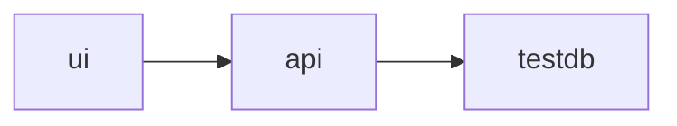

<!-- generated by docwizz: edits are overwritten -->
# Deployment

What the repository's deployment descriptors state. Environment variables are listed by name only.

## Deployable units (from project files)

- [Connector.Api](../../src/Connector.Api/Connector.Api.csproj) — ASP.NET Core web host
- [connector-ui](../../src/connector-ui/package.json) — frontend (npm)

## Services ([docker-compose.dev.yml](../../docker-compose.dev.yml))

| Service | Image / build | Ports | Environment | Depends on | Volumes | Networks | Runs |
|---|---|---|---|---|---|---|---|
| [api](../../docker-compose.dev.yml#L14) | `mcr.microsoft.com/dotnet/sdk:10.0-alpine` | 5189:5189 | ASPNETCORE_ENVIRONMENT, DOTNET_USE_POLLING_FILE_WATCHER, DOTNET_WATCH_SUPPRESS_LAUNCH_BROWSER | testdb | .:/app, nuget-cache:/root/.nuget/packages, api-bin:/app/src/Connector.Api/bin, api-obj:/app/src/Connector.Api/obj, core-bin:/app/src/Connector.Core/bin, core-obj:/app/src/Connector.Core/obj, erp-bin:/app/src/Connector.Erp/bin, erp-obj:/app/src/Connector.Erp/obj, infra-bin:/app/src/Connector.Infrastructure/bin, infra-obj:/app/src/Connector.Infrastructure/obj, export-bin:/app/src/Connector.Export/bin, export-obj:/app/src/Connector.Export/obj |  |  |
| [ui](../../docker-compose.dev.yml#L43) | `node:24-alpine` | 5173:5173 | VITE_API_PROXY_TARGET, CHOKIDAR_USEPOLLING | api | ./src/connector-ui:/app, ui-node-modules:/app/node_modules, npm-cache:/root/.npm |  |  |
| [testdb](../../docker-compose.dev.yml#L62) | `postgres:16-alpine` | 127.0.0.1:5432:5432 | POSTGRES_USER, POSTGRES_PASSWORD, POSTGRES_DB |  | ./testdb/init.sql:/docker-entrypoint-initdb.d/init.sql:ro, testdb-data:/var/lib/postgresql/data |  | PostgreSQL — used by the code (detected) |

## Services ([docker-compose.yml](../../docker-compose.yml))

| Service | Image / build | Ports | Environment | Depends on | Volumes | Networks | Runs |
|---|---|---|---|---|---|---|---|
| [api](../../docker-compose.yml#L2) | build `.` | 8090:8080 | ASPNETCORE_ENVIRONMENT, Auth__JwtSecret, Auth__Users__0__Username, Auth__Users__0__PasswordHash, Auth__Users__0__Role, Auth__Users__1__Username, Auth__Users__1__PasswordHash, Auth__Users__1__Role, ConnectionStrings__ExportLog, ExportSink__StagingPath, ImportSink__InboundPath, AllowedHosts |  | connector-db:/data/db, connector-dpkeys:/data/dpkeys, connector-staging:/data/staging, connector-inbound:/data/inbound |  | project `Connector.Api`, project `Connector.Core`, project `Connector.Infrastructure`, project `connector-ui` |
| [testdb](../../docker-compose.yml#L63) | `postgres:16-alpine` | 127.0.0.1:5432:5432 | POSTGRES_USER, POSTGRES_PASSWORD, POSTGRES_DB |  | ./testdb/init.sql:/docker-entrypoint-initdb.d/init.sql:ro |  | PostgreSQL — used by the code (detected) |
| [testdb-mariadb](../../docker-compose.yml#L86) | `mariadb:11.4` | 127.0.0.1:3306:3306 | MARIADB_USER, MARIADB_PASSWORD, MARIADB_DATABASE, MARIADB_RANDOM_ROOT_PASSWORD |  | ./testdb/mariadb-init.sql:/docker-entrypoint-initdb.d/init.sql:ro |  |  |

## Container images

- [Dockerfile](../../Dockerfile): from `node:26-alpine@sha256:0b36e8c136b94cd4fcf02188228e76c31ad5872eef3fec8cbd2eee500cfd9e80`, `mcr.microsoft.com/dotnet/sdk:10.0-alpine@sha256:230c3fbae0ceedc70bca04eed2bfb5694e8b248cadbb81010f41b7a993601f55`, `mcr.microsoft.com/dotnet/aspnet:10.0-alpine@sha256:819bd3649d8bf53f35527c68d62e17b348ef6f24ae73073f497f00a878348062`; exposes 8080

## Other descriptors

- [.github/workflows/ci.yml](../../.github/workflows/ci.yml)
- [.github/workflows/docwizz.yml](../../.github/workflows/docwizz.yml)
- [.github/workflows/security.yml](../../.github/workflows/security.yml)
- [.github/workflows/version.yml](../../.github/workflows/version.yml)

## Configuration

Environments with configuration files in the repository: default ([src/Connector.Api/appsettings.json](../../src/Connector.Api/appsettings.json)), Production ([src/Connector.Api/appsettings.Production.json](../../src/Connector.Api/appsettings.Production.json)), Development ([src/Connector.Api/appsettings.Development.json](../../src/Connector.Api/appsettings.Development.json)). Values are not shown — they may be secrets — except the host of a URL.

| Key | Defined for | Points to | Read by | Status |
|---|---|---|---|---|
| [`AllowedOrigins`](../../src/Connector.Api/appsettings.Development.json#L2) | Development, Production |  | Connector.Api | detected: defined and read |
| [`Auth`](../../src/Connector.Api/Program.cs#L57) | Production, default, Development |  | AuthOptions (binds) | detected: defined and read |
| [`Auth:ApiKeys`](../../src/Connector.Api/appsettings.Production.json#L21) | Production |  | Connector.Api | detected: defined and read |
| [`Auth:JwtExpiryHours`](../../src/Connector.Api/appsettings.json#L4) | default, Development, Production |  | AuthEndpoints | detected: defined and read |
| [`Auth:JwtSecret`](../../src/Connector.Api/appsettings.json#L3) | default, Development, Production |  | AuthEndpoints, Connector.Api | detected: defined and read |
| [`Auth:Users`](../../src/Connector.Api/appsettings.json#L5) | default, Production |  | Connector.Api | detected: defined and read |
| [`ConnectionStrings:ExportLog`](../../src/Connector.Api/appsettings.Development.json#L15) | Development, Production |  | ExportLogDbContext | detected: defined and read |
| [`DataProtection:KeysDirectory`](../../src/Connector.Api/appsettings.Production.json#L43) | Production |  | Connector.Api | detected: defined and read |
| [`ExportSink`](../../src/Connector.Api/Program.cs#L198) | Development, Production |  | ExportSinkOptions (binds) | detected: defined and read |
| [`ExportSink:StagingPath`](../../src/Connector.Api/appsettings.Development.json#L18) | Development, Production |  |  | detected: bound as part of a section |
| [`ExportWorker`](../../src/Connector.Api/Program.cs#L199) | Development, Production |  | ExportWorkerOptions (binds) | detected: defined and read |
| [`ExportWorker:RetentionDays`](../../src/Connector.Api/appsettings.Development.json#L22) | Development, Production |  |  | detected: bound as part of a section |
| [`ExportWorker:ScheduledTimeUtc`](../../src/Connector.Api/appsettings.Development.json#L21) | Development, Production |  |  | detected: bound as part of a section |
| [`ImportSink`](../../src/Connector.Api/Program.cs#L202) | Development, Production |  | ImportSinkOptions (binds) | detected: defined and read |
| [`ImportSink:InboundPath`](../../src/Connector.Api/appsettings.Development.json#L25) | Development, Production |  |  | detected: bound as part of a section |
| [`ImportWorker`](../../src/Connector.Api/Program.cs#L203) | Development, Production |  | ImportWorkerOptions (binds) | detected: defined and read |
| [`ImportWorker:PollInterval`](../../src/Connector.Api/appsettings.Development.json#L28) | Development, Production |  |  | detected: bound as part of a section |
| [`AllowedHosts`](../../src/Connector.Api/appsettings.json#L13) | default, Production | | | read by the framework |
| [`DataSources:AllowUnencryptedConnections`](../../src/Connector.Api/appsettings.Production.json#L49) | Production | | | defined, not read by scanned code |
| `Logging:*` (3 keys) | default, Development, Production | | | read by the framework |

## Not derivable from the repository

- which environments exist and where they are hosted, beyond the configuration files and descriptors above
- values of secrets and of environment variables set outside the repository
- scaling, availability and network topology not declared in the descriptors
- who operates the system and how it is released

_None of this can be read from the code. Write it in `architecture/deployment.md` next to these docs; docwizz links it and never overwrites it._

